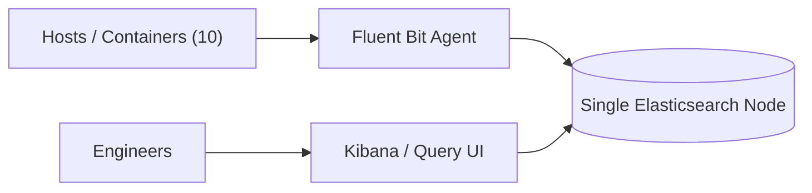
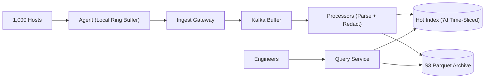
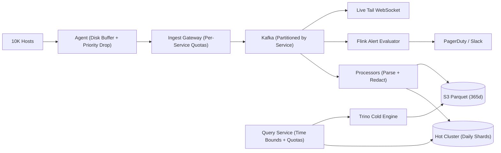
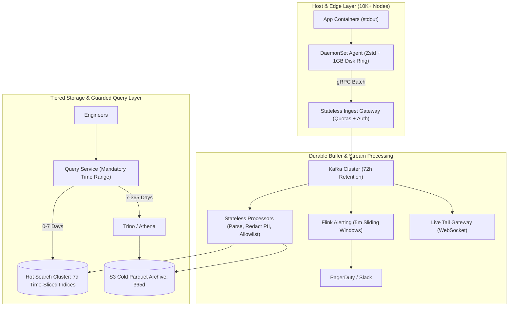
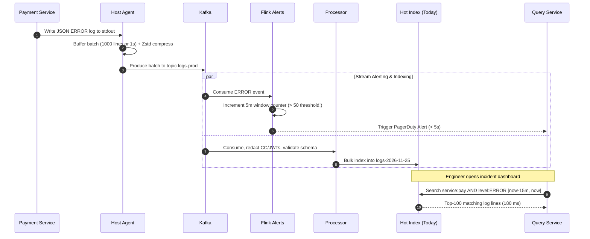

# Logging and Monitoring Platform: Full System Design Mock Interview

> **Difficulty:** Hard (Senior / Staff)
> **Prerequisites:** [Previous lesson: Inventory Management System: Full System Design Mock Interview, 9 Steps](../24-inventory-management-system/README.md) and the [Interview Framework track](../../21-interview-framework/README.md).
> **Estimated Reading Time:** 25–30 minutes
> **Target Audience:** Engineers practising the full 9-step system design interview on a classic prompt: ingesting, indexing, alerting, and archiving terabytes of logs per day from thousands of services.

> [!NOTE]
> **In one line:** A logging platform is **a write-heavy streaming pipeline with tiered storage and selective indexing**: lightweight host agents buffer and ship compressed batches to Kafka, stateless processors parse/redact/alert, and time-sliced storage keeps recent logs hot on NVMe while archiving older logs cheaply in object storage.

> [!TIP]
> **The Golden Rule:** Decouple producers from storage with a durable buffer, index only the fields you actually search (or labels like Grafana Loki), drop or sample `DEBUG` logs under overload, and **never** let logging backpressure crash the application producing the logs.

---

## 1. Clarifying Questions, Functional & Non-Functional Requirements

Open with questions, not boxes. Logging is an **inverse pyramid**: 99.9% of log lines are never read, yet when an incident hits, engineers need the last 15 minutes searchable in seconds—and the platform must survive 10x log storms *caused* by the incident itself.

### Clarifying Questions & Assumed Answers

| Question | Assumed Answer | Architectural Impact |
| :--- | :--- | :--- |
| **Log sources?** | 10,000 hosts / Kubernetes pods across microservices | Requires lightweight sidecar/DaemonSet agents with local disk ring-buffers |
| **Query patterns?** | Filter by `service`, `env`, `level`, `trace_id`, time range, and keyword search | Needs inverted index (hot) or label index + compressed chunks (Loki-style) |
| **Retention tiers?** | 7 days hot (fast search), 30 days warm, 1 year cold archive | Time-sliced daily/hourly indices + S3 Parquet/Zstd lifecycle rules |
| **Ingest-to-search SLA?** | Searchable within 5–10 seconds; real-time alerts within 10 seconds | Streaming processors + inline alert evaluation (don't poll the search cluster) |
| **Volume & bursts?** | 5 TB/day average; 5x–10x burst during outage storms | Partitioned Kafka buffer + priority-based load shedding (`DEBUG` dropped first) |

> Say it aloud: *"Before I draw anything, let me confirm daily log volume, burst multiplier during incidents, retention tiers, and whether we need full-text indexing on every JSON field."*

### Functional Requirements

1. **Agent Collection:** Tail container/host logs, attach Kubernetes metadata, batch, compress, and ship reliably.
2. **Parsing, Enrichment & PII Redaction:** Extract structured fields (`timestamp`, `level`, `trace_id`), scrub credit cards/tokens/emails, and route by tenant.
3. **Time-Bounded Search & Live Tail:** Search logs across `[from, to]` time ranges and stream live logs (`tail -f` equivalent) for debugging.
4. **Streaming Log Alerting:** Trigger PagerDuty/Slack alerts when error patterns exceed thresholds over sliding windows.
5. **Automated Retention:** Drop expired hot indices instantaneously without expensive row-level deletes.

### Non-Functional Requirements

| Quality Attribute | Target | Why It Drives the Design |
| :--- | :--- | :--- |
| **Ingest Resilience** | Absorb 10x outage bursts without data loss for `ERROR`/`WARN` | Logs are most critical *during* production outages |
| **App Isolation** | Zero blocking of host application threads | Agents must drop/spool locally rather than stall app stdout |
| **Query Latency** | p95 < 2s (7-day hot); < 30s (cold archive) | Fast incident triage |
| **Cost Efficiency** | Tiered storage (< $0.05/GB/mo cold) | Indexing 5 TB/day on SSD for a year would bankrupt the team |

### Explicit Scope Boundaries

- **In Scope:** Host agents, Kafka ingest buffer, stream processors (parse/redact/alert), time-sliced hot index, S3 cold archive, query safety guardrails.
- **Out of Scope:** Time-series metrics (covered in Lesson 26), distributed tracing UI, SIEM security correlation rules, per-team chargeback billing.

---

## 2. Back-of-the-Envelope Capacity Estimation

Let us derive ingestion throughput, Kafka partitioning, and tiered storage costs from first principles.

### Assumptions
- Daily raw log volume: $V_{\text{raw}} = 5\text{ TB/day}$.
- Average log line size: $500\text{ bytes}$.
- Incident burst multiplier: $5\times$ (up to $10\times$ extreme).
- Zstd compression ratio on text logs: $5:1$.
- Hot index overhead (if full-text + fields indexed): $\approx 1.2\times$ raw size before compression, or $\approx 0.4\times$ raw size compressed. Using compressed columnar/Lucene segments: $\approx 5:1$ net on disk $\implies 1\text{ TB/day}$ hot footprint.
- Retention: $7\text{ days}$ hot, $365\text{ days}$ cold archive.

### Worked Equations

**1. Average & Peak Log Lines per Second:**
$$L_{\text{avg}} = \frac{5 \times 10^{12} \text{ bytes/day}}{500 \text{ bytes/line} \times 86{,}400 \text{ s/day}} \approx 115{,}740 \text{ lines/sec}$$
$$L_{\text{peak (5x)}} = 115{,}740 \times 5 \approx 578{,}700 \text{ lines/sec}$$

**2. Network Ingest Bandwidth (Compressed 5:1 at Agent):**
$$BW_{\text{raw\_peak}} = 578{,}700 \times 500 \text{ B} \approx 289.4 \text{ MB/s}$$
$$BW_{\text{compressed}} = \frac{289.4 \text{ MB/s}}{5} \approx 57.9 \text{ MB/s} \approx 463 \text{ Mbps}$$

**3. Hot Storage (7 Days) & Cold Archive (1 Year):**
$$S_{\text{hot (7d)}} = \frac{5\text{ TB/day} \times 7\text{ days}}{5\text{ (compression)}} = 7\text{ TB (}\times 2\text{ replicas} = 14\text{ TB NVMe)}$$
$$S_{\text{cold (1yr)}} = \frac{5\text{ TB/day} \times 365\text{ days}}{5\text{ (Zstd/Parquet)}} = 365\text{ TB on S3}$$

### Capacity Summary Table

| Metric | Formula / Derivation | Result |
| :--- | :--- | :--- |
| **Average Ingest Rate** | $5\text{ TB} / 500\text{ B} / 86{,}400$ | **~116K lines/s** |
| **Peak Burst Rate (5x)** | $116\text{K} \times 5$ | **~579K lines/s** |
| **Compressed Ingest Bandwidth** | $289\text{ MB/s} / 5$ | **~58 MB/s (~463 Mbps)** |
| **Hot NVMe Storage (7d, 2x rep)** | $(5\text{ TB} \times 7 / 5) \times 2$ | **14 TB NVMe** |
| **Cold S3 Archive (1 Year)** | $(5\text{ TB} \times 365) / 5$ | **365 TB Object Storage** |

---

## 3. Core API Contracts & Data Model

### Public & Internal APIs

| Endpoint / Interface | Direction | Contract & Safety Rules |
| :--- | :--- | :--- |
| `POST /v1/ingest/logs` (gRPC/HTTP) | Agent $\to$ Ingest Gateway | Accepts Zstd-compressed batch of up to 1,000 log lines. Returns `202 Accepted` or `429 Too Many Requests` (with `Retry-After`). |
| `GET /v1/logs/search?q=level:ERROR&from=...&to=...&limit=100` | UI/CLI $\to$ Query Service | **`from` and `to` timestamps are mandatory.** Rejects unbounded queries. Max `limit=1000`. |
| `GET /v1/logs/tail?service=checkout&level=ERROR` | UI/CLI $\to$ Tail Service | WebSocket/SSE stream reading directly from Kafka consumer group (bypasses index wait). |
| `POST /v1/alerts` | Engineer $\to$ Alert Config | Defines streaming rule: `{name, filter: "service:pay AND level:ERROR", window: "5m", threshold: 50}`. |

### Data Model & Time-Sliced Storage

| Tier / Store | Partitioning & Schema | Engine & Rationale |
| :--- | :--- | :--- |
| **Ingest Buffer** | Kafka topics partitioned by `hash(service_name)` | Absorbs 10x bursts; 24–72h retention protects against downstream maintenance |
| **Hot Index (0–7 days)** | Daily/Hourly indices: `logs-2026-11-25-14` | OpenSearch/Elasticsearch (or ClickHouse); selective fields (`ts`, `service`, `level`, `trace_id`) + tokenized message |
| **Cold Archive (7–365 days)** | `s3://logs-archive/year=2026/month=11/day=25/service=pay/*.parquet` | Zstd-compressed Parquet chunks; queried on demand via Trino/Athena/DuckDB |
| **Alert State** | Sliding window counters per rule (`service:pay:5m`) | Flink / Kafka Streams RocksDB state store |

---

## 4. Stage 1 (100 - 1K Users): Baseline Monolith & Single Database

At 100–1,000 users (< 10 services, < 50 GB/day), a simple single-node setup works cleanly.

### Component-by-Component Build
1. **Host Log Shipper (Fluent Bit / Vector):** Tails `/var/log/containers/*.log` and posts JSON batches directly to a single Elasticsearch/ClickHouse node.
2. **Single Search & UI Node (Kibana / Grafana):** Engineers search recent logs and tail stdout.



### What Breaks at 10K Services & 5 TB/Day?
- **Ingest Coupled to Indexing:** During an outage, 10x log volume overwhelms Elasticsearch's indexing thread pool, causing HTTP 429s; agents fill local disks and **drop critical crash logs** or block container stdout.
- **Mapping Explosion:** Services logging arbitrary JSON keys (`user_123_field`) create 10,000+ dynamic fields in Elasticsearch, crashing cluster metadata (OOM).
- **Storage Cost Explosion:** Keeping 365 days of full-text inverted indexes on NVMe SSDs costs tens of thousands of dollars per month.

---

## 5. Stage 2 (10K - 100K Users): Caching, Read Replicas & Async Offload

At 10K–100K scale (~500 GB–1 TB/day), we decouple ingestion with **Kafka**, add **Stateless Processors**, and enforce **Index Lifecycle Management (ILM)**.

### Component-by-Component Additions
1. **Ingest Gateway + Kafka Buffer:** Agents ship compressed batches to stateless Ingest Gateways, which append to Kafka immediately. If downstream indexing lags, Kafka absorbs hours of bursts.
2. **Stateless Log Processors (Vector/Flink):** Consume from Kafka, parse/normalize timestamps, **redact PII/secrets** (regex + entropy checks for API keys), and enforce strict schema allowlists (preventing mapping explosion).
3. **Time-Sliced Hot Indices + S3 Cold Archive:** Processors dual-write: structured hot fields to OpenSearch (7-day ILM drop) and raw Zstd Parquet batches to S3.



### What Breaks at 10,000+ Services & 5 TB/Day?
- **Query of Death:** One engineer running `q="*"` over 7 days scans 14 TB of shards and OOMs the hot search cluster for everyone.
- **Alerting Latency:** Alerting jobs polling Elasticsearch every minute lag during high load and add heavy read pressure to the hot cluster.
- **Noisy Neighbor Service:** One misconfigured service stuck in a `DEBUG` crash loop consumes 90% of Kafka & hot-index capacity, starving critical payment logs.

---

## 6. Stage 3 (1M - 10M+ Users): Sharding, Partitioning & Multi-Region Scale

At full enterprise scale (10,000+ hosts, 5 TB/day avg, 580K+ lines/sec peak), we add **Priority Load Shedding**, **Streaming Alerting**, **Query Isolation**, and **Multi-Tenant Quotas**.

### Component-by-Component Additions
1. **Priority-Aware Load Shedding:** Agents and Ingest Gateways tag logs by severity. Under Kafka lag or per-service quota breach, `DEBUG`/`TRACE` logs are sampled (1%) or dropped first—guaranteeing `ERROR`/`FATAL` logs always get through.
2. **Streaming Alert Evaluator (Flink):** Evaluates alert rules directly on the Kafka stream in real time (< 5s latency), completely decoupled from the search cluster.
3. **Live Tail Fan-Out Service:** Engineers debugging a live incident subscribe via WebSocket to a dedicated Kafka consumer group, bypassing indexing latency altogether.
4. **Query Guardrails & Cold Query Engine:** Query Service enforces mandatory `[from, to]` bounds, per-team QPS quotas, and routes `> 7d` queries to serverless Trino/Athena over S3 Parquet.



---

## 7. Final Full Production Architecture & End-to-End Flows

### Complete Production Architecture



### End-to-End Ingest, Alert & Search Sequence Diagram



---

## 8. Deep-Dive Bottlenecks & Algorithmic Trade-Offs

### 1. Full-Text Indexing vs. Label-Only Indexing (Elastic vs. Grafana Loki)

| Dimension | Full-Text Inverted Index (OpenSearch/Elastic) | Label-Only + Compressed Chunks (Loki) |
| :--- | :--- | :--- |
| **What is indexed?** | Every token in `message` + structured fields | Only low-cardinality labels (`service`, `env`, `level`) |
| **Storage footprint** | High (~1.0–1.5x raw text) | Very low (~0.15–0.25x raw text, Zstd chunks in S3) |
| **Keyword search speed** | Sub-second across 7 days | Fast if narrowed by labels; slower brute-force grep if broad |
| **Best choice** | **Hybrid:** Index `ts`, `service`, `level`, `trace_id`, `status_code` + hot 3–7d text; archive everything else as compressed Parquet in S3 |

### 2. Time-Sliced Indices & Zero-Cost Retention
Never delete expired logs with `DELETE FROM logs WHERE ts < NOW() - 7d`—that triggers massive tombstone writes and compaction storms. Instead, route writes to `logs-YYYY-MM-DD` (or hourly indices). Retaining 7 days means running a daily metadata command `DELETE INDEX logs-2026-11-18`, which unlinks files in milliseconds with zero I/O amplification.

### 3. Dynamic Mapping Explosion Prevention
If a developer logs `{"user_id_88219": "ok"}`, Elasticsearch's default dynamic mapping creates a new indexed field in cluster state. At 10,000 services, cluster state hits hundreds of megabytes and freezes the master node. **Mitigation:** Enforce `dynamic: false` (or `strict` schema allowlists) in processors, packing unknown arbitrary keys into an unindexed `extra_json` blob or `flattened` field type.

---

## 9. Failure Modes, Reliability & Backpressure Mitigations

| Failure Mode | User / System Impact | Engineering Mitigation |
| :--- | :--- | :--- |
| **10x Log Storm During Outage** | Hot cluster saturates; Kafka lags | **Priority Load Shedding:** Drop `DEBUG`/`INFO` at Agent/Gateway when Kafka lag > 60s; preserve 100% of `ERROR`/`FATAL` |
| **Host Disk Full from Agent Spool** | App crashes if `/var/log` fills | Cap agent disk ring-buffer at e.g. `1 GB` (`FIFO` drop oldest `DEBUG` first); never block app `stdout` pipe |
| **Query of Death (`*` over 7 days)** | One user OOMs search cluster | Require `from`/`to` time bounds, cap max time span (e.g., 24h per hot query), enforce 10s query timeout + per-user concurrency limit |
| **PII / Secret Leak in Logs** | Compliance violation (GDPR/PCI) | Stateless Processors run compiled regex + Luhn/entropy scrubbers (`Bearer ...`, `4111-...`) **before** writing to Kafka/Hot/S3 |
| **Hot Cluster Maintenance / Upgrade** | Ingest stalls if direct-write | Kafka retains 72h on disk; processors pause and drain backlog cleanly after cluster returns |

---

## 10. Production War Story & Real-World Reference

### The "Retry-Loop Log Storm" Incident (Industry Classic)
During a downstream database blip, a fleet of 2,000 microservice pods entered a tight retry loop, logging a 4 KB stack trace at `ERROR` level 500 times/sec per pod—generating **4 GB/sec** (350 TB/day) of logs!
- **Root Cause:** Without per-service ingest quotas or agent-side deduplication, the log storm saturated the central Kafka cluster, causing 100% consumer lag across *all* other healthy services and delaying critical alerts by 25 minutes.
- **Fix:**
  1. **Per-Service Token Bucket Quotas:** Cap each service at e.g. `5x` its baseline volume at the Ingest Gateway (`429` + agent local sampling of identical stack traces).
  2. **Separate Priority Kafka Topics:** Route `ERROR`/`FATAL` (capped per service) and `INFO`/`DEBUG` to separate topics so noisy `INFO` logs can never starve `ERROR` alerting.

---

## 11. Core Component Implementation (4 Languages)

Below is a production-pattern **Time-Sliced Log Router with PII Redaction, Priority Load Shedding, and Instant Retention Drop** in Go, TypeScript, Python, and C#.

````carousel
```go
package main

import (
	"fmt"
	"regexp"
	"strings"
	"time"
)

type LogEntry struct {
	Timestamp time.Time
	Service   string
	Level     string // DEBUG, INFO, WARN, ERROR
	Message   string
}

type LogPipeline struct {
	indices   map[string][]LogEntry
	ccRegex   *regexp.Regexp
	overloaded bool
}

func NewLogPipeline() *LogPipeline {
	return &LogPipeline{
		indices: make(map[string][]LogEntry),
		ccRegex: regexp.MustCompile(`\b\d{4}[- ]?\d{4}[- ]?\d{4}[- ]?\d{4}\b`),
	}
}

func (p *LogPipeline) Ingest(entry LogEntry) bool {
	// Priority load shedding: drop DEBUG/INFO when overloaded
	if p.overloaded && (entry.Level == "DEBUG" || entry.Level == "INFO") {
		return false
	}
	// Redact sensitive patterns before indexing
	entry.Message = p.ccRegex.ReplaceAllString(entry.Message, "[REDACTED_CC]")
	slice := "logs-" + entry.Timestamp.UTC().Format("2006-01-02")
	p.indices[slice] = append(p.indices[slice], entry)
	return true
}

func (p *LogPipeline) ApplyRetention(now time.Time, keepDays int) []string {
	cutoff := now.UTC().AddDate(0, 0, -keepDays).Format("2006-01-02")
	var dropped []string
	for name := range p.indices {
		dayPart := strings.TrimPrefix(name, "logs-")
		if dayPart < cutoff {
			delete(p.indices, name)
			dropped = append(dropped, name)
		}
	}
	return dropped
}

func main() {
	pipe := NewLogPipeline()
	now := time.Date(2026, 11, 25, 12, 0, 0, 0, time.UTC)
	pipe.Ingest(LogEntry{Timestamp: now.AddDate(0, 0, -10), Service: "pay", Level: "ERROR", Message: "card 4111-2222-3333-4444 failed"})
	pipe.overloaded = true
	fmt.Println("DEBUG accepted under overload:", pipe.Ingest(LogEntry{Timestamp: now, Service: "pay", Level: "DEBUG", Message: "trace"}))
	fmt.Println("ERROR accepted under overload:", pipe.Ingest(LogEntry{Timestamp: now, Service: "pay", Level: "ERROR", Message: "card 4111-2222-3333-4444 timeout"}))
	fmt.Println("Dropped indices:", pipe.ApplyRetention(now, 7))
	fmt.Println("Remaining:", pipe.indices)
}
```
<!-- slide -->
```typescript
interface LogEntry {
  timestamp: Date;
  service: string;
  level: "DEBUG" | "INFO" | "WARN" | "ERROR";
  message: string;
}

class LogPipeline {
  public indices = new Map<string, LogEntry[]>();
  private ccRegex = /\b\d{4}[- ]?\d{4}[- ]?\d{4}[- ]?\d{4}\b/g;
  public overloaded = false;

  ingest(entry: LogEntry): boolean {
    if (this.overloaded && (entry.level === "DEBUG" || entry.level === "INFO")) {
      return false; // Priority load shedding
    }
    const sanitized: LogEntry = {
      ...entry,
      message: entry.message.replace(this.ccRegex, "[REDACTED_CC]"),
    };
    const slice = `logs-${entry.timestamp.toISOString().slice(0, 10)}`;
    const bucket = this.indices.get(slice) ?? [];
    bucket.push(sanitized);
    this.indices.set(slice, bucket);
    return true;
  }

  applyRetention(now: Date, keepDays: number): string[] {
    const cutoff = new Date(now.getTime() - keepDays * 86_400_000)
      .toISOString()
      .slice(0, 10);
    const dropped: string[] = [];
    for (const key of this.indices.keys()) {
      if (key.slice(5) < cutoff) {
        this.indices.delete(key);
        dropped.push(key);
      }
    }
    return dropped;
  }
}

const pipe = new LogPipeline();
const now = new Date("2026-11-25T12:00:00Z");
pipe.ingest({ timestamp: new Date("2026-11-15T12:00:00Z"), service: "pay", level: "ERROR", message: "card 4111-2222-3333-4444 failed" });
pipe.overloaded = true;
console.log("DEBUG accepted:", pipe.ingest({ timestamp: now, service: "pay", level: "DEBUG", message: "trace" }));
console.log("ERROR accepted:", pipe.ingest({ timestamp: now, service: "pay", level: "ERROR", message: "card 4111-2222-3333-4444 timeout" }));
console.log("Dropped:", pipe.applyRetention(now, 7));
```
<!-- slide -->
```python
import re
from collections import defaultdict
from dataclasses import dataclass
from datetime import date, timedelta

CC_REGEX = re.compile(r"\b\d{4}[- ]?\d{4}[- ]?\d{4}[- ]?\d{4}\b")

@dataclass
class LogEntry:
    day: date
    service: str
    level: str
    message: str

class LogPipeline:
    def __init__(self) -> None:
        self.indices: dict[str, list[LogEntry]] = defaultdict(list)
        self.overloaded = False

    def ingest(self, entry: LogEntry) -> bool:
        if self.overloaded and entry.level in ("DEBUG", "INFO"):
            return False  # Priority load shedding
        clean_msg = CC_REGEX.sub("[REDACTED_CC]", entry.message)
        slice_name = f"logs-{entry.day.isoformat()}"
        self.indices[slice_name].append(LogEntry(entry.day, entry.service, entry.level, clean_msg))
        return True

    def apply_retention(self, today: date, keep_days: int = 7) -> list[str]:
        cutoff = today - timedelta(days=keep_days)
        dropped = [k for k in list(self.indices.keys()) if date.fromisoformat(k[5:]) < cutoff]
        for k in dropped:
            del self.indices[k]
        return sorted(dropped)

if __name__ == "__main__":
    pipe = LogPipeline()
    today = date(2026, 11, 25)
    pipe.ingest(LogEntry(today - timedelta(days=10), "pay", "ERROR", "card 4111-2222-3333-4444 failed"))
    pipe.overloaded = True
    print("DEBUG accepted:", pipe.ingest(LogEntry(today, "pay", "DEBUG", "trace")))
    print("ERROR accepted:", pipe.ingest(LogEntry(today, "pay", "ERROR", "card 4111-2222-3333-4444 timeout")))
    print("Dropped:", pipe.apply_retention(today, 7))
```
<!-- slide -->
```csharp
using System;
using System.Collections.Generic;
using System.Linq;
using System.Text.RegularExpressions;

public record LogEntry(DateTime Timestamp, string Service, string Level, string Message);

public class LogPipeline
{
    private readonly Dictionary<string, List<LogEntry>> _indices = new();
    private static readonly Regex CcRegex = new(@"\b\d{4}[- ]?\d{4}[- ]?\d{4}[- ]?\d{4}\b", RegexOptions.Compiled);
    public bool Overloaded { get; set; }

    public bool Ingest(LogEntry entry)
    {
        if (Overloaded && (entry.Level == "DEBUG" || entry.Level == "INFO"))
            return false;

        var redacted = entry with { Message = CcRegex.Replace(entry.Message, "[REDACTED_CC]") };
        string slice = $"logs-{entry.Timestamp:yyyy-MM-dd}";
        if (!_indices.TryGetValue(slice, out var list))
        {
            list = new List<LogEntry>();
            _indices[slice] = list;
        }
        list.Add(redacted);
        return true;
    }

    public List<string> ApplyRetention(DateTime now, int keepDays)
    {
        string cutoff = now.AddDays(-keepDays).ToString("yyyy-MM-dd");
        var dropped = _indices.Keys.Where(k => string.CompareOrdinal(k.Substring(5), cutoff) < 0).ToList();
        foreach (var k in dropped)
            _indices.Remove(k);
        return dropped;
    }
}
```
````

---

## 12. Verification, Load Testing & CLI Diagnostics

```bash
# 1. Inspect Kafka consumer lag on log processors (detect backpressure early)
kafka-consumer-groups.sh --bootstrap-server kafka:9092 --describe --group log-processors

# 2. Verify time-sliced indices and ILM retention in OpenSearch/Elasticsearch
curl -s "http://localhost:9200/_cat/indices/logs-*?v&s=index:desc&h=index,docs.count,store.size"

# 3. Verify Query Service rejects unbounded searches missing a time range (expect 400)
curl -i "http://logs-api.internal/v1/logs/search?q=ERROR"

# 4. Check S3 Parquet cold archive partitioning & Zstd compression ratio
aws s3 ls s3://logs-archive/year=2026/month=11/day=25/ --recursive --summarize --human-readable
```

---

## 13. Common Interview Mistakes & Red Flags

- **Shipping logs directly from agents to Elasticsearch:** A 10x outage log storm crashes the search cluster and loses the exact logs you need to debug it.
- **Indexing every JSON field dynamically:** Causes mapping explosion and OOMs cluster state.
- **Allowing unbounded searches without a mandatory time range:** One accidental `q="*"` query scans terabytes and takes down the platform.
- **Keeping 1 year of logs on hot NVMe SSDs:** Prohibitive cost; use 7d hot + 365d S3 Parquet/Zstd cold archive.
- **Deleting old logs with `DELETE WHERE ts < ...`:** Causes massive write amplification and compaction stalls instead of dropping whole time-sliced indices.
- **Letting logging backpressure block the host application:** Never block `stdout` or application threads; spool to a capped local ring buffer and shed `DEBUG` logs.

---

## 14. Key Terminology & Glossary

| Key Term | Definition |
| :--- | :--- |
| **DaemonSet / Sidecar Agent** | Lightweight collector (Fluent Bit, Vector) tailing host/pod logs with local disk ring-buffering and Zstd compression. |
| **Durable Buffer (Kafka)** | Partitioned append-only log decoupling spiky log producers from indexing and storage speed. |
| **Time-Sliced Index** | Partitioning indices by day/hour (`logs-2026-11-25`) so retention is an instant metadata drop. |
| **ILM (Index Lifecycle Management)** | Automated policy moving indices from Hot (NVMe) $\to$ Warm $\to$ Cold (S3) $\to$ Delete. |
| **Priority Load Shedding** | Dropping or sampling low-value `DEBUG`/`INFO` logs under overload while preserving `ERROR`/`FATAL`. |
| **Mapping Explosion** | Unbounded creation of inverted-index fields from dynamic JSON keys, exhausting cluster metadata RAM. |
| **PII Redaction** | Scrubbing sensitive tokens (CCs, JWTs, SSNs) in stateless processors before storage. |
| **Live Tail** | Real-time log streaming directly from Kafka consumers via WebSocket, bypassing search indexing delay. |

---

## 15. Interview Follow-Up Questions (12 Q&As)

### Basic Conceptual Questions

<details>
<summary><strong>Q1: Why put Kafka between log agents and the search cluster? [BASIC]</strong></summary>

Outages trigger 5x–10x log storms (stack traces, retries). Kafka absorbs those bursts on cheap sequential disk, decouples producer speed from Elasticsearch indexing throughput, and lets processors fan out simultaneously to Hot Index, S3 Archive, Alerting, and Live Tail.

</details>

<details>
<summary><strong>Q2: How do you implement 7-day retention without hurting cluster performance? [BASIC]</strong></summary>

Create time-sliced indices (one per day or hour, e.g., `logs-2026-11-25`). Dropping logs older than 7 days is a single `DELETE INDEX` metadata operation that unlinks segment files instantaneously, avoiding row-level tombstones and compaction.

</details>

<details>
<summary><strong>Q3: Why require a `[from, to]` time range on every search API call? [BASIC]</strong></summary>

Time ranges let the Query Service prune 95%+ of time-sliced indices and S3 Parquet partitions immediately. Without a time bound, a single user query fans out across all 7 days of hot shards (or 365 TB of cold archive) and can OOM the cluster.

</details>

<details>
<summary><strong>Q4: How do you keep storage costs under control at 5 TB/day? [BASIC]</strong></summary>

Use **tiered storage** (7 days hot, 365 days Zstd-compressed Parquet on S3), **selective indexing** (index only `ts`, `service`, `level`, `trace_id` + message tokens, not every nested JSON key), and **sampling/dropping `DEBUG` logs** in production.

</details>

### Scenario-Based Architecture Questions

<details>
<summary><strong>Q5: A cascading outage causes 10x log volume and Kafka consumer lag hits 10 minutes. What happens? [SCENARIO]</strong></summary>

First, Kafka holds the backlog safely on disk while processors autoscale. Second, **Priority Load Shedding** kicks in at the Ingest Gateway/Processors: `DEBUG` and `INFO` logs are sampled at 1–5% or dropped, freeing 80%+ of pipeline capacity so `ERROR`/`FATAL` logs remain searchable in seconds.

</details>

<details>
<summary><strong>Q6: How do you trigger PagerDuty alerts within 10 seconds if the hot search index is lagging by 2 minutes? [SCENARIO]</strong></summary>

Never run alerts by polling the search cluster. Evaluate alert rules **inline on the Kafka stream** using Flink/Kafka Streams sliding windows (`count(level=ERROR) by service over 5m`), completely independent of indexing lag.

</details>

<details>
<summary><strong>Q7: How do you prevent a single misbehaving microservice from filling the host disk or starving other teams? [SCENARIO]</strong></summary>

On the host, cap the agent's local disk ring-buffer (e.g., 1 GB FIFO) and configure Docker/containerd log rotation (`max-size: 50m, max-file: 3`). At the Ingest Gateway, enforce **per-service token-bucket quotas** and route noisy services to isolated Kafka partitions.

</details>

<details>
<summary><strong>Q8: An engineer needs to investigate a security incident from 6 months ago in the 365 TB S3 archive. How does that work? [SCENARIO]</strong></summary>

The Query Service detects `from < now - 7d` and routes the query to **Trino / Athena** over the S3 Parquet archive. Because Parquet files are partitioned by `year/month/day/service`, Trino prunes 99.7% of the 365 TB and scans only that day's compressed files in 10–30 seconds.

</details>

### Advanced & Tricky Interview Questions

<details>
<summary><strong>Q9: How do you handle multi-line Java/Python stack traces when agents tail line-by-line? [TRICKY]</strong></summary>

Configure a **multiline parser** in the host agent (Fluent Bit/Vector) that buffers lines not matching a leading timestamp/JSON regex and merges them into the preceding log event *before* emitting to Kafka. Otherwise, each stack frame becomes a separate, unsearchable log document.

</details>

<details>
<summary><strong>Q10: How do you prevent "mapping explosion" when 10,000 services log arbitrary JSON payloads? [TRICKY]</strong></summary>

Disable dynamic field creation (`dynamic: false`) in the hot index. In the stateless Processor, extract a strict allowlist of indexed fields (`ts`, `service`, `level`, `trace_id`, `http_status`) and serialize all other ad-hoc JSON keys into a single non-indexed or `flattened` string field.

</details>

<details>
<summary><strong>Q11: How do you correlate logs with distributed traces without storing massive redundant metadata? [TRICKY]</strong></summary>

Inject `trace_id` and `span_id` (16-byte/8-byte hex) into every structured log line via thread-local/context middleware. Index `trace_id` as an exact `keyword` field in the hot store so clicking a slow span in Jaeger/Tempo runs `GET /v1/logs/search?q=trace_id:abc123` in < 50 ms.

</details>

<details>
<summary><strong>Q12: How do you guarantee PII (credit cards, JWTs) never reaches S3 or the hot index even if a developer logs a raw request body? [TRICKY]</strong></summary>

Run deterministic **PII scrubbing** in the stateless Processors (and optionally at the host agent) using compiled regexes (Luhn-validated card numbers, `eyJ...` JWTs, `ssn`, `password=` keys) before writing to any sink. Pair with strict schema validation and periodic canary scans on S3 buckets.

</details>

---

## 16. One-Page Master Cheat Sheet

```text
+-----------------------------------------------------------------------------+
|             LOGGING & MONITORING PLATFORM ARCHITECTURE CHEAT SHEET          |
+-----------------------------------------------------------------------------+
| SCALE:     10K hosts | 5 TB/day | 116K avg / 579K peak lines/sec            |
| STORAGE:   7d Hot (14 TB NVMe, 2x rep) | 365d Cold (365 TB S3 Parquet/Zstd) |
+-----------------------------------------------------------------------------+
| CORE FLOW:                                                                  |
|  1. Collect: DaemonSet Agent (1GB ring, Zstd) -> Ingest Gateway (Quotas)    |
|  2. Buffer:  Kafka (72h durable buffer absorbs 10x outage log storms)       |
|  3. Process: Parse + Redact PII + Schema Allowlist -> Hot Index + S3 Parquet|
|  4. Alert:   Flink evaluates rules directly on Kafka stream (< 5s latency)  |
|  5. Query:   Mandatory [from, to] -> 0-7d Hot Cluster | 7-365d Trino on S3  |
+-----------------------------------------------------------------------------+
| GOLDEN RULES:                                                               |
|  * Never write logs straight from app/agent to Elasticsearch.               |
|  * Time-sliced indices (logs-YYYY-MM-DD) make retention an instant drop.    |
|  * Priority load shedding: drop DEBUG/INFO first; never crash the host app. |
+-----------------------------------------------------------------------------+
```

| Step | Key Decision | Target Number |
| :--- | :--- | :--- |
| **Clarify** | 10K hosts, 5 TB/day, 7d hot / 1y cold | < 10s ingest-to-search |
| **Capacity** | 116K avg / 579K peak lines/s | 14 TB hot, 365 TB cold |
| **Buffer** | Kafka partitioned by `service` | 5x–10x burst absorption |
| **Safety** | Mandatory `[from, to]`, schema allowlist | Zero mapping explosion |
| **Overload** | Drop `DEBUG`/`INFO`, cap agent disk at 1 GB | 100% `ERROR` preserved |

---

## Further Reading

- Elastic documentation on index lifecycle management.
- Grafana Loki design doc: index only labels, not content.

---

## Next

Continue with [Metrics Collection System: Full System Design Mock Interview, 9 Steps](../26-metrics-collection-system/README.md).
