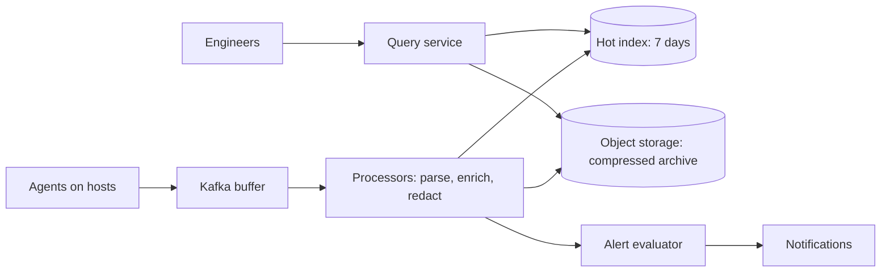

# Logging and Monitoring Platform: Full System Design Mock Interview

> **Prerequisites:** [Previous lesson: Inventory Management System: Full System Design Mock Interview, 9 Steps](../24-inventory-management-system/README.md) and the [Interview Framework track](../../21-interview-framework/README.md).
> **Estimated Reading Time:** 15–20 minutes
> **Target Audience:** Engineers practising the full 9-step system design interview on a classic prompt: collecting, storing and searching logs from thousands of services.

> [!NOTE]
> **In one line:** A logging platform is **a high-volume write pipeline with cheap tiered storage and an index for search**: agents ship logs to a durable buffer, a processing layer parses them, and a store makes them searchable.

> [!TIP]
> **The Golden Rule:** Decouple producers from storage with a durable queue, index only what you must search, keep recent logs hot and old logs cold, and drop or sample under overload before you lose the platform.

---

## Step 1. Clarify the Problem

Open with questions, not boxes. The numbers are huge and the value is concentrated in recent data, so design around volume, retention tiers and cost.

**Questions to ask the interviewer, and the answer we assume:**

| Question | Assumed answer |
| :--- | :--- |
| Sources? | 10,000 services and hosts |
| Queries? | Search by service, time, level and free text |
| Retention? | 7 days hot, 90 days warm, 1 year archive |
| Latency? | Searchable within 10 seconds |
| Volume? | 5 TB of logs per day |

> Say it aloud: *"Before I draw anything, let me confirm the scope and the numbers."* That one sentence earns the first minutes of the interview.

---

## Step 2. Functional and Non-Functional Requirements

**Functional (what the system does):**

- Collect logs from hosts and containers.
- Parse and enrich them (service, host, trace id).
- Search by time range, fields and text.
- Alert on log patterns and retain per policy.

**Non-functional (how well it does it):**

| Quality | Target | Why it drives the design |
| :--- | :--- | :--- |
| Durability | Do not lose logs during incidents | Logs matter most when things break |
| Ingest throughput | Handle 10x bursts | Incidents produce log storms |
| Query latency | Seconds for recent data | Debugging needs speed |
| Cost | Tiered storage | Volume makes cost the main constraint |

---

## Step 3. Scope: In and Out

**In scope:** Agents, buffer, processing, indexed store, tiering, alerting.

**Out of scope (say it explicitly, then move on):**

- Metrics and tracing (adjacent systems).
- Security analytics (SIEM) rules.
- Billing.

---

## Step 4. Capacity Estimation

Assumptions: 5 TB per day, average log line 500 bytes, peak is 5x average, compression about 5x, hot index covers 7 days.

| Quantity | Calculation | Result |
| :--- | :--- | :--- |
| Lines per second (average) | `tb_day * 1e12 / line / 86400` | **115.7K lines/s** |
| Lines per second (peak) | `lines_per_second__average_ * peak` | **578.7K lines/s** |
| Hot storage (compressed) | `tb_day * hot_days / compress` | **7 TB** |
| Year of archive (compressed) | `tb_day * 365 / compress` | **365 TB** |

**What the numbers tell you:** About 116K lines per second on average and 580K at peak requires a partitioned buffer such as Kafka. Compression makes hot storage about 7 TB and a year of archive about 365 TB, which is cheap in object storage but expensive if everything were indexed on SSD.

---

## Step 5. API Design

| Endpoint | Purpose | Notes |
| :--- | :--- | :--- |
| Agent `ship(batch)` | Send logs | Batched, compressed, with retry and local disk buffering. |
| `GET /v1/logs/search?q=&from=&to=` | Search | Time range is required. |
| `POST /v1/alerts` | Create an alert rule | Query plus threshold. |
| `GET /v1/logs/tail?service=` | Live tail | Streaming from the buffer. |

Always require a time range on search. Without it a query scans everything and one user can take the cluster down.

---

## Step 6. Data Model

| Entity / Store | Key fields | Why this store |
| :--- | :--- | :--- |
| Buffer (Kafka topics by service group) | Raw log batches | Absorbs bursts and decouples stages |
| Hot index (search cluster) | Indexed fields plus text, time-based indices | Fast search for 7 days |
| Warm/cold store (object storage) | Compressed columnar files by hour | Cheap long retention |
| Metadata store | Services, fields, retention rules | Configuration |

Create one index per time slice (daily or hourly). Dropping an old slice is then instant and needs no row deletion.

---

## Step 7. High-Level Architecture



**Walk the diagram in this order:** agents ship batches to Kafka, processors parse and redact, writes go to the hot index and the archive, and queries hit the hot index first, then the archive for older ranges.

---

## Step 8. Deep Dives and Bottlenecks

### 1. Ingest pipeline and backpressure

Agents batch, compress and buffer on local disk if the network is down. The central buffer absorbs bursts. If processors fall behind, consumer lag grows but nothing is lost until retention expires. When overloaded, apply sampling or drop debug-level logs by policy instead of falling over.

### 2. Indexing and storage tiers

Index timestamp, service, level and a few chosen fields, plus text where needed, for 7 days on fast storage. Beyond that, store compressed columnar files in object storage and query them with a slower engine. Time-sliced indices make retention a delete of a whole index. Do not index every field of every line; that multiplies cost.

### 3. Query safety and alerting

Require time ranges, limit result sizes, cap query time, and use per-user quotas. Alerts run as streaming rules on the processing path (count of errors per service over 5 minutes) so they do not wait for indexing.

---

## Step 9. Trade-offs, Failures and Security

**Trade-offs to state aloud:**

| Decision | Option A | Option B | Pick and why |
| :--- | :--- | :--- | :--- |
| Index scope | Index everything | Index selected fields | Selected fields: cost scales with what you search |
| Retention | All hot | Tiered | Tiered: recent hot, older cold |
| Overload | Block producers | Sample or drop low priority | Drop low priority: never take the app down for its logs |

**Failure modes and mitigations:**

| Failure | What users see | Mitigation |
| :--- | :--- | :--- |
| Processor lag | Search delay | Autoscale consumers; buffer holds the data |
| Hot cluster full | Ingest stalls | Retention by index drop and tier earlier |
| Query of death | Cluster slow | Time range, limits, per-user quotas |

**Security and abuse:** Redact secrets and personal data in the processors, enforce per-team access to log streams, encrypt in transit and at rest, and audit who searches what.

---

## Runnable Example: Time-sliced indices and retention

Logs go into a daily index, and retention just drops whole days.

```python
from datetime import date, timedelta

def index_name(d):
    return "logs-" + d.isoformat()

today = date(2026, 12, 10)
indices = {index_name(today - timedelta(days=i)): 1000 for i in range(10)}

def apply_retention(indices, today, keep_days):
    cutoff = today - timedelta(days=keep_days)
    dropped = [n for n in indices if date.fromisoformat(n[5:]) < cutoff]
    for n in dropped:
        del indices[n]
    return sorted(dropped)

print(len(indices), "indices")
print("dropped:", apply_retention(indices, today, 7))
print(len(indices), "indices left")
```

Output (produced by running this exact code):

```text
10 indices
dropped: ['logs-2026-12-01', 'logs-2026-12-02']
8 indices left
```

With 10 daily indices and 7 days of retention counted back from 10 December, the two oldest are dropped as whole units, with no per-row deletion.

---

## Common Mistakes

- Writing logs straight to the search cluster with no buffer.
- Indexing every field.
- Searches without time ranges.
- Keeping everything on hot storage.
- Letting log volume take down the application.

---

## Interview Questions and Answers

<details>
<summary><strong>Q1: Why a queue between agents and storage?</strong></summary>

It absorbs bursts, decouples producers from storage speed and gives durability while processors catch up.

</details>

<details>
<summary><strong>Q2: How do you control cost?</strong></summary>

Tiered storage, selective indexing, compression, sampling of low-value logs and short hot retention.

</details>

<details>
<summary><strong>Q3: How do you implement retention?</strong></summary>

Time-sliced indices dropped as a whole, and lifecycle rules in object storage.

</details>

<details>
<summary><strong>Q4: How do you protect the cluster from heavy queries?</strong></summary>

Required time ranges, result and time limits, per-user quotas and query isolation.

</details>

<details>
<summary><strong>Q5: What if the pipeline is overloaded?</strong></summary>

Backpressure through the buffer, then sample or drop low-priority logs by policy.

</details>

---

## One-Page Cheat Sheet

| Step | What to say or draw |
| :--- | :--- |
| Clarify | 10K hosts, 5 TB/day, tiered retention |
| Capacity | 116K lines/s (580K peak), ~7 TB hot, ~365 TB/year |
| API | ship, search (time range), alerts, tail |
| Data | Kafka, hot index by time, object storage archive |
| Deep dive | Backpressure, tiering, query safety, alerts |
| Trade-off | Selective indexing, drop low priority |

---

## Further Reading

- Elastic documentation on index lifecycle management.
- Grafana Loki design doc: index only labels, not content.

---

## Next

Continue with [Metrics Collection System: Full System Design Mock Interview, 9 Steps](../26-metrics-collection-system/README.md).
