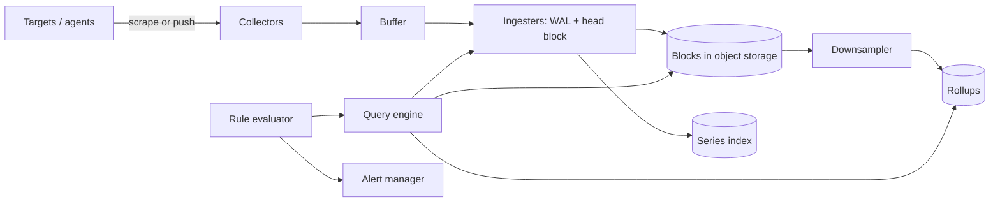

# Metrics Collection System: Full System Design Mock Interview, 9 Steps

> **Prerequisites:** [Previous lesson: Logging and Monitoring Platform: Full System Design Mock Interview](../25-logging-and-monitoring-platform/README.md) and the [Interview Framework track](../../21-interview-framework/README.md).
> **Estimated Reading Time:** 15–20 minutes
> **Target Audience:** Engineers practising the full 9-step system design interview on a classic prompt: collecting and querying time-series metrics from many machines.

> [!NOTE]
> **In one line:** A metrics system is **a time-series database fed by a collection layer**: points are tiny and append-only, so the design is about ingest volume, compression, downsampling and cardinality.

> [!TIP]
> **The Golden Rule:** Store samples compressed in time-ordered blocks, downsample old data, and control label cardinality, because the number of unique series, not the number of points, is what breaks these systems.

---

## Step 1. Clarify the Problem

Open with questions, not boxes. Metrics look like logs but behave differently: small numeric points, queried as aggregates over time, with cardinality as the main risk.

**Questions to ask the interviewer, and the answer we assume:**

| Question | Assumed answer |
| :--- | :--- |
| Collection model? | Agents push or a server pulls (scrape); support both |
| Metrics? | Counters, gauges, histograms with labels |
| Queries? | Aggregations over time and labels, dashboards and alerts |
| Retention? | 15 days raw, 13 months downsampled |
| Scale? | 10M active series, 10-second interval |

> Say it aloud: *"Before I draw anything, let me confirm the scope and the numbers."* That one sentence earns the first minutes of the interview.

---

## Step 2. Functional and Non-Functional Requirements

**Functional (what the system does):**

- Collect metrics from services and hosts.
- Store them with labels.
- Query and aggregate over time ranges.
- Evaluate alert rules continuously.

**Non-functional (how well it does it):**

| Quality | Target | Why it drives the design |
| :--- | :--- | :--- |
| Ingest rate | Millions of samples per second | Many series, short interval |
| Query latency | Dashboards under 2 s | Used during incidents |
| Efficiency | About 1-2 bytes per sample | Volume is huge |
| Reliability | Alerts must fire when systems fail | It monitors everything else |

---

## Step 3. Scope: In and Out

**In scope:** Collection, ingestion, compressed storage, downsampling, queries, alerts.

**Out of scope (say it explicitly, then move on):**

- Logs and traces.
- Dashboard UI.
- Anomaly detection ML.

---

## Step 4. Capacity Estimation

Assumptions: 10M active series, one sample every 10 seconds, 1.5 bytes per sample after compression, 15 days of raw retention.

| Quantity | Calculation | Result |
| :--- | :--- | :--- |
| Samples per second | `series / interval` | **1M samples/s** |
| Samples per day | `samples_per_second * 86400` | **86.4B samples** |
| Raw storage for 15 days | `samples_per_day * bytes_ * days / 1e12` | **1.94 TB** |

**What the numbers tell you:** 1M samples per second is a lot of writes but each is tiny. With compression of about 1.5 bytes per sample the raw 15 days fit in about 2 TB, which is why time-series compression (delta of delta, XOR of floats) matters so much.

---

## Step 5. API Design

| Endpoint | Purpose | Notes |
| :--- | :--- | :--- |
| `POST /v1/write` | Push samples | Batch of `(series labels, timestamp, value)`. |
| Scrape `GET /metrics` | Pull from a target | Text exposition format. |
| `GET /v1/query?expr=&start=&end=&step=` | Range query | Aggregations, rates, quantiles. |
| `POST /v1/rules` | Alert and recording rules | Evaluated on a schedule. |

Pull makes it easy to know when a target is down (the scrape fails); push suits short-lived jobs. Many platforms support both.

---

## Step 6. Data Model

| Entity / Store | Key fields | Why this store |
| :--- | :--- | :--- |
| Write-ahead log + in-memory head block | Last 2 hours of samples | Fast writes, crash recovery |
| Compressed blocks (object storage) | 2-hour then larger blocks per series | Efficient long storage |
| Series index | Labels to series id (inverted index) | Find series by label match |
| Downsampled store | 5-minute and 1-hour rollups | Cheap long retention |

A series is identified by its metric name plus label set. Every unique label combination is a new series, which is why a label such as `user_id` is dangerous.

---

## Step 7. High-Level Architecture



**Walk the diagram in this order:** collectors gather samples, ingesters hold recent data in memory with a log, blocks flush to object storage, a downsampler builds rollups, and the query engine merges across tiers.

---

## Step 8. Deep Dives and Bottlenecks

### 1. Compression and storage layout

Samples in a series are close in time and value. Store timestamps as delta of delta and values with XOR of consecutive floats (the Gorilla scheme), which brings a 16-byte sample to about 1 to 2 bytes. Group a time window of many series into immutable blocks with an index, so queries scan only the needed blocks.

### 2. Cardinality

Total series equals the product of label values. Adding `user_id` or `request_id` as a label can create millions of series and exhaust memory. Enforce limits per metric and per tenant, reject or drop offending series, and keep high-cardinality identifiers in logs or traces instead.

### 3. Downsampling, queries and alerts

Roll raw points into 5-minute and 1-hour aggregates (min, max, sum, count) and keep them long term; queries over long ranges use rollups. Alert rules are evaluated on the freshest data by a separate, highly available evaluator, because the monitoring system must keep working when everything else does not.

---

## Step 9. Trade-offs, Failures and Security

**Trade-offs to state aloud:**

| Decision | Option A | Option B | Pick and why |
| :--- | :--- | :--- | :--- |
| Collection | Push | Pull | Support both: pull for services, push for batch jobs |
| Retention | Raw forever | Downsample | Downsample: cost scales with time |
| Labels | Unbounded | Cardinality limits | Limits protect the system |

**Failure modes and mitigations:**

| Failure | What users see | Mitigation |
| :--- | :--- | :--- |
| Ingester crash | Recent data at risk | WAL replay and replicated ingesters |
| Cardinality explosion | Out of memory | Per-tenant series limits and rejection |
| Alerting path down | Missed alerts | Redundant evaluators and a watchdog alert |

**Security and abuse:** Authenticate collectors and tenants, isolate tenants' data and limits, avoid secrets in labels, and restrict who can write recording and alert rules.

---

## Runnable Example: Delta-of-delta timestamp compression

Regular timestamps become runs of zeros after two differences, which compress to almost nothing.

```python
ts = [1000, 1010, 1020, 1030, 1040, 1051, 1061]

def delta_of_delta(ts):
    deltas = [b - a for a, b in zip(ts, ts[1:])]
    return [ts[0], deltas[0]] + [b - a for a, b in zip(deltas, deltas[1:])]

dd = delta_of_delta(ts)
print(dd)
zeros = sum(1 for x in dd[2:] if x == 0)
print("zeros:", zeros, "of", len(dd) - 2)
```

Output (produced by running this exact code):

```text
[1000, 10, 0, 0, 0, 1, -1]
zeros: 3 of 5
```

After the first timestamp and first delta, the values are mostly zero (and +1 or -1 for jitter), which a bit-packing encoder stores in one or two bits each instead of 8 bytes.

---

## Common Mistakes

- Using a general relational database for metrics.
- High-cardinality labels.
- Keeping raw data forever.
- Evaluating alerts on the same path that can fail.
- No limits per tenant.

---

## Interview Questions and Answers

<details>
<summary><strong>Q1: Push or pull?</strong></summary>

Pull gives built-in health detection and simple targets; push is needed for short-lived jobs. Support both.

</details>

<details>
<summary><strong>Q2: How do you store points efficiently?</strong></summary>

Time-ordered blocks per series with delta-of-delta timestamps and XOR-compressed values, about 1 to 2 bytes per sample.

</details>

<details>
<summary><strong>Q3: What is cardinality and why does it matter?</strong></summary>

The number of unique label combinations. Each is a series with its own memory and index entries, so unbounded labels can exhaust the system.

</details>

<details>
<summary><strong>Q4: How do long queries stay fast?</strong></summary>

Downsampled rollups and block indices, so queries read aggregates rather than raw points.

</details>

<details>
<summary><strong>Q5: How do you make alerting reliable?</strong></summary>

A redundant evaluator, evaluation on fresh data, and a watchdog that alerts if alerting stops.

</details>

---

## One-Page Cheat Sheet

| Step | What to say or draw |
| :--- | :--- |
| Clarify | 10M series, 10s interval, push and pull |
| Capacity | 1M samples/s, ~2 TB for 15 days raw |
| API | write, scrape, range query, rules |
| Data | WAL + head, compressed blocks, series index, rollups |
| Deep dive | Compression, cardinality, downsampling, alerts |
| Trade-off | Downsample, limit labels |

---

## Further Reading

- Pelkonen et al., *Gorilla: A Fast, Scalable, In-Memory Time Series Database* (VLDB 2015).
- Prometheus documentation on storage and cardinality.

---

## Next

Continue with [Distributed Cache: Full System Design Mock Interview, All 9 Steps](../27-distributed-cache/README.md).
