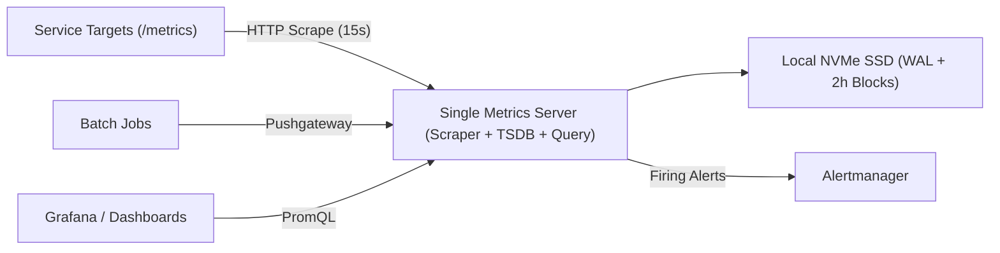
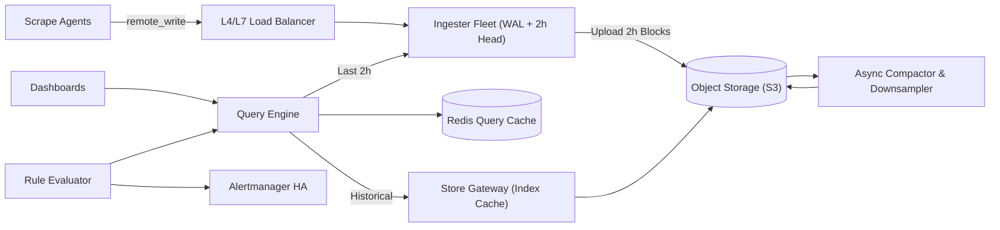
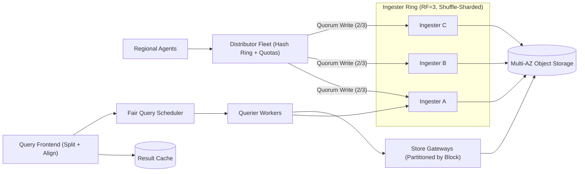
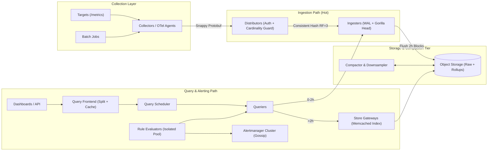
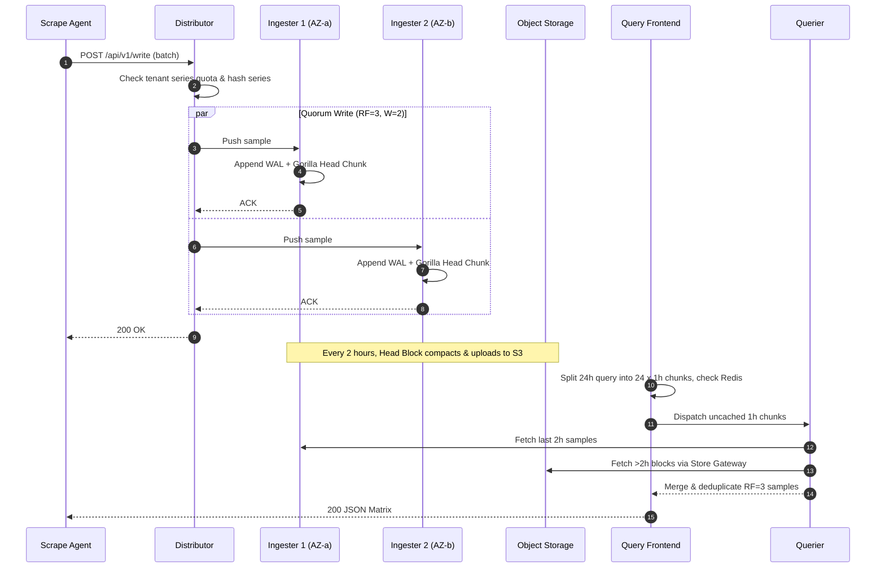

# Metrics Collection System: Full System Design Mock Interview, 9 Steps

> **Difficulty:** Senior / Staff (L5–L7)
> **Prerequisites:** [Previous lesson: Logging and Monitoring Platform: Full System Design Mock Interview](../25-logging-and-monitoring-platform/README.md) and the [Interview Framework track](../../21-interview-framework/README.md).
> **Estimated Reading Time:** 25–30 minutes
> **Target Audience:** Engineers practising the full system design interview on a classic prompt: collecting, compressing, querying, and alerting on time-series metrics from millions of targets.

> [!NOTE]
> **In one line:** A metrics system is **a time-series database fed by a hybrid pull/push collection layer**: points are tiny, numeric, and append-only, so the design centers on ingest throughput, Gorilla compression, downsampling, and strict label-cardinality bounds.

> [!TIP]
> **The Golden Rule:** Store samples compressed in immutable time-ordered blocks, downsample historical data into rollups, and enforce hard per-tenant cardinality limits—because the number of unique label combinations (active series), not the raw sample count, is what exhausts memory and crashes a metrics platform.

---

## 1. Clarifying Questions, Functional & Non-Functional Requirements

Open the interview by clarifying the workload shape. Metrics look superficially like logs, but they behave completely differently: logs are variable-length text blobs indexed for substring search, whereas metrics are fixed-shape `(metric_name, labels, timestamp_ms, float64_value)` tuples queried as mathematical aggregations over time windows.

### Clarifying Questions & Assumed Answers

| Question | Assumed Answer | Architectural Implication |
| :--- | :--- | :--- |
| **Collection model?** | Support both **pull** (HTTP scrape `/metrics`) and **push** (remote-write / agent push for short-lived batch jobs) | Collectors need service discovery for scraping plus an ingestion HTTP/gRPC endpoint |
| **Metric types?** | Counters, gauges, and histograms/summaries with arbitrary key-value labels | Need monotonic counter `rate()` handling and bucketed quantile aggregation |
| **Query patterns?** | Time-range aggregations (`sum`, `avg`, `rate`, `histogram_quantile`) for dashboards & alerts | Inverted label index + columnar/time-ordered block storage |
| **Retention policy?** | 15 days raw (10 s resolution), 90 days 5-minute rollups, 13 months 1-hour rollups | Tiered storage + background compactor & downsampler |
| **Target scale?** | 10M active time series, 10-second scrape/push interval, 500 concurrent dashboard/alert queries/s | 1M samples/sec sustained ingest; hot head-block in RAM + object storage |

> Say it aloud: *"Before I draw anything, let me confirm the scope, cardinality assumptions, and retention tiers."*

### Functional Requirements

1. **Ingest & Scrape:** Pull metrics from discovered service endpoints (`/metrics`) and accept pushed batches (`POST /api/v1/write`) from ephemeral jobs or edge agents.
2. **Labelled Time-Series Storage:** Store `(metric_name + sorted_labels, timestamp, value)` with fast lookup by label matchers (`env="prod"`, `status=~"5.."`).
3. **PromQL-Style Querying:** Evaluate instant and range queries with aggregations (`sum by (service)`), `rate()`, and `histogram_quantile()`.
4. **Continuous Alerting & Recording Rules:** Evaluate alert expressions every 15–30 s on fresh data, deduplicate/route notifications, and precompute expensive recording rules.
5. **Multi-Tenancy & Quotas:** Isolate tenants, enforce active-series limits, and prevent one noisy service from OOM-killing shared ingesters.

### Non-Functional Requirements

| Quality | Target | Why It Drives the Design |
| :--- | :--- | :--- |
| **Ingest Throughput** | 1M samples/s sustained, 3M/s burst | Requires horizontally sharded ingesters with WAL + in-memory head blocks |
| **Query Latency** | p99 < 2 s for 6-hour dashboard ranges | Needs inverted label index, block pruning, and 5m/1h downsampled rollups |
| **Storage Efficiency** | 1.2–2.0 bytes per sample on disk | Uncompressed 16-byte tuples would cost 10x more; requires Gorilla compression |
| **Alerting Availability** | 99.99% (must survive partial outages) | Monitoring must work *during* an incident; isolated alerting path + watchdog |
| **Data Durability** | Zero silent loss of recent 2 h head block | Replicated ingesters (RF=3) + Write-Ahead Log (WAL) on local SSD |

**Explicitly Out of Scope:** Unstructured log aggregation, distributed trace spans, dashboard rendering UI, and ML-based anomaly detection.

---

## 2. Back-of-the-Envelope Capacity Estimation

Let us derive every capacity number from first principles using the assumed scale: **10M active series**, **10-second interval**, **15 days raw retention**, **90 days at 5m rollup**, and **13 months (400 days) at 1h rollup**.

### Ingest Rate & Bandwidth

$$
\text{Samples/sec} = \frac{N_{\text{series}}}{\Delta t_{\text{interval}}} = \frac{10{,}000{,}000}{10\text{ s}} = 1{,}000{,}000\text{ samples/s}
$$

$$
\text{Samples/day} = 1{,}000{,}000 \times 86{,}400 = 8.64 \times 10^{10}\text{ samples/day}
$$

Assuming an uncompressed wire payload of ~24 bytes per sample (after snappy/zstd batching on the wire, ~6 bytes/sample):

$$
\text{Ingress Bandwidth (compressed)} = 1{,}000{,}000 \times 6\text{ B} = 6\text{ MB/s} \approx 48\text{ Mbps}
$$

### Storage Footprint (Gorilla Compression + Tiered Rollups)

With Gorilla compression (delta-of-delta timestamps + XOR float64 values), each persisted sample averages **1.5 bytes** (plus ~10% index/metadata overhead $\approx 1.65\text{ B}$).

$$
\text{Raw Storage (15 days)} = 8.64 \times 10^{10} \times 15 \times 1.65\text{ B} \approx 2.14\text{ TB}
$$

For downsampled rollups, each interval stores 4 aggregates (`min`, `max`, `sum`, `count`) at ~2 bytes each = **8 bytes per rollup point**:

- **5-minute rollups (90 days):** $288\text{ points/day} \times 10^7\text{ series} \times 90\text{ d} \times 8\text{ B} \approx 2.07\text{ TB}$
- **1-hour rollups (400 days):** $24\text{ points/day} \times 10^7\text{ series} \times 400\text{ d} \times 8\text{ B} \approx 0.77\text{ TB}$

$$
\text{Total Compressed Storage (13 months)} \approx 2.14 + 2.07 + 0.77 \approx 4.98\text{ TB} \text{ (per replica)}
$$

### Ingester Memory Footprint (2-Hour Head Block)

Ingesters keep the active 2-hour head block in RAM (label strings, inverted index postings, and active chunk buffers). Roughly **4 KB per active series** in RAM (including Go/C++ struct + postings overhead):

$$
\text{Total Head RAM} = 10{,}000{,}000 \times 4\text{ KB} = 40\text{ GB}
$$

With replication factor $\text{RF} = 3$, total cluster head RAM is $120\text{ GB}$. Using 32 GB RAM ingester nodes at 60% target utilization (~19 GB usable), we need $\lceil 120 / 19 \rceil \approx 7$ ingester nodes (provision 9–12 for headroom and rolling restarts).

### Capacity Summary Table

| Metric | Formula / Assumption | Result |
| :--- | :--- | :--- |
| **Sustained Ingest** | $10^7\text{ series} / 10\text{ s}$ | **1,000,000 samples/s** |
| **Daily Samples** | $10^6 \times 86{,}400$ | **86.4 Billion samples/day** |
| **Raw 15d Storage** | $86.4\text{B} \times 15 \times 1.65\text{ B}$ | **~2.14 TB** |
| **Total 13m Storage** | Raw + 5m (90d) + 1h (400d) | **~5.0 TB** (single copy) |
| **Active Head RAM (RF=3)** | $10^7 \times 4\text{ KB} \times 3$ | **120 GB RAM** (~9–12 nodes) |

---

## 3. Core API Contracts & Data Model

### API Contracts

| Endpoint / Protocol | Direction | Purpose & Payload |
| :--- | :--- | :--- |
| `GET /metrics` | Collector $\leftarrow$ Target | Pull scrape endpoint returning Prometheus text/OpenMetrics exposition format |
| `POST /api/v1/write` | Agent $\rightarrow$ Distributor | Protobuf + Snappy compressed `WriteRequest` containing `TimeSeries[]` batches |
| `GET /api/v1/query_range` | Client $\rightarrow$ Query Frontend | `expr`, `start`, `end`, `step`; returns matrix of `(timestamp, value)` per series |
| `GET /api/v1/series` | Client $\rightarrow$ Query Frontend | `match[]`, `start`, `end`; returns matching label sets for autocomplete |
| `POST /api/v1/rules` | Operator $\rightarrow$ Rule Store | YAML/JSON alert & recording rule definitions with `for` duration and `labels` |

**Example Remote-Write Payload (Protobuf Logical Schema):**
```protobuf
message WriteRequest {
  repeated TimeSeries timeseries = 1;
}
message TimeSeries {
  repeated Label labels = 1;   // sorted by name: __name__, env, instance, job
  repeated Sample samples = 2; // timestamp_ms (int64), value (double)
}
```

### Data Model & Storage Tiers

A time series is uniquely identified by its **canonical label set** (e.g., `http_requests_total{env="prod",method="GET",status="200"}`).

| Store / Tier | Key Structure | Purpose & Retention |
| :--- | :--- | :--- |
| **Write-Ahead Log (WAL)** | Sequential append-only segments (`000001`, `000002`) | Crash recovery for the uncompacted 2-hour head block |
| **Head Block (RAM)** | `series_id -> GorillaChunk[]` + `label_kv -> RoaringBitmap(series_id)` | Sub-millisecond writes & freshest-data queries (last 2 hours) |
| **Immutable TSDB Blocks (Object Storage)** | `tenant/block_ulid/{chunks/, index, meta.json, tombstones}` | 2-hour, 12-hour, and 24-hour compacted blocks (15 days raw) |
| **Downsampled Blocks (Object Storage)** | Same block layout storing `min`, `max`, `sum`, `count` chunks | 5m rollups (90 days) and 1h rollups (13 months) |
| **Rule & Alert State DB (PostgreSQL/etcd)** | `tenant_id`, `rule_group`, `expr`, `state (inactive/pending/firing)` | Durable rule definitions and alertmanager silences |

---

## 4. Stage 1 (100 – 1K Users): Baseline Monolith & Single Database

At early startup scale (100–1,000 internal services/hosts, ~50K active series, ~5K samples/sec), simplicity beats distributed complexity.

### Component-by-Component Build
1. **Single Scraper / Collector:** One Prometheus-style server discovers targets via static config or Kubernetes API and scrapes `/metrics` every 15 seconds.
2. **Embedded TSDB + Local SSD:** The same binary writes samples to a local WAL and in-memory head block, flushing 2-hour blocks to local NVMe disk.
3. **Built-in Query & Alert Evaluator:** The monolith serves `query_range` directly from local disk/RAM and evaluates alert rules every 30 s, forwarding firing alerts to a single Alertmanager process.



### What Breaks at 10K Users / 500K Series?
- **Single-Node RAM & Disk Exhaustion:** 500K+ series with high-churn ephemeral pods blows past single-node RAM, and local NVMe fills up within days.
- **Single Point of Failure:** If the monolith restarts or its disk dies, both ingestion and alerting go blind simultaneously.
- **Long-Range Query OOMs:** A single dashboard querying 30 days of raw data scans millions of chunks in the same process that is trying to ingest live traffic, causing scrape drops.

---

## 5. Stage 2 (10K – 100K Users): Caching, Read Replicas & Async Offload

To scale past one machine (100K–1M active series, ~100K samples/s), we **decouple ingestion, storage, querying, and alerting** and move historical blocks to durable object storage.

### Component-by-Component Additions
1. **Stateless Collectors / Agents:** Lightweight agents (e.g., Grafana Agent / OpenTelemetry Collector) run on hosts or in K8s, scrape local targets, and `remote_write` batched samples.
2. **Ingester Fleet + Object Storage (S3/GCS):** Multiple ingesters hold the 2-hour head block in RAM + WAL and upload immutable 2-hour TSDB blocks to S3.
3. **Dedicated Querier + Query Cache (Redis/Memcached):** Queries are routed to a separate Querier tier that fans out to Ingesters (for the last 2 h) and S3 (via Store Gateways with LRU chunk/index cache) for older data.
4. **Separate Compactor & Downsampler:** An async background worker merges 2-hour blocks in S3 into 12 h/24 h blocks and builds 5 m and 1 h rollups.



### What Breaks at 1M+ Users / 10M Series?
- **No Sharding Strategy on Ingesters:** Random load balancing spreads a single tenant's series across all ingesters, forcing queries to fan out to *every* ingester.
- **Query Fan-Out & Head-of-Line Blocking:** A single user running a 30-day wildcard query (`{job=~".*"}`) saturates the Querier fleet and starves alert evaluations.
- **Cardinality Explosion:** Without a stateful Distributor enforcing per-tenant limits *before* samples hit ingesters, one bad deploy with a `user_id` label OOMs the entire ingester fleet.

---

## 6. Stage 3 (1M – 10M+ Users): Sharding, Partitioning & Multi-Region Scale

At 10M+ active series (1M+ samples/sec) and multi-tenant SaaS scale, we introduce **consistent-hash sharding**, **query splitting/caching**, and **multi-region isolation**.

### Component-by-Component Additions
1. **Stateless Distributor Tier (Consistent Hash Ring):** Receives `remote_write`, validates labels, enforces per-tenant rate and active-series quotas, and hashes `(tenant_id, metric_name, labels)` onto an ingester ring with **Replication Factor = 3** (quorum write: 2 of 3).
2. **Shuffle-Sharding:** Each tenant is assigned only a subset of ingesters (e.g., 6 out of 60) so a noisy neighbor can impact at most 10% of the cluster.
3. **Query Frontend + Query Scheduler:** Splits large `query_range` requests into 1-hour aligned sub-queries, caches individual step results in Redis/Memcached, and schedules sub-queries fairly across tenants (preventing one tenant from hogging workers).
4. **Zone-Aware & Multi-Region Deployment:** Ingesters are spread across 3 Availability Zones; global Query Frontends federate across regions.



---

## 7. Final Full Production Architecture & End-to-End Flows

### Complete Production Architecture



### End-to-End Write & Query Sequence



---

## 8. Deep-Dive Bottlenecks & Algorithmic Trade-Offs

### 1. Gorilla Time-Series Compression (Delta-of-Delta + XOR)
Storing `(int64 timestamp, float64 value)` uncompressed takes 16 bytes/sample. Gorilla (Facebook, VLDB 2015) exploits two properties of metrics:
- **Timestamps arrive at regular intervals** (e.g., every 10 s): Compute $D = (t_n - t_{n-1}) - (t_{n-1} - t_{n-2})$. If $D = 0$, encode with a **single `0` bit**! Small jitter ($[-63, 64]$) takes 9 bits.
- **Consecutive float values change slowly:** Compute `xor = val_n ^ val_{n-1}`. If `xor == 0`, encode with a **single `0` bit**. Otherwise, encode only the leading/trailing zero counts and the meaningful middle bits.
- **Result:** ~1.37 bytes/sample in production—a **>10x reduction** in RAM and object storage.

### 2. Cardinality Explosion & Inverted Index Bottlenecks
Total active series is the Cartesian product of label values:
$$
N_{\text{series}} = \prod_{i=1}^{k} |\text{Label}_i|
$$
If an engineer adds `user_id` (1M values) or `request_path` (unnormalized UUIDs) to `http_requests_total`, a single metric explodes from 500 series to 50,000,000 series.
- **Inverted Index:** Each block maps `label_name=label_value -> sorted posting list of series_ids` (compressed with Roaring Bitmaps).
- **Mitigation:** Enforce `max_global_series_per_user` and `max_series_per_metric` in the Distributor using a distributed counter (e.g., gossip/etcd), and drop or relabel high-cardinality labels at the collector.

### 3. Pull vs. Push Collection Trade-Offs

| Dimension | Pull (Scrape `/metrics`) | Push (`remote_write`) |
| :--- | :--- | :--- |
| **Target Health Detection** | Built-in (`up == 0` when scrape fails) | Requires heartbeats / staleness markers |
| **Short-Lived Batch Jobs** | Poor (job may exit before scrape) | Native (push on job completion) |
| **Firewall / NAT Traversal** | Hard (collector must reach targets) | Easy (edge agents push outbound over HTTPS) |
| **Backpressure** | Collector controls scrape rate | Needs rate limiting & queue buffering on agent |

**Production Pick:** Hybrid—scrape services inside clusters via local agents, and have agents `remote_write` to central Distributors.

---

## 9. Failure Modes, Reliability & Backpressure Mitigations

| Failure Mode | Blast Radius / Symptom | Mitigation |
| :--- | :--- | :--- |
| **Ingester Node Crash** | Loss of last 2 h in-memory head block on that node | **RF=3** quorum writes + **WAL replay** on restart + graceful handoff during scale-down |
| **Cardinality Explosion** | Ingester OOM loop, dropped samples across tenants | **Shuffle-sharding** + Distributor per-tenant series caps + collector `metric_relabel_configs` |
| **Query Storm (Incident)** | Dashboards time out when everyone opens Grafana | **Query Frontend** splits/caches sub-queries; **Query Scheduler** enforces per-tenant concurrency |
| **Alerting Path Failure** | Silent outage—no pages fire during SEV-1 | Run **Rule Evaluators** in an isolated worker pool; configure an external **Dead Man's Switch / Watchdog** alert |
| **Object Storage Slowdown** | Compaction lags, ingester disks fill up | Decouple flush queue, alert on `ingester_wal_size_bytes`, and set local disk headroom alerts at 70% |

---

## 10. Production War Story & Real-World Reference

### War Story: The Unbounded `path` Label Outage (SEV-1)
- **What Happened:** A payment microservice deployed a new HTTP middleware that attached the raw URL path (`path="/v1/orders/ord_98a7f6..."`) as a Prometheus label instead of the parameterized route (`route="/v1/orders/:id"`).
- **Cascade:** Within 8 minutes, active series jumped from 400K to 18M. Ingesters exhausted 64 GB RAM and entered an OOMKill crash loop. Because WAL replay on restart tried to reload all 18M series into memory, ingesters could not recover—causing a 45-minute blind spot across *all* microservices.
- **Root Cause:** No per-metric or per-tenant active-series limit at the Distributor, and no collector-side relabeling guard.
- **Permanent Fix:**
  1. Added Distributor-level hard caps (`max_series_per_metric = 50_000`, `max_series_per_tenant = 500_000`) returning `400 Bad Request` (non-retryable) on breach.
  2. Enabled **shuffle-sharding** (4 ingesters per tenant) so a bad deploy can never take down the shared fleet.
  3. Added a synthetic **Dead Man's Switch** alert (`vector(1)` always firing to PagerDuty/Healthchecks) to detect monitoring pipeline stalls within 60 seconds.

**Real-World Reference:** Prometheus TSDB, Cortex / Grafana Mimir (shuffle-sharded ingesters + Query Frontend), and Facebook Gorilla (VLDB 2015).

---

## 11. Core Component Implementation (4 Languages)

Below is a production-grade implementation of **Gorilla Delta-of-Delta Timestamp Compression** and **Cardinality Guard (Per-Metric Series Limiter)** in Go, TypeScript, Python, and C#.

````carousel
```go
package metrics

import (
	"errors"
	"sync"
)

// DeltaOfDeltaEncode compresses monotonic millisecond timestamps.
// Regular intervals (e.g., 10000ms) produce 0s after the second sample.
func DeltaOfDeltaEncode(timestamps []int64) []int64 {
	if len(timestamps) == 0 {
		return nil
	}
	if len(timestamps) == 1 {
		return []int64{timestamps[0]}
	}
	out := make([]int64, 0, len(timestamps))
	prevDelta := timestamps[1] - timestamps[0]
	out = append(out, timestamps[0], prevDelta)

	for i := 2; i < len(timestamps); i++ {
		delta := timestamps[i] - timestamps[i-1]
		dod := delta - prevDelta
		out = append(out, dod)
		prevDelta = delta
	}
	return out
}

// CardinalityGuard enforces hard per-metric series limits at the Distributor.
type CardinalityGuard struct {
	mu          sync.Mutex
	maxPerMetric int
	seen        map[string]map[uint64]struct{}
}

func NewCardinalityGuard(maxPerMetric int) *CardinalityGuard {
	return &CardinalityGuard{
		maxPerMetric: maxPerMetric,
		seen:         make(map[string]map[uint64]struct{}),
	}
}

func (g *CardinalityGuard) Allow(metric string, seriesHash uint64) error {
	g.mu.Lock()
	defer g.mu.Unlock()

	set, ok := g.seen[metric]
	if !ok {
		set = make(map[uint64]struct{})
		g.seen[metric] = set
	}
	if _, exists := set[seriesHash]; exists {
		return nil
	}
	if len(set) >= g.maxPerMetric {
		return errors.New("cardinality limit exceeded for metric: " + metric)
	}
	set[seriesHash] = struct{}{}
	return nil
}
```
<!-- slide -->
```typescript
/**
 * Compresses monotonic timestamps using Delta-of-Delta encoding.
 * Regular intervals collapse to 0s, which bit-pack into 1 bit per sample.
 */
export function deltaOfDeltaEncode(timestamps: number[]): number[] {
  if (timestamps.length === 0) return [];
  if (timestamps.length === 1) return [timestamps[0]];

  const out: number[] = [timestamps[0]];
  let prevDelta = timestamps[1] - timestamps[0];
  out.push(prevDelta);

  for (let i = 2; i < timestamps.length; i++) {
    const delta = timestamps[i] - timestamps[i - 1];
    out.push(delta - prevDelta);
    prevDelta = delta;
  }
  return out;
}

export class CardinalityGuard {
  private readonly seen = new Map<string, Set<string>>();

  constructor(private readonly maxPerMetric: number) {}

  allow(metricName: string, canonicalLabels: string): boolean {
    let seriesSet = this.seen.get(metricName);
    if (!seriesSet) {
      seriesSet = new Set<string>();
      this.seen.set(metricName, seriesSet);
    }
    if (seriesSet.has(canonicalLabels)) {
      return true;
    }
    if (seriesSet.size >= this.maxPerMetric) {
      return false; // Reject new series to protect ingester RAM
    }
    seriesSet.add(canonicalLabels);
    return true;
  }
}
```
<!-- slide -->
```python
from typing import Dict, List, Set

def delta_of_delta_encode(timestamps: List[int]) -> List[int]:
    """Compress monotonic timestamps; regular intervals become 0s."""
    if not timestamps:
        return []
    if len(timestamps) == 1:
        return [timestamps[0]]

    prev_delta = timestamps[1] - timestamps[0]
    out = [timestamps[0], prev_delta]
    for i in range(2, len(timestamps)):
        delta = timestamps[i] - timestamps[i - 1]
        out.append(delta - prev_delta)
        prev_delta = delta
    return out


class CardinalityGuard:
    """Enforces per-metric active series limits at the Distributor."""

    def __init__(self, max_per_metric: int) -> None:
        self.max_per_metric = max_per_metric
        self._seen: Dict[str, Set[int]] = {}

    def allow(self, metric_name: str, series_hash: int) -> bool:
        series_set = self._seen.setdefault(metric_name, set())
        if series_hash in series_set:
            return True
        if len(series_set) >= self.max_per_metric:
            return False
        series_set.add(series_hash)
        return True


if __name__ == "__main__":
    ts = [1000, 1010, 1020, 1030, 1041, 1051]
    print("Delta-of-Delta:", delta_of_delta_encode(ts))
```
<!-- slide -->
```csharp
using System;
using System.Collections.Concurrent;
using System.Collections.Generic;

public static class GorillaEncoder
{
    public static List<long> DeltaOfDeltaEncode(IReadOnlyList<long> timestamps)
    {
        var result = new List<long>(timestamps.Count);
        if (timestamps.Count == 0) return result;
        result.Add(timestamps[0]);
        if (timestamps.Count == 1) return result;

        long prevDelta = timestamps[1] - timestamps[0];
        result.Add(prevDelta);

        for (int i = 2; i < timestamps.Count; i++)
        {
            long delta = timestamps[i] - timestamps[i - 1];
            result.Add(delta - prevDelta);
            prevDelta = delta;
        }
        return result;
    }
}

public sealed class CardinalityGuard
{
    private readonly int _maxPerMetric;
    private readonly ConcurrentDictionary<string, HashSet<ulong>> _seen = new();

    public CardinalityGuard(int maxPerMetric) => _maxPerMetric = maxPerMetric;

    public bool Allow(string metricName, ulong seriesHash)
    {
        var set = _seen.GetOrAdd(metricName, _ => new HashSet<ulong>());
        lock (set)
        {
            if (set.Contains(seriesHash)) return true;
            if (set.Count >= _maxPerMetric) return false;
            set.Add(seriesHash);
            return true;
        }
    }
}
```
````

---

## 12. Verification, Load Testing & CLI Diagnostics

```bash
# 1. Verify Delta-of-Delta compression ratio in Python
python3 -c '
ts = [1700000000 + i*10 for i in range(1000)]
dd = [ts[0], ts[1]-ts[0]] + [(ts[i]-ts[i-1])-(ts[i-1]-ts[i-2]) for i in range(2, len(ts))]
print("Zero DoDs:", sum(1 for x in dd[2:] if x == 0), "out of", len(dd)-2)
'

# 2. Query Prometheus / Mimir TSDB status & top 10 highest-cardinality metrics
curl -s "http://localhost:9090/api/v1/status/tsdb" | jq '.data.seriesCountByMetricName[:10]'

# 3. Inspect active series count and head-block memory via PromQL
curl -G -s "http://localhost:9090/api/v1/query" \
  --data-urlencode 'query=topk(5, count by (__name__)({__name__=~".+"}))' | jq '.data.result'

# 4. Load test remote_write endpoint with avalanche (Prometheus load generator)
avalanche --metric-count=500 --series-count=20 --remote-url="http://localhost:9009/api/v1/push"
```

---

## 13. Common Interview Mistakes & Red Flags

1. **Using a General-Purpose RDBMS (PostgreSQL) for Raw Samples:** Row-per-sample B-tree inserts at 1M writes/s will thrash disk I/O and bloat storage by 20x.
2. **Ignoring Label Cardinality:** Designing the storage engine without mentioning per-metric/per-tenant cardinality caps is an instant red flag for Senior+ candidates.
3. **Evaluating Alerts on the Same Path as User Dashboards:** If a heavy Grafana dashboard starves the Query tier during an outage, alerts stop firing.
4. **Keeping Raw Data Forever:** Failing to propose 5m/1h downsampling means 13-month queries scan billions of raw samples and time out.
5. **Forgetting WAL + Replication for the Head Block:** Claiming "we flush to S3 every 2 hours" without explaining how the last 2 hours survive an ingester crash.
6. **Using `rate()` Without Explaining Counter Resets:** Not knowing how monotonic counters handle process restarts (`rate()` detects drops and adjusts).

---

## 14. Key Terminology & Glossary

| Term | Definition |
| :--- | :--- |
| **Time Series** | A unique combination of a metric name and sorted key-value labels, producing a stream of `(timestamp, float64)` points. |
| **Cardinality** | The total number of unique active time series; driven by the Cartesian product of label values. |
| **Gorilla Compression** | Time-series encoding using delta-of-delta for timestamps and XOR for consecutive floating-point values (~1.4 bytes/sample). |
| **Head Block** | The mutable, in-memory recent time window (typically 2 hours) on an ingester, backed by a local WAL. |
| **Inverted Index** | A mapping from `label_name=label_value` to posting lists (Roaring Bitmaps) of matching series IDs. |
| **Downsampling (Rollup)** | Aggregating high-resolution raw points into coarser intervals (`min`, `max`, `sum`, `count`) for fast long-range queries. |
| **Shuffle-Sharding** | Assigning each tenant a small random subset of ingesters to isolate noisy-neighbor cardinality spikes. |
| **Remote Write** | Push-based protocol (Snappy-compressed Protobuf over HTTP) used by agents to stream samples to Distributors. |
| **Recording Rule** | A precomputed PromQL expression evaluated periodically and stored as a new time series to speed up dashboards. |
| **Dead Man's Switch** | A synthetic alert that is always firing; if the external receiver stops seeing it, the alerting pipeline itself is down. |

---

## 15. Interview Follow-Up Questions (12 Q&As)

### Basic Conceptual Questions

<details>
<summary><strong>Q1: Pull vs. Push—which collection model should we choose? [BASIC]</strong></summary>

Support **both**. Pull (HTTP `/metrics` scraping) gives built-in target health detection (`up == 0`) and centralized scrape intervals for long-lived services. Push (`remote_write` or Pushgateway) is essential for short-lived batch jobs (Lambda/CronJobs) and edge devices behind NATs.

</details>

<details>
<summary><strong>Q2: How does Gorilla compression achieve ~1.5 bytes per sample? [BASIC]</strong></summary>

It encodes timestamps using **delta-of-delta** (regular intervals become `0`, stored in 1 bit) and float64 values using **XOR** against the previous value (identical values become `0` in 1 bit; small changes store only the differing mantissa bits).

</details>

<details>
<summary><strong>Q3: What is label cardinality and why does it break metrics systems? [BASIC]</strong></summary>

Cardinality is the number of unique `(metric_name, labels)` combinations. Each unique series requires its own in-memory chunk buffer and inverted-index posting entry. Putting `user_id` or `trace_id` in a label creates millions of series and OOMs ingesters.

</details>

<details>
<summary><strong>Q4: Why do we need both a WAL and object storage? [BASIC]</strong></summary>

Object storage (S3) has high per-PUT latency and does not support append-in-place. Ingesters buffer 2 hours of samples in RAM, protect them with a sequential local SSD WAL for crash recovery, and then flush immutable 2-hour blocks to S3.

</details>

### Scenario-Based Architecture Questions

<details>
<summary><strong>Q5: A user queries a 90-day range on a dashboard. How do you keep latency under 2 seconds? [SCENARIO]</strong></summary>

Three mechanisms work together: (1) the **Query Frontend** splits the 90-day query into aligned daily/hourly sub-queries and serves cached intervals from Redis; (2) the **Querier** automatically selects the **1-hour downsampled rollup blocks** instead of raw 10 s blocks; (3) **Store Gateways** use cached inverted indices to prune blocks that lack matching labels.

</details>

<details>
<summary><strong>Q6: One tenant deploys a bug that creates 5M new series per minute. How do you protect other tenants? [SCENARIO]</strong></summary>

First, the **Distributor** enforces per-tenant `max_series_per_metric` and `max_global_series` quotas, rejecting excess series with `400 Bad Request`. Second, **shuffle-sharding** isolates that tenant to a small subset of ingesters (e.g., 4 of 60) so other tenants' ingestion and alerting remain unaffected.

</details>

<details>
<summary><strong>Q7: How do you handle an ingester crashing in the middle of a 2-hour window? [SCENARIO]</strong></summary>

Because the Distributor writes with **RF=3 (quorum 2/3)**, two other ingesters in different AZs already hold the recent samples, so queries continue uninterrupted. Meanwhile, the crashed ingester restarts and **replays its local WAL** to restore its in-memory head block before rejoining the read path.

</details>

<details>
<summary><strong>Q8: How do you ensure `rate(http_requests_total[5m])` is accurate across pod restarts? [SCENARIO]</strong></summary>

Counters are monotonically increasing until a pod restarts and resets to 0. When the query engine scans samples in the `[5m]` window and sees $v_i < v_{i-1}$, it detects a **counter reset**, treats $v_i$ as having started from 0, and adds the pre-reset value to compute the true rate.

</details>

### Advanced & Tricky Interview Questions

<details>
<summary><strong>Q9: With RF=3, how does the Querier avoid triple-counting samples during `sum()` or `rate()`? [TRICKY]</strong></summary>

The Distributor attaches a deterministic timestamp/sample stream to all 3 replicas. When the Querier fetches chunks from the 3 ingesters for a series, it performs **sample-level deduplication** (merging streams by timestamp and dropping identical `(ts, value)` pairs) *before* passing the series into `rate()` or `sum()`.

</details>

<details>
<summary><strong>Q10: Why are Prometheus Histograms preferred over Summaries in distributed systems? [TRICKY]</strong></summary>

Summaries compute quantiles (p95, p99) client-side inside each pod—you **cannot** mathematically aggregate precomputed percentiles across 50 pods. Histograms count observations into fixed cumulative buckets (`le="0.1"`, `le="0.5"`), which are simple counters that can be summed across pods via `histogram_quantile(0.99, sum by (le)(rate(latency_bucket[5m])))`.

</details>

<details>
<summary><strong>Q11: What happens during a ring rebalance when a new ingester joins? [TRICKY]</strong></summary>

Instead of immediately dropping series on old ingesters (which would split the 2-hour head block across nodes), ingesters use **handoff / token ownership transitions**: the joining node receives new writes for its hash range while old nodes finish and flush their existing 2-hour head blocks to S3, or stream active head chunks over gRPC before leaving.

</details>

<details>
<summary><strong>Q12: How do you prevent stale series from lingering in queries after a pod terminates? [TRICKY]</strong></summary>

When a scrape target disappears, the collector emits a **Prometheus staleness marker** (`NaN` with a special bit pattern) for all series previously exposed by that target. The query engine stops interpolating that series immediately after the staleness timestamp instead of waiting for the full 5-minute lookback delta to expire.

</details>

---

## 16. One-Page Master Cheat Sheet

```text
+-----------------------------------------------------------------------------+
|            METRICS COLLECTION SYSTEM (10M SERIES, 1M SAMPLES/SEC)           |
+-----------------------------------------------------------------------------+
| 1. WORKLOAD     : Tiny (metric, labels, ts, float64), append-only, numeric  |
| 2. INGEST MATH  : 10M series / 10s = 1M samples/s (~86.4B/day, ~2.1 TB/15d) |
| 3. COMPRESSION  : Gorilla (Delta-of-Delta ts + XOR float) -> ~1.5 B/sample  |
| 4. WRITE PATH   : Agents -> Distributors (Quotas) -> Ingesters (RF=3, WAL)  |
| 5. STORAGE TIER : 2h Head (RAM+WAL) -> 2h/24h Blocks (S3) -> 5m/1h Rollups  |
| 6. QUERY PATH   : Query Frontend (Split+Redis) -> Scheduler -> Queriers     |
| 7. CARDINALITY  : #1 killer. Cap per-metric/tenant + Shuffle-Sharding       |
| 8. ALERTING     : Isolated Rule Evaluators + HA Alertmanager + Watchdog     |
+-----------------------------------------------------------------------------+
```

| Step | Key Decision | Why |
| :--- | :--- | :--- |
| **Collection** | Hybrid Pull + Push | Pull detects down targets; Push supports batch/edge |
| **Sharding** | Consistent Hash + Shuffle-Shard | Isolates noisy neighbors; minimizes query fan-out |
| **Retention** | 15d Raw, 90d 5m, 13m 1h | Balances incident precision with 10x cheaper long-term storage |
| **Reliability** | RF=3 + WAL + Dead Man's Switch | Survives node loss and detects silent alerting failures |

---

## Further Reading

- Pelkonen et al., *Gorilla: A Fast, Scalable, In-Memory Time Series Database* (VLDB 2015).
- Prometheus documentation on TSDB storage, compaction, and cardinality.
- Grafana Mimir / Cortex architecture documentation on Shuffle-Sharding and the Query Frontend.

---

## Next

Continue with [Distributed Cache: Full System Design Mock Interview, All 9 Steps](../27-distributed-cache/README.md).
