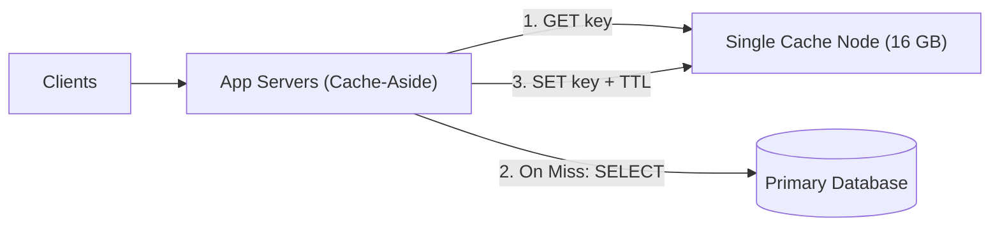
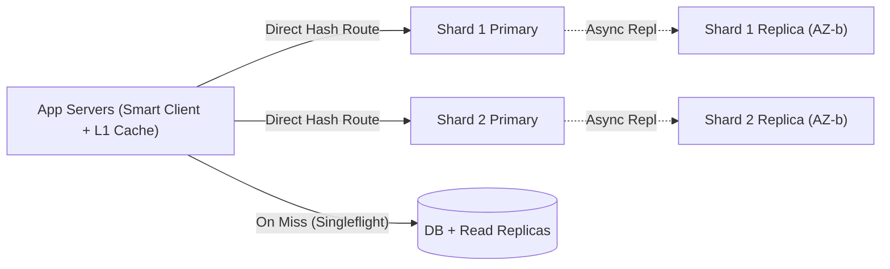
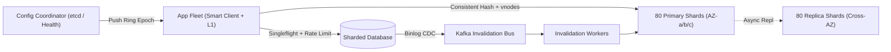
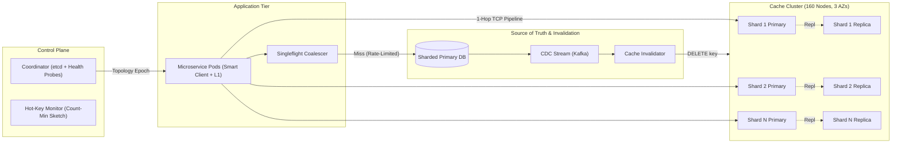
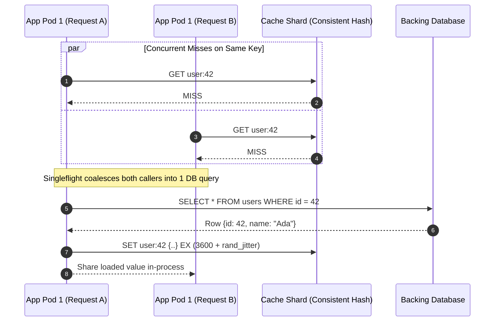

# Distributed Cache: Full System Design Mock Interview, All 9 Steps

> **Difficulty:** Senior / Staff (L5–L7)
> **Prerequisites:** [Previous lesson: Metrics Collection System: Full System Design Mock Interview, 9 Steps](../26-metrics-collection-system/README.md) and the [Interview Framework track](../../21-interview-framework/README.md).
> **Estimated Reading Time:** 25–30 minutes
> **Target Audience:** Engineers practising the full system design interview on a classic prompt: designing a multi-terabyte, sub-millisecond distributed cache cluster shared by microservices.

> [!NOTE]
> **In one line:** A distributed cache **partitions keys across memory nodes using consistent hashing with virtual nodes**, replicates shards for high availability, evicts with LRU/W-TinyLFU, and protects the backing database from stampedes and hot-key skew.

> [!TIP]
> **The Golden Rule:** Treat the cache as disposable acceleration—never the source of truth. Partition with consistent hashing, jitter every TTL, coalesce concurrent misses (singleflight), and protect the backing database with circuit breakers and rate limits.

---

## 1. Clarifying Questions, Functional & Non-Functional Requirements

Open by clarifying consistency, durability, and access patterns. A single Redis/Memcached instance tops out at ~100K–200K RPS and ~64–256 GB of RAM; scaling beyond one machine introduces **partitioning, topology discovery, rebalancing, hot-key skew, and thundering herds**.

### Clarifying Questions & Assumed Answers

| Question | Assumed Answer | Architectural Implication |
| :--- | :--- | :--- |
| **Caching pattern?** | Cache-aside (look-aside) key-value store with TTL | App checks cache first; on miss, loads from DB and populates cache |
| **Consistency model?** | Eventual consistency; stale reads within TTL acceptable | Async replication to replicas; delete-on-write invalidation |
| **Durability?** | Ephemeral (in-memory only); DB is source of truth | No synchronous disk fsync on `SET`; fast recovery via warm-up |
| **Value size & eviction?** | Average 2 KB values (max 1 MB); LRU / LFU eviction when full | Slab allocator or jemalloc to prevent memory fragmentation |
| **Target scale?** | 1M RPS (90% reads, 10% writes), 5 TB working set | Memory-bound (~80 primary shards); sub-2 ms p99 inside VPC |

> Say it aloud: *"Before I draw anything, let me confirm whether we are building an ephemeral cache-aside cluster or a durable KV store, and verify our memory and QPS targets."*

### Functional Requirements

1. **Core KV Operations:** `GET(key)`, `SET(key, value, ttl_sec)`, `DELETE(key)`, and batch `MGET(keys[])` / `MSET()`.
2. **Automatic Expiration & Eviction:** Lazy + active TTL expiration, plus bounded-memory eviction (LRU / W-TinyLFU) when memory hits `maxmemory`.
3. **Online Elastic Scaling:** Add or remove cache nodes with minimal key movement and zero cluster-wide downtime.
4. **High Availability & Failover:** Survive single-node or single-AZ failure by promoting a replica without flooding the backing database.

### Non-Functional Requirements

| Quality | Target | Why It Drives the Design |
| :--- | :--- | :--- |
| **Latency** | p50 < 0.5 ms, p99 < 2 ms | Sits on every critical request path; zero extra proxy hops if possible |
| **Availability** | 99.99% (< 52 min/year) | A cache outage causes a 20x–50x traffic spike to the primary database |
| **Hit Ratio** | > 95% for working set | Directly governs database CPU/IOPS savings |
| **Rebalance Blast Radius** | $\approx 1/N$ keys moved on resize | Modulo hashing (`hash % N`) remaps ~99% of keys and triggers a miss storm |

**Explicitly Out of Scope:** Multi-key ACID transactions, secondary indexing / SQL queries, and cross-region active-active strong consistency.

---

## 2. Back-of-the-Envelope Capacity Estimation

Assumptions: **1,000,000 RPS** (900K `GET`, 100K `SET`/`DELETE`), **5 TB total cached data**, **2 KB average entry** (including key + metadata overhead), **64 GB usable RAM per cache node** (leaving headroom for OS/fragmentation), **100K RPS capacity per node**, and **Replication Factor = 2** (1 primary + 1 replica per shard).

### Memory-Bound vs. Throughput-Bound Sizing

$$
N_{\text{primary (memory)}} = \left\lceil \frac{5\text{ TB}}{64\text{ GB/node}} \right\rceil = \left\lceil \frac{5{,}000\text{ GB}}{64\text{ GB}} \right\rceil = 79\text{ primary nodes}
$$

$$
N_{\text{primary (throughput)}} = \left\lceil \frac{1{,}000{,}000\text{ RPS}}{100{,}000\text{ RPS/node}} \right\rceil = 10\text{ primary nodes}
$$

Memory clearly dominates! With $\text{RF} = 2$ (1 primary + 1 replica per shard, plus 10% headroom for rolling upgrades):

$$
N_{\text{total nodes}} = 79 \times 2 \approx 158\text{ nodes (round to } 160\text{ nodes across 3 AZs)}
$$

### Network Bandwidth

At 1M RPS with 2 KB average payload (90% reads = 900K × 2 KB egress, 10% writes = 100K × 2 KB ingress):

$$
\text{Aggregate Egress} = 900{,}000 \times 2\text{ KB} = 1.8\text{ GB/s} \approx 14.4\text{ Gbps}
$$

Across 80 primary nodes, that is only **~180 Mbps per node**, well within standard 10 Gbps / 25 Gbps cloud NICs.

### Cache Miss Database Load

At a 96% hit rate, 4% of 900K reads/sec hit the database:

$$
\text{DB Read Load} = 900{,}000 \times 0.04 = 36{,}000\text{ QPS}
$$

If hit rate drops to 50% during a cold-start or modulo-hash resize, DB load jumps to **450,000 QPS** (>12x spike)—which is why **consistent hashing** and **stampede protection** are mandatory.

### Capacity Summary Table

| Metric | Formula / Assumption | Result |
| :--- | :--- | :--- |
| **Total Keys** | $5\text{ TB} / 2\text{ KB}$ | **~2.5 Billion keys** |
| **Primary Nodes** | $5{,}000\text{ GB} / 64\text{ GB}$ | **~80 primary shards** |
| **Total Cluster Nodes (RF=2)** | $80 \times 2$ | **160 nodes** |
| **Aggregate Network Egress** | $900\text{K RPS} \times 2\text{ KB} \times 8$ | **14.4 Gbps** (~180 Mbps/node) |
| **Normal DB Miss QPS (96% hit)** | $900\text{K} \times 0.04$ | **36,000 QPS** |

---

## 3. Core API Contracts & Data Model

### Client & Control-Plane APIs

| Interface | Signature / Endpoint | Semantics |
| :--- | :--- | :--- |
| **Read** | `GET(key) -> (value, found)` | Routes to primary (or replica on read-scaling); updates LRU position |
| **Write** | `SET(key, value, ttl_sec) -> ok` | Writes to primary, asynchronously replicates to replica, sets expiry |
| **Invalidate** | `DELETE(key) -> deleted` | Removes key on primary and replica; called after DB mutation |
| **Batch Read** | `MGET(keys[]) -> map[key]value` | Client groups keys by owning shard and pipelines parallel requests |
| **Cluster Topology** | `CLUSTER SLOTS` / `GET /v1/topology` | Returns `(hash_range, primary_ip, replica_ip, epoch)` for smart clients |

### In-Node Data Structures

Inside each cache node, achieving $O(1)$ `GET`, `SET`, `DELETE`, and eviction requires two paired structures:

| Structure | Fields / Implementation | Complexity & Purpose |
| :--- | :--- | :--- |
| **Hash Table** | `key_hash -> *Entry{key, val_ptr, expires_at, prev, next}` | $O(1)$ average lookup, open addressing or chained buckets |
| **Doubly Linked List (LRU)** | `head (MRU) <-> ... <-> tail (LRU)` | $O(1)$ promote-to-head on `GET` and $O(1)$ evict-from-tail when full |
| **Timing Wheel / Min-Heap** | Bucketed expiry timestamps | $O(1)$ background active expiration of dead TTLs |
| **Consistent Hash Ring** | `SortedArray<(uint64 token, node_id)>` (100–200 vnodes/node) | $O(\log(N \cdot V))$ binary search routing in smart client or proxy |

---

## 4. Stage 1 (100 – 1K Users): Baseline Monolith & Single Database

At early scale (100–1,000 users, <5K RPS, <10 GB working set), a **single Redis/Memcached instance** paired with cache-aside logic in the application server is optimal.

### Component-by-Component Build
1. **App Server (Cache-Aside):** Checks the single cache node before querying PostgreSQL; on miss, queries DB and writes back with a jittered TTL.
2. **Single Cache Node:** Holds 16 GB RAM, single-threaded event loop (Redis) or multi-threaded slab allocator (Memcached).
3. **Primary Database:** Handles writes and the ~5% cache-miss read traffic.



### What Breaks at 10K Users / 100K RPS?
- **Memory Ceiling:** Working set exceeds 64–128 GB; vertical scaling becomes prohibitively expensive or hits cloud instance limits.
- **Single Point of Failure:** If the single cache node restarts or crashes, **100% of reads hit PostgreSQL simultaneously**, causing a cascading DB outage.
- **Single-Core Bottleneck (Redis):** One CPU core saturates around 100K–150K RPS, spiking p99 latency.

---

## 5. Stage 2 (10K – 100K Users): Caching, Read Replicas & Async Offload

To scale to 100K+ RPS and 500 GB+ of cached data, we introduce **sharding across multiple nodes**, **per-shard read replicas**, and **client-side routing**.

### Component-by-Component Additions
1. **Partitioned Shards (8–16 Primary Nodes):** Keys are distributed across shards using a hash ring or fixed slot map (like Redis Cluster's 16,384 hash slots).
2. **Async Replica per Shard:** Each primary asynchronously replicates mutations to 1 replica in a separate Availability Zone for fast failover.
3. **Smart Client / Connection Pool:** App servers cache the cluster topology locally, hashing keys directly to the owning shard (1 network hop, no proxy overhead) and refreshing topology on `MOVED` redirects.
4. **Local L1 In-Process Cache (Optional for Hot Configs):** A tiny 100 MB LRU inside each app server with a 5-second TTL absorbs ultra-hot keys.



### What Breaks at 1M+ Users / 5 TB Scale?
- **Topology Gossip Storms:** With 160+ cache nodes and 5,000 app servers, naive all-to-all gossip or polling overwhelms the cluster.
- **Hot-Key Skew:** A single celebrity profile or viral product (`item:999`) hashes to Shard 17, saturating that single node's NIC/CPU while 79 other shards sit at 5% load.
- **Cold-Start / Failover Stampedes:** If Shard 17 dies and failover takes 5 seconds, or if a new shard joins without warm-up, thousands of concurrent misses slam the database.

---

## 6. Stage 3 (1M – 10M+ Users): Sharding, Partitioning & Multi-Region Scale

At 1M RPS and 5 TB across 160 nodes, we add **dedicated coordination**, **consistent hashing with virtual nodes**, **hot-key mitigation**, and **multi-region cache invalidation**.

### Component-by-Component Additions
1. **Dedicated Config / Membership Coordinator (etcd / ZooKeeper):** Stores the authoritative hash ring epoch and node health; pushes topology deltas to proxies or smart clients (eliminating $O(N^2)$ gossip).
2. **Consistent Hashing with Virtual Nodes (150 vnodes/node):** Ensures smooth key distribution (<5% variance) and limits key movement to $\approx 1/N$ when scaling nodes in or out.
3. **Hot-Key Detection & Key Salting / L1:** Nodes track top-K keys via Count-Min Sketch; hot keys are either replicated across $K$ salted keys (`key#0..key#9`) or pushed to app-tier L1 caches.
4. **CDC-Driven Cache Invalidation (Debezium + Kafka):** Instead of relying solely on app-side `DELETE(key)` (which can fail after a DB commit), a Change Data Capture stream asynchronously invalidates stale keys across regions.



---

## 7. Final Full Production Architecture & End-to-End Flows

### Complete Production Architecture



### End-to-End Cache-Aside, Singleflight & Invalidation Sequence



---

## 8. Deep-Dive Bottlenecks & Algorithmic Trade-Offs

### 1. Consistent Hashing vs. Modulo Hashing vs. Hash Slots
- **Modulo Hashing (`hash(k) % N`):** When $N$ changes from 80 to 81, $\approx 80/81 = 98.7\%$ of keys remap to different nodes, causing a catastrophic cluster-wide miss storm.
- **Consistent Hashing with Virtual Nodes:** Map both nodes (with $V = 150$ vnodes each, e.g., `hash("node17#0")`) and keys onto $[0, 2^{64}-1]$. Adding 1 node to 80 moves only $\approx 1/81 = 1.2\%$ of keys, and vnodes keep load variance under 5%.
- **Fixed Hash Slots (Redis Cluster):** 16,384 fixed slots assigned to nodes. Adding a node explicitly migrates a subset of slots. Great for deterministic slot ownership; consistent hashing is cleaner for stateless/ephemeral Memcached-style pools.

### 2. Eviction Policies: LRU vs. W-TinyLFU
- **Classic LRU (Hash Map + Doubly Linked List):** $O(1)$ operations, simple, but suffers from **scan pollution**—a batch job reading 1M cold keys once will evict the hot working set.
- **W-TinyLFU (Window TinyLFU, used in Caffeine):** Combines a tiny 1% LRU admission window with a 99% Segmented LRU main space, gated by a **4-bit Count-Min Sketch** frequency filter. Only items with higher estimated frequency than the eviction victim enter the main space, improving hit rates by 5–15% on skewed workloads.

### 3. Cache Stampede (Thundering Herd) Prevention
When a hot key (`homepage:feed`) expires, 10,000 concurrent requests miss at once and slam the DB. Combine three defenses:
1. **Request Coalescing (Singleflight):** Per-key mutex/future inside the app server ensures only 1 goroutine/thread queries the DB for a given key while others await its result.
2. **TTL Jitter:** Add $\pm 10\%$ random jitter (`ttl + rand(-0.1*ttl, +0.1*ttl)`) so keys populated together don't expire simultaneously.
3. **Probabilistic Early Expiration (XFetch):** Before TTL expires, each read probabilistically refreshes the key early with probability proportional to remaining TTL and recompute time.

### 4. Write Policies Comparison

| Policy | How It Works | Pros | Cons |
| :--- | :--- | :--- | :--- |
| **Cache-Aside (Pick)** | App reads cache; on miss reads DB & sets cache; on write updates DB & deletes cache | Simple, resilient to cache failure, only caches read data | Possible brief race window between concurrent read/write |
| **Write-Through** | App writes to cache, cache synchronously writes to DB | Cache is always fresh | Doubles write latency; caches cold writes nobody reads |
| **Write-Behind** | App writes to cache, cache asynchronously batches writes to DB | Ultra-fast writes | **Data loss risk** if cache node crashes before flush |

---

## 9. Failure Modes, Reliability & Backpressure Mitigations

| Failure Mode | Impact / Symptom | Mitigation |
| :--- | :--- | :--- |
| **Primary Node Crash** | Shard unavailable for 1–5 s; misses hit DB | Coordinator detects heartbeat loss, promotes **Replica**, updates topology; DB protected by **token-bucket rate limiter** |
| **Hot-Key Saturation** | 1 node hits 100% CPU/NIC while cluster is idle | **L1 in-process cache** (5 s TTL) + **Key Salting** (`hotkey#0..9` spread across 10 shards) |
| **Network Partition (Split Brain)** | Two primaries accept conflicting writes | Fencing tokens / epoch numbers from coordinator; minority partition steps down |
| **Memory Fragmentation** | Node OOMs despite 30% free logical space | **Slab allocator** (Memcached) or **jemalloc** with active defragmentation (Redis) |
| **Cache Penetration (Non-Existent Keys)** | Attackers query `user:-1` repeatedly, bypassing cache to DB | **Negative Caching** (cache `NULL` sentinel for 60 s) + **Bloom Filter** in front of DB |

---

## 10. Production War Story & Real-World Reference

### War Story: The Synchronized Midnight TTL Stampede (SEV-1)
- **What Happened:** An e-commerce platform cached its homepage product catalog with a fixed 3600-second TTL populated by a midnight cron job. At 01:00:00 UTC, 40,000 cached keys expired in the exact same second.
- **Cascade:** 120,000 RPS of cache misses bypassed the cache and hit the PostgreSQL primary simultaneously. Connection pools exhausted in 4 seconds, CPU hit 100%, and checkout APIs returned `503` for 22 minutes until engineers manually shed 80% of traffic.
- **Root Cause:** Fixed TTL without jitter, no singleflight coalescing on the app tier, and no circuit breaker/rate limit protecting PostgreSQL from cache-miss floods.
- **Permanent Fix:**
  1. Added $\pm 15\%$ **TTL jitter** to every `SET` call.
  2. Wrapped all DB fallback loaders in **Singleflight** coalescing.
  3. Implemented **stale-while-revalidate** (serve slightly stale value for 30 s while 1 background worker refreshes) and a DB miss-path rate limiter.

**Real-World Reference:** *Scaling Memcache at Facebook* (NSDI 2013 — leases to prevent thundering herds, Gutter pool for failed nodes, Mcrouter), and *Consistent Hashing and Random Trees* (Karger et al., STOC 1997).

---

## 11. Core Component Implementation (4 Languages)

Below is a production-grade **Consistent Hash Ring with Virtual Nodes** in Go, TypeScript, Python, and C#.

````carousel
```go
package distcache

import (
	"crypto/sha256"
	"encoding/binary"
	"fmt"
	"sort"
	"sync"
)

type vnode struct {
	hash uint64
	node string
}

// ConsistentRing maps keys to physical nodes using virtual nodes.
type ConsistentRing struct {
	mu     sync.RWMutex
	vnodes int
	ring   []vnode
}

func NewConsistentRing(nodes []string, vnodes int) *ConsistentRing {
	r := &ConsistentRing{vnodes: vnodes}
	for _, n := range nodes {
		r.addLocked(n)
	}
	r.sortLocked()
	return r
}

func hash64(s string) uint64 {
	sum := sha256.Sum256([]byte(s))
	return binary.BigEndian.Uint64(sum[:8])
}

func (r *ConsistentRing) addLocked(node string) {
	for i := 0; i < r.vnodes; i++ {
		h := hash64(fmt.Sprintf("%s#%d", node, i))
		r.ring = append(r.ring, vnode{hash: h, node: node})
	}
}

func (r *ConsistentRing) sortLocked() {
	sort.Slice(r.ring, func(i, j int) bool { return r.ring[i].hash < r.ring[j].hash })
}

func (r *ConsistentRing) AddNode(node string) {
	r.mu.Lock()
	defer r.mu.Unlock()
	r.addLocked(node)
	r.sortLocked()
}

func (r *ConsistentRing) GetNode(key string) string {
	r.mu.RLock()
	defer r.mu.RUnlock()
	if len(r.ring) == 0 {
		return ""
	}
	h := hash64(key)
	idx := sort.Search(len(r.ring), func(i int) bool { return r.ring[i].hash >= h })
	if idx == len(r.ring) {
		idx = 0 // Wrap around the ring
	}
	return r.ring[idx].node
}
```
<!-- slide -->
```typescript
import { createHash } from "crypto";

interface VNode {
  hash: bigint;
  node: string;
}

export class ConsistentHashRing {
  private ring: VNode[] = [];

  constructor(nodes: string[], private readonly vnodes = 150) {
    for (const node of nodes) {
      this.addNode(node);
    }
  }

  private hash64(input: string): bigint {
    const digest = createHash("sha256").update(input).digest();
    return digest.readBigUInt64BE(0);
  }

  addNode(node: string): void {
    for (let i = 0; i < this.vnodes; i++) {
      this.ring.push({ hash: this.hash64(`${node}#${i}`), node });
    }
    this.ring.sort((a, b) => (a.hash < b.hash ? -1 : a.hash > b.hash ? 1 : 0));
  }

  getNode(key: string): string | undefined {
    if (this.ring.length === 0) return undefined;
    const h = this.hash64(key);
    let lo = 0;
    let hi = this.ring.length - 1;
    while (lo <= hi) {
      const mid = (lo + hi) >>> 1;
      if (this.ring[mid].hash >= h) {
        hi = mid - 1;
      } else {
        lo = mid + 1;
      }
    }
    const idx = lo < this.ring.length ? lo : 0;
    return this.ring[idx].node;
  }
}
```
<!-- slide -->
```python
import bisect
import hashlib
from typing import List, Tuple


class ConsistentHashRing:
    """Consistent hash ring with virtual nodes for O(log(N*V)) key routing."""

    def __init__(self, nodes: List[str], vnodes: int = 150) -> None:
        self.vnodes = vnodes
        self._ring: List[Tuple[int, str]] = []
        self._hashes: List[int] = []
        for node in nodes:
            self.add_node(node)

    @staticmethod
    def _hash64(value: str) -> int:
        digest = hashlib.sha256(value.encode("utf-8")).digest()
        return int.from_bytes(digest[:8], "big")

    def add_node(self, node: str) -> None:
        for i in range(self.vnodes):
            self._ring.append((self._hash64(f"{node}#{i}"), node))
        self._ring.sort(key=lambda item: item[0])
        self._hashes = [item[0] for item in self._ring]

    def get_node(self, key: str) -> str:
        if not self._ring:
            raise ValueError("Hash ring is empty")
        h = self._hash64(key)
        idx = bisect.bisect_left(self._hashes, h) % len(self._ring)
        return self._ring[idx][1]


if __name__ == "__main__":
    before = ConsistentHashRing(["n1", "n2", "n3"])
    after = ConsistentHashRing(["n1", "n2", "n3", "n4"])
    moved = sum(before.get_node(f"k:{i}") != after.get_node(f"k:{i}") for i in range(10000))
    print(f"Keys moved on 3->4 nodes: {moved}/10000 ({moved/100:.1f}%)")
```
<!-- slide -->
```csharp
using System;
using System.Collections.Generic;
using System.Security.Cryptography;
using System.Text;

public sealed class ConsistentHashRing
{
    private readonly int _vnodes;
    private readonly List<(ulong Hash, string Node)> _ring = new();

    public ConsistentHashRing(IEnumerable<string> nodes, int vnodes = 150)
    {
        _vnodes = vnodes;
        foreach (var node in nodes) AddNode(node);
    }

    private static ulong Hash64(string input)
    {
        byte[] hash = SHA256.HashData(Encoding.UTF8.GetBytes(input));
        return BitConverter.ToUInt64(hash, 0);
    }

    public void AddNode(string node)
    {
        for (int i = 0; i < _vnodes; i++)
            _ring.Add((Hash64($"{node}#{i}"), node));
        _ring.Sort((a, b) => a.Hash.CompareTo(b.Hash));
    }

    public string GetNode(string key)
    {
        if (_ring.Count == 0) throw new InvalidOperationException("Ring is empty");
        ulong h = Hash64(key);
        int lo = 0, hi = _ring.Count - 1;
        while (lo <= hi)
        {
            int mid = lo + ((hi - lo) >> 1);
            if (_ring[mid].Hash >= h) hi = mid - 1;
            else lo = mid + 1;
        }
        return _ring[lo < _ring.Count ? lo : 0].Node;
    }
}
```
````

---

## 12. Verification, Load Testing & CLI Diagnostics

```bash
# 1. Verify consistent hashing key movement vs modulo hashing
python3 -c '
import hashlib, bisect
h = lambda s: int.from_bytes(hashlib.sha256(s.encode()).digest()[:8], "big")
ring = lambda ns: sorted((h(f"{n}#{i}"), n) for n in ns for i in range(150))
r3, r4 = ring(["n1","n2","n3"]), ring(["n1","n2","n3","n4"])
k3, k4 = [x[0] for x in r3], [x[0] for x in r4]
owner = lambda r, k, s: r[bisect.bisect_left(k, h(s)) % len(r)][1]
moved = sum(owner(r3,k3,f"u:{i}") != owner(r4,k4,f"u:{i}") for i in range(10000))
print(f"Consistent hash moved: {moved/100:.1f}% (expected ~25%)")
'

# 2. Check Redis Cluster shard health, hit ratio, and memory fragmentation
redis-cli -h 127.0.0.1 -p 6379 info stats | grep -E "keyspace_hits|keyspace_misses|evicted_keys"
redis-cli -h 127.0.0.1 -p 6379 info memory | grep -E "used_memory_human|mem_fragmentation_ratio"

# 3. Detect hot keys in Redis 7+ using LFU/hotkeys sampling
redis-cli --hotkeys -i 0.1

# 4. Benchmark cluster throughput & p99 latency with memtier_benchmark
memtier_benchmark -s 127.0.0.1 -p 6379 --cluster-mode -t 4 -c 50 --ratio=1:9 --key-pattern=G:G
```

---

## 13. Common Interview Mistakes & Red Flags

1. **Using `hash(key) % N` for Sharding:** Remaps ~99% of keys when adding a single node, triggering a database-crushing miss storm.
2. **Omitting Virtual Nodes:** Without vnodes, physical nodes on a consistent hash ring get wildly uneven key ranges (up to 3x–5x skew).
3. **Ignoring Cache Stampedes:** Not mentioning singleflight coalescing, TTL jitter, or probabilistic early refresh when discussing hot-key expiry.
4. **Treating Cache as Durable Storage:** Putting unpersisted state (like shopping carts or financial balances) only in an LRU cache where eviction silently loses data.
5. **Forgetting Cache Penetration:** Failing to handle repeated queries for non-existent keys (`NULL` caching or Bloom filters).
6. **Updating Cache on DB Write Instead of Deleting:** Concurrent `UPDATE` + `SET` races leave permanently stale data until TTL expires; `DELETE` on write is safer.

---

## 14. Key Terminology & Glossary

| Term | Definition |
| :--- | :--- |
| **Consistent Hashing** | Hashing both nodes and keys onto a circular $[0, 2^{64}-1]$ ring so resizing moves only $\approx 1/N$ of keys. |
| **Virtual Nodes (vnodes)** | Assigning each physical node 100–200 positions on the hash ring to smooth load distribution and rebalance blast radius. |
| **Cache-Aside** | Pattern where the application checks the cache, falls back to the DB on miss, and populates the cache. |
| **Cache Stampede** | Concurrent misses on a freshly expired hot key all hitting the backing DB simultaneously (thundering herd). |
| **Singleflight** | In-process request coalescing ensuring only one caller fetches a missing key from the DB while others share the result. |
| **Cache Penetration** | Queries for keys that do not exist in cache *or* DB, bypassing cache protection unless negatively cached or Bloom-filtered. |
| **W-TinyLFU** | Modern eviction policy combining a small LRU admission window with a Count-Min Sketch frequency filter. |
| **Key Salting** | Appending `#0..#K` to a hot key so its reads spread across $K$ shards instead of overloading one node. |
| **Smart Client** | Cache client that holds the cluster hash ring locally and routes requests in 1 hop directly to the owning shard. |
| **TTL Jitter** | Adding random variance to expiration times to prevent synchronized mass-expiry spikes. |

---

## 15. Interview Follow-Up Questions (12 Q&As)

### Basic Conceptual Questions

<details>
<summary><strong>Q1: Why use consistent hashing instead of `hash(key) % N`? [BASIC]</strong></summary>

With `hash(key) % N`, changing $N$ by even 1 node remaps nearly $100\%$ of keys, causing a massive wave of cache misses that overwhelms the database. Consistent hashing remaps only $\approx 1/N$ of keys, keeping hit rates stable during scaling or node failures.

</details>

<details>
<summary><strong>Q2: What problem do virtual nodes solve on a hash ring? [BASIC]</strong></summary>

With few physical nodes, random hash placement creates uneven arc lengths (one node might own 40% of the ring). Giving each physical node 100–200 virtual nodes averages out the arc lengths (<5% variance) and spreads a failed node's load evenly across all survivors.

</details>

<details>
<summary><strong>Q3: How does a node achieve O(1) GET, SET, and LRU eviction? [BASIC]</strong></summary>

By pairing a **hash table** (mapping `key -> doubly-linked-list node`) with a **doubly linked list** ordered by recency. `GET` looks up the node in $O(1)$ and moves it to the head in $O(1)$; eviction pops the tail in $O(1)$.

</details>

<details>
<summary><strong>Q4: Why is `DELETE(key)` preferred over `SET(key, new_val)` after a database update? [BASIC]</strong></summary>

If two concurrent writers update the DB and then call `SET` out of order, the slower writer overwrites the cache with stale data. Calling `DELETE(key)` (or better, `DELETE` + delayed double-delete / CDC invalidation) forces the next reader to load the latest state cleanly.

</details>

### Scenario-Based Architecture Questions

<details>
<summary><strong>Q5: A single celebrity profile key receives 200K RPS and saturates one shard. How do you fix it? [SCENARIO]</strong></summary>

Apply two layers: (1) add a short-TTL (e.g., 2–5 s) **L1 in-process cache** inside each app server so 99% of reads never leave the app pod; (2) for keys that must stay centralized, use **key salting** (`celeb:1#0` .. `celeb:1#19`) to replicate the hot key across 20 shards and pick a random salt on read.

</details>

<details>
<summary><strong>Q6: A shard primary crashes. Walk through what happens in the next 10 seconds. [SCENARIO]</strong></summary>

(1) Health probes from the coordinator (etcd/Sentinel) detect missed heartbeats within ~2–3 s; (2) the coordinator promotes the shard's **Replica** to primary and bumps the topology epoch; (3) smart clients refresh topology on connection error/redirect; (4) during the 2–3 s gap, requests either read from the replica (if eventual consistency allows) or fall back to the DB behind a **rate limiter / circuit breaker**.

</details>

<details>
<summary><strong>Q7: Attackers are flooding `GET /users/random-nonexistent-id` and crashing your DB. How do you stop it? [SCENARIO]</strong></summary>

This is **cache penetration**. Mitigate with: (1) **Negative Caching**—store a `NULL` sentinel in the cache with a short 30–60 s TTL; (2) a **Bloom Filter** (or Cuckoo Filter) in the app/gateway tier containing all valid IDs, rejecting guaranteed-missing IDs in microseconds before touching cache or DB.

</details>

<details>
<summary><strong>Q8: You need to bring up a brand-new 80-node cache cluster. How do you avoid a cold-start DB meltdown? [SCENARIO]</strong></summary>

Never flip 100% of traffic onto an empty cache. (1) **Pre-warm** the cluster by replaying the top-K hot keys from the previous cluster's access logs or DB read replicas; (2) **canary-shift traffic** gradually (1% -> 5% -> 25% -> 100%); (3) enforce **per-pod DB fallback rate limits** so cold misses shed gracefully instead of crashing the DB.

</details>

### Advanced & Tricky Interview Questions

<details>
<summary><strong>Q9: Smart client (direct 1-hop) vs. Proxy tier (Twemproxy/Mcrouter)—when do you pick each? [TRICKY]</strong></summary>

**Smart clients** save 1 network hop (~0.3–0.5 ms) and scale with the app tier, making them ideal for homogeneous stacks (e.g., Go/Java). A **Proxy tier** (like Facebook's Mcrouter) is better when you have polyglot microservices (Python, Node, PHP) that lack consistent client libraries, or when you need connection-pooling multiplexing so 10,000 app pods don't open 10,000 × 160 = 1.6M TCP connections to the cache.

</details>

<details>
<summary><strong>Q10: How do Facebook's Memcache "leases" solve both stale sets and thundering herds? [TRICKY]</strong></summary>

On a cache miss, Memcache issues a **64-bit lease token** to the first client and returns a "wait & retry" hint to concurrent missers for the next few milliseconds (coalescing the herd). If a concurrent `DELETE` occurs while the first client is querying the DB, Memcache invalidates the lease token so the client's delayed `SET` is rejected—preventing stale data from being written back.

</details>

<details>
<summary><strong>Q11: Why can a cache node run out of memory even when `SUM(key+value sizes) < maxmemory`? [TRICKY]</strong></summary>

**Slab calcification / memory fragmentation.** In Memcached, memory is divided into fixed-size slab classes (e.g., 128 B, 256 B, 1 KB). If your workload shifts from 128 B items to 1 KB items, old 128 B slabs stay locked and cannot serve 1 KB allocations unless slab reassignment is enabled. In Redis, frequent variable-size allocations fragment `jemalloc` pages (`mem_fragmentation_ratio > 1.5`).

</details>

<details>
<summary><strong>Q12: How do you maintain cache consistency across two geographic regions? [TRICKY]</strong></summary>

Do not replicate cache writes directly across WANs (race conditions). Instead, replicate the **source-of-truth DB** across regions, and run a **CDC (Change Data Capture) pipeline** (e.g., MySQL binlog -> Kafka -> regional invalidator) that issues `DELETE(key)` to the local cache cluster in each region whenever a row mutates.

</details>

---

## 16. One-Page Master Cheat Sheet

```text
+-----------------------------------------------------------------------------+
|              DISTRIBUTED CACHE (1M RPS, 5 TB, <2ms P99)                     |
+-----------------------------------------------------------------------------+
| 1. SIZING       : 5 TB / 64 GB = ~80 Primaries x 2 (RF=2) = 160 Nodes       |
| 2. PARTITIONING : Consistent Hashing + 150 vnodes/node -> ~1/N key movement |
| 3. NODE ENGINE  : Hash Table + Doubly Linked List (O(1) LRU / W-TinyLFU)    |
| 4. WRITE POLICY : Cache-Aside (Read: Cache->DB->Set; Write: DB->Delete)     |
| 5. STAMPEDES    : Singleflight + TTL Jitter (±15%) + XFetch / Leases        |
| 6. HOT KEYS     : L1 In-Process Cache (5s) + Key Salting (key#0..K)         |
| 7. PENETRATION  : Negative Caching (NULL + 60s TTL) + Bloom Filter          |
| 8. FAILOVER     : Cross-AZ Replica Promotion + Rate-Limited DB Fallback     |
+-----------------------------------------------------------------------------+
```

| Problem | Solution | Key Metric |
| :--- | :--- | :--- |
| **Resizing Miss Storm** | Consistent Hashing + vnodes | $\approx 1/N$ keys moved |
| **Thundering Herd** | Singleflight + TTL Jitter | 1 DB query per expired key |
| **Hot-Key Overload** | L1 Cache + Key Salting | Spreads 200K RPS across $K$ shards |
| **Stale Reads on Race** | `DELETE` on write + CDC invalidation | Sub-second eventual consistency |

---

## Further Reading

- Karger et al., *Consistent Hashing and Random Trees* (STOC 1997).
- Nishtala et al., *Scaling Memcache at Facebook* (NSDI 2013).
- Einziger et al., *TinyLFU: A Highly Efficient Cache Admission Policy* (ACM TOS 2017).

---

## Next

Continue with [API Gateway: Full System Design Mock Interview, All 9 Steps](../28-api-gateway/README.md).
