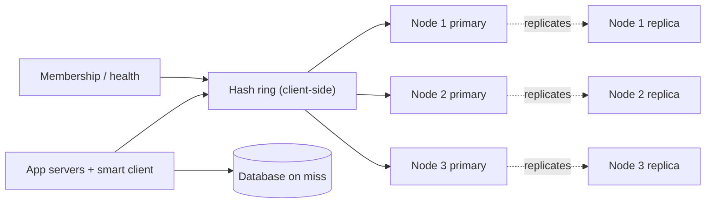

# Distributed Cache: Full System Design Mock Interview, All 9 Steps

> **Prerequisites:** [Previous lesson: Metrics Collection System: Full System Design Mock Interview, 9 Steps](../26-metrics-collection-system/README.md) and the [Interview Framework track](../../21-interview-framework/README.md).
> **Estimated Reading Time:** 15–20 minutes
> **Target Audience:** Engineers practising the full 9-step system design interview on a classic prompt: a cache cluster that many services share, scaling past one machine.

> [!NOTE]
> **In one line:** A distributed cache **spreads keys across many nodes with consistent hashing** so adding or losing a node moves only a small part of the data, while keeping reads in memory-speed.

> [!TIP]
> **The Golden Rule:** Route each key to a node with consistent hashing, replicate for availability, evict with LRU, and treat the cache as disposable: the source of truth stays in the database.

---

## Step 1. Clarify the Problem

Open with questions, not boxes. Beyond a single Redis, the questions are partitioning, rebalancing, replication, hot keys and what happens on a miss storm.

**Questions to ask the interviewer, and the answer we assume:**

| Question | Assumed answer |
| :--- | :--- |
| Use? | Read-through cache for services, key-value with TTL |
| Consistency? | Eventual; stale reads acceptable within TTL |
| Durability? | None required; it is a cache |
| Latency? | Sub-millisecond in the data centre |
| Scale? | 1M requests per second, 5 TB of cached data |

> Say it aloud: *"Before I draw anything, let me confirm the scope and the numbers."* That one sentence earns the first minutes of the interview.

---

## Step 2. Functional and Non-Functional Requirements

**Functional (what the system does):**

- Get, set and delete keys with a TTL.
- Scale out and in without downtime.
- Evict least-recently-used entries when full.
- Survive node failures.

**Non-functional (how well it does it):**

| Quality | Target | Why it drives the design |
| :--- | :--- | :--- |
| Latency | p99 under 2 ms | On every request path |
| Availability | 99.99% | A cache outage hits the database |
| Scalability | Add nodes online | Growth |
| Hit rate | Above 95% | Protects the database |

---

## Step 3. Scope: In and Out

**In scope:** Partitioning, replication, eviction, client routing, hot keys, miss storms.

**Out of scope (say it explicitly, then move on):**

- Persistent storage guarantees.
- Strong consistency across replicas.
- Query features beyond key lookup.

---

## Step 4. Capacity Estimation

Assumptions: 1M requests per second, 5 TB of data, 64 GB of usable memory per node, 1 replica per shard.

| Quantity | Calculation | Result |
| :--- | :--- | :--- |
| Primary nodes for data | `tb * 1000 / node_gb` | **78.1 nodes** |
| Nodes for throughput | `rps / node_rps` | **10 nodes** |
| Total nodes with replicas | `primary_nodes_for_data * replicas` | **156 nodes** |

**What the numbers tell you:** Memory, not throughput, sets the size: about 78 primary nodes to hold 5 TB, doubled to 156 with a replica each. Throughput needs only 10 nodes, so there is ample request headroom per node.

---

## Step 5. API Design

| Endpoint | Purpose | Notes |
| :--- | :--- | :--- |
| `GET key` | Read | Routed to the key's owner. |
| `SET key value TTL` | Write | Primary then async replica. |
| `DELETE key` | Invalidate | Used after database writes. |
| Cluster `topology` | Which node owns which range | Clients cache it and refresh on redirect. |

Smart clients hold the hash ring and talk directly to the owning node, which avoids an extra proxy hop.

---

## Step 6. Data Model

| Entity / Store | Key fields | Why this store |
| :--- | :--- | :--- |
| Hash ring with virtual nodes | Each node owns many ring positions | Even distribution and smooth rebalance |
| Node memory | Hash table + LRU list | O(1) get, set and evict |
| Replica per shard | Copy of the primary's keys | Failover |
| Config/membership service | Node list and health | Gossip or coordinator |

Virtual nodes (100 or more per physical node) even out the load and make node addition move small, evenly spread slices of keys.

---

## Step 7. High-Level Architecture



**Walk the diagram in this order:** the client hashes the key onto the ring, talks to the owning node (falling back to its replica), and on a miss reads the database and fills the cache.

---

## Step 8. Deep Dives and Bottlenecks

### 1. Consistent hashing

Hash keys and nodes onto a ring; a key belongs to the next node clockwise. Adding a node takes over only the range between it and its predecessor, so about 1/N of keys move, not all of them as with `hash(key) % N`. Virtual nodes smooth out the distribution and let a faster node take more points.

### 2. Eviction, TTL and miss storms

Each node uses a hash map plus a doubly linked list for O(1) LRU. TTLs expire stale entries. When a hot key expires, thousands of requests may hit the database at once (cache stampede). Prevent it with request coalescing (one loader per key), jittered TTLs and refreshing popular keys early.

### 3. Hot keys and failures

A single very popular key overloads its node. Replicate hot keys to several nodes or add a local in-process cache in the clients. On node failure the replica is promoted and the ring updates; during the gap, clients treat errors as misses and go to the database, which must be protected with rate limits.

---

## Step 9. Trade-offs, Failures and Security

**Trade-offs to state aloud:**

| Decision | Option A | Option B | Pick and why |
| :--- | :--- | :--- | :--- |
| Partitioning | Modulo hashing | Consistent hashing | Consistent hashing: minimal remapping on resize |
| Write policy | Write-through | Cache-aside | Cache-aside: simple, with delete on write |
| Replication | Synchronous | Asynchronous | Asynchronous: speed, accepting small staleness |

**Failure modes and mitigations:**

| Failure | What users see | Mitigation |
| :--- | :--- | :--- |
| Node loss | Misses and DB load | Replica promotion, rate-limit the database |
| Stampede on hot key expiry | DB overload | Coalescing, jitter, early refresh |
| Network partition | Split view of the ring | Short timeouts and treating failures as misses |

**Security and abuse:** Keep the cache inside a private network, require authentication and TLS, avoid caching sensitive data without encryption, and namespace keys per tenant.

---

## Runnable Example: Consistent hashing with virtual nodes

Adding a fourth node should move only about a quarter of the keys.

```python
import hashlib, bisect

def h(s):
    return int(hashlib.md5(s.encode()).hexdigest(), 16)

class Ring:
    def __init__(self, nodes, vnodes=100):
        self.ring = sorted((h(f"{n}#{i}"), n) for n in nodes for i in range(vnodes))
        self.keys = [k for k, _ in self.ring]

    def owner(self, key):
        i = bisect.bisect(self.keys, h(key)) % len(self.ring)
        return self.ring[i][1]

keys = [f"user:{i}" for i in range(10000)]
before = Ring(["n1", "n2", "n3"])
after = Ring(["n1", "n2", "n3", "n4"])
moved = sum(before.owner(k) != after.owner(k) for k in keys)
print("moved:", moved, "of", len(keys), f"({moved / len(keys):.0%})")
mod_moved = sum(h(k) % 3 != h(k) % 4 for k in keys)
print("modulo hashing would move:", f"{mod_moved / len(keys):.0%}")
```

Output (produced by running this exact code):

```text
moved: 2709 of 10000 (27%)
modulo hashing would move: 75%
```

Consistent hashing moves roughly a quarter of the keys when a fourth node joins, while modulo hashing would remap about three quarters of them and cause a wave of cache misses.

---

## Common Mistakes

- `hash(key) % N` partitioning.
- No replicas, so a node loss floods the database.
- Same TTL for every key (synchronised expiry).
- Ignoring hot keys.
- Treating the cache as a source of truth.

---

## Interview Questions and Answers

<details>
<summary><strong>Q1: Why consistent hashing?</strong></summary>

Adding or removing a node remaps only about 1/N of the keys instead of nearly all of them, so resizing does not cause a miss storm.

</details>

<details>
<summary><strong>Q2: What are virtual nodes?</strong></summary>

Many ring positions per physical node, which balances load and spreads the moved keys across all nodes.

</details>

<details>
<summary><strong>Q3: How do you prevent a cache stampede?</strong></summary>

Coalesce loads per key, jitter TTLs, and refresh hot keys before they expire.

</details>

<details>
<summary><strong>Q4: How do you handle hot keys?</strong></summary>

Replicate them to several nodes or add a small client-side cache.

</details>

<details>
<summary><strong>Q5: What happens when a node dies?</strong></summary>

The replica is promoted, the ring updates, and clients treat errors as misses with the database protected by rate limiting.

</details>

---

## One-Page Cheat Sheet

| Step | What to say or draw |
| :--- | :--- |
| Clarify | Read-through cache, TTL, eventual consistency |
| Capacity | ~78 primaries for 5 TB, ~156 with replicas |
| API | get, set, delete, topology |
| Data | Hash ring with vnodes, LRU per node, replicas |
| Deep dive | Consistent hashing, stampedes, hot keys |
| Trade-off | Cache-aside, async replication |

---

## Further Reading

- Karger et al., *Consistent Hashing and Random Trees* (STOC 1997).
- Facebook, *Scaling Memcache at Facebook* (NSDI 2013).

---

## Next

Continue with [API Gateway: Full System Design Mock Interview, All 9 Steps](../28-api-gateway/README.md).
