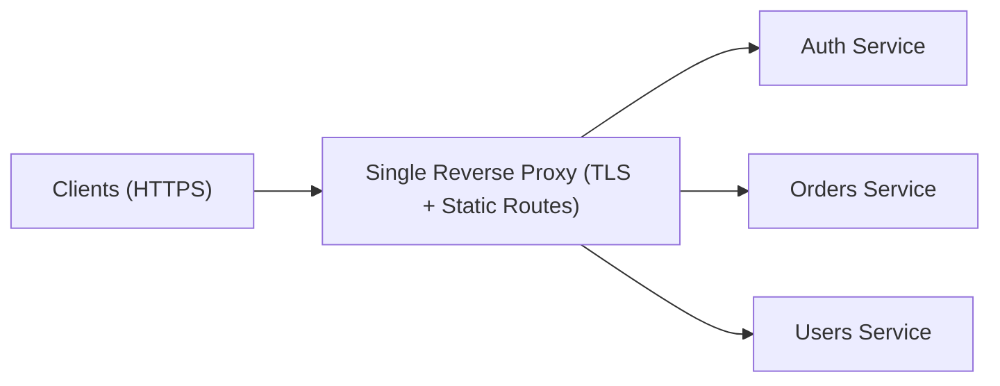
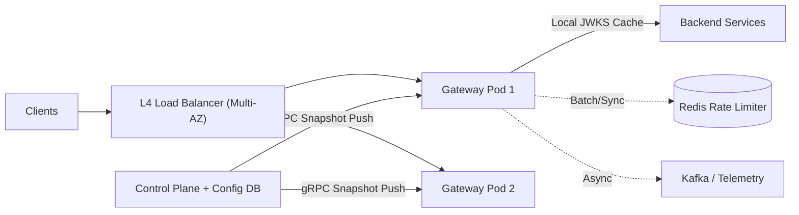
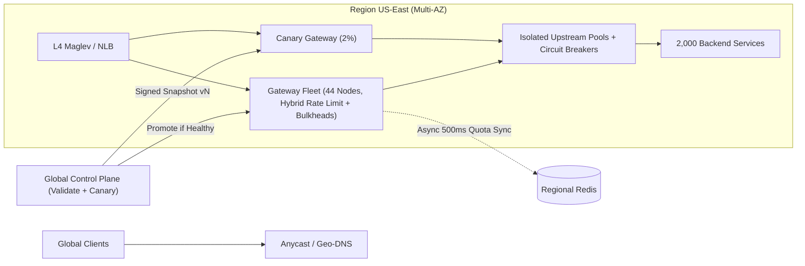
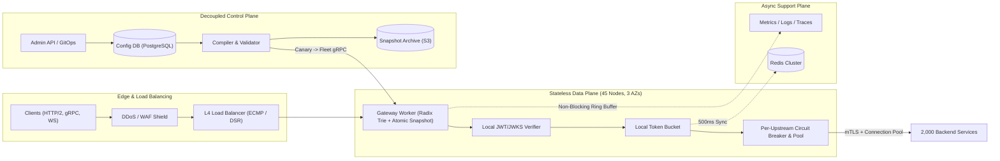
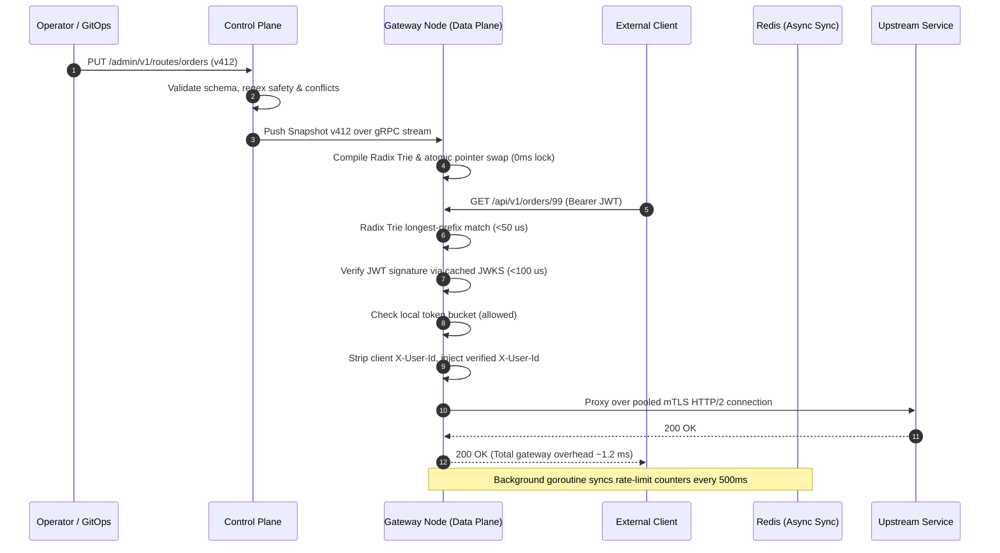

# API Gateway: Full System Design Mock Interview, All 9 Steps

> **Difficulty:** Senior / Staff (L5–L7)
> **Prerequisites:** [Previous lesson: Distributed Cache: Full System Design Mock Interview, All 9 Steps](../27-distributed-cache/README.md) and the [Interview Framework track](../../21-interview-framework/README.md).
> **Estimated Reading Time:** 25–30 minutes
> **Target Audience:** Engineers practising the full system design interview on a classic prompt: a high-throughput, low-latency north-south entry point that routes, authenticates, rate-limits, and protects thousands of backend services.

> [!NOTE]
> **In one line:** An API gateway is **a stateless reverse proxy driven by a decoupled control plane**: every external request passes through it for TLS termination, radix-trie routing, local JWT auth, rate limiting, and resilience policies without adding business logic.

> [!TIP]
> **The Golden Rule:** Strictly separate the **Data Plane** (stateless, C++/Rust/Go proxies with immutable in-memory routing snapshots) from the **Control Plane** (validated, versioned, canary-rolled config). If the control plane dies, the data plane must keep serving traffic indefinitely.

---

## 1. Clarifying Questions, Functional & Non-Functional Requirements

Open by clarifying what sits *inside* the gateway versus what belongs in a Backend-for-Frontend (BFF) or service mesh. Because the gateway sits on the critical path of **every** external request, every millisecond of added latency and every single point of failure is magnified across the entire company.

### Clarifying Questions & Assumed Answers

| Question | Assumed Answer | Architectural Implication |
| :--- | :--- | :--- |
| **Traffic direction?** | North-south (external clients $\rightarrow$ internal services) | Distinct from east-west service mesh (Envoy sidecars) |
| **Protocols?** | HTTP/1.1, HTTP/2, HTTP/3 (QUIC), gRPC, WebSockets | Event-driven non-blocking I/O (epoll/kqueue) + HTTP/2 multiplexing |
| **Core policies?** | Routing, JWT/API-key auth, rate limiting, circuit breaking, telemetry | Modular filter/middleware pipeline executing in <5 ms |
| **Config updates?** | Live zero-downtime updates across 2,000 backend services | Control plane compiles & pushes immutable snapshots with atomic swap |
| **Target scale?** | 500K RPS sustained (1.5M burst), 2,000 services, 20,000 routes | ~30–40 stateless gateway nodes across multiple AZs |

> Say it aloud: *"Before I draw anything, let me confirm our latency budget, protocol mix, and whether business-logic aggregation is out of scope."*

### Functional Requirements

1. **Dynamic Request Routing:** Match incoming requests by `(host, method, longest-path-prefix, headers)` and proxy to healthy upstream service endpoints.
2. **Authentication & Authorization:** Verify JWT signatures (via cached JWKS) or API keys, enforce route-level scopes, and inject trusted identity headers (`X-User-Id`, `X-Tenant-Id`) while stripping untrusted client headers.
3. **Traffic Management & Resilience:** Enforce per-tenant/per-IP rate limits, request/idle timeouts, bounded retries (with retry budgets), and per-upstream circuit breakers.
4. **Live Control Plane:** Validate, version, canary-rollout, and atomically swap route/policy configurations without dropping active TCP/HTTP2 connections.
5. **Observability:** Emit structured access logs, RED metrics (Rate, Errors, Duration), and W3C Trace-Context headers (`traceparent`) asynchronously.

### Non-Functional Requirements

| Quality | Target | Why It Drives the Design |
| :--- | :--- | :--- |
| **Added Latency** | p50 < 1 ms, p99 < 5 ms | Paid on every single API call across the platform |
| **Availability** | 99.999% (< 5.2 min/year) | Gateway outage = total company outage |
| **Fault Isolation** | Bad config or slow upstream cannot crash gateway | Staged config validation + per-upstream bulkheads/circuit breakers |
| **Horizontal Scale** | Linear scaling, zero shared local state | Stateless data-plane nodes behind Anycast / L4 load balancers |

**Explicitly Out of Scope:** Response aggregation/orchestration (BFF), east-west service-to-service mesh, and developer portal UI.

---

## 2. Back-of-the-Envelope Capacity Estimation

Assumptions: **500,000 RPS sustained** (1.5M RPS peak burst), **2 KB average combined request + response payload**, **20,000 routes across 2,000 services**, and a single modern gateway node (e.g., 16 vCPU Envoy/Go/Nginx) handling **25,000 RPS** at 50% target CPU utilization (leaving headroom for TLS handshakes and burst absorption).

### Compute & Fleet Sizing

$$
N_{\text{nodes (sustained)}} = \frac{500{,}000\text{ RPS}}{25{,}000\text{ RPS/node}} = 20\text{ nodes}
$$

To survive a full Availability Zone loss (3 AZs $\rightarrow$ lose 33% capacity) and absorb 3x burst traffic:

$$
N_{\text{nodes (provisioned)}} = 20 \times 1.5\text{ (AZ loss)} \times 1.5\text{ (burst headroom)} \approx 45\text{ nodes (15 per AZ)}
$$

### Network Bandwidth & Connection Concurrency

$$
\text{Aggregate Throughput} = 500{,}000\text{ RPS} \times 2\text{ KB} \times 8\text{ bits} = 8\text{ Gbps}
$$

Assuming average client-to-gateway + upstream duration is 40 ms, Little's Law gives concurrent active requests:

$$
L = \lambda \times W = 500{,}000 \times 0.04\text{ s} = 20{,}000\text{ concurrent requests}
$$

With HTTP/1.1 keep-alive and HTTP/2, each gateway node holds ~5K–15K idle/active TLS connections ($\approx 2\text{ GB}$ kernel socket buffer + TLS session state).

### Control-Plane Snapshot Size

20,000 routes × ~1 KB compiled JSON/Protobuf per route = **~20 MB** uncompressed (~3 MB zstd-compressed). Every gateway node easily holds the entire routing table in L3/RAM!

### Capacity Summary Table

| Metric | Formula / Assumption | Result |
| :--- | :--- | :--- |
| **Sustained / Peak RPS** | $500\text{K}$ sustained, $3\times$ burst | **500K / 1.5M RPS** |
| **Gateway Fleet Size** | $500\text{K} / 25\text{K} \times \text{AZ & burst headroom}$ | **45 nodes (15 per AZ)** |
| **Network Bandwidth** | $500\text{K} \times 2\text{ KB} \times 8$ | **8 Gbps** (~180 Mbps/node) |
| **Compiled Route Table** | $20{,}000\text{ routes} \times 1\text{ KB}$ | **20 MB** in RAM |
| **Concurrent In-Flight** | $500{,}000 \times 0.04\text{ s}$ (Little's Law) | **20,000 active requests** |

---

## 3. Core API Contracts & Data Model

### Control-Plane & Data-Plane Contracts

| Plane | Endpoint / Interface | Purpose & Guarantees |
| :--- | :--- | :--- |
| **Data Plane** | `* /*` (Any HTTP/gRPC) | Matches `(Host, Method, Path)` in radix trie, runs auth/rate-limit filters, proxies upstream |
| **Control Plane** | `PUT /admin/v1/routes/{id}` | Upserts route definition; runs schema + dry-run conflict validation before commit |
| **Control Plane** | `POST /admin/v1/snapshots/publish` | Compiles immutable snapshot `vN`, pushes to canary gateways (5%) then full fleet |
| **Control Plane** | `POST /admin/v1/snapshots/rollback` | Instant pointer revert to `v(N-1)` across all gateways in <2 seconds |
| **Health** | `GET /_healthz` | L4 LB health check (verifies listener + valid snapshot loaded) |

### Data Model

| Store / Artifact | Key Fields | Why This Store |
| :--- | :--- | :--- |
| **Control-Plane DB (PostgreSQL)** | `route_id`, `version`, `host`, `path_prefix`, `upstream_cluster`, `timeout_ms`, `rate_limit_policy`, `author` | ACID transactions, audit log, and optimistic locking on config edits |
| **Snapshot Object Store (S3)** | `snapshot_v412.pb.zst` + SHA-256 checksum | Immutable versioned artifacts for fast rollback & cold-start bootstrap |
| **In-Memory Snapshot (Gateway)** | Compiled **Radix Trie** + `UpstreamPool[]` + `JWKS` cache | Zero-allocation lock-free reads via atomic pointer swap (`atomic.Pointer`) |
| **Rate-Limit Store (Redis Cluster)** | `rl:{tenant}:{route}:{window_ts} -> count` | Shared sliding-window/token-bucket counters for strict global limits |

---

## 4. Stage 1 (100 – 1K Users): Baseline Monolith & Single Database

At early startup scale (100–1,000 users, <1K RPS, 5–10 backend services), a single **Nginx / Caddy / Envoy** reverse proxy with static configuration checked into Git is simple and reliable.

### Component-by-Component Build
1. **TLS & Reverse Proxy:** Terminates HTTPS (Let's Encrypt) and forwards requests to backend services based on static `location /api/...` blocks.
2. **Basic Auth / Rate Limit:** Simple in-memory IP rate limiting (`limit_req_zone`) and JWT signature check.
3. **Static Upstream List:** Hardcoded or DNS-backed upstream IPs.



### What Breaks at 10K Users / 50K RPS?
- **Single Point of Failure:** One gateway instance means a kernel panic, deploy, or AZ outage drops 100% of external traffic.
- **Reload Storms:** Editing static config and running `nginx -s reload` across nodes manually causes config drift and drops long-lived WebSocket/gRPC connections.
- **Per-Node Rate Limit Drift:** Local in-memory rate limits don't coordinate across nodes, allowing an attacker to multiply their quota by the number of gateway instances.

---

## 5. Stage 2 (10K – 100K Users): Caching, Read Replicas & Async Offload

To scale to 50K–100K RPS and 100+ services, we introduce **stateless horizontal scaling**, **centralized config management**, **cached auth**, and **shared rate limiting**.

### Component-by-Component Additions
1. **L4 Load Balancer (NLB / HAProxy) + Stateless Gateway Pool:** Distributes TCP connections across 6–10 gateway pods across 3 AZs using consistent-hash / least-conn balancing.
2. **Control Plane + Config DB:** Operators push route changes via API/GitOps; the Control Plane validates and pushes snapshots over gRPC (xDS-style) to gateways.
3. **Local JWKS & API-Key Cache:** Gateways cache Identity Provider public keys (JWKS) in RAM (refreshing every 5 min) to verify JWTs locally in ~50 µs instead of calling the Auth service.
4. **Redis Rate-Limit Cluster + Async Telemetry:** Shared Redis counters for strict tenant rate limits; access logs and metrics buffer in memory and flush asynchronously to Kafka/OTel.



### What Breaks at 1M+ Users / 500K RPS?
- **Redis Rate-Limit Bottleneck:** Doing a synchronous `EVALSHA` network call to Redis on *every* 500K RPS request adds 1–2 ms p99 latency and makes Redis a hard critical-path dependency.
- **Thundering Herd on Upstream Slowdowns:** If `Orders Service` slows down from 20 ms to 5 s, all 45 gateway nodes exhaust their connection pools waiting on Orders, starving healthy services like `Auth` (head-of-line / resource exhaustion).
- **Bad Config Blast Radius:** Pushing a regex typo or wildcard route to all 45 gateways simultaneously takes down the entire platform.

---

## 6. Stage 3 (1M – 10M+ Users): Sharding, Partitioning & Multi-Region Scale

At 500K–1.5M RPS and 2,000+ backend services, we add **hybrid local+async rate limiting**, **per-upstream bulkheads & circuit breakers**, **canary config rollouts**, and **multi-region Anycast DNS/BGP routing**.

### Component-by-Component Additions
1. **Hybrid Token-Bucket Rate Limiting:** Gateways enforce a **local in-memory token bucket** (0 µs network cost) and asynchronously sync quotas with Redis every 500 ms (or fall back to local-only fail-open if Redis is unreachable).
2. **Per-Upstream Bulkheads & Circuit Breakers:** Each upstream service gets an isolated connection pool, max-pending-requests cap, and adaptive circuit breaker (trips on >50% 5xx or timeout rate), protecting healthy services from noisy neighbors.
3. **Canary Control Plane (xDS / gRPC Streaming):** Config changes roll out to 1 canary gateway (2% traffic) for 3 minutes; automated error-budget checks must pass before rolling out to the remaining 44 nodes.
4. **Global Anycast / Geo-DNS + Regional Gateways:** Users terminate TLS at the nearest regional gateway PoP, which maintains persistent HTTP/2 connection pools to regional backends.



---

## 7. Final Full Production Architecture & End-to-End Flows

### Complete Production Architecture



### End-to-End Request & Config Rollout Sequence



---

## 8. Deep-Dive Bottlenecks & Algorithmic Trade-Offs

### 1. Longest-Prefix Route Matching: Radix Trie vs. Regex Scan
Scanning 20,000 regex routes linearly takes $O(R)$ per request—several milliseconds and vulnerable to **ReDoS** (catastrophic regex backtracking).
- **Solution:** Compile static & parameterized routes (`/api/v1/orders/:id`) into a **Compressed Radix Trie** (Patricia Trie). Lookup time is $O(L)$ where $L$ is the URL path length (typically <10 segments), taking **<10 microseconds** regardless of whether you have 100 or 100,000 routes. Only allow RE2 (linear-time) regexes as a last-resort fallback.

### 2. Zero-Downtime Config Swap (Atomic Pointer / RCU)
Mutating a live routing table with a `sync.RWMutex` causes lock contention at 500K RPS.
- **Solution:** Treat every config snapshot as **strictly immutable**. When `v412` arrives, a background goroutine builds the entire new Radix Trie and upstream pool map in memory, verifies it, and performs a single **atomic pointer swap** (`atomic.StorePointer`). In-flight requests finish on `v411` and garbage collection reclaims `v411` once drained.

### 3. Retry Amplification & Circuit Breaking
If Service A calls B calls C and each layer retries 3 times on timeout, a brief hiccup causes $3 \times 3 \times 3 = 27\times$ traffic amplification!
- **Mitigation:**
  1. Only retry **idempotent** methods (`GET`, `HEAD`, `PUT`, `DELETE`) on specific transient errors (`502`, `503`, connection reset).
  2. Enforce a **Retry Budget** (e.g., max 10% of total requests to an upstream may be retries).
  3. Trip a **Circuit Breaker** when error rate exceeds 50% over a 10-second sliding window, failing fast in 0.1 ms instead of holding sockets open for 5-second timeouts.

### 4. Local vs. Distributed Rate Limiting Trade-Off

| Approach | Added Latency | Accuracy | Availability if Redis Dies |
| :--- | :--- | :--- | :--- |
| **Strict Sync Redis (`EVALSHA`)** | +1.5 ms per request | Exact global limit | Fails open or closed |
| **Local Token Bucket Only** | ~1 µs | Drifts by $N_{\text{nodes}}\times$ | 100% immune |
| **Hybrid (Local + 500ms Async Sync)** | **~1 µs** | Within ~5% of global | **Degrades gracefully to local** |

---

## 9. Failure Modes, Reliability & Backpressure Mitigations

| Failure Mode | Impact / Symptom | Mitigation |
| :--- | :--- | :--- |
| **Control Plane Outage** | Operators cannot update routes | Data plane runs off **in-memory snapshot + local disk backup**; zero impact on live traffic |
| **Bad Route / Policy Push** | 404s or 500s across routes | **Schema/RE2 validation** + **2% canary rollout** + **last-known-good fallback** + 1-click rollback |
| **Slow Upstream (Brownout)** | Gateway worker/socket exhaustion | **Strict per-route timeouts**, **per-upstream max-connections bulkhead**, and **circuit breaker** |
| **Redis Rate-Limit Outage** | Potential 500s if fail-closed | **Fail-open** to local per-node token buckets and alert on Redis disconnect |
| **TLS Handshake Flood (DDoS)** | CPU pinned at 100% on RSA/ECDSA | Offload L4/SYN-flood to Anycast/WAF; enable **TLS 1.3 session tickets** & **ECDSA** certs |

---

## 10. Production War Story & Real-World Reference

### War Story: The Catastrophic Regex & Retry Storm (SEV-1)
- **What Happened:** A team pushed a route rule containing a nested-quantifier PCRE regex (`^/api/v1/users/([a-z0-9-]+)+/profile$`) to match user profiles.
- **Cascade:** A malformed client request with a 60-character string triggered exponential backtracking (ReDoS), pinning gateway CPU cores for 4 seconds per request. Clients timed out and retried 3x, which caused gateways to retry upstreams 3x. Within 90 seconds, all 40 gateway nodes hit 100% CPU and failed L4 health checks, taking the entire platform offline for 18 minutes.
- **Root Cause:** Unbounded PCRE regexes in the routing engine, no canary rollout, and uncapped retries.
- **Permanent Fix:**
  1. Replaced PCRE with a **Radix Trie** + linear-time **RE2** engine (rejecting backtracking regexes at Control Plane admission).
  2. Enforced **canary config deployment** (1 node for 5 minutes watching CPU/p99 before fleet push).
  3. Added a **10% retry budget** and **adaptive load shedding** (shedding non-critical traffic when event-loop queue depth > 50 ms).

**Real-World Reference:** Envoy Proxy (xDS eventual-consistency control plane, C++17 event loop), Kong Gateway, and Netflix Zuul 2 (non-blocking Netty architecture).

---

## 11. Core Component Implementation (4 Languages)

Below is a production-grade **Longest-Prefix Radix-Style Route Matcher + Token Bucket Rate Limiter** in Go, TypeScript, Python, and C#.

````carousel
```go
package gateway

import (
	"strings"
	"sync"
	"time"
)

// RouteNode represents a segment in a prefix routing trie.
type RouteNode struct {
	children map[string]*RouteNode
	upstream string
}

type Router struct {
	root *RouteNode
}

func NewRouter() *Router {
	return &Router{root: &RouteNode{children: make(map[string]*RouteNode)}}
}

func (r *Router) AddRoute(prefix, upstream string) {
	curr := r.root
	for _, seg := range strings.Split(strings.Trim(prefix, "/"), "/") {
		if seg == "" {
			continue
		}
		if curr.children[seg] == nil {
			curr.children[seg] = &RouteNode{children: make(map[string]*RouteNode)}
		}
		curr = curr.children[seg]
	}
	curr.upstream = upstream
}

// Match returns the upstream for the longest matching path prefix in O(segments).
func (r *Router) Match(path string) (string, bool) {
	curr := r.root
	best := curr.upstream
	for _, seg := range strings.Split(strings.Trim(path, "/"), "/") {
		if seg == "" {
			continue
		}
		next, ok := curr.children[seg]
		if !ok {
			break
		}
		curr = next
		if curr.upstream != "" {
			best = curr.upstream
		}
	}
	return best, best != ""
}

// TokenBucket provides O(1) local rate limiting per tenant/route.
type TokenBucket struct {
	mu       sync.Mutex
	capacity float64
	tokens   float64
	rate     float64 // tokens per second
	last     time.Time
}

func NewTokenBucket(capacity, ratePerSec float64) *TokenBucket {
	return &TokenBucket{capacity: capacity, tokens: capacity, rate: ratePerSec, last: time.Now()}
}

func (tb *TokenBucket) Allow() bool {
	tb.mu.Lock()
	defer tb.mu.Unlock()
	now := time.Now()
	tb.tokens = min(tb.capacity, tb.tokens+now.Sub(tb.last).Seconds()*tb.rate)
	tb.last = now
	if tb.tokens < 1.0 {
		return false
	}
	tb.tokens -= 1.0
	return true
}
```
<!-- slide -->
```typescript
class TrieNode {
  children = new Map<string, TrieNode>();
  upstream: string | null = null;
}

export class PrefixRouter {
  private readonly root = new TrieNode();

  addRoute(prefix: string, upstream: string): void {
    let curr = this.root;
    for (const seg of prefix.split("/").filter(Boolean)) {
      let next = curr.children.get(seg);
      if (!next) {
        next = new TrieNode();
        curr.children.set(seg, next);
      }
      curr = next;
    }
    curr.upstream = upstream;
  }

  match(path: string): string | null {
    let curr = this.root;
    let best: string | null = curr.upstream;
    for (const seg of path.split("/").filter(Boolean)) {
      const next = curr.children.get(seg);
      if (!next) break;
      curr = next;
      if (curr.upstream !== null) best = curr.upstream;
    }
    return best;
  }
}

export class TokenBucket {
  private tokens: number;
  private lastMs = Date.now();

  constructor(private readonly capacity: number, private readonly ratePerSec: number) {
    this.tokens = capacity;
  }

  allow(): boolean {
    const now = Date.now();
    const elapsedSec = (now - this.lastMs) / 1000;
    this.tokens = Math.min(this.capacity, this.tokens + elapsedSec * this.ratePerSec);
    this.lastMs = now;
    if (this.tokens < 1) return false;
    this.tokens -= 1;
    return true;
  }
}
```
<!-- slide -->
```python
import time
from typing import Dict, Optional


class TrieNode:
    def __init__(self) -> None:
        self.children: Dict[str, "TrieNode"] = {}
        self.upstream: Optional[str] = None


class PrefixRouter:
    """O(path_segments) longest-prefix route matcher."""

    def __init__(self) -> None:
        self.root = TrieNode()

    def add_route(self, prefix: str, upstream: str) -> None:
        curr = self.root
        for seg in (s for s in prefix.strip("/").split("/") if s):
            curr = curr.children.setdefault(seg, TrieNode())
        curr.upstream = upstream

    def match(self, path: str) -> Optional[str]:
        curr = self.root
        best = curr.upstream
        for seg in (s for s in path.strip("/").split("/") if s):
            if seg not in curr.children:
                break
            curr = curr.children[seg]
            if curr.upstream is not None:
                best = curr.upstream
        return best


class TokenBucket:
    def __init__(self, capacity: float, rate_per_sec: float) -> None:
        self.capacity = capacity
        self.tokens = capacity
        self.rate = rate_per_sec
        self.last = time.monotonic()

    def allow(self) -> bool:
        now = time.monotonic()
        self.tokens = min(self.capacity, self.tokens + (now - self.last) * self.rate)
        self.last = now
        if self.tokens < 1.0:
            return False
        self.tokens -= 1.0
        return True
```
<!-- slide -->
```csharp
using System;
using System.Collections.Generic;

public sealed class PrefixRouter
{
    private sealed class Node
    {
        public Dictionary<string, Node> Children { get; } = new();
        public string? Upstream { get; set; }
    }

    private readonly Node _root = new();

    public void AddRoute(string prefix, string upstream)
    {
        var curr = _root;
        foreach (var seg in prefix.Split('/', StringSplitOptions.RemoveEmptyEntries))
        {
            if (!curr.Children.TryGetValue(seg, out var next))
            {
                next = new Node();
                curr.Children[seg] = next;
            }
            curr = next;
        }
        curr.Upstream = upstream;
    }

    public string? Match(string path)
    {
        var curr = _root;
        string? best = curr.Upstream;
        foreach (var seg in path.Split('/', StringSplitOptions.RemoveEmptyEntries))
        {
            if (!curr.Children.TryGetValue(seg, out var next)) break;
            curr = next;
            if (curr.Upstream is not null) best = curr.Upstream;
        }
        return best;
    }
}

public sealed class TokenBucket
{
    private readonly object _lock = new();
    private readonly double _capacity, _ratePerSec;
    private double _tokens;
    private long _lastTicks = Environment.TickCount64;

    public TokenBucket(double capacity, double ratePerSec)
    {
        _capacity = capacity;
        _tokens = capacity;
        _ratePerSec = ratePerSec;
    }

    public bool Allow()
    {
        lock (_lock)
        {
            long now = Environment.TickCount64;
            double elapsed = (now - _lastTicks) / 1000.0;
            _tokens = Math.Min(_capacity, _tokens + elapsed * _ratePerSec);
            _lastTicks = now;
            if (_tokens < 1.0) return false;
            _tokens -= 1.0;
            return true;
        }
    }
}
```
````

---

## 12. Verification, Load Testing & CLI Diagnostics

```bash
# 1. Benchmark gateway added latency & throughput with wrk / hey
hey -n 100000 -c 200 -H "Authorization: Bearer $TOKEN" https://api.example.com/v1/orders/17

# 2. Inspect Envoy data-plane active config snapshot, circuit breakers, and upstream stats
curl -s http://localhost:9901/config_dump | jq '.configs[2].dynamic_route_configs[0]'
curl -s http://localhost:9901/stats | grep -E "upstream_cx_overflow|upstream_rq_retry|rq_timeout"

# 3. Verify TLS 1.3 handshake & HTTP/2 multiplexing support
curl -sI --http2 -v https://api.example.com/health 2>&1 | grep -E "SSL connection|ALPN|HTTP/2"

# 4. Simulate upstream 503 failure to verify circuit breaker trips & fast-fails
for i in $(seq 1 20); do curl -s -o /dev/null -w "%{http_code} %{time_total}s\n" https://api.example.com/v1/flaky; done
```

---

## 13. Common Interview Mistakes & Red Flags

1. **Putting Business Logic or DB Calls in the Gateway:** Turns the gateway into a monolithic bottleneck that teams must deploy together.
2. **Calling the Auth/Identity Service Synchronously Per Request:** Adds 10–30 ms to every call and makes the Identity DB a single point of failure for 500K RPS.
3. **Coupling Data Plane to Control Plane:** If the gateway crashes or stops serving when the Config DB is down, an admin outage becomes a total site outage.
4. **Unbounded Retries:** Retrying failed POST requests or retrying without a retry budget amplifies upstream brownouts into full outages.
5. **Single Gateway Node or No Canary Config Rollout:** A single bad route push instantly breaks all 2,000 services.
6. **Ignoring Header Spoofing:** Trusting client-supplied `X-User-Id` without stripping and overwriting it after JWT verification.

---

## 14. Key Terminology & Glossary

| Term | Definition |
| :--- | :--- |
| **Data Plane** | The stateless proxy fleet handling live client traffic (routing, auth, rate limits, TLS). |
| **Control Plane** | The management tier that validates, versions, and pushes configuration snapshots to the data plane. |
| **North-South Traffic** | External client-to-datacenter traffic entering through the API Gateway. |
| **East-West Traffic** | Internal service-to-service traffic inside the cluster (typically managed by a service mesh). |
| **Radix Trie** | Compressed prefix tree enabling $O(\text{path length})$ longest-prefix route matching. |
| **JWKS (JSON Web Key Set)** | Public cryptographic keys cached locally by the gateway to verify JWT signatures without network calls. |
| **Bulkhead** | Isolating connection pools and concurrency limits per upstream so one slow service cannot starve others. |
| **Retry Budget** | Capping retries (e.g., $\le 10\%$ of requests) to prevent cascading retry amplification. |
| **xDS** | Envoy's gRPC-based discovery protocol for streaming dynamic listeners, routes, and endpoints. |
| **BFF (Backend-for-Frontend)** | A client-specific aggregation service sitting *behind* the API gateway. |

---

## 15. Interview Follow-Up Questions (12 Q&As)

### Basic Conceptual Questions

<details>
<summary><strong>Q1: What is the difference between an API Gateway, a Load Balancer, and a Service Mesh? [BASIC]</strong></summary>

An **L4/L7 Load Balancer** distributes packets/connections across identical backend instances. An **API Gateway** sits at the edge (north-south) and adds API-level policies: auth, rate limiting, routing across 2,000 different services, and telemetry. A **Service Mesh** (sidecars) manages internal service-to-service (east-west) mTLS, retries, and observability.

</details>

<details>
<summary><strong>Q2: Why separate the Data Plane from the Control Plane? [BASIC]</strong></summary>

The Data Plane must be 99.999% available and sub-5 ms. The Control Plane talks to databases, runs validators, and handles operator edits. Decoupling them ensures a Control Plane crash or DB maintenance only pauses *config changes* while live traffic continues uninterrupted on cached snapshots.

</details>

<details>
<summary><strong>Q3: How does the gateway authenticate 500K RPS without overloading the Identity Provider? [BASIC]</strong></summary>

By using stateless **JWTs** verified locally at the gateway using cached **JWKS** public keys (refreshed every few minutes). Signature verification takes ~50–100 µs in CPU with zero network calls. For opaque API keys, gateways keep a local LRU cache backed by Redis/DB.

</details>

<details>
<summary><strong>Q4: Why should the gateway strip untrusted headers before proxying? [BASIC]</strong></summary>

If an external attacker sends `X-User-Id: admin`, and the gateway fails to strip/overwrite it, a trusting backend service could grant admin access. The gateway must strip all internal identity headers on ingress and inject them *only* from the verified token.

</details>

### Scenario-Based Architecture Questions

<details>
<summary><strong>Q5: An operator pushes a broken route config that causes 500s. How do you limit the blast radius? [SCENARIO]</strong></summary>

(1) **Pre-publish validation** in the Control Plane (schema, RE2 regex check, duplicate route detection); (2) **Canary rollout** to 2% of gateway nodes for 3–5 minutes; (3) **Automated rollback** if 5xx rate or CPU spikes; (4) gateways always retain their **last-known-good snapshot** on disk.

</details>

<details>
<summary><strong>Q6: One of your 2,000 backend services becomes unresponsive (10s latency). How do you protect the other 1,999 services? [SCENARIO]</strong></summary>

Use **per-upstream bulkheads** (strictly bounded connection pools and pending-request queues per service), **aggressive timeouts** (e.g., 1–2 s), and **circuit breakers** that trip open when error/timeout rates exceed a threshold—failing fast for that one service while leaving shared worker threads free for the other 1,999.

</details>

<details>
<summary><strong>Q7: How do you implement distributed rate limiting at 500K RPS without adding 2 ms to every request? [SCENARIO]</strong></summary>

Use **hybrid rate limiting**: each gateway maintains a fast **local in-memory token bucket** (0 µs network cost) and asynchronously syncs usage deltas with a regional Redis cluster every 200–500 ms to adjust remaining quotas. If Redis fails, the gateway gracefully falls back to local-only limits.

</details>

<details>
<summary><strong>Q8: How do you handle zero-downtime WebSocket or gRPC streaming connections during a gateway deploy? [SCENARIO]</strong></summary>

Use **graceful connection draining**: remove the draining gateway from the L4 LB target group, send HTTP/2 `GOAWAY` frames to ask clients to open new streams elsewhere, and keep existing long-lived WebSocket/gRPC streams alive for a configurable drain window (e.g., 5–15 minutes) before terminating.

</details>

### Advanced & Tricky Interview Questions

<details>
<summary><strong>Q9: How do you revoke a compromised JWT immediately if the gateway verifies JWTs locally? [TRICKY]</strong></summary>

Short-lived access tokens (5–15 min) limit the window, but for immediate revocation, maintain a compact **revocation list (bloom filter or Redis-synced `jti` set)** pushed via the Control Plane stream to all gateways. Because only revoked tokens are stored (until their `exp` passes), the set stays tiny in RAM.

</details>

<details>
<summary><strong>Q10: Why is an L4 Load Balancer (Maglev/NLB) placed in front of the API Gateway instead of an L7 ALB? [TRICKY]</strong></summary>

The API Gateway *is* your L7 proxy! Placing an L7 ALB in front of an L7 API Gateway adds an unnecessary extra TLS termination + HTTP parsing hop, doubles latency, and limits custom L7 routing/streaming. An L4 LB (using ECMP/DSR) forwards TCP packets at line rate with near-zero overhead.

</details>

<details>
<summary><strong>Q11: How do you update routing tables in-memory at 500K RPS without lock contention? [TRICKY]</strong></summary>

Use **immutable snapshots with atomic pointer swapping** (RCU pattern). Worker threads read the current snapshot pointer lock-free. When a new snapshot arrives, a background thread compiles the new Radix Trie, then swaps the pointer atomically—zero mutex locks on the hot path.

</details>

<details>
<summary><strong>Q12: How do you prevent a slow-reading mobile client (Slowloris) from exhausting gateway memory? [TRICKY]</strong></summary>

Stream request/response bodies rather than buffering whole payloads in memory, enforce strict **header-read timeouts** (e.g., 5 s), **idle stream timeouts**, **max request body size** caps, and **minimum send/receive byte-rate thresholds** so slowloris connections are closed promptly.

</details>

---

## 16. One-Page Master Cheat Sheet

```text
+-----------------------------------------------------------------------------+
|                 API GATEWAY (500K RPS, 2K SERVICES, <5ms P99)               |
+-----------------------------------------------------------------------------+
| 1. SEPARATION   : Stateless Data Plane (45 nodes, 3 AZs) vs Control Plane   |
| 2. ROUTING      : Compressed Radix Trie O(path_len) + Atomic Snapshot Swap  |
| 3. AUTH         : Local JWT verification via cached JWKS (~100 us)          |
| 4. RATE LIMIT   : Hybrid local token bucket + 500ms async Redis sync        |
| 5. RESILIENCE   : Per-upstream bulkheads, timeouts, retry budget, breakers  |
| 6. CONFIG PUSH  : Validate -> Canary (2%) -> Fleet gRPC -> Last-Good Backup |
| 7. SECURITY     : TLS 1.3 at edge, strip untrusted headers, WAF/body caps   |
| 8. TELEMETRY    : Non-blocking ring buffer -> async OTel/Kafka flush        |
+-----------------------------------------------------------------------------+
```

| Concern | Pattern | Target |
| :--- | :--- | :--- |
| **Route Matching** | Radix Trie (RE2 fallback) | < 50 µs |
| **Auth** | Local JWKS + Revocation Set | < 100 µs |
| **Rate Limiting** | Local Bucket + Async Redis | ~ 1 µs hot path |
| **Config Safety** | Canary + Atomic Swap + Rollback | < 2 s rollback |

---

## Further Reading

- Envoy Proxy architecture documentation (xDS, threading model, circuit breaking).
- Kong and AWS API Gateway architecture whitepapers.
- Google SRE Book, *Addressing Cascading Failures*.

---

## Next

Continue with [Feature Flag Service: Full System Design Mock Interview, All 9 Steps](../29-feature-flag-service/README.md).
