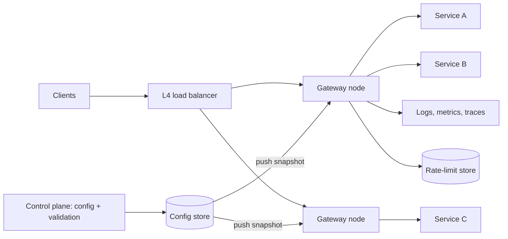

# API Gateway: Full System Design Mock Interview, All 9 Steps

> **Prerequisites:** [Previous lesson: Distributed Cache: Full System Design Mock Interview, All 9 Steps](../27-distributed-cache/README.md) and the [Interview Framework track](../../21-interview-framework/README.md).
> **Estimated Reading Time:** 15–20 minutes
> **Target Audience:** Engineers practising the full 9-step system design interview on a classic prompt: a single entry point that routes, authenticates and protects many backend services.

> [!NOTE]
> **In one line:** An API gateway is **a reverse proxy with policy**: every request passes through it for routing, authentication, rate limiting and observability, so those concerns live in one place.

> [!TIP]
> **The Golden Rule:** Keep the gateway stateless and fast, push policy in as configuration, and never put business logic in it. Fail safe, scale horizontally, and cache the control-plane data locally.

---

## Step 1. Clarify the Problem

Open with questions, not boxes. The gateway sits on the critical path of every request, so the design is about low added latency, safe configuration changes and not becoming a single point of failure.

**Questions to ask the interviewer, and the answer we assume:**

| Question | Assumed answer |
| :--- | :--- |
| Responsibilities? | Routing, auth, rate limiting, TLS, logging |
| Protocols? | HTTP and gRPC |
| Config changes? | Live, without restart |
| Latency budget? | Under 5 ms added |
| Scale? | 500K requests per second, 2,000 backend services |

> Say it aloud: *"Before I draw anything, let me confirm the scope and the numbers."* That one sentence earns the first minutes of the interview.

---

## Step 2. Functional and Non-Functional Requirements

**Functional (what the system does):**

- Route requests to backend services by host and path.
- Authenticate callers and authorise by route.
- Apply rate limits, retries, timeouts and circuit breakers.
- Emit logs, metrics and traces for every request.

**Non-functional (how well it does it):**

| Quality | Target | Why it drives the design |
| :--- | :--- | :--- |
| Added latency | p99 under 5 ms | Paid on every call |
| Availability | 99.999% | Everything depends on it |
| Config safety | Bad config must not take it down | Operators change routes often |
| Scalability | Horizontal, stateless | Traffic grows |

---

## Step 3. Scope: In and Out

**In scope:** Routing, auth, limits, resilience, config distribution, observability.

**Out of scope (say it explicitly, then move on):**

- Business logic and aggregation (that is a BFF).
- Service mesh east-west traffic.
- The developer portal.

---

## Step 4. Capacity Estimation

Assumptions: 500K requests per second, 2 KB average request and response combined, one gateway node handles 25K requests per second.

| Quantity | Calculation | Result |
| :--- | :--- | :--- |
| Gateway nodes for load | `rps / node_rps` | **20 nodes** |
| Nodes with 50% headroom | `gateway_nodes_for_load * headroom` | **30 nodes** |
| Throughput | `rps * kb * 8 / 1e6` | **8 Gbps** |

**What the numbers tell you:** Around 20 nodes carry the load and about 30 give headroom and room to lose a zone. The bandwidth is only 8 Gbps, so CPU (TLS, JSON, auth) is the limit, not the network.

---

## Step 5. API Design

| Endpoint | Purpose | Notes |
| :--- | :--- | :--- |
| Data plane: any request | Routed by host, path, method | Looks up the route in a local table. |
| `PUT /admin/routes/{id}` | Define a route | Control plane; validated, versioned. |
| `PUT /admin/policies/{id}` | Auth, limits, timeouts per route | Pushed to gateways. |
| `GET /admin/health` | Gateway status | For load balancer health checks. |

Separate the **data plane** (handles traffic) from the **control plane** (changes configuration). The data plane keeps serving even if the control plane is down.

---

## Step 6. Data Model

| Entity / Store | Key fields | Why this store |
| :--- | :--- | :--- |
| Route and policy config (control plane DB) | Routes, upstreams, auth rules, limits | Versioned, validated, audited |
| Local config snapshot (each gateway) | Compiled routing table | No remote lookup per request |
| Auth keys cache | JWKS keys, API key hashes | Avoid calling the identity provider each time |
| Rate-limit counters | Redis or local plus sync | Shared limits |

Each gateway loads config into memory as an immutable snapshot and swaps it atomically, so a config update never blocks traffic.

---

## Step 7. High-Level Architecture



**Walk the diagram in this order:** clients reach a gateway node through an L4 load balancer, the node matches a route from its local table, applies auth and limits, proxies to the service, and emits telemetry.

---

## Step 8. Deep Dives and Bottlenecks

### 1. Fast request path

Keep per-request work small: a trie or hash lookup on host and path, a cached JWT verification (signature check with a cached key), and a local token bucket. Use connection pooling and keep-alive to upstreams, avoid body buffering where possible and stream instead. Each added millisecond is paid by every call, so measure and budget it.

### 2. Resilience policies

Per route: timeouts, bounded retries only for idempotent methods, circuit breakers that stop calling an unhealthy upstream, and load shedding when overloaded. Retries multiply load, so cap them with a retry budget (for example 10% of requests). Health checks remove bad instances from the pool.

### 3. Safe config distribution

Validate a new config in the control plane, version it, and roll it out gradually to a few gateways first. Gateways keep the last good snapshot if a new one fails to load. This prevents a typo in a route from taking down every request. Keep the data plane independent so a control-plane outage only freezes changes.

---

## Step 9. Trade-offs, Failures and Security

**Trade-offs to state aloud:**

| Decision | Option A | Option B | Pick and why |
| :--- | :--- | :--- | :--- |
| Auth | Call the identity service per request | Verify tokens locally | Local verification with cached keys: no hot dependency |
| Rate limiting | Local only | Shared in Redis | Local plus periodic sync, or Redis for strict limits |
| Config | Pull on request | Pushed snapshot | Pushed snapshot: no runtime dependency |

**Failure modes and mitigations:**

| Failure | What users see | Mitigation |
| :--- | :--- | :--- |
| Bad config rollout | Many routes broken | Validate, canary, keep last good snapshot, instant rollback |
| Upstream slow | Gateway threads blocked | Timeouts, circuit breaker, bulkheads per upstream |
| Gateway node dies | Some requests fail | LB health checks and retries to another node |

**Security and abuse:** Terminate TLS, validate tokens and scopes, strip untrusted headers and add trusted identity headers, enforce request size limits, and integrate WAF rules and bot protection.

---

## Runnable Example: Longest-prefix route matching

A route table maps path prefixes to upstreams; the longest matching prefix wins.

```python
routes = {
    "/api/": "default-service",
    "/api/orders": "order-service",
    "/api/orders/export": "export-service",
    "/health": "gateway-health",
}

def match(path):
    best = None
    for prefix in routes:
        if path.startswith(prefix) and (best is None or len(prefix) > len(best)):
            best = prefix
    return routes[best] if best else "404"

for p in ("/api/orders/17", "/api/orders/export/2026", "/api/users", "/health", "/other"):
    print(p, "->", match(p))
```

Output (produced by running this exact code):

```text
/api/orders/17 -> order-service
/api/orders/export/2026 -> export-service
/api/users -> default-service
/health -> gateway-health
/other -> 404
```

Each path goes to the most specific route, unmatched paths return 404, and a real gateway uses a trie to do this in time proportional to the path length.

---

## Common Mistakes

- Putting business logic in the gateway.
- Calling the identity provider on every request.
- Unbounded retries that amplify outages.
- Config changes without validation or canary.
- A single gateway instance.

---

## Interview Questions and Answers

<details>
<summary><strong>Q1: What is the gateway's job?</strong></summary>

A single entry point that routes requests and applies cross-cutting policy such as authentication, limits, resilience and observability.

</details>

<details>
<summary><strong>Q2: How do you keep added latency low?</strong></summary>

In-memory route tables, locally verified tokens, local rate-limit counters, connection pooling and streaming.

</details>

<details>
<summary><strong>Q3: How do you avoid a single point of failure?</strong></summary>

Many stateless nodes behind a load balancer across zones, with config snapshots so they run without the control plane.

</details>

<details>
<summary><strong>Q4: How do you change config safely?</strong></summary>

Validate, version, canary roll out, keep the last good snapshot, and support instant rollback.

</details>

<details>
<summary><strong>Q5: Gateway versus service mesh?</strong></summary>

The gateway handles north-south traffic from outside; a mesh handles east-west traffic between services.

</details>

---

## One-Page Cheat Sheet

| Step | What to say or draw |
| :--- | :--- |
| Clarify | Routing, auth, limits, 5 ms budget, 500K rps |
| Capacity | ~20 nodes, ~30 with headroom, 8 Gbps |
| API | Data plane proxy, control plane routes and policies |
| Data | Config store, local snapshot, key cache, counters |
| Deep dive | Fast path, resilience, config rollout |
| Trade-off | Local token checks, pushed config |

---

## Further Reading

- Kong, Envoy and AWS API Gateway documentation.
- Google SRE book chapter on addressing cascading failures.

---

## Next

Continue with [Feature Flag Service: Full System Design Mock Interview, All 9 Steps](../29-feature-flag-service/README.md).
