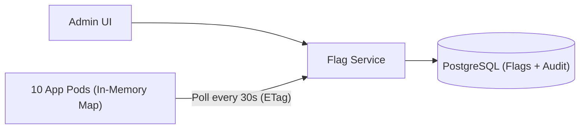
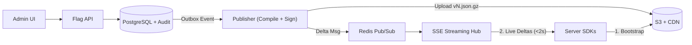
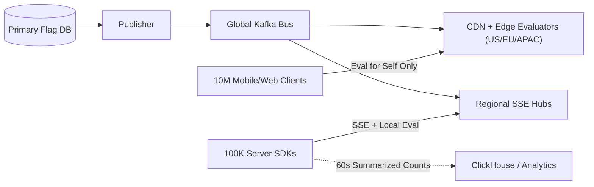
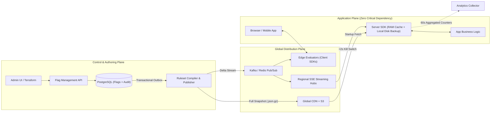
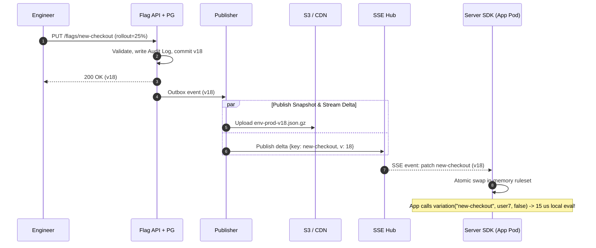

# Feature Flag Service: Full System Design Mock Interview, All 9 Steps

> **Difficulty:** Senior / Staff (L5–L7)
> **Prerequisites:** [Previous lesson: API Gateway: Full System Design Mock Interview, All 9 Steps](../28-api-gateway/README.md) and the [Interview Framework track](../../21-interview-framework/README.md).
> **Estimated Reading Time:** 25–30 minutes
> **Target Audience:** Engineers practising the full system design interview on a classic prompt: evaluating billions of feature flags per day at microsecond latency with sub-5-second global kill-switch propagation.

> [!NOTE]
> **In one line:** A feature flag service is **a globally distributed rules compiler and streaming bus paired with local SDK evaluators**: flags are evaluated in-memory inside the application in microseconds, never over a per-request network RPC.

> [!TIP]
> **The Golden Rule:** Keep the flag service completely off the application's critical request path. Distribute compiled rulesets via CDN + Server-Sent Events (SSE), evaluate locally with deterministic hashing, and guarantee that any failure returns the safe in-code default—never an exception or timeout.

---

## 1. Clarifying Questions, Functional & Non-Functional Requirements

Open by highlighting the core asymmetry of feature flags: **evaluations happen billions of times per day** (inside tight loops and hot request paths), while **flag mutations happen only hundreds or thousands of times per day**. Designing a synchronous RPC endpoint `GET /evaluate` is the #1 trap—the winning architecture pushes rulesets to SDKs so evaluation is 100% local.

### Clarifying Questions & Assumed Answers

| Question | Assumed Answer | Architectural Implication |
| :--- | :--- | :--- |
| **Flag types?** | Boolean, string, number, and structured JSON variants | Typed SDK `variation()` methods with fallback defaults |
| **Targeting rules?** | User ID allowlists, attribute predicates (`country == "DE"`), reusable segments, and % rollouts | Deterministic hashing + ordered rule-evaluation engine in SDK |
| **Client vs. Server SDKs?** | Both backend microservices (100K pods) and browser/mobile clients (10M MAU) | Server SDKs hold full ruleset; client SDKs must *not* receive other users' PII/rules |
| **Propagation SLA?** | Kill switches & rule edits reach 99% of SDKs in < 5 seconds | Streaming hub (SSE) + CDN snapshot bootstrap + polling fallback |
| **Target scale?** | 10,000 active flags, 100K server SDK instances, 5B evaluations/day | ~20 MB ruleset; 58K evals/s (local); ~100M update deliveries/day |

> Say it aloud: *"Before I draw anything, let me confirm whether evaluation happens locally inside SDKs and whether we need both server-side and browser/mobile client SDKs."*

### Functional Requirements

1. **Flag & Segment Management:** Create/update flags per environment (`dev`, `staging`, `prod`) with ordered targeting rules, reusable user segments, and percentage rollouts.
2. **Microsecond Local Evaluation:** Evaluate `variation(flagKey, userContext, defaultValue)` in-memory without network I/O.
3. **Sub-5-Second Propagation (Kill Switch):** Stream flag deltas to all connected SDKs within seconds, with CDN snapshot bootstrap and polling fallback.
4. **Governance & Auditability:** Immutable audit log of who changed what, approval workflows for production, and 1-click instant rollback.
5. **Sampled Evaluation Analytics:** Aggregate evaluation counts per flag/variant asynchronously for experiment tracking and stale-flag cleanup.

### Non-Functional Requirements

| Quality | Target | Why It Drives the Design |
| :--- | :--- | :--- |
| **Evaluation Latency** | p99 < 50 µs (in-process) | Called dozens of times per HTTP request |
| **Fault Tolerance** | App 100% unaffected if flag service dies | SDK uses last-known-good ruleset or code default |
| **Propagation Latency** | p99 < 5 seconds globally | Critical for emergency kill switches |
| **Assignment Consistency** | 100% deterministic per `(flag, user)` | Same user must see the same variant across pods & reloads |

**Explicitly Out of Scope:** Statistical A/B hypothesis testing engine (p-values), billing, and full frontend dashboard UI.

---

## 2. Back-of-the-Envelope Capacity Estimation

Assumptions: **10,000 flags** per environment averaging **2 KB** of compiled JSON rules each, **100,000 connected server SDK instances**, **5 billion evaluations/day**, and **1,000 flag mutations/day** (each delta ~1 KB).

### Ruleset Footprint & Evaluation Rate

$$
\text{Total Ruleset Size (Uncompressed)} = 10{,}000 \times 2\text{ KB} = 20\text{ MB}
$$

With gzip/zstd compression (~5:1 on JSON), the initial bootstrap payload downloaded by an SDK from the CDN is only **~4 MB**.

$$
\text{Average Evaluations/sec} = \frac{5 \times 10^9}{86{,}400\text{ s}} \approx 57{,}870\text{ evals/s}
$$

Because evaluation is local in RAM, 58K evals/s across 100K SDKs is **< 1 eval/s per SDK** on average—completely free in network terms!

### Streaming Fan-Out & Bandwidth

Each of the 1,000 daily flag updates fans out to 100,000 connected SSE streams:

$$
\text{Daily Update Deliveries} = 1{,}000 \times 100{,}000 = 10^8\text{ messages/day}
$$

During a burst (say 10 updates in 1 second), the streaming tier pushes:

$$
\text{Burst Egress} = 10 \times 100{,}000 \times 1\text{ KB} = 1\text{ GB/s} \approx 8\text{ Gbps}
$$

Assuming 1 streaming hub node holds **25,000 concurrent SSE connections** (with ~1 GB RAM for TCP/TLS buffers), we need:

$$
N_{\text{stream nodes}} = \left\lceil \frac{100{,}000}{25{,}000} \right\rceil = 4\text{ nodes (provision 8 across 3 AZs for HA)}
$$

### Capacity Summary Table

| Metric | Formula / Assumption | Result |
| :--- | :--- | :--- |
| **Compiled Ruleset** | $10{,}000 \times 2\text{ KB}$ | **20 MB raw (~4 MB gzipped)** |
| **Evaluation Rate** | $5\text{B} / 86{,}400\text{ s}$ | **~58K evals/s** (100% local) |
| **Update Fan-Out** | $1{,}000\text{ edits} \times 100\text{K SDKs}$ | **100M deliveries/day** |
| **Streaming Fleet** | $100\text{K SSE} / 25\text{K per node}$ | **8 SSE edge nodes** (with HA) |
| **Burst Fan-Out Bandwidth** | $10\text{ edits/s} \times 100\text{K} \times 1\text{ KB}$ | **8 Gbps peak** |

---

## 3. Core API Contracts & Data Model

### API & SDK Contracts

| Endpoint / Method | Caller | Purpose & Notes |
| :--- | :--- | :--- |
| `PUT /api/v1/envs/{env}/flags/{key}` | Admin UI / CI | Create or update flag rules; requires `If-Match: version` (optimistic lock) |
| `GET /api/v1/sdk/snapshot/{env}` | SDK (Startup) | Returns full compiled ruleset from CDN (`ETag` + `Cache-Control: max-age=10`) |
| `GET /api/v1/sdk/stream/{env}` | Server SDK | Long-lived **Server-Sent Events (SSE)** stream pushing `PUT`/`DELETE` flag deltas |
| `POST /api/v1/sdk/eval-context` | Client/Browser SDK | Evaluates flags for *one* logged-in user at Edge/Relay and returns only boolean/variant results (no PII rules leaked) |
| `POST /api/v1/analytics/events` | SDK (Background) | Batched, summarized evaluation counts flushed every 30–60 s |
| `sdk.Variation(key, user, default)` | App Code | Synchronous, zero-I/O local evaluation returning `default` on any error |

### Data Model

| Store | Key Fields | Why This Store |
| :--- | :--- | :--- |
| **Flag Store (PostgreSQL)** | `flag_key`, `env_id`, `version`, `enabled`, `rules_jsonb`, `salt`, `updated_by` | Strong ACID consistency for rule edits & optimistic locking |
| **Audit Log (Append-Only Table)** | `event_id`, `flag_key`, `env_id`, `diff_json`, `actor`, `timestamp`, `prev_version` | Compliance, blame, and 1-click rollback |
| **Snapshot Store (S3 + CDN)** | `snapshots/{env}/v{version}.json.gz` | Cheap, globally cached bootstrap for 100K+ SDKs |
| **Pub/Sub Bus (Redis / Kafka)** | Topic `flag-updates:{env}` carrying `{key, version, compiled_rule}` | Broadcasts deltas from Publisher to all Streaming Hub nodes |

---

## 4. Stage 1 (100 – 1K Users): Baseline Monolith & Single Database

At startup scale (100–1,000 users, <50 flags, 10 backend pods), you don't need SSE hubs or CDNs.

### Component-by-Component Build
1. **Flag Admin API + PostgreSQL:** A single service stores flags in PostgreSQL and serves `GET /flags/snapshot` as JSON.
2. **SDK Polling (Every 30 s):** Application pods poll `GET /flags/snapshot` with `If-None-Match: <ETag>` every 30 seconds and cache the map in memory.
3. **Local Evaluator:** App code calls `flags.isEnabled("new-ui", userId, false)` against the in-memory map.



### What Breaks at 10K Users / 5,000 SDKs?
- **Polling Thundering Herd:** 5,000–100,000 SDKs polling PostgreSQL every 5 seconds (for fast kill switches) generates 20,000 QPS of JSON serialization and crushes the DB.
- **30-Second Kill-Switch Lag:** Waiting 30 seconds to turn off a broken feature during a SEV-1 outage is too slow.
- **Security Leak to Browsers:** Sending raw targeting rules (`if user.email.endsWith("@vip.com")`) to browser SDKs leaks customer lists and internal logic.

---

## 5. Stage 2 (10K – 100K Users): Caching, Read Replicas & Async Offload

To scale to 100K SDKs and <5-second kill switches, we **separate the Authoring DB from Read Distribution** using a **Compiler/Publisher**, **CDN Snapshots**, and an **SSE Streaming Hub**.

### Component-by-Component Additions
1. **Publisher Worker (Outbox / CDC):** Whenever PostgreSQL commits a flag edit, a Publisher compiles the environment's ruleset into an immutable JSON artifact, uploads it to **S3 + CDN**, and publishes the delta to **Redis Pub/Sub**.
2. **CDN Snapshot Bootstrap:** SDKs fetch the initial 4 MB compressed snapshot from the CDN (zero load on origin DB).
3. **SSE Streaming Hub:** Stateless edge nodes subscribe to Redis Pub/Sub and push small 1 KB deltas over persistent Server-Sent Events (SSE) connections to SDKs in <1 second.
4. **Relay Proxy (Optional Inside VPC):** Large Kubernetes clusters can run 1 local Relay Proxy per cluster that holds 1 SSE stream upstream and fans out locally to 5,000 pods.



### What Breaks at 1M+ Users / Browser & Mobile Scale?
- **SSE Connection Exhaustion from Browsers/Mobile:** 10M mobile/browser users opening persistent SSE connections to your origin streaming hub will exhaust file descriptors and cost a fortune.
- **PII / Rule Exposure on Client Devices:** Browser SDKs cannot receive the full 20 MB ruleset (contains all user allowlists and unreleased feature names).
- **Analytics Write Storms:** 100K SDKs sending raw evaluation events for 5B evaluations/day will overwhelm the analytics ingestion pipeline.

---

## 6. Stage 3 (1M – 10M+ Users): Sharding, Partitioning & Multi-Region Scale

At global multi-region scale (100K server SDKs + 10M browser/mobile clients, 5B+ evaluations/day), we add **Edge Evaluation for Client SDKs**, **Multi-Region Streaming**, and **SDK-Side Event Summarization**.

### Component-by-Component Additions
1. **Edge Flag Evaluator (Cloudflare Workers / Fastly / Regional Edge):** Browser and mobile SDKs send their *own* user context (`{userId, country, plan}`) to an Edge node. The Edge node holds the full server ruleset in memory, evaluates all flags for that single user in <1 ms, and returns only `{flagKey: variant}`—**zero PII or rules leaked**.
2. **Multi-Region Streaming Fan-Out:** Kafka/NATS JetStream replicates flag deltas across US, EU, and APAC regions; regional SSE hubs fan out locally.
3. **SDK-Side Analytics Summarization:** Instead of sending 5B raw events, each SDK aggregates counts in a local hash map (`{flag_key, variant, count}`) and flushes a single 5 KB summary every 60 seconds.



---

## 7. Final Full Production Architecture & End-to-End Flows

### Complete Production Architecture



### End-to-End Flag Update & Evaluation Sequence



---

## 8. Deep-Dive Bottlenecks & Algorithmic Trade-Offs

### 1. Deterministic Percentage Rollouts & Monotonic Expansion
If you use `random()`, a user flips between `true` and `false` on every page reload. If you use `hash(user_id) % 100`, *all* flags turn on for the exact same 10% of users (experiment correlation bias!).
- **Solution:** Hash `SHA256(flag_key + ":" + flag_salt + ":" + user_id)` and take the first 32 bits modulo `100_000` (for `0.001%` precision):
  $$
  \text{bucket} = \text{uint32}(\text{SHA256}(\text{flag\_key} + \text{":"} + \text{user\_id})[0:4]) \bmod 100{,}000
  $$
  Enable if $\text{bucket} < \text{percentage} \times 1000$.
- **Why this works:**
  1. **Zero correlation** between different flags (`flag_key` is in the hash).
  2. **Monotonic expansion:** Raising rollout from 10% to 30% keeps every user in `[0, 9999]` enabled and only adds `[10000, 29999]`.

### 2. SDK Startup, Resilience & Fallback Hierarchy
What if the Flag Service, CDN, and SSE Hub are all down when a new Kubernetes pod boots?
1. **Tier 1 (Memory):** Live in-memory ruleset updated by SSE.
2. **Tier 2 (Local Disk Cache / Bootstrap File):** SDK persists the last valid snapshot to `/tmp/flags-cache.json` (or ships a baked-in JSON snapshot in the container image).
3. **Tier 3 (In-Code Default):** Every call requires a default (`sdk.BoolVariation("new-checkout", user, false)`). Evaluation **never blocks or throws**.

### 3. Server-Side vs. Client-Side SDK Security Trade-Off

| Dimension | Server SDK (Backend Pods) | Client SDK (Browser / Mobile) |
| :--- | :--- | :--- |
| **What it downloads** | Full environment ruleset (20 MB) | Pre-evaluated map for *one* user (~2 KB) |
| **Authentication** | Secret Server SDK Key | Public Client-Side Environment ID |
| **PII / Rule Privacy** | Safe inside private VPC | Never exposes segments, emails, or unpublished flags |
| **Evaluation Latency** | ~15 µs (in-memory) | ~15 µs after initial Edge fetch |

---

## 9. Failure Modes, Reliability & Backpressure Mitigations

| Failure Mode | Impact / Symptom | Mitigation |
| :--- | :--- | :--- |
| **SSE Hub Outage / Disconnect** | SDKs miss live updates | SDK reconnects with **exponential backoff + jitter** and automatically **falls back to CDN polling** every 30 s |
| **Bad Rule Published (SEV-1)** | Wrong users get broken feature | **1-click rollback** to `v(N-1)` from Audit Log + **Kill Switch** flag pattern + JSON schema validation |
| **Thundering Herd on SSE Reconnect** | 100K SDKs reconnect simultaneously after deploy | **Full jitter** on reconnect timers + **Relay Proxy** inside large K8s clusters |
| **Corrupt Ruleset Published** | SDK fails to parse JSON | SDK validates checksum & schema *before* atomic swap; rejects bad payload and keeps `v(N-1)` |
| **Stale Flag Debt** | 1,000 dead `if/else` branches in code | Track `last_evaluated_at` via analytics; auto-create Jira/PR reminders when a flag is 100% rolled out for >30 days |

---

## 10. Production War Story & Real-World Reference

### War Story: The Accidental 100% Rollout & Missing Default (SEV-1)
- **What Happened:** An engineer intended to roll out a new, unoptimized SQL query path (`use-new-search`) to `1%` of beta users, but accidentally typed `100` in the percentage box and hit Save without peer review.
- **Cascade:** Within 2 seconds, SSE pushed the update to 40,000 backend pods. Search DB CPU jumped to 100%. The engineer panicked and deleted the flag from the database instead of toggling it off—and in one legacy service, the developer had passed `defaultValue = true` in code! Deleting the flag caused that service to fall back to `true`, keeping the DB overloaded for another 12 minutes.
- **Root Cause:** No production approval gate on 0% $\rightarrow$ 100% jumps, and unsafe `true` default in application code.
- **Permanent Fix:**
  1. Enforced **two-person approval** for any production flag change affecting >10% traffic.
  2. Replaced "delete flag" in the UI with a **Kill Switch (`off` state)** and blocked deletion until 0 evaluations are seen for 7 days.
  3. Added a **linter rule** requiring new feature flags to pass `false` / control-variant as the code default.

**Real-World Reference:** LaunchDarkly (Streaming SSE + CDN Relay Proxy architecture), Unleash (open-source polling/SSE SDKs), and Martin Fowler's *Feature Toggles*.

---

## 11. Core Component Implementation (4 Languages)

Below is a production-grade **Deterministic Percentage Bucketing & Rule Evaluator** in Go, TypeScript, Python, and C#.

````carousel
```go
package featureflags

import (
	"crypto/sha256"
	"encoding/binary"
	"fmt"
)

type UserContext struct {
	ID      string
	Country string
}

type FlagRule struct {
	Key        string
	Enabled    bool
	Salt       string
	Percentage float64 // 0.0 to 100.0
	AllowList  map[string]bool
}

// Bucket returns a deterministic value in [0, 100000) for 0.001% rollout precision.
func Bucket(flagKey, salt, userID string) uint32 {
	sum := sha256.Sum256([]byte(fmt.Sprintf("%s:%s:%s", flagKey, salt, userID)))
	return binary.BigEndian.Uint32(sum[:4]) % 100000
}

func Evaluate(flag *FlagRule, user UserContext, defaultVal bool) bool {
	if flag == nil || !flag.Enabled {
		return defaultVal
	}
	if flag.AllowList[user.ID] {
		return true
	}
	threshold := uint32(flag.Percentage * 1000.0)
	return Bucket(flag.Key, flag.Salt, user.ID) < threshold
}
```
<!-- slide -->
```typescript
import { createHash } from "crypto";

export interface FlagRule {
  key: string;
  enabled: boolean;
  salt: string;
  percentage: number; // 0 to 100
  allowList: Set<string>;
}

export function bucket(flagKey: string, salt: string, userId: string): number {
  const digest = createHash("sha256")
    .update(`${flagKey}:${salt}:${userId}`)
    .digest();
  return digest.readUInt32BE(0) % 100_000;
}

export function evaluate(
  flag: FlagRule | undefined,
  userId: string,
  defaultVal: boolean
): boolean {
  if (!flag || !flag.enabled) return defaultVal;
  if (flag.allowList.has(userId)) return true;
  return bucket(flag.key, flag.salt, userId) < flag.percentage * 1000;
}
```
<!-- slide -->
```python
import hashlib
from dataclasses import dataclass, field
from typing import Optional, Set


@dataclass
class FlagRule:
    key: str
    enabled: bool
    salt: str
    percentage: float  # 0.0 to 100.0
    allow_list: Set[str] = field(default_factory=set)


def bucket(flag_key: str, salt: str, user_id: str) -> int:
    """Deterministic bucket in [0, 100000) for monotonic percentage rollouts."""
    digest = hashlib.sha256(f"{flag_key}:{salt}:{user_id}".encode("utf-8")).digest()
    return int.from_bytes(digest[:4], "big") % 100_000


def evaluate(flag: Optional[FlagRule], user_id: str, default_val: bool) -> bool:
    if flag is None or not flag.enabled:
        return default_val
    if user_id in flag.allow_list:
        return True
    return bucket(flag.key, flag.salt, user_id) < int(flag.percentage * 1000)


if __name__ == "__main__":
    f10 = FlagRule(key="new-checkout", enabled=True, salt="s1", percentage=10.0)
    f30 = FlagRule(key="new-checkout", enabled=True, salt="s1", percentage=30.0)
    u10 = {f"u{i}" for i in range(2000) if evaluate(f10, f"u{i}", False)}
    u30 = {f"u{i}" for i in range(2000) if evaluate(f30, f"u{i}", False)}
    print(f"10%={len(u10)}, 30%={len(u30)}, monotonic={u10 <= u30}")
```
<!-- slide -->
```csharp
using System;
using System.Collections.Generic;
using System.Security.Cryptography;
using System.Text;

public sealed record FlagRule(
    string Key,
    bool Enabled,
    string Salt,
    double Percentage,
    HashSet<string> AllowList);

public static class FlagEvaluator
{
    public static uint Bucket(string flagKey, string salt, string userId)
    {
        byte[] hash = SHA256.HashData(Encoding.UTF8.GetBytes($"{flagKey}:{salt}:{userId}"));
        uint val = ((uint)hash[0] << 24) | ((uint)hash[1] << 16) | ((uint)hash[2] << 8) | hash[3];
        return val % 100_000;
    }

    public static bool Evaluate(FlagRule? flag, string userId, bool defaultValue)
    {
        if (flag is null || !flag.Enabled) return defaultValue;
        if (flag.AllowList.Contains(userId)) return true;
        return Bucket(flag.Key, flag.Salt, userId) < (uint)(flag.Percentage * 1000.0);
    }
}
```
````

---

## 12. Verification, Load Testing & CLI Diagnostics

```bash
# 1. Verify monotonic rollout property (10% cohort is a strict subset of 30% cohort)
python3 -c '
import hashlib
b = lambda k, u: int.from_bytes(hashlib.sha256(f"{k}:{u}".encode()).digest()[:4], "big") % 100
s10 = {f"u{i}" for i in range(5000) if b("checkout", f"u{i}") < 10}
s30 = {f"u{i}" for i in range(5000) if b("checkout", f"u{i}") < 30}
print("10% count:", len(s10), "30% count:", len(s30), "Subset preserved:", s10 <= s30)
'

# 2. Test SSE live streaming endpoint with curl
curl -N -H "Authorization: Bearer $SDK_KEY" https://stream.flags.example.com/api/v1/sdk/stream/prod

# 3. Verify CDN snapshot ETag caching (304 Not Modified when unchanged)
curl -sI -H 'If-None-Match: "v18-sha256"' https://cdn.flags.example.com/snapshots/prod.json.gz

# 4. Benchmark local SDK evaluation throughput (target: >1M evals/sec/core)
go test -bench=BenchmarkEvaluate -benchmem ./...
```

---

## 13. Common Interview Mistakes & Red Flags

1. **Designing a Synchronous `GET /evaluate` RPC:** Making every app request wait on a network call to the flag service adds latency and turns the flag service into a Tier-0 SPOF.
2. **Using `rand()` Instead of Deterministic Hashing:** Causes users to flip-flop between old and new UI on every click.
3. **Hashing Only `user_id` Without `flag_key`:** Causes every 10% rollout in the company to target the exact same 10% of users.
4. **Sending Full Rulesets to Browser/Mobile Clients:** Leaks internal emails, VIP customer lists, and unreleased feature names to anyone opening DevTools.
5. **Failing Closed When the Flag Service Is Unreachable:** Throwing an exception instead of returning the in-code `defaultValue`.
6. **Ignoring Flag Lifecycle & Cleanup:** Leaving thousands of dead flags in codebases causes cognitive overload and accidental re-enabling.

---

## 14. Key Terminology & Glossary

| Term | Definition |
| :--- | :--- |
| **Local Evaluation** | Evaluating targeting rules in-process inside the SDK using a cached ruleset with zero network I/O. |
| **Deterministic Bucketing** | Hashing `(flag_key, salt, user_id)` into `[0, 100000)` so user assignment is sticky and monotonic. |
| **Kill Switch** | A boolean flag wrapping a risky feature that can be toggled off globally in <5 seconds without a deploy. |
| **Server-Sent Events (SSE)** | Unidirectional HTTP streaming protocol used to push flag deltas from Streaming Hubs to SDKs. |
| **Relay Proxy** | Optional in-cluster proxy that holds one upstream SSE stream and fans out locally to thousands of pods. |
| **Edge Evaluator** | Edge worker that evaluates rules for a single client-SDK user so raw rules never reach the browser. |
| **Transactional Outbox** | Pattern writing flag edits and publish events in the same DB transaction so streams never miss updates. |
| **Flag Debt** | Accumulation of obsolete, 100%-rolled-out feature flags that were never removed from application code. |

---

## 15. Interview Follow-Up Questions (12 Q&As)

### Basic Conceptual Questions

<details>
<summary><strong>Q1: Why must flag evaluation happen locally in the SDK instead of via an API call? [BASIC]</strong></summary>

Applications evaluate flags billions of times per day inside hot loops. Local evaluation takes ~15 µs with zero network overhead, and ensures the application keeps working normally even if the central flag service goes completely offline.

</details>

<details>
<summary><strong>Q2: How do you guarantee a 10% rollout stays consistent for a user and expands cleanly to 30%? [BASIC]</strong></summary>

Hash `SHA256(flag_key + ":" + salt + ":" + user_id)` into `[0, 100000)`. Enable if `bucket < percentage * 1000`. The same user always gets the same bucket, and raising 10% to 30% only adds buckets `[10000, 29999]` without flipping anyone in `[0, 9999]`.

</details>

<details>
<summary><strong>Q3: What happens if the flag service, CDN, and SSE hub are all down when an app pod starts? [BASIC]</strong></summary>

The SDK checks its **local disk cache** (or a baked-in bootstrap snapshot) first; if none exists, it **never blocks or throws**—every `variation()` call immediately returns the safe `defaultValue` passed in application code.

</details>

<details>
<summary><strong>Q4: Why use SSE (Server-Sent Events) instead of WebSockets or pure polling? [BASIC]</strong></summary>

Flag updates are strictly **server-to-SDK** (unidirectional). SSE runs over standard HTTP/2, traverses corporate proxies/firewalls cleanly, supports automatic browser/client reconnection (`Last-Event-ID`), and avoids the complexity of bidirectional WebSockets.

</details>

### Scenario-Based Architecture Questions

<details>
<summary><strong>Q5: How do you support browser and mobile SDKs without leaking targeting rules or PII? [SCENARIO]</strong></summary>

Never ship the full ruleset to browsers/mobile. Instead, client SDKs call an **Edge Evaluator** (CDN Worker) passing *only* the current user's context; the Edge evaluates the ruleset locally and returns only the final `{flagKey: variant}` map for that single user.

</details>

<details>
<summary><strong>Q6: You have 100,000 Kubernetes pods and an SSE hub restarts. How do you avoid a reconnect storm? [SCENARIO]</strong></summary>

Combine three defenses: (1) SDKs reconnect with **exponential backoff + full jitter**; (2) deploy a **Relay Proxy** per K8s cluster so 100,000 pods connect to local proxies rather than hitting the central SSE hub; (3) autoscale SSE hubs behind L4 load balancers.

</details>

<details>
<summary><strong>Q7: How do you ensure a kill switch reaches all 100K SDKs in under 5 seconds? [SCENARIO]</strong></summary>

Use the **Transactional Outbox** in PostgreSQL to trigger the Publisher immediately on commit; push the tiny 1 KB delta over Redis Pub/Sub / Kafka to regional SSE hubs, which write directly to open TCP streams; and set a short `Cache-Control: max-age=5` on CDN snapshots for polling fallbacks.

</details>

<details>
<summary><strong>Q8: Two engineers edit the same production flag at the exact same time. How do you prevent lost updates? [SCENARIO]</strong></summary>

Use **optimistic concurrency control** (`version` column + HTTP `ETag` / `If-Match` header). The second writer's `PUT` fails with `409 Conflict`, forcing a refresh before re-applying their change.

</details>

### Advanced & Tricky Interview Questions

<details>
<summary><strong>Q9: How do you handle "targeting by segment" when a segment has 2 million user IDs? [TRICKY]</strong></summary>

Embedding 2M user IDs in a 20 MB JSON ruleset would bloat it to 100+ MB. Instead: (1) for exact ID membership, compile large segments into a compact **Bloom Filter** or **Roaring Bitmap** (~250 KB for 2M IDs) or (2) evaluate huge segments at the **Edge/Relay** backed by Redis, keeping the core SDK ruleset small.

</details>

<details>
<summary><strong>Q10: How do you prevent experiment correlation bias across multiple flags? [TRICKY]</strong></summary>

Always include `flag_key` (and a per-flag `salt`) inside the hash input (`SHA256(flag_key:salt:user_id)`). That way, user #42 might land in bucket 5 for `flag-A` and bucket 83 for `flag-B`, making rollouts statistically independent. If you need to re-randomize a flag, simply rotate its `salt`.

</details>

<details>
<summary><strong>Q11: How do you handle 5 billion evaluation analytics events per day without overwhelming ClickHouse/Kafka? [TRICKY]</strong></summary>

Do **SDK-side pre-aggregation**: each SDK keeps an in-memory counter map `(flag_key, variation_idx, version) -> count` and flushes a compact summary every 60 seconds. This compresses 5B raw events/day into ~100K summary payloads/minute—a >1,000x reduction.

</details>

<details>
<summary><strong>Q12: How do you guarantee an in-flight HTTP request sees a consistent set of flags even if an SSE update arrives mid-request? [TRICKY]</strong></summary>

Use **immutable ruleset snapshots** with atomic pointer swaps in the SDK, and optionally bind the snapshot pointer (or a per-request flag evaluation cache) to the request context at the start of the request so all evaluations within one request observe the exact same flag state.

</details>

---

## 16. One-Page Master Cheat Sheet

```text
+-----------------------------------------------------------------------------+
|            FEATURE FLAG SERVICE (10K FLAGS, 100K SDKS, 5B EVALS/DAY)        |
+-----------------------------------------------------------------------------+
| 1. CORE RULE    : Never evaluate over RPC. Push rulesets; evaluate in RAM.  |
| 2. SIZING       : 10K flags x 2 KB = 20 MB (~4 MB gz); 58K local evals/sec  |
| 3. PROPAGATION  : PG Outbox -> Publisher -> CDN (bootstrap) + SSE (<5s)     |
| 4. BUCKETING    : SHA256(flag:salt:user) % 100K -> sticky & monotonic       |
| 5. FALLBACK     : RAM -> Local Disk Cache -> Code Default (never throws)    |
| 6. CLIENT SDKS  : Edge Evaluator returns single-user variants (no PII leak) |
| 7. ANALYTICS    : SDK-side 60s counter summarization (1000x compression)    |
| 8. SAFETY       : Audit log, 2-person prod approval, 1-click rollback       |
+-----------------------------------------------------------------------------+
```

| Pattern | Choice | Why |
| :--- | :--- | :--- |
| **Evaluation** | Local SDK (in-memory) | ~15 µs latency, zero runtime dependency |
| **Updates** | SSE Stream + CDN Poll Fallback | <5 s kill switch + high resilience |
| **Failure Mode** | Return `defaultValue` | Flag outage never causes app outage |
| **Rollout Math** | `SHA256(flag:salt:user) % 100K` | Deterministic, uncorrelated, monotonic |

---

## Further Reading

- LaunchDarkly Architecture Documentation (Streaming, Relay Proxy, and Edge SDKs).
- Unleash Architecture & Client Specifications.
- Martin Fowler, *Feature Toggles (aka Feature Flags)*.

---

## Next

Continue with [Design Dropbox / Google Drive: Cloud File Storage Mock Interview](../30-design-dropbox-google-drive/README.md).
