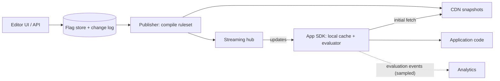

# Feature Flag Service: Full System Design Mock Interview, All 9 Steps

> **Prerequisites:** [Previous lesson: API Gateway: Full System Design Mock Interview, All 9 Steps](../28-api-gateway/README.md) and the [Interview Framework track](../../21-interview-framework/README.md).
> **Estimated Reading Time:** 15–20 minutes
> **Target Audience:** Engineers practising the full 9-step system design interview on a classic prompt: turning features on and off for chosen users without redeploying.

> [!NOTE]
> **In one line:** A feature flag service is **a rules engine evaluated next to the application**: flags and targeting rules are distributed to SDKs, which evaluate them locally in microseconds.

> [!TIP]
> **The Golden Rule:** Evaluate in the client SDK from a cached ruleset, push changes by streaming, and make failure mean 'use the default', never 'block the request'. The flag service must not be on the request's critical path.

---

## Step 1. Clarify the Problem

Open with questions, not boxes. The key insight is that flag evaluation happens billions of times, so the network must not be involved per evaluation.

**Questions to ask the interviewer, and the answer we assume:**

| Question | Assumed answer |
| :--- | :--- |
| Flag types? | Boolean, string, number and JSON variants |
| Targeting? | By user attribute, segment and percentage rollout |
| Latency? | Evaluation under 1 ms, changes within 5 seconds |
| Safety? | Audit log, approvals and kill switch |
| Scale? | 10,000 flags, 100K SDK instances, 5B evaluations per day |

> Say it aloud: *"Before I draw anything, let me confirm the scope and the numbers."* That one sentence earns the first minutes of the interview.

---

## Step 2. Functional and Non-Functional Requirements

**Functional (what the system does):**

- Create flags with targeting rules and percentage rollouts.
- Evaluate a flag for a user in application code.
- Propagate changes to all SDKs within seconds.
- Audit changes and support instant rollback.

**Non-functional (how well it does it):**

| Quality | Target | Why it drives the design |
| :--- | :--- | :--- |
| Evaluation latency | Microseconds | Called in hot code paths |
| Availability | App works if the service is down | A flag outage must not be an app outage |
| Propagation | Under 5 s | Kill switches must be fast |
| Consistency | Same user gets the same variant | Experiments need stable assignment |

---

## Step 3. Scope: In and Out

**In scope:** Flag definitions, local evaluation, streaming updates, stable bucketing, audit.

**Out of scope (say it explicitly, then move on):**

- Experiment statistics.
- Dashboard UI.
- Billing.

---

## Step 4. Capacity Estimation

Assumptions: 10,000 flags averaging 2 KB of rules, 100K SDK instances, 5B evaluations per day, a flag changes about 1,000 times per day.

| Quantity | Calculation | Result |
| :--- | :--- | :--- |
| Ruleset size | `flags * kb / 1e3` | **20 MB** |
| Evaluations per second | `evals / 86400` | **57.9K evals/s** |
| Update fan-out per day | `changes * sdks` | **100M deliveries/day** |

**What the numbers tell you:** The whole ruleset is only about 20 MB, so every SDK can hold all of it in memory. 58K evaluations per second across the fleet is trivial because it is local. The only network load is pushing about 100 million small updates a day, which streaming and a CDN handle easily.

---

## Step 5. API Design

| Endpoint | Purpose | Notes |
| :--- | :--- | :--- |
| `PUT /v1/flags/{key}` | Create or edit a flag | Versioned, audited, may require approval. |
| `GET /v1/ruleset?env=` | Fetch all rules | Cacheable, ETag; used at SDK start. |
| `GET /v1/stream?env=` | Server-sent events | Pushes changed flags. |
| SDK `variation(key, user, default)` | Evaluate locally | No network call. |

Every SDK call takes a default value, which is returned if the ruleset is unavailable or the flag is missing, so evaluation can never throw or block.

---

## Step 6. Data Model

| Entity / Store | Key fields | Why this store |
| :--- | :--- | :--- |
| Flag store (relational) | `key`, `environment`, `rules`, `version`, `owner` | Strong consistency for edits |
| Change log | Who, what, when, previous version | Audit and rollback |
| Ruleset snapshots (CDN / object storage) | Compiled JSON per environment | Scales to many SDKs |
| Stream hub | Pub/sub of changes | Real-time propagation |

A snapshot per environment is published on every change; SDKs fetch it with conditional requests and receive updates over a stream.

---

## Step 7. High-Level Architecture



**Walk the diagram in this order:** an edit is stored and audited, the publisher compiles and publishes a snapshot and a stream message, SDKs update their in-memory ruleset, and the application evaluates locally.

---

## Step 8. Deep Dives and Bottlenecks

### 1. Local evaluation and stable bucketing

The SDK holds all rules and evaluates against user attributes in memory. For percentage rollouts, hash the flag key and user id into a number from 0 to 99 and compare it with the threshold. The same user always lands in the same bucket, so their experience is stable, and raising the percentage only adds users, never flips existing ones.

### 2. Propagation and failure modes

On start the SDK fetches the snapshot from the CDN; then it holds a stream connection for updates and falls back to polling if the stream breaks. If everything fails, the SDK keeps the last known ruleset, and if it has none it returns the default in code. Use a short TTL on the snapshot so kill switches propagate quickly.

### 3. Safety and lifecycle

Require approvals for production changes, write every change to an audit log, support instant rollback to a previous version, and track flag age to remove stale flags (flag debt). Add a kill switch pattern: a flag that disables a risky feature everywhere in seconds.

---

## Step 9. Trade-offs, Failures and Security

**Trade-offs to state aloud:**

| Decision | Option A | Option B | Pick and why |
| :--- | :--- | :--- | :--- |
| Evaluation | Server-side call | Local SDK evaluation | Local: microsecond latency and no dependency |
| Updates | Polling | Streaming with polling fallback | Streaming for speed, polling for resilience |
| Failure | Fail closed | Return default | Return default: the app keeps working |

**Failure modes and mitigations:**

| Failure | What users see | Mitigation |
| :--- | :--- | :--- |
| Flag service down | No changes possible | SDKs keep the last ruleset and defaults |
| Bad rule published | Feature misbehaves | Rollback to the previous version, validation before publish |
| Stream disconnected | Stale flags | Reconnect with backoff, poll fallback |

**Security and abuse:** Use separate keys for server and client SDKs (client keys cannot see targeting rules for other users), restrict who edits production flags, and do not send sensitive user attributes to browsers.

---

## Runnable Example: Stable percentage rollout

Hashing the flag and user into a bucket gives the same answer every time, and raising the percentage only adds users.

```python
import hashlib

def bucket(flag, user):
    h = hashlib.sha256(f"{flag}:{user}".encode()).hexdigest()
    return int(h[:8], 16) % 100

def enabled(flag, user, percent):
    return bucket(flag, user) < percent

users = [f"user{i}" for i in range(2000)]
on_10 = {u for u in users if enabled("new-checkout", u, 10)}
on_30 = {u for u in users if enabled("new-checkout", u, 30)}
print(len(on_10), len(on_30))
print("10% group still enabled at 30%:", on_10 <= on_30)
print(enabled("new-checkout", "user7", 30) == enabled("new-checkout", "user7", 30))
```

Output (produced by running this exact code):

```text
211 611
10% group still enabled at 30%: True
True
```

About 10% and 30% of users are enabled, everyone in the 10% group stays enabled when the rollout widens, and the same user always gets the same answer.

---

## Common Mistakes

- Calling the flag service on every evaluation.
- Failing closed when the service is down.
- Random assignment per request instead of hashing.
- No audit log or rollback.
- Never removing old flags.

---

## Interview Questions and Answers

<details>
<summary><strong>Q1: Why evaluate locally?</strong></summary>

Evaluations happen billions of times in hot paths. A network call per check would add latency and make the flag service a dependency of every request.

</details>

<details>
<summary><strong>Q2: How do you roll out to 10% of users?</strong></summary>

Hash the flag key and user id into a bucket from 0 to 99 and enable below 10, so assignment is stable and widening adds users only.

</details>

<details>
<summary><strong>Q3: What if the flag service is down?</strong></summary>

SDKs keep their cached ruleset, and if there is none they return the default value passed in code.

</details>

<details>
<summary><strong>Q4: How do changes reach SDKs quickly?</strong></summary>

A streaming connection (SSE) pushes changes, with CDN snapshots for startup and polling as a fallback.

</details>

<details>
<summary><strong>Q5: How do you keep flags manageable?</strong></summary>

Ownership, expiry dates, audit logs and cleanup of flags that are fully rolled out.

</details>

---

## One-Page Cheat Sheet

| Step | What to say or draw |
| :--- | :--- |
| Clarify | Rules, percentage rollout, <5 s propagation |
| Capacity | 20 MB ruleset, 58K evals/s local, 100M updates/day |
| API | edit flag, ruleset snapshot, stream, SDK variation |
| Data | Flag store, change log, CDN snapshots, stream |
| Deep dive | Local evaluation, bucketing, propagation, safety |
| Trade-off | Local eval, default on failure |

---

## Further Reading

- LaunchDarkly and Unleash architecture documentation.
- Martin Fowler, *Feature Toggles*.

---

## Next

Continue with [Design Dropbox / Google Drive: Cloud File Storage Mock Interview](../30-design-dropbox-google-drive/README.md).
