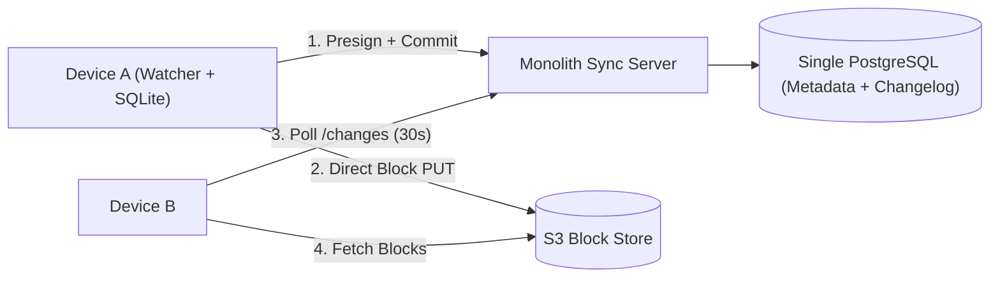
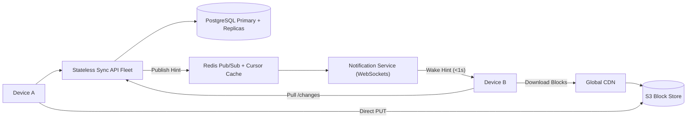
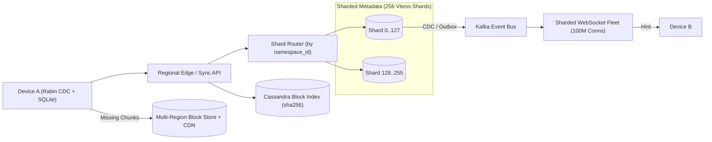
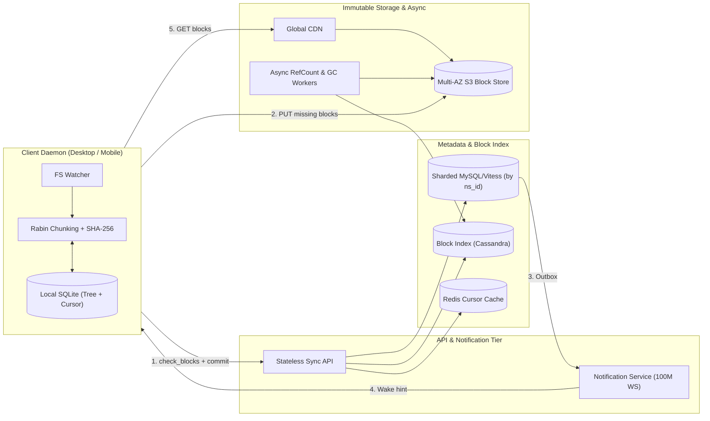

# Design Dropbox / Google Drive: Cloud File Storage Mock Interview

> **Difficulty:** Senior / Staff (L5–L7)
> **Prerequisites:** [Previous lesson: Feature Flag Service: Full System Design Mock Interview, All 9 Steps](../29-feature-flag-service/README.md) and the [Interview Framework track](../../21-interview-framework/README.md).
> **Estimated Reading Time:** 25–30 minutes
> **Target Audience:** Engineers practising the full system design interview on a classic prompt: cloud file storage with delta block-level sync, offline reconciliation, and conflict resolution across hundreds of millions of devices.

> [!NOTE]
> **In one line:** A Dropbox/Google Drive sync engine **separates immutable content-addressed blocks from a sharded per-namespace metadata & change-log database**: clients upload only modified chunks, commit ordered block lists, and wake sibling devices via lightweight "hint + cursor pull" notifications.

> [!TIP]
> **The Golden Rule:** Never upload whole files on small edits, never push file payloads inside notifications, and never silently overwrite concurrent edits—preserve both versions as a conflicted copy and let the user reconcile.

---

## 1. Clarifying Questions, Functional & Non-Functional Requirements

Open by distinguishing **plain blob storage** (S3) from **multi-device file synchronization**. The core engineering challenges here are **content-defined block deduplication**, **ordered per-namespace change logs**, **offline conflict detection**, and **scaling the metadata database** to 500M users.

### Clarifying Questions & Assumed Answers

| Question | Assumed Answer | Architectural Implication |
| :--- | :--- | :--- |
| **Client platforms?** | Desktop (macOS/Win/Linux daemon), mobile, and web | Local filesystem watcher + SQLite state DB on desktop clients |
| **Max file size?** | Up to 50 GB (arbitrary binary & text files) | Must chunk files into 4 MB blocks; resumable multipart block uploads |
| **Sync model?** | Automatic near-real-time (<5 s) across devices | Persistent WebSocket/long-poll notification + cursor-based delta pull |
| **Conflict policy?** | Never lose user data; preserve both edits | Optimistic concurrency (`base_rev`) + `file (conflicted copy)` |
| **Target scale?** | 500M total users, 50M DAU, 2 GB avg stored, 10 edits/DAU/day | 1,000 PB raw (600 PB deduped); 500M block uploads/day |

> Say it aloud: *"Before I draw anything, let me confirm our chunking model, conflict semantics, and whether real-time collaborative doc editing is out of scope."*

### Functional Requirements

1. **Block-Level Upload & Download:** Split files into chunks, hash each chunk (`SHA-256`), and upload/download only blocks missing from the destination.
2. **Multi-Device Sync:** Propagate creates, edits, renames, moves, and deletes to all online devices within seconds.
3. **Offline Edits & Conflict Resolution:** Queue local changes offline and reconcile on reconnect using optimistic base-revision checks without data loss.
4. **Version History & Shared Folders:** Retain immutable file revisions (30-day history) and support shared folders across multiple users.

### Non-Functional Requirements

| Quality | Target | Why It Drives the Design |
| :--- | :--- | :--- |
| **Durability** | 99.999999999% (11 nines) | Users trust the platform with irreplaceable personal & business files |
| **Bandwidth Efficiency** | Only changed blocks transferred | Critical for mobile data, battery, and 2 PB/day ingress savings |
| **Sync Convergence** | < 5 s notification + pull | Feels instantaneous across laptop and phone |
| **Consistency** | Strong per-namespace tree consistency | Prevents torn directories, orphan blocks, and silent overwrites |

**Explicitly Out of Scope:** Real-time character-by-character co-editing (OT/CRDTs—covered in Google Docs), full-text OCR search, and enterprise DLP.

---

## 2. Back-of-the-Envelope Capacity Estimation

Assumptions: **500M registered users**, **50M Daily Active Users (DAU)**, **2 GB average storage per user**, **10 file modifications per DAU per day**, **4 MB block size** (with ~1 changed block per edit), and **40% deduplication savings**.

### Storage Footprint (Block Store + Metadata)

$$
\text{Raw Storage} = 500 \times 10^6 \times 2\text{ GB} = 10^9\text{ GB} = 1{,}000\text{ PB} = 1\text{ Exabyte}
$$

With content-addressed deduplication (reusing unchanged blocks across file revisions and identical files):

$$
\text{Deduplicated Storage} = 1{,}000\text{ PB} \times (1 - 0.40) = 600\text{ PB}
$$

Metadata footprint (assuming ~500 files/user $\times$ 500 B per file row = 250 KB/user):

$$
\text{Total Metadata DB Size} = 500 \times 10^6 \times 250\text{ KB} = 125\text{ TB}
$$

### Daily Sync & Upload Bandwidth

$$
\text{Changed Blocks/day} = 50 \times 10^6\text{ DAU} \times 10\text{ edits} \times 1\text{ block} = 500 \times 10^6\text{ blocks/day}
$$

$$
\text{Upload QPS (avg / 3x peak)} = \frac{500 \times 10^6}{86{,}400} \approx 5{,}787\text{ blocks/s} \quad (\text{~17.4K blocks/s peak})
$$

$$
\text{Daily Upload Volume} = 500 \times 10^6 \times 4\text{ MB} = 2{,}000\text{ TB/day} = 2\text{ PB/day}
$$

$$
\text{Sustained Upload Bandwidth} = \frac{2 \times 10^{15}\text{ B} \times 8}{86{,}400\text{ s}} \approx 185\text{ Gbps} \quad (\text{~555 Gbps peak})
$$

### Capacity Summary Table

| Metric | Formula / Assumption | Result |
| :--- | :--- | :--- |
| **Total Stored (Deduped)** | $500\text{M} \times 2\text{ GB} \times 0.6$ | **600 PB** |
| **Metadata DB Size** | $500\text{M} \times 250\text{ KB}$ | **125 TB** |
| **Block Upload QPS** | $500\text{M} / 86{,}400\text{ s}$ | **~5.8K/s avg (~17.4K/s peak)** |
| **Daily Upload Volume** | $500\text{M} \times 4\text{ MB}$ | **2 PB/day (~185 Gbps avg)** |
| **Sync Notification Connections** | $50\text{M DAU} \times 2\text{ devices}$ | **~100M concurrent WebSockets** |

---

## 3. Core API Contracts & Data Model

### Sync & Block APIs

| Endpoint | Caller $\rightarrow$ Service | Purpose & Payload |
| :--- | :--- | :--- |
| `POST /v1/sync/check_blocks` | Client $\rightarrow$ Sync API | Sends `[sha256_1, sha256_2, ...]`; returns missing block hashes + presigned PUT URLs |
| `PUT {presigned_s3_url}` | Client $\rightarrow$ Block Store | Uploads missing 4 MB encrypted blocks directly to object storage (bypasses Sync API) |
| `POST /v1/sync/commit` | Client $\rightarrow$ Sync API | `{ns_id, path, base_rev, block_hashes[], mtime}`; atomic CAS commit or `409 Conflict` |
| `GET /v1/sync/changes?cursor=` | Client $\rightarrow$ Sync API | Pulls ordered change-log entries `(file_id, op, rev, block_hashes[])` since `cursor` |
| `WS /v1/notify` | Notification Service $\rightarrow$ Client | Lightweight push hint: `{"ns_id": 123, "latest_cursor": 9042}` |

### Data Model

| Store | Schema / Key Fields | Partitioning & Storage Choice |
| :--- | :--- | :--- |
| **Namespace Metadata DB** | `(ns_id, file_id, parent_id, name, rev, is_deleted, block_list_json, mtime)` | **Sharded MySQL/Vitess by `ns_id`** (keeps one user/shared folder ACID-transactional) |
| **Change Log (Journal)** | `(ns_id, cursor_seq, file_id, op, rev, timestamp)` | **Append-only table on same `ns_id` shard** (committed in same DB transaction!) |
| **Block Index** | `(block_sha256 -> s3_bucket_key, size_bytes, ref_count)` | **Cassandra / DynamoDB** keyed by `block_sha256` for $O(1)$ existence checks |
| **Block Store** | `key = sha256`, immutable 4 MB compressed+encrypted blobs | **Multi-AZ Object Storage (S3/GCS)** + **CDN** for hot shared downloads |

---

## 4. Stage 1 (100 – 1K Users): Baseline Monolith & Single Database

At startup scale (100–1,000 users, <1 TB stored, <50 QPS), a single API server backed by PostgreSQL and S3 works cleanly.

### Component-by-Component Build
1. **Desktop Sync Client:** Watches a local folder (`inotify` / `FSEvents`), computes SHA-256 of 4 MB chunks, and calls the API.
2. **Monolith Sync Server:** Checks chunk existence, issues S3 presigned URLs, commits file metadata to PostgreSQL, and serves `GET /changes?cursor=`.
3. **30-Second Polling:** Other devices poll `GET /changes?cursor=` every 30 seconds to discover updates.



### What Breaks at 10K Users / 500K Devices?
- **Polling Flood:** 500K devices polling PostgreSQL every 5 seconds for "near-real-time" sync creates 100,000 QPS of empty `SELECT * FROM changelog WHERE cursor > X` queries, melting the DB.
- **Single PostgreSQL Write Ceiling:** Metadata + change-log writes and 125 TB of file trees cannot fit on one PostgreSQL instance.
- **No Edge Caching for Viral Shared Links:** A single public PDF shared on Hacker News hammers S3 origin bandwidth.

---

## 5. Stage 2 (10K – 100K Users): Caching, Read Replicas & Async Offload

To eliminate polling floods and scale metadata, we add a **WebSocket Notification Service**, **Redis Cursor Cache**, **Metadata Read Replicas**, and a **CDN** for downloads.

### Component-by-Component Additions
1. **Long-Lived Notification Service (WebSockets / Long-Poll):** Devices hold an idle connection per namespace. On commit, the Sync API publishes `{ns_id, cursor}` to Redis Pub/Sub; the Notification Service wakes Device B in <1 second, which *then* pulls `/changes`.
2. **Redis Cursor Cache:** Caches `latest_cursor:{ns_id}` so reconnects and polls skip PostgreSQL when `client_cursor == latest_cursor`.
3. **CDN (CloudFront / Cloudflare):** Serves immutable, content-addressed block downloads (`GET /blocks/{sha256}`) at the edge.
4. **Async Garbage Collector:** Decouples block deletion from file deletes—files are soft-deleted immediately, and background workers decrement `ref_count` and sweep unreferenced blocks after the 30-day retention window.



### What Breaks at 1M+ Users / 500M Users?
- **Single Primary DB Bottleneck:** 50M DAU generating 500M commits/day + shared-folder updates saturates a single PostgreSQL primary.
- **Fixed 4 MB Chunking Insertion Shift:** Inserting 1 byte at the start of a 100 MB file shifts every fixed 4 MB boundary, forcing all 25 blocks to re-upload!
- **Shared Folder Fan-Out:** A company folder shared by 10,000 employees causes a 10,000x notification & metadata fan-out storm on every edit.

---

## 6. Stage 3 (1M – 10M+ Users): Sharding, Partitioning & Multi-Region Scale

At 500M users (600 PB, 100M concurrent devices), we introduce **Namespace-Sharded Metadata (Vitess/MySQL)**, **Content-Defined Chunking (Rabin Fingerprinting)**, **Dedicated Block-Index Tier**, and **Multi-Region Edge PoPs**.

### Component-by-Component Additions
1. **Namespace-Sharded Metadata (Vitess / 256+ Shards):** Shard by `hash(namespace_id)`. Every user's root folder and every shared folder is a self-contained **Namespace**, keeping folder renames, moves, and change-log appends **single-shard ACID transactions**.
2. **Content-Defined Chunking (CDC / Rabin Fingerprinting):** Instead of fixed 4 MB cuts, chunk boundaries are determined by a rolling hash over a sliding window (`hash(window) % 4MB == 0`). Inserting 100 bytes at the beginning of a file changes only **1 chunk**, leaving the remaining 99% of blocks identical!
3. **Shared-Folder Indirection (Mount Points):** Shared folders live in their own `namespace_id` mounted into each member's home namespace—avoiding 10,000x duplicate metadata copies.
4. **Regional Block Store & Edge PoPs:** Multi-region S3 replication + regional Sync APIs terminate TLS close to users.



---

## 7. Final Full Production Architecture & End-to-End Flows

### Complete Production Architecture



### End-to-End Block Sync & Conflict Sequence

```mermaid
sequenceDiagram
  autonumber
  participant A as Device A
  participant API as Sync API
  participant DB as Namespace Shard (DB)
  participant S3 as Block Store (S3)
  participant WS as Notification Svc
  participant B as Device B

  A->>A: Detect edit, Rabin-chunk file, compute SHA-256s
  A->>API: POST /check_blocks [h1, h2_new, h3]
  API-->>A: Missing: [h2_new] + Presigned PUT URL
  A->>S3: PUT h2_new (4 MB encrypted block)
  S3-->>A: 200 OK
  A->>API: POST /commit {ns: 7, path: "/doc.pdf", base_rev: 4, blocks: [h1,h2_new,h3]}
  API->>DB: BEGIN; Check current rev == 4; UPDATE rev=5; INSERT changelog(c=109); COMMIT
  API-->>A: 200 OK (rev: 5, cursor: 109)
  API->>WS: Notify {ns: 7, cursor: 109}
  WS-->>B: Push hint {ns: 7, cursor: 109}
  B->>API: GET /changes?ns=7&cursor=108
  API-->>B: [{file: "/doc.pdf", rev: 5, blocks: [h1, h2_new, h3]}]
  B->>S3: GET h2_new (reuses local h1 & h3!)
  B->>B: Reassemble file atomically & update local SQLite cursor=109
```

---

## 8. Deep-Dive Bottlenecks & Algorithmic Trade-Offs

### 1. Fixed-Size Chunking vs. Content-Defined Chunking (Rabin Fingerprinting)
- **Fixed 4 MB Chunking:** Simple (`offset % 4MB`), but inserting 10 bytes at byte 0 shifts every subsequent block boundary—invalidating 100% of hashes in a 1 GB video/archive.
- **Content-Defined Chunking (FastCDC / Rabin):** Slides a 48-byte rolling hash window over the file and cuts a chunk whenever `(hash & mask) == 0` (average 4 MB, clamped between min 1 MB and max 8 MB). An insertion at byte 0 only alters the **first chunk**; all trailing chunks align at the exact same content boundaries and are deduplicated!

### 2. Conflict Resolution: Optimistic Concurrency (`base_rev`)
Suppose Device A and Device B are both offline, and both edit `budget.xlsx` (at `rev = 4`).
- Device A reconnects first: commits with `base_rev = 4` $\rightarrow$ succeeds, server advances file to `rev = 5`.
- Device B reconnects second: commits with `base_rev = 4` $\rightarrow$ server sees `current_rev (5) != base_rev (4)` and returns `409 Conflict` with the server's `rev = 5` metadata.
- Device B downloads `rev = 5` as `budget.xlsx` and saves its own offline edit as `budget (Device B's conflicted copy 2026-11-25).xlsx`, then commits the conflicted copy as a new file. **Zero data loss.**

### 3. Cross-User Deduplication & Encryption Security Trade-Off
- **Cross-User Dedup:** Saves ~40% storage by storing one copy of popular files (e.g., an Ubuntu ISO or PDF attachment) across all users.
- **Security Risk (Side-Channel / Convergent Encryption):** If you check `exists(sha256(plaintext))` globally, an attacker can probe whether *someone else* has a sensitive file (hash-oracle attack), and per-user KMS encryption keys prevent cross-user dedup.
- **Production Pick:** Deduplicate **within a single user/organization namespace** using per-tenant encryption keys, or use **server-side envelope encryption** with authenticated ownership tokens if cross-user dedup is required.

---

## 9. Failure Modes, Reliability & Backpressure Mitigations

| Failure Mode | Impact / Symptom | Mitigation |
| :--- | :--- | :--- |
| **Missed WebSocket Notification** | Device B doesn't see Device A's edit | **Hint + Cursor Pull:** Client wakes on WS *or* periodic background fallback poll (e.g., every 5 min) and pulls `/changes?cursor=X`; missed hints never lose data |
| **Client Crashes Mid-Download** | Corrupted half-written local file | Download blocks to `.tmp/` staging area, verify `SHA-256`, assemble temp file, then **atomic `rename()`** into user folder |
| **Orphaned Blocks (Upload Before Commit)** | Client uploads 4 MB block then crashes before `/commit` | **Async GC** sweeps blocks with `ref_count == 0` older than 24 hours |
| **Sync Loop (Client Re-Uploads Downloaded File)** | Infinite sync storm between devices | Local SQLite records `(path, mtime, local_rev)` before atomic `rename()`, ignoring FS watcher events caused by the sync daemon itself |
| **Viral Public Link Download Spike** | Origin S3 egress throttled | Serve all public/shared downloads through **Global CDN** with signed URLs and range-request caching |

---

## 10. Production War Story & Real-World Reference

### War Story: The Infinite Sync Loop & Rename Storm (SEV-1)
- **What Happened:** A desktop client update introduced a subtle bug on case-insensitive filesystems (macOS APFS / Windows NTFS): when User A renamed `Report.pdf` to `report.pdf`, Device B (Windows) saw the change, wrote `report.pdf`, and its filesystem watcher emitted a "new file created" event because of a metadata timestamp mismatch.
- **Cascade:** Device B committed a new revision, waking Device A, which re-committed—creating 10,000+ rapid revisions per minute for affected folders. Metadata DB shards hit 100% IOPS and notification queues backed up by 15 minutes.
- **Root Cause:** Missing **self-echo suppression** in the local FS watcher and no **per-file commit rate limiter** on the Sync API.
- **Permanent Fix:**
  1. Added **in-daemon echo suppression** (tag daemon-initiated writes with expected `mtime` + `inode` in local SQLite before `rename()`).
  2. Added **per-file/per-user token-bucket throttling** on `/commit` and exponential backoff on identical consecutive hashes.

**Real-World Reference:** Dropbox Tech Blog (*Rewriting the Heart of Our Sync Engine* — Nucleus in Rust, *Pocket* exabyte block store, and Magic Pocket); Google Drive API (`changes.list` with `pageToken` cursors).

---

## 11. Core Component Implementation (4 Languages)

Below is a production-grade **Block-Level Delta Differ & Optimistic-Concurrency Commit Validator** in Go, TypeScript, Python, and C#.

````carousel
```go
package syncengine

import (
	"crypto/sha256"
	"encoding/hex"
	"errors"
)

// ChunkHashes splits data into fixed-size blocks and returns their SHA-256 hex digests.
func ChunkHashes(data []byte, blockSize int) []string {
	var hashes []string
	for start := 0; start < len(data); start += blockSize {
		end := min(start+blockSize, len(data))
		sum := sha256.Sum256(data[start:end])
		hashes = append(hashes, hex.EncodeToString(sum[:]))
	}
	return hashes
}

// MissingBlocks returns only the hashes not already present in the server block index.
func MissingBlocks(newHashes []string, existing map[string]bool) []string {
	var missing []string
	seen := make(map[string]bool)
	for _, h := range newHashes {
		if !existing[h] && !seen[h] {
			missing = append(missing, h)
			seen[h] = true
		}
	}
	return missing
}

// CommitFile enforces optimistic concurrency via baseRev to detect offline conflicts.
func CommitFile(currentRev, baseRev int64) (int64, error) {
	if baseRev != currentRev {
		return currentRev, errors.New("409 Conflict: create conflicted copy")
	}
	return currentRev + 1, nil
}
```
<!-- slide -->
```typescript
import { createHash } from "crypto";

export function chunkHashes(data: Buffer, blockSize = 4 * 1024 * 1024): string[] {
  const hashes: string[] = [];
  for (let start = 0; start < data.length; start += blockSize) {
    const slice = data.subarray(start, Math.min(start + blockSize, data.length));
    hashes.push(createHash("sha256").update(slice).digest("hex"));
  }
  return hashes;
}

export function missingBlocks(newHashes: string[], existing: Set<string>): string[] {
  const missing: string[] = [];
  const seen = new Set<string>();
  for (const h of newHashes) {
    if (!existing.has(h) && !seen.has(h)) {
      missing.push(h);
      seen.add(h);
    }
  }
  return missing;
}

export function commitFile(currentRev: number, baseRev: number): number {
  if (baseRev !== currentRev) {
    throw new Error("409 Conflict: save conflicted copy");
  }
  return currentRev + 1;
}
```
<!-- slide -->
```python
import hashlib
from typing import List, Set


def chunk_hashes(data: bytes, block_size: int = 4 * 1024 * 1024) -> List[str]:
    """Split file bytes into blocks and return SHA-256 hex digests."""
    return [
        hashlib.sha256(data[i : i + block_size]).hexdigest()
        for i in range(0, len(data), block_size)
    ]


def missing_blocks(new_hashes: List[str], existing: Set[str]) -> List[str]:
    """Return deduplicated list of block hashes missing on the server."""
    missing: List[str] = []
    seen: Set[str] = set()
    for h in new_hashes:
        if h not in existing and h not in seen:
            missing.append(h)
            seen.add(h)
    return missing


def commit_file(current_rev: int, base_rev: int) -> int:
    if base_rev != current_rev:
        raise ValueError("409 Conflict: preserve both as conflicted copy")
    return current_rev + 1


if __name__ == "__main__":
    v1 = chunk_hashes(b"AAAAAAAABBBBBBBBCCCCCCCCDDDDDDDD", block_size=8)
    v2 = chunk_hashes(b"AAAAAAAABBBBXXXXCCCCCCCCDDDDDDDD", block_size=8)
    to_upload = missing_blocks(v2, set(v1))
    print(f"Total blocks: {len(v2)}, blocks to upload: {len(to_upload)}")
```
<!-- slide -->
```csharp
using System;
using System.Collections.Generic;
using System.Security.Cryptography;

public static class SyncEngine
{
    public static List<string> ChunkHashes(ReadOnlySpan<byte> data, int blockSize = 4 * 1024 * 1024)
    {
        var hashes = new List<string>();
        for (int start = 0; start < data.Length; start += blockSize)
        {
            int len = Math.Min(blockSize, data.Length - start);
            byte[] digest = SHA256.HashData(data.Slice(start, len));
            hashes.Add(Convert.ToHexString(digest).ToLowerInvariant());
        }
        return hashes;
    }

    public static List<string> MissingBlocks(IEnumerable<string> newHashes, IReadOnlySet<string> existing)
    {
        var missing = new List<string>();
        var seen = new HashSet<string>();
        foreach (var h in newHashes)
        {
            if (!existing.Contains(h) && seen.Add(h))
                missing.Add(h);
        }
        return missing;
    }

    public static long CommitFile(long currentRev, long baseRev)
    {
        if (baseRev != currentRev)
            throw new InvalidOperationException("409 Conflict: save conflicted copy");
        return currentRev + 1;
    }
}
```
````

---

## 12. Verification, Load Testing & CLI Diagnostics

```bash
# 1. Verify block-level delta upload savings in Python
python3 -c '
import hashlib
blk = lambda d: [hashlib.sha256(d[i:i+8]).hexdigest()[:8] for i in range(0, len(d), 8)]
v1, v2 = blk(b"AAAAAAAABBBBBBBBCCCCCCCCDDDDDDDD"), blk(b"AAAAAAAABBBBXXXXCCCCCCCCDDDDDDDD")
print("Total:", len(v2), "To upload:", len([h for h in v2 if h not in v1]))
'

# 2. Simulate presigned block upload + atomic commit flow
curl -s -X POST https://sync.example.com/v1/sync/check_blocks \
  -H "Authorization: Bearer $TOKEN" \
  -d '{"hashes":["e3b0c442..."]}' | jq .

# 3. Pull incremental change log from cursor
curl -s "https://sync.example.com/v1/sync/changes?ns_id=42&cursor=108" \
  -H "Authorization: Bearer $TOKEN" | jq '.entries'

# 4. Monitor Vitess / MySQL shard lag and WebSocket connection count
curl -s http://localhost:9100/metrics | grep -E "ws_active_connections|mysql_replica_lag_seconds"
```

---

## 13. Common Interview Mistakes & Red Flags

1. **Uploading Whole Files on Every Edit:** Wastes 2 PB/day of bandwidth and fails on 10 GB files over spotty Wi-Fi.
2. **Last-Write-Wins Conflict Resolution:** Silently destroys user work when two offline laptops edit the same document.
3. **Treating Push Notifications as the Source of Truth:** If a WebSocket packet drops while a phone enters a tunnel, the device permanently misses the file unless it pulls from a cursor-based change log.
4. **Storing File Blobs in PostgreSQL:** Bloats the metadata DB to 600 PB and destroys transaction performance.
5. **Using a Single Global Metadata Database:** Fails to scale past ~50K writes/s; must shard by `namespace_id`.
6. **Deleting Blocks Synchronously on File Delete:** Breaks 30-day version history and other deduplicated files referencing the same block.

---

## 14. Key Terminology & Glossary

| Term | Definition |
| :--- | :--- |
| **Block-Level Sync** | Splitting files into ~4 MB chunks and transferring only chunks whose cryptographic hashes changed. |
| **Content-Defined Chunking (CDC)** | Using a rolling hash (e.g., Rabin/FastCDC) to find chunk boundaries so insertions don't shift all trailing blocks. |
| **Namespace** | A unit of file-tree ownership (a user's home folder or a shared folder) used as the sharding key for ACID metadata. |
| **Change Log (Journal)** | Append-only, per-namespace ordered log of file mutations indexed by a monotonic `cursor`. |
| **Hint + Cursor Pull** | Pattern where WebSockets send a tiny "something changed" hint and clients pull exact deltas from their cursor. |
| **Conflicted Copy** | Preserving both versions when `base_rev != current_rev` on commit so zero user data is lost. |
| **Content-Addressed Storage** | Storing immutable blocks keyed by their `SHA-256` hash, enabling natural deduplication and integrity checks. |
| **Reference Counting GC** | Background garbage collection that deletes a block only when zero file revisions reference it and retention expires. |

---

## 15. Interview Follow-Up Questions (12 Q&As)

### Basic Conceptual Questions

<details>
<summary><strong>Q1: Why split files into 4 MB blocks instead of uploading whole files? [BASIC]</strong></summary>

If a user edits 1 KB inside a 100 MB presentation, block-level sync uploads only the single 4 MB block that changed instead of 100 MB—saving 96% bandwidth, battery, and upload latency. It also makes large uploads naturally resumable.

</details>

<details>
<summary><strong>Q2: Why do we use "hint + cursor pull" instead of pushing the file changes over WebSockets? [BASIC]</strong></summary>

WebSocket messages can drop when devices sleep or switch networks. Sending a tiny hint ("namespace 7 has new cursor 109") keeps the notification tier stateless and lightweight; the client then pulls `/changes?cursor=108` from the durable DB, so a missed hint is harmless.

</details>

<details>
<summary><strong>Q3: How do you handle file renames or moves efficiently? [BASIC]</strong></summary>

Because blocks are content-addressed and immutable, renaming or moving a 10 GB folder only updates a single row (`name` or `parent_id`) in the Metadata DB and appends a `RENAME` entry to the change log—**zero bytes** of block data are re-uploaded or copied.

</details>

<details>
<summary><strong>Q4: Why shard the Metadata DB by `namespace_id` instead of `file_id`? [BASIC]</strong></summary>

Sharding by `namespace_id` keeps an entire user's folder tree and its append-only change log on a **single database shard**. This allows atomic transactions for folder moves, `base_rev` conflict checks, and monotonic `cursor` assignment without distributed 2PC.

</details>

### Scenario-Based Architecture Questions

<details>
<summary><strong>Q5: Two users edit the same file while offline on airplanes. What happens when they land? [SCENARIO]</strong></summary>

User A reconnects first with `base_rev=4`, succeeds, and advances the file to `rev=5`. User B reconnects later with `base_rev=4`; the Sync API detects `current_rev (5) != base_rev (4)`, rejects with `409 Conflict`, and User B's client saves its local version as `file (User B's conflicted copy).ext` while downloading `rev=5`. Both edits are preserved.

</details>

<details>
<summary><strong>Q6: A user inserts 100 bytes at the beginning of a 500 MB file. How do you avoid re-uploading all 500 MB? [SCENARIO]</strong></summary>

Use **Content-Defined Chunking (Rabin Fingerprinting / FastCDC)** instead of fixed 4 MB offsets. Because chunk boundaries depend on local byte patterns, inserting 100 bytes at byte 0 only alters the first chunk; all remaining ~124 chunks retain identical hashes and are skipped.

</details>

<details>
<summary><strong>Q7: How do you support a shared folder with 5,000 company employees without 5,000x write amplification? [SCENARIO]</strong></summary>

Model the shared folder as its own independent **Namespace** (`ns_shared_99`) mounted into each employee's home namespace via a lightweight pointer. An edit writes **1 row** to `ns_shared_99`'s change log, and the Notification Service fans out the wake hint to active connected subscribers of `ns_shared_99`.

</details>

<details>
<summary><strong>Q8: A user accidentally deletes a 2 GB folder and empties trash, or wants a version from 2 weeks ago. How does that work? [SCENARIO]</strong></summary>

Every commit creates a new immutable revision pointing to a list of content-addressed block hashes. Old revisions are kept for 30 days, and blocks are only deleted by the **async Garbage Collector** once zero active or retained revisions reference that `block_sha256` and the 30-day window has passed.

</details>

### Advanced & Tricky Interview Questions

<details>
<summary><strong>Q9: How do you prevent a client from corrupting a local file if it crashes halfway through syncing? [TRICKY]</strong></summary>

The client downloads missing blocks to a hidden staging directory, verifies each block's `SHA-256` checksum, assembles the complete new file in the staging directory, and performs an OS-level **atomic `rename()`** over the target path (recording the new `inode`/`mtime` in local SQLite first to suppress watcher echo).

</details>

<details>
<summary><strong>Q10: What is the security risk of cross-user deduplication, and how do you mitigate it? [TRICKY]</strong></summary>

If the server tells a client "you don't need to upload `sha256(X)` because it already exists," an attacker can probe whether *another user* stores a known sensitive document (hash-oracle / confirmation-of-a-file attack). Mitigate by **scoping deduplication to a single user/org** with per-tenant encryption keys, or requiring proof-of-ownership challenges before skipping uploads.

</details>

<details>
<summary><strong>Q11: How do you handle "hot shards" when one enterprise customer has 50,000 users in one shared namespace? [TRICKY]</strong></summary>

Isolate massive enterprise namespaces onto **dedicated Vitess shards**, cache read-heavy `/changes` responses in Redis (keyed by `(ns_id, cursor)`), batch rapid consecutive commits on the client, and use **hierarchical/fan-out pub/sub** for the 50,000 WebSocket wake hints.

</details>

<details>
<summary><strong>Q12: How does the client detect local edits while the sync daemon was shut down? [TRICKY]</strong></summary>

On startup, the daemon runs a **local tree reconciliation scan**: it walks the watched directory, comparing each file's `(path, size, mtime, inode)` against its local SQLite state snapshot. Only files with changed `size`/`mtime` are re-hashed and queued for `/check_blocks` + `/commit`.

</details>

---

## 16. One-Page Master Cheat Sheet

```text
+-----------------------------------------------------------------------------+
|            DROPBOX / GOOGLE DRIVE (500M USERS, 600 PB, 2 PB/DAY)            |
+-----------------------------------------------------------------------------+
| 1. ARCHITECTURE : Split immutable Block Store (S3) from Metadata DB (Vitess)|
| 2. CHUNKING     : Content-Defined Chunking (Rabin/FastCDC ~4 MB) + SHA-256  |
| 3. UPLOAD PATH  : check_blocks -> Presigned PUT missing blocks -> commit    |
| 4. SHARDING     : Shard Metadata + Changelog by namespace_id (single-shard) |
| 5. SYNC SIGNAL  : WebSocket "hint" -> Client pulls /changes?cursor=X        |
| 6. CONFLICTS    : Optimistic check (base_rev == current_rev) -> 409 copy    |
| 7. DOWNLOADS    : Global CDN for content-addressed blocks + atomic rename() |
| 8. CLEANUP      : Soft-delete + 30d version history + Async RefCount GC     |
+-----------------------------------------------------------------------------+
```

| Decision | Choice | Why |
| :--- | :--- | :--- |
| **Chunking** | Content-Defined (Rabin) | Insertions only dirty 1 chunk |
| **Metadata Sharding** | By `namespace_id` | Keeps tree moves & change log ACID |
| **Notifications** | Hint + Cursor Pull | Resilient to dropped WebSockets |
| **Conflicts** | Preserve Conflicted Copy | Never silently lose user data |

---

## Further Reading

- Dropbox Tech Blog, *Rewriting the Heart of Our Sync Engine* and *Inside the Magic Pocket*.
- Muthitacharoen et al., *A Low-Bandwidth Network File System (LBFS)* (SOSP 2001 — Content-Defined Chunking).
- Google Drive API documentation on `changes.list` cursors and file revisions.

---

## Next

Continue with [Design Google Docs: Real-Time Collaborative Editor Mock Interview](../31-design-google-docs/README.md).
