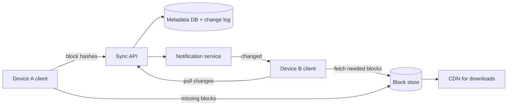

# Design Dropbox / Google Drive: Cloud File Storage Mock Interview

> **Prerequisites:** [Previous lesson: Feature Flag Service: Full System Design Mock Interview, All 9 Steps](../29-feature-flag-service/README.md) and the [Interview Framework track](../../21-interview-framework/README.md).
> **Estimated Reading Time:** 15–20 minutes
> **Target Audience:** Engineers practising the full 9-step system design interview on a classic prompt: cloud file storage with automatic sync across devices.

> [!NOTE]
> **In one line:** Dropbox-style storage adds **sync** to file storage: a client watches a local folder, uploads changed blocks, and every other device learns about the change and downloads only what differs.

> [!TIP]
> **The Golden Rule:** Sync at the block level with content hashes, keep a per-user change log as the source of truth for sync, and resolve conflicts explicitly instead of overwriting.

---

## Step 1. Clarify the Problem

Open with questions, not boxes. The earlier file storage lesson covered chunks and sharing. This one is about keeping many devices consistent.

**Questions to ask the interviewer, and the answer we assume:**

| Question | Assumed answer |
| :--- | :--- |
| Devices? | Desktop, mobile and web per user |
| Sync model? | Automatic and near real time |
| Conflicts? | Keep both versions when edits collide |
| Offline? | Edit offline, sync on reconnect |
| Scale? | 500M users, 50M daily actives, average 2 GB stored |

> Say it aloud: *"Before I draw anything, let me confirm the scope and the numbers."* That one sentence earns the first minutes of the interview.

---

## Step 2. Functional and Non-Functional Requirements

**Functional (what the system does):**

- Upload files and keep them in sync across devices.
- Download only the changed parts of a file.
- Handle offline edits and conflicts.
- Share folders and keep version history.

**Non-functional (how well it does it):**

| Quality | Target | Why it drives the design |
| :--- | :--- | :--- |
| Consistency | All devices converge | The core promise of sync |
| Efficiency | Transfer only changed blocks | Bandwidth and battery |
| Durability | No lost files | Highest trust requirement |
| Latency | Changes appear within seconds | Feels real time |

---

## Step 3. Scope: In and Out

**In scope:** Block sync, change log, notifications, conflicts, versions.

**Out of scope (say it explicitly, then move on):**

- Real-time co-editing (next lesson).
- Search inside files.
- Admin and enterprise controls.

---

## Step 4. Capacity Estimation

Assumptions: 500M users storing 2 GB on average, 50M daily actives each changing 10 files, average change affects 1 block of 4 MB.

| Quantity | Calculation | Result |
| :--- | :--- | :--- |
| Total stored (before dedup) | `users * gb / 1e6` | **1K PB** |
| Stored after dedup | `total_stored__before_dedup_ * dedup` | **600 PB** |
| Changed blocks per day | `dau * changes` | **500M blocks** |
| Upload traffic per day | `dau * changes * block_mb / 1e6` | **2K TB/day** |

**What the numbers tell you:** 1,000 PB before deduplication shows the scale of the storage bill; content-addressed blocks with dedup cut it noticeably. Block-level sync is what keeps upload traffic to about 2 PB per day instead of sending whole files every time.

---

## Step 5. API Design

| Endpoint | Purpose | Notes |
| :--- | :--- | :--- |
| `POST /v1/sync/commit` | Commit a file change | List of block hashes; server says which blocks it still needs. |
| `PUT {presigned}` | Upload a missing block | Direct to block storage. |
| `GET /v1/sync/changes?cursor=` | Pull changes since a cursor | Per-user change log. |
| `WS /v1/notify` | Wake devices | Says 'something changed', then the client pulls. |

The notification only says that there is news. The client then pulls the change log from its cursor, so a missed notification never loses a change.

---

## Step 6. Data Model

| Entity / Store | Key fields | Why this store |
| :--- | :--- | :--- |
| Metadata DB (sharded by user) | Namespace tree: file id, path, version, block list, `mtime` | Transactional per user |
| Change log (per user, ordered) | `cursor`, file id, action, new version | What sync reads |
| Block store | Key = block hash, immutable | Content-addressed and deduplicated |
| Notification service | Connections per device | Push 'changed' hints |

A file is just an ordered list of block hashes. A new version reuses every unchanged block, so a small edit stores a few new blocks and a new list.

---

## Step 7. High-Level Architecture



**Walk the diagram in this order:** device A hashes its changed blocks, asks the API which are missing, uploads only those, and commits the new block list; the notification service wakes device B, which pulls the change log and downloads the new blocks.

---

## Step 8. Deep Dives and Bottlenecks

### 1. Block-level sync and deduplication

The client splits files into blocks (fixed, or content-defined chunking so an insertion does not shift every block), hashes each, and asks the server which it lacks. Only missing blocks are uploaded. A rename or move changes only metadata, never blocks. Identical blocks across users can be stored once, with care for privacy.

### 2. The change log and conflicts

Each user namespace has an append-only, ordered change log. A device stores a cursor and pulls entries after it. A commit includes the version it was based on; if the server's current version differs, a conflict exists. Keep both: save the loser as `file (conflicted copy)` rather than discarding data.

### 3. Offline, scale and metadata

Offline devices queue their changes and reconcile on reconnect using the same base-version check. Metadata is sharded by user (a namespace is the unit), which keeps a user's tree transactional. The metadata database is the scaling bottleneck, so cache namespace listings and batch commits.

---

## Step 9. Trade-offs, Failures and Security

**Trade-offs to state aloud:**

| Decision | Option A | Option B | Pick and why |
| :--- | :--- | :--- | :--- |
| Chunking | Fixed-size blocks | Content-defined | Content-defined: small edits change few blocks |
| Notification | Push the data | Push a hint then pull | Hint then pull: robust to missed messages |
| Conflict | Last write wins | Keep both copies | Keep both: never lose user data |

**Failure modes and mitigations:**

| Failure | What users see | Mitigation |
| :--- | :--- | :--- |
| Missed notification | Delayed sync | Periodic pull and cursor catch-up |
| Conflicting edits | Two versions | Conflicted copy with both preserved |
| Block store loss | Lost data | Replication across zones and integrity checks |

**Security and abuse:** Encrypt blocks at rest and in transit, authorise every metadata and block access, use short-lived signed URLs, and consider convergent-encryption risks before cross-user dedup.

---

## Runnable Example: Which blocks must be uploaded

A one-line edit in the middle of a file changes a single block, so only that block is sent.

```python
import hashlib

BLOCK = 8

def blocks(data):
    return [hashlib.sha256(data[i:i + BLOCK]).hexdigest()[:6] for i in range(0, len(data), BLOCK)]

v1 = b"AAAAAAAABBBBBBBBCCCCCCCCDDDDDDDD"
v2 = b"AAAAAAAABBBBXXXXCCCCCCCCDDDDDDDD"
old, new = blocks(v1), blocks(v2)
to_upload = [h for h in new if h not in old]
print(len(new), "blocks in file;", len(to_upload), "to upload")
print("changed block index:", [i for i, (a, b) in enumerate(zip(old, new)) if a != b])
```

Output (produced by running this exact code):

```text
4 blocks in file; 1 to upload
changed block index: [1]
```

Only the second block differs, so one of four blocks is uploaded instead of the whole file.

---

## Common Mistakes

- Uploading whole files on each change.
- Last-write-wins that silently destroys edits.
- Relying on a notification as the only sync signal.
- One global metadata database.
- Storing files in the metadata store.

---

## Interview Questions and Answers

<details>
<summary><strong>Q1: How does block-level sync save bandwidth?</strong></summary>

The client hashes blocks and uploads only those the server does not have, so a small edit transfers one block.

</details>

<details>
<summary><strong>Q2: How do devices find out about changes?</strong></summary>

A notification wakes them; they pull the per-user change log from their cursor, so a missed hint is harmless.

</details>

<details>
<summary><strong>Q3: How do you resolve conflicts?</strong></summary>

Compare the base version on commit; if it differs, keep both and save a conflicted copy.

</details>

<details>
<summary><strong>Q4: How do you shard metadata?</strong></summary>

By user or namespace, so one user's file tree is transactional on one shard.

</details>

<details>
<summary><strong>Q5: How do you handle offline edits?</strong></summary>

Queue changes locally and reconcile on reconnect with the same base-version check.

</details>

---

## One-Page Cheat Sheet

| Step | What to say or draw |
| :--- | :--- |
| Clarify | Multi-device sync, conflicts, offline |
| Capacity | ~1,000 PB stored, ~2 PB/day uploads |
| API | commit block list, upload missing, pull changes, notify |
| Data | Metadata and change log, content-addressed blocks |
| Deep dive | Block sync, change log, conflicts |
| Trade-off | Hint then pull, keep both copies |

---

## Further Reading

- Dropbox Tech Blog, *Rewriting the heart of our sync engine* and *Streaming File Synchronization*.
- Google Drive API documentation on changes and revisions.

---

## Next

Continue with [Design Google Docs: Real-Time Collaborative Editor Mock Interview](../31-design-google-docs/README.md).
