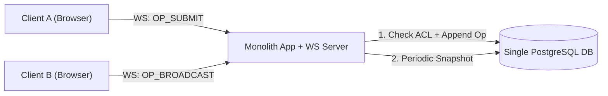
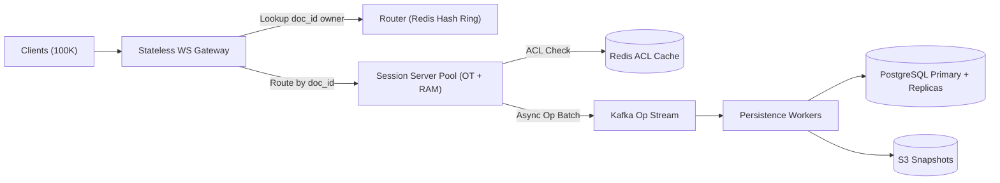
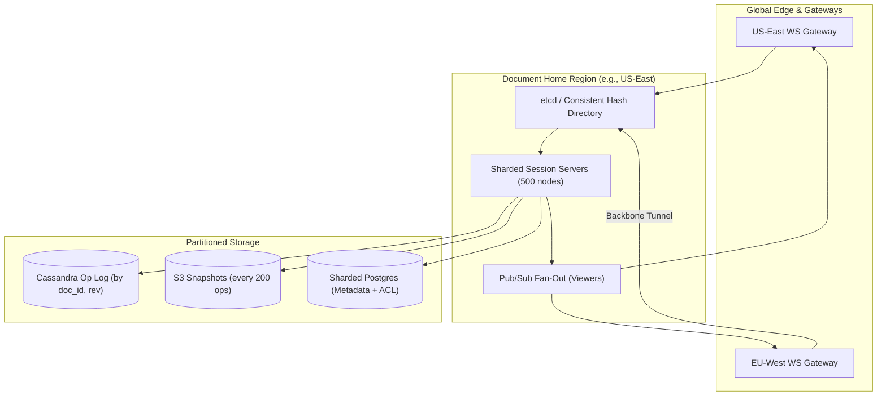
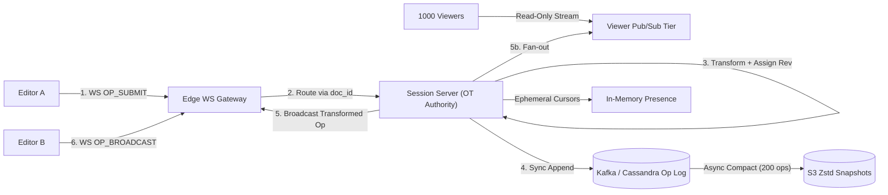
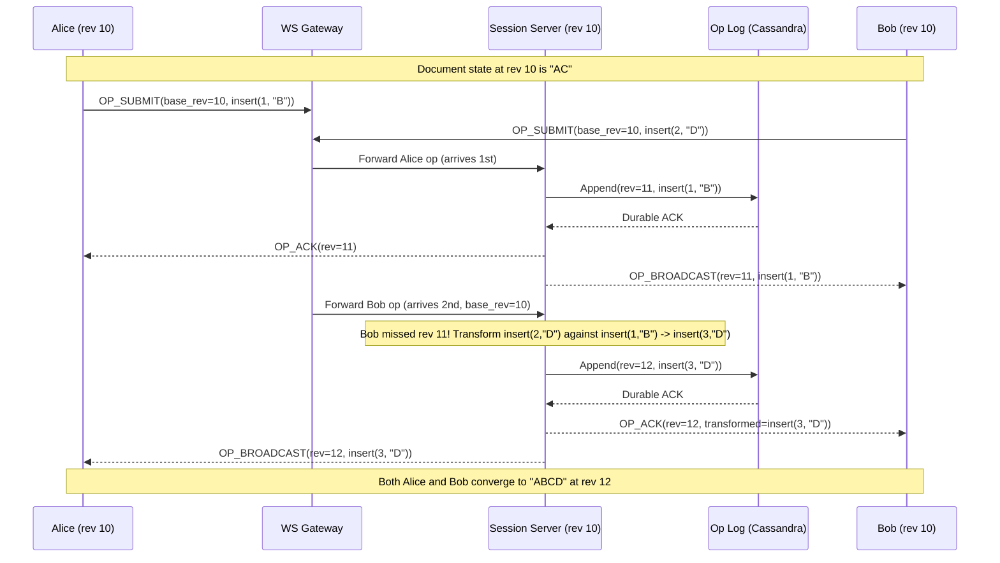
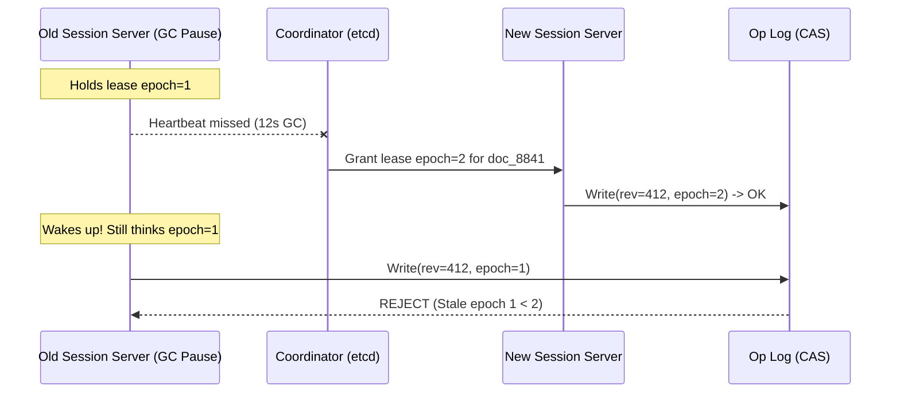

# Design Google Docs: Real-Time Collaborative Editor Mock Interview

> **Difficulty:** Hard (Senior / Staff System Design)
> **Prerequisites:** [Previous lesson: Design Dropbox / Google Drive: Cloud File Storage Mock Interview](../30-design-dropbox-google-drive/README.md) and the [Interview Framework track](../../21-interview-framework/README.md).
> **Estimated Reading Time:** 25 minutes
> **Target Audience:** Engineers practising the full system design interview on a classic prompt: several people editing the same document live without overwriting each other.

> [!NOTE]
> **In one line:** Collaborative editing needs a way to **merge concurrent edits so every client converges to the same document**; the two main approaches are Operational Transformation (OT) and Conflict-free Replicated Data Types (CRDTs).

> [!TIP]
> **The Golden Rule:** Send small operations, not whole documents; route each document's edits through one authoritative session server that orders them; and persist an append-only operation log with periodic snapshots.

---

## 1. Clarifying Questions, Functional & Non-Functional Requirements

Open the interview with scoping questions, not boxes. Authentication, blob storage, and folder hierarchies are standard; the heart of this interview is how concurrent keystrokes converge deterministically across distributed clients in under 300 ms.

> Say it aloud: *"Before I draw anything, let me confirm the scope, concurrency limits, and scale numbers."*

### Clarifying Questions & Assumed Answers

| Question | Assumed Answer | Architectural Impact |
| :--- | :--- | :--- |
| How many concurrent editors per document? | Up to 100 concurrent, typically 2–5 | Fits in-memory on one session server; broadcast fan-out is bounded |
| Do we need full offline editing? | Short disconnects (seconds/minutes), not multi-day offline | Favors central-server OT over heavy peer-to-peer CRDTs |
| What document features are in scope? | Rich text (bold/italic/lists), live cursors, comments | Operations carry position + attributes; cursors are ephemeral |
| Do we need revision history? | Full revision history with point-in-time restore | Requires append-only operation log + periodic snapshots |
| What is the target scale? | 10M daily active documents (DAD), 2 ops/s average per doc | ~20M ops/s aggregate, partitioned cleanly by `doc_id` |

### Functional Requirements

1. **Real-Time Co-Editing:** Multiple users edit the same document simultaneously and see each other's changes within ~300 ms.
2. **Ephemeral Presence:** Display collaborators' live cursor positions, text selections, and active user avatars.
3. **Auto-Save & Revision History:** Persist every edit automatically without an explicit "Save" button, and allow viewing/restoring any historical revision.
4. **Access Control & Sharing:** Support role-based permissions (`owner`, `editor`, `commenter`, `viewer`) enforced on every read and write operation.

### Non-Functional Requirements

| Quality | Target | Why It Drives the Design |
| :--- | :--- | :--- |
| **Convergence** | Strong eventual consistency (all clients reach identical state) | Core correctness guarantee; prevents silent corruption |
| **Edit Latency** | Local echo < 10 ms; remote broadcast p99 < 300 ms | Feels instantaneous like a local desktop editor |
| **Durability** | Zero acknowledged edits lost (`RPO = 0`) | Users trust the editor with critical work |
| **Availability** | 99.95% uptime (~4.38 hours downtime/year) | Business-critical productivity tool used all day |
| **Scope (Out)** | Embedded spreadsheets/slides, full-text search, video chat | Explicitly excluded to keep focus on the collaboration engine |

---

## 2. Back-of-the-Envelope Capacity Estimation

Assume **10M active documents at peak**, an average of **3 concurrent editors** per active document, **2 operations/second** per active document, and **100 bytes** per serialized operation (JSON/Protobuf envelope with `doc_id`, `rev`, `op`, `user_id`, `ts`).

### Worked Capacity Equations

1. **Aggregate Operation Write Rate ($Q_{\text{ops}}$):**

$$Q_{\text{ops}} = N_{\text{docs}} \times R_{\text{doc}} = 10^7 \times 2\text{ ops/s} = 2 \times 10^7\text{ ops/s (20M ops/s)}$$

2. **Broadcast Delivery Rate ($Q_{\text{bcast}}$):** Each operation is sent to $(E - 1)$ other editors:

$$Q_{\text{bcast}} = Q_{\text{ops}} \times (E - 1) = 2 \times 10^7 \times (3 - 1) = 4 \times 10^7\text{ deliveries/s}$$

3. **Ingress & Egress Bandwidth ($BW$):**

$$BW_{\text{in}} = 2 \times 10^7 \times 100\text{ B} = 2\text{ GB/s}, \quad BW_{\text{out}} = 4 \times 10^7 \times 100\text{ B} = 4\text{ GB/s}$$

4. **Session Server Fleet Size ($N_{\text{srv}}$):** If one session server holds $C_{\text{srv}} = 20{,}000$ active documents in RAM (each document taking ~50 KB of active state + op buffer = ~1 GB RAM, plus 40K ops/s):

$$N_{\text{srv}} = \frac{10^7\text{ docs}}{20{,}000\text{ docs/server}} = 500\text{ session servers}$$

5. **Daily Operation Log Storage ($S_{\text{day}}$):**

$$S_{\text{day}} = 2 \times 10^7\text{ ops/s} \times 100\text{ B} \times 86{,}400\text{ s/day} \approx 172.8\text{ TB/day}$$

With Zstandard (zstd) batch compression (~4:1 ratio on text/JSON ops), daily compressed log growth is **~43 TB/day**.

### Capacity Summary Table

| Metric | Formula / Assumption | Peak Estimate |
| :--- | :--- | :--- |
| **Active Documents** | Given peak concurrency | **10M docs** |
| **Aggregate Ops/s** | $10\text{M} \times 2\text{ ops/s}$ | **20M ops/s** |
| **Broadcast Deliveries/s** | $20\text{M} \times (3 - 1)$ | **40M deliveries/s** |
| **Session Servers** | $10\text{M} / 20{,}000\text{ docs/server}$ | **500 servers** |
| **Raw Op Log / Day** | $20\text{M} \times 100\text{ B} \times 86{,}400$ | **172.8 TB/day** (~43 TB compressed) |

> **What the numbers tell you:** 20M ops/s sounds terrifying on a single database, but the **scalable unit is the document**. Each document only sees ~2 ops/s. Sharding by `doc_id` across 500 stateful session servers reduces per-server load to 40K ops/s, which fits comfortably in memory.

---

## 3. Core API Contracts & Data Model

### API Contracts (REST + WebSocket)

| Protocol / Endpoint | Purpose | Payload / Behavior |
| :--- | :--- | :--- |
| `GET /v1/docs/{doc_id}` | Open document | Returns latest snapshot (`rev: 4120`, `content`) + tail ops `[4121..4135]` + WebSocket ticket |
| `WS /v1/docs/{doc_id}/session` | Join live editing session | Bidirectional frames: `OP_SUBMIT`, `OP_ACK`, `OP_BROADCAST`, `PRESENCE_UPDATE` |
| `GET /v1/docs/{doc_id}/revisions` | List / load revision history | Paginated revision metadata or reconstructed document at target `rev` |
| `PUT /v1/docs/{doc_id}/permissions` | Share / update ACLs | `{ "user_id": "u_42", "role": "editor" }` |

**WebSocket Operation Frame Example:**

```json
{
  "type": "OP_SUBMIT",
  "doc_id": "doc_9812",
  "client_id": "c_alice_1",
  "client_seq": 88,
  "base_rev": 4135,
  "op": { "kind": "insert", "pos": 142, "text": "distributed ", "attrs": { "bold": true } }
}
```

### Data Model & Storage Engines

| Store | Schema / Key Fields | Engine Choice | Why This Store |
| :--- | :--- | :--- | :--- |
| **Document Metadata & ACLs** | `doc_id (PK)`, `owner_id`, `title`, `acl_json`, `latest_rev` | PostgreSQL (sharded by `doc_id`) | Strong consistency for permissions and ownership |
| **Operation Log** | `PK: (doc_id, rev)`, `client_id`, `client_seq`, `op_blob`, `ts` | Cassandra / DynamoDB / Kafka + S3 | Append-only, partitioned by `doc_id`, ordered by `rev` |
| **Document Snapshots** | `PK: (doc_id, rev)`, `snapshot_blob_zstd`, `created_at` | Object Storage (S3) + Metadata pointer | Cheap, immutable; bounds log replay to $\le 200$ ops |
| **Session Routing & Presence** | `doc_id -> session_node_ip`, `cursors: {user_id -> pos}` | Redis / etcd + Session Server RAM | Sub-millisecond routing lookup; cursors never hit disk |

---

## 4. Stage 1 (100 - 1K Users): Baseline Monolith & Single Database

At 100–1,000 users (~50–200 concurrent documents), simplicity wins. We build a single stateless-plus-WebSocket monolith backed by a single PostgreSQL instance.

### Component-by-Component Build
1. **Client Editor:** Renders text locally, sends keystrokes as deltas over a WebSocket connection, and applies incoming remote deltas.
2. **Monolith App + WebSocket Server:** Terminates TLS, authenticates the user, checks PostgreSQL ACLs, runs an in-memory OT loop per open `doc_id`, and broadcasts transformed ops to connected sockets in the same process.
3. **Single PostgreSQL Database:** Stores `documents`, `permissions`, `operations` (append-only table), and `snapshots`.



### What Breaks at 10K Users?
- **Single-process memory & socket limit:** One server holding all WebSocket connections and document states hits file descriptor limits and single-CPU bottlenecks during OT transformation.
- **Horizontal scaling breaks ordering:** If you put 2 monolith servers behind a round-robin load balancer, Client A lands on Server 1 and Client B lands on Server 2 for the same document—causing split-brain revision numbers.
- **PostgreSQL write contention:** Writing every keystroke synchronously as an individual `INSERT` row saturates disk IOPS and WAL fsyncs.

---

## 5. Stage 2 (10K - 100K Users): Caching, Read Replicas & Async Offload

To scale to 100K users (~50K concurrent docs), we decouple **connection termination**, **stateful document ordering**, and **durable persistence**.

### Component-by-Component Additions
1. **Stateless WebSocket Gateway:** Terminates TLS and holds thousands of long-lived client sockets. It does *not* run OT.
2. **Consistent-Hash Document Router (Redis / Ring):** Maps `hash(doc_id)` to a specific **Session Server** so all editors of `doc_9812` always reach the exact same OT authority.
3. **Stateful Session Server Pool:** Holds active document state in RAM, assigns monotonic `rev` numbers, transforms concurrent ops, and broadcasts via the gateway.
4. **Write-Behind Kafka + Batch Persister:** Session servers push ops to an in-memory/Kafka buffer and batch-write to PostgreSQL/Cassandra + S3 snapshots asynchronously.
5. **PostgreSQL Read Replicas + Redis ACL Cache:** Offload `GET /docs/{id}` metadata and permission checks.



### What Breaks at 1M Users?
- **Single PostgreSQL `operations` table explodes:** Even with batching, billions of rows cause B-tree index bloat and slow vacuuming.
- **Session Server failover lag:** If a Session Server crashes with 10,000 active docs, replaying 5,000 ops per doc from cold storage causes a multi-second freeze.
- **Hot document celebrity problem:** A company-wide all-hands doc with 500+ viewers/editors overwhelms a single session server's outbound broadcast loop.

---

## 6. Stage 3 (1M - 10M+ Users): Sharding, Partitioning & Multi-Region Scale

At 10M active documents (20M ops/s), we shard every layer by `doc_id` and isolate read-only viewers from active editors.

### Component-by-Component Additions
1. **Wide-Column Op Log (Cassandra / DynamoDB):** Partition key `doc_id`, clustering key `rev` (`ASC`). Gives $O(1)$ partition routing and sequential disk writes without B-tree index bloat.
2. **S3 Tiered Snapshots & Log Compaction:** Compact every 200 operations into an immutable zstd snapshot in S3; drop older op-log partitions after retention window or archive to cold storage.
3. **Viewer Fan-Out Tree (Pub/Sub):** Read-only viewers (>100 on a viral doc) do not connect to the Session Server. They subscribe to a stateless Pub/Sub fan-out tier fed by the Session Server.
4. **Multi-Region Routing (GeoDNS + Home Region):** Each document has a **home region** (where its creator resides) to keep its single OT sequencer local; cross-region editors connect via edge PoPs over private backbone links.



---

## 7. Final Full Production Architecture & End-to-End Flows

In production, every component has a single responsibility: gateways hold sockets, session servers serialize and transform edits, Cassandra/S3 guarantee durability, and Pub/Sub scales presence and read-only viewers.



### End-to-End Concurrent Edit Sequence (Alice & Bob)



---

## 8. Deep-Dive Bottlenecks & Algorithmic Trade-Offs

### 1. Operational Transformation (OT) vs. CRDTs

| Dimension | Operational Transformation (OT) | CRDT (e.g., Yjs, Automerge, RGA) |
| :--- | :--- | :--- |
| **Ordering Authority** | Central session server assigns total order (`rev`) | Decentralized; unique IDs + Lamport clocks commute |
| **Memory Overhead** | Low (~100 B/op; document is plain string/tree) | Higher (per-character IDs + tombstones for deletes) |
| **Offline Support** | Weak (long offline branches cause complex rebases) | Strong (merges arbitrarily long offline edits) |
| **Implementation Complexity** | Transform functions $T(op_1, op_2)$ are notoriously subtle | Mathematically clean commutativity, harder garbage collection |
| **Industry Choice** | **Google Docs, Etherpad** (online-first, server-backed) | **Figma (hybrid), Notion/Linear (local-first)** |

### 2. Why a Client Can Have at Most 1 In-Flight Operation (Jupiter / Google Wave Protocol)
If Alice sends 5 operations before receiving `OP_ACK` for the first one, transforming against server operations becomes a 2D matrix problem. Google Docs uses the **Jupiter / Wave OT protocol**:
- The client maintains **at most 1 unacknowledged in-flight operation** (`sent_op`).
- Any further keystrokes while `sent_op` is in flight are composed into a local **buffer** (`pending_op`).
- When `OP_ACK` arrives, the client flushes `pending_op` as the next single in-flight operation. This reduces client-side OT to a simple 1-on-1 transform.

### 3. Snapshot Compaction & Bounded Replay
Replaying 100,000 operations on document open would violate our latency SLA.
- Every $K = 200$ operations (or 60 seconds of inactivity), a background worker applies ops $[r_{\text{snap}}+1 \dots r_{\text{snap}}+200]$ to the previous snapshot and writes a new immutable snapshot to S3.
- `GET /docs/{id}` fetches the latest snapshot from S3/CDN and replays at most 199 ops from Cassandra (< 15 ms total).

---

## 9. Failure Modes, Reliability & Backpressure Mitigations

| Failure Mode | User Impact | Mitigation Strategy |
| :--- | :--- | :--- |
| **Session Server Crash** | Brief 1–3s pause; "Reconnecting..." banner | Consistent-hash ring routes `doc_id` to standby node; standby loads latest snapshot + replays tail ops from Cassandra; clients resend unacked `sent_op` (deduped by `(client_id, client_seq)`) |
| **Client Network Drop** | Local edits appear immediately (optimistic UI) | Client queues edits in `pending_op` in `IndexedDB`; on reconnect, sends `base_rev` and transforms/rebases against missed server revisions |
| **Presence / Cursor Storm** | 100 editors moving mice floods WebSockets | Coalesce cursor updates on client/server to max **1 update per 200 ms** per user; drop stale frames rather than queuing |
| **Op Log Write Stall** | Server ACK latency spikes > 500 ms | Bounded per-document op queue; apply backpressure via WebSocket flow control; circuit-break non-essential comments/presence |
| **Split-Brain Session Routing** | Two servers assign `rev=11` to different ops | Session server acquires a **fencing lease** (etcd/ZooKeeper lease with epoch number) before accepting writes for `doc_id`; Cassandra rejects writes with stale epoch |

---

## 10. Production War Story & Real-World Reference

### The "Split-Brain Revision 412" Outage (Fencing Token Lesson)
During a partial network partition in a real-world collaborative editor cluster, a Session Server (`SS-1`) experienced a 12-second GC pause. The coordinator (`etcd`) declared `SS-1` dead and reassigned `doc_8841` to `SS-2`.
- `SS-2` loaded the snapshot at `rev=411`, accepted Bob's edit, and wrote `rev=412` to the database.
- `SS-1` woke up from its GC pause, unaware it had lost ownership, accepted Alice's edit, and *also* wrote `rev=412` (overwriting Bob's op in a non-conditional `INSERT`).
- Clients diverged permanently until manual intervention.



**The Fix:** Every Session Server includes a monotonically increasing **fencing epoch** from `etcd` on every database write. The storage layer enforces `IF epoch >= current_epoch AND rev == current_rev + 1` via conditional writes (Compare-And-Set), making split-brain overwrites mathematically impossible.

---

## 11. Core Component Implementation (4 Languages)

Below is the core **Server-Side OT Sequencer & Transform Engine** handling concurrent `Insert` and `Delete` operations with idempotency deduplication.

````carousel
```go
package ot

import (
	"errors"
	"sync"
)

type OpKind int

const (
	Insert OpKind = iota
	Delete
)

type Op struct {
	Kind     OpKind
	Pos      int
	Text     string // used for Insert
	Len      int    // used for Delete
	ClientID string
	Seq      int64
	BaseRev  int
}

// Transform adjusts op against an already-applied concurrent op.
func Transform(op, against Op) Op {
	if against.Kind == Insert {
		insLen := len(against.Text)
		if op.Kind == Insert {
			// Tie-break on ClientID if positions match
			if against.Pos < op.Pos || (against.Pos == op.Pos && against.ClientID < op.ClientID) {
				op.Pos += insLen
			}
		} else if against.Pos <= op.Pos {
			op.Pos += insLen
		}
	} else { // against is Delete
		delEnd := against.Pos + against.Len
		if op.Kind == Insert {
			if op.Pos >= delEnd {
				op.Pos -= against.Len
			} else if op.Pos > against.Pos {
				op.Pos = against.Pos
			}
		} else {
			if op.Pos >= delEnd {
				op.Pos -= against.Len
			} else if op.Pos+op.Len <= against.Pos {
				// No overlap
			} else {
				// Overlapping deletes: shrink op
				overlap := min(op.Pos+op.Len, delEnd) - max(op.Pos, against.Pos)
				op.Len -= overlap
				if op.Pos > against.Pos {
					op.Pos = against.Pos
				}
			}
		}
	}
	return op
}

type DocSession struct {
	mu      sync.Mutex
	text    string
	history []Op
	seenSeq map[string]int64
}

func NewDocSession(initial string) *DocSession {
	return &DocSession{text: initial, seenSeq: make(map[string]int64)}
}

func (s *DocSession) Apply(op Op) (int, Op, error) {
	s.mu.Lock()
	defer s.mu.Unlock()

	if last, ok := s.seenSeq[op.ClientID]; ok && op.Seq <= last {
		return len(s.history), op, errors.New("duplicate operation")
	}
	if op.BaseRev < 0 || op.BaseRev > len(s.history) {
		return 0, op, errors.New("invalid base_rev")
	}

	// Transform against all ops committed after client's BaseRev
	transformed := op
	for i := op.BaseRev; i < len(s.history); i++ {
		transformed = Transform(transformed, s.history[i])
	}

	if transformed.Kind == Insert {
		p := min(transformed.Pos, len(s.text))
		s.text = s.text[:p] + transformed.Text + s.text[p:]
	} else if transformed.Len > 0 {
		p := min(transformed.Pos, len(s.text))
		end := min(p+transformed.Len, len(s.text))
		s.text = s.text[:p] + s.text[end:]
	}

	s.history = append(s.history, transformed)
	s.seenSeq[op.ClientID] = op.Seq
	return len(s.history), transformed, nil
}
```
<!-- slide -->
```typescript
export type Op =
  | { kind: "insert"; pos: number; text: string; clientId: string; seq: number; baseRev: number }
  | { kind: "delete"; pos: number; len: number; clientId: string; seq: number; baseRev: number };

export function transformOp(op: Op, against: Op): Op {
  const copy = { ...op };
  if (against.kind === "insert") {
    const insLen = against.text.length;
    if (copy.kind === "insert") {
      if (against.pos < copy.pos || (against.pos === copy.pos && against.clientId < copy.clientId)) {
        copy.pos += insLen;
      }
    } else if (against.pos <= copy.pos) {
      copy.pos += insLen;
    }
  } else {
    const delEnd = against.pos + against.len;
    if (copy.kind === "insert") {
      if (copy.pos >= delEnd) copy.pos -= against.len;
      else if (copy.pos > against.pos) copy.pos = against.pos;
    } else {
      if (copy.pos >= delEnd) {
        copy.pos -= against.len;
      } else if (copy.pos + copy.len > against.pos) {
        const overlap = Math.min(copy.pos + copy.len, delEnd) - Math.max(copy.pos, against.pos);
        copy.len -= overlap;
        if (copy.pos > against.pos) copy.pos = against.pos;
      }
    }
  }
  return copy;
}

export class DocSession {
  private text: string;
  private history: Op[] = [];
  private seenSeq = new Map<string, number>();

  constructor(initial = "") {
    this.text = initial;
  }

  apply(op: Op): { rev: number; transformed: Op; text: string } {
    const last = this.seenSeq.get(op.clientId) ?? -1;
    if (op.seq <= last) throw new Error("Duplicate operation");
    if (op.baseRev < 0 || op.baseRev > this.history.length) throw new Error("Invalid baseRev");

    let transformed = op;
    for (let i = op.baseRev; i < this.history.length; i++) {
      transformed = transformOp(transformed, this.history[i]);
    }

    if (transformed.kind === "insert") {
      const p = Math.min(transformed.pos, this.text.length);
      this.text = this.text.slice(0, p) + transformed.text + this.text.slice(p);
    } else if (transformed.len > 0) {
      const p = Math.min(transformed.pos, this.text.length);
      this.text = this.text.slice(0, p) + this.text.slice(p + transformed.len);
    }

    this.history.push(transformed);
    this.seenSeq.set(op.clientId, op.seq);
    return { rev: this.history.length, transformed, text: this.text };
  }
}
```
<!-- slide -->
```python
from dataclasses import dataclass, replace
from typing import Literal


@dataclass(frozen=True)
class Op:
    kind: Literal["insert", "delete"]
    pos: int
    client_id: str
    seq: int
    base_rev: int
    text: str = ""
    length: int = 0


def transform_op(op: Op, against: Op) -> Op:
    if against.kind == "insert":
        ins_len = len(against.text)
        if op.kind == "insert":
            if against.pos < op.pos or (against.pos == op.pos and against.client_id < op.client_id):
                return replace(op, pos=op.pos + ins_len)
        elif against.pos <= op.pos:
            return replace(op, pos=op.pos + ins_len)
        return op

    del_end = against.pos + against.length
    if op.kind == "insert":
        if op.pos >= del_end:
            return replace(op, pos=op.pos - against.length)
        if op.pos > against.pos:
            return replace(op, pos=against.pos)
        return op

    if op.pos >= del_end:
        return replace(op, pos=op.pos - against.length)
    if op.pos + op.length <= against.pos:
        return op
    overlap = min(op.pos + op.length, del_end) - max(op.pos, against.pos)
    new_pos = against.pos if op.pos > against.pos else op.pos
    return replace(op, pos=new_pos, length=op.length - overlap)


class DocSession:
    def __init__(self, initial: str = "") -> None:
        self.text = initial
        self.history: list[Op] = []
        self.seen_seq: dict[str, int] = {}

    def apply(self, op: Op) -> tuple[int, Op]:
        if op.seq <= self.seen_seq.get(op.client_id, -1):
            raise ValueError("Duplicate operation")
        if not (0 <= op.base_rev <= len(self.history)):
            raise ValueError("Invalid base_rev")

        transformed = op
        for committed in self.history[op.base_rev:]:
            transformed = transform_op(transformed, committed)

        if transformed.kind == "insert":
            p = min(transformed.pos, len(self.text))
            self.text = self.text[:p] + transformed.text + self.text[p:]
        elif transformed.length > 0:
            p = min(transformed.pos, len(self.text))
            self.text = self.text[:p] + self.text[p + transformed.length:]

        self.history.append(transformed)
        self.seen_seq[op.client_id] = op.seq
        return len(self.history), transformed
```
<!-- slide -->
```csharp
using System;
using System.Collections.Generic;

public enum OpKind { Insert, Delete }

public record Op(OpKind Kind, int Pos, string ClientId, long Seq, int BaseRev, string Text = "", int Length = 0);

public sealed class DocSession
{
    private string _text;
    private readonly List<Op> _history = new();
    private readonly Dictionary<string, long> _seenSeq = new();
    private readonly object _lock = new();

    public DocSession(string initial = "") => _text = initial;

    public static Op Transform(Op op, Op against)
    {
        if (against.Kind == OpKind.Insert)
        {
            int insLen = against.Text.Length;
            if (op.Kind == OpKind.Insert)
            {
                if (against.Pos < op.Pos || (against.Pos == op.Pos && string.CompareOrdinal(against.ClientId, op.ClientId) < 0))
                    return op with { Pos = op.Pos + insLen };
            }
            else if (against.Pos <= op.Pos)
            {
                return op with { Pos = op.Pos + insLen };
            }
            return op;
        }

        int delEnd = against.Pos + against.Length;
        if (op.Kind == OpKind.Insert)
        {
            if (op.Pos >= delEnd) return op with { Pos = op.Pos - against.Length };
            if (op.Pos > against.Pos) return op with { Pos = against.Pos };
            return op;
        }

        if (op.Pos >= delEnd) return op with { Pos = op.Pos - against.Length };
        if (op.Pos + op.Length <= against.Pos) return op;
        int overlap = Math.Min(op.Pos + op.Length, delEnd) - Math.Max(op.Pos, against.Pos);
        return op with { Pos = Math.Min(op.Pos, against.Pos), Length = op.Length - overlap };
    }

    public (int Rev, Op Transformed, string Text) Apply(Op op)
    {
        lock (_lock)
        {
            if (_seenSeq.TryGetValue(op.ClientId, out var last) && op.Seq <= last)
                throw new InvalidOperationException("Duplicate operation");
            if (op.BaseRev < 0 || op.BaseRev > _history.Count)
                throw new ArgumentOutOfRangeException(nameof(op.BaseRev));

            var transformed = op;
            for (int i = op.BaseRev; i < _history.Count; i++)
                transformed = Transform(transformed, _history[i]);

            if (transformed.Kind == OpKind.Insert)
            {
                int p = Math.Min(transformed.Pos, _text.Length);
                _text = _text.Insert(p, transformed.Text);
            }
            else if (transformed.Length > 0)
            {
                int p = Math.Min(transformed.Pos, _text.Length);
                int len = Math.Min(transformed.Length, _text.Length - p);
                _text = _text.Remove(p, len);
            }

            _history.Add(transformed);
            _seenSeq[op.ClientId] = op.Seq;
            return (_history.Count, transformed, _text);
        }
    }
}
```
````

---

## 12. Verification, Load Testing & CLI Diagnostics

Use these commands to verify convergence properties, inspect Cassandra op-log partitions, and benchmark WebSocket session throughput:

```bash
# 1. Quick convergence fuzz test using Python's DocSession
python3 -c '
from ot_sim import DocSession, Op
s1, s2 = DocSession("AC"), DocSession("AC")
_, t_a = s1.apply(Op("insert", 1, "alice", 1, 0, text="B"))
_, t_b = s1.apply(Op("insert", 2, "bob", 1, 0, text="D"))
assert s1.text == "ABCD", f"Expected ABCD, got {s1.text}"
print("Convergence verified:", s1.text)
'

# 2. Load test WebSocket session server with k6 (100 concurrent editors on 10 docs)
k6 run --vus 100 --duration 60s ws_collab_load.js

# 3. Inspect Cassandra operation log tail for a specific document
cqlsh -e "SELECT doc_id, rev, client_id, op_kind, ts FROM docs.operations WHERE doc_id = 'doc_9812' ORDER BY rev DESC LIMIT 10;"

# 4. Check Redis consistent-hash session routing key
redis-cli HGETALL "doc:session:doc_9812"
```

---

## 13. Common Interview Mistakes & Red Flags

1. **Sending the entire document on every keystroke:** Wastes megabytes of bandwidth and causes catastrophic Last-Write-Wins (LWW) data loss.
2. **Using Last-Write-Wins (LWW) on concurrent edits:** Silently overwrites another user's paragraph.
3. **Stateless round-robin routing for OT:** Allowing two different servers to process edits for the same `doc_id` simultaneously without a single sequencer destroys total ordering.
4. **Skipping snapshots:** Replaying 500,000 operations from `rev=0` every time a user opens a document breaks p99 load latency.
5. **Persisting cursor movements to the database:** Cursors are ephemeral presence; writing mouse/arrow movements to Cassandra wastes 80%+ of your IOPS.
6. **Ignoring fencing tokens on failover:** Letting a zombie Session Server write to the op log after a GC pause corrupts document history.
7. **Forgetting client-side idempotency (`client_id`, `client_seq`):** Network retries after a WebSocket drop will duplicate characters ("helloo").

---

## 14. Key Terminology & Glossary

| Key Term | Definition |
| :--- | :--- |
| **Operational Transformation (OT)** | An algorithm that adjusts incoming edit positions against concurrent committed operations so all clients converge to identical state. |
| **CRDT** | Conflict-free Replicated Data Type; a data structure whose operations commute mathematically without requiring a central coordinator. |
| **Revision Number (`rev`)** | Monotonically increasing integer assigned by the document's Session Server establishing total order of operations. |
| **Base Revision (`base_rev`)** | The document revision a client's operation was generated against before transmission. |
| **Jupiter / Wave Protocol** | An OT protocol restricting each client to at most one unacknowledged in-flight operation to simplify transformation. |
| **Tombstone** | A soft-delete marker kept in CRDTs so concurrent operations referencing deleted positions can still resolve deterministically. |
| **Ephemeral Presence** | Transient state (cursors, selections, online avatars) broadcast in real time but never persisted to disk. |
| **Snapshot Compaction** | Periodically folding $K$ operations into a full document state in object storage to bound replay latency. |
| **Fencing Token / Epoch** | A monotonically increasing lease ID used by storage to reject writes from stale, partitioned Session Servers. |
| **Consistent Hashing** | A routing technique mapping `doc_id` to a specific Session Server with minimal key movement when nodes join or leave. |

---

## 15. Interview Follow-Up Questions (12 Q&As)

### Basic Conceptual Questions

<details>
<summary><strong>Q1: Why can't we just use Last-Write-Wins (LWW) with timestamps? [BASIC]</strong></summary>

If Alice inserts at index 1 and Bob deletes at index 5 at the same millisecond, LWW discards one user's entire edit. Collaborative editing requires **intention preservation** and **convergence**: both edits must be retained and merged deterministically.

</details>

<details>
<summary><strong>Q2: What is the difference between OT and CRDTs? [BASIC]</strong></summary>

OT transforms operation indices against concurrent operations using a central sequencer to assign total order. CRDTs assign globally unique IDs to every character/node so operations commute in any order without a central server, at the cost of higher memory overhead for IDs and tombstones.

</details>

<details>
<summary><strong>Q3: Why do we need both an operation log and snapshots? [BASIC]</strong></summary>

The append-only operation log provides durability (`RPO = 0`) and full revision history. Snapshots bound the number of operations that must be replayed when opening a document (e.g., max 200 ops instead of 200,000).

</details>

<details>
<summary><strong>Q4: Should cursor positions be stored in the operation log? [BASIC]</strong></summary>

No. Cursors and text selections are ephemeral presence state. They should be throttled (e.g., 5 Hz) and broadcast over WebSockets/PubSub in memory without ever hitting disk.

</details>

### Scenario-Based Architecture Questions

<details>
<summary><strong>Q5: How do you handle a viral document with 5,000 concurrent viewers and 5 editors? [SCENARIO]</strong></summary>

Separate the **write/OT path** from the **read-only fan-out path**. Only the 5 editors connect to the authoritative Session Server. The Session Server publishes committed ops to a stateless Pub/Sub fan-out tree (e.g., Redis Pub/Sub or Kafka-backed edge relays) that broadcasts to the 5,000 viewers.

</details>

<details>
<summary><strong>Q6: A user edits on a train, loses signal for 3 minutes, and reconnects. What happens? [SCENARIO]</strong></summary>

The client continues applying edits optimistically to its local buffer (`pending_op` stored in `IndexedDB`). Upon reconnecting, it sends `pending_op` with its last known `base_rev`. The Session Server transforms it against all revisions committed during the 3-minute gap (or asks the client to rebase if the gap exceeds the in-memory history window) and broadcasts the result.

</details>

<details>
<summary><strong>Q7: How do you implement "Undo" in a collaborative document without undoing someone else's work? [SCENARIO]</strong></summary>

Local Undo cannot simply revert to `rev - 1` because another user may have edited since then. Instead, the client maintains a personal undo stack; when the user presses Undo, the client generates the **inverse operation** of its own last action, transforms that inverse against all intervening remote operations, and submits it as a brand-new forward operation.

</details>

<details>
<summary><strong>Q8: How do you route editors to the right Session Server without a single bottleneck? [SCENARIO]</strong></summary>

Use stateless WebSocket Gateways that hash `doc_id` against a consistent-hash ring (stored in `etcd` or ZooKeeper and cached locally at the gateway). Gateways maintain persistent multiplexed gRPC streams to the Session Server fleet.

</details>

### Advanced & Tricky Interview Questions

<details>
<summary><strong>Q9: How do you prevent a zombie Session Server from corrupting the op log after a GC pause? [TRICKY]</strong></summary>

Use **fencing tokens**. When `etcd` assigns ownership of `doc_id` to a Session Server, it issues a monotonically increasing `epoch` number. Every write to Cassandra includes `IF epoch >= stored_epoch AND rev == stored_rev + 1` (Lightweight Transaction / CAS). A woken-up zombie server with an old epoch is rejected by storage.

</details>

<details>
<summary><strong>Q10: How does rich-text formatting (bold, italic, comments) work in OT? [TRICKY]</strong></summary>

Represent rich text as a sequence of characters with attribute spans (e.g., Quill Delta `retain(5, {bold: true})`) or a hierarchical tree. When two users concurrently bold overlapping ranges, the transform function merges attributes deterministically (e.g., last-writer-wins per attribute key on the exact overlapping span) while preserving text indices.

</details>

<details>
<summary><strong>Q11: What happens when a user's permission is downgraded from Editor to Viewer mid-session? [TRICKY]</strong></summary>

The Permissions service publishes an invalidation event to the Session Server owning `doc_id` (and the Redis ACL cache). The Session Server immediately downgrades the user's WebSocket session state to read-only, rejects any in-flight `OP_SUBMIT` frames from that user with `403 Forbidden`, and optionally moves them to the viewer Pub/Sub tier.

</details>

<details>
<summary><strong>Q12: How do you scale this globally when Alice is in New York and Bob is in Tokyo? [TRICKY]</strong></summary>

Each document has a single **home region** (typically the creator's region) where its authoritative Session Server lives, preserving a single total order without cross-region consensus latency on every keystroke. Bob connects to a Tokyo Edge Gateway, which proxies his WebSocket frames over a private, persistent backbone tunnel to the US-East Session Server. Local echo remains < 10 ms; cross-ocean remote sync is ~150 ms.

</details>

---

## 16. One-Page Master Cheat Sheet

```text
+------------------------------------------------------------------------------+
|                   DESIGN GOOGLE DOCS: MASTER CHEAT SHEET                     |
+------------------------------------------------------------------------------+
| SCALE: 10M active docs | 20M ops/s | 40M broadcasts/s | 500 Session Servers  |
| SLAs : Local echo <10ms | Remote sync p99 <300ms | RPO=0 | 99.95% Avail      |
+------------------------------------------------------------------------------+
| CORE FLOW:                                                                   |
|  1. Client sends small delta (pos, text, base_rev, client_seq) over WS.      |
|  2. Stateless WS Gateway routes by consistent-hash(doc_id) -> 1 Session Srv. |
|  3. Session Server transforms op against [base_rev..head], assigns rev+1.    |
|  4. Append op to Cassandra (fenced by epoch) -> ACK sender -> Broadcast.     |
|  5. Every 200 ops, async worker compacts snapshot to S3 (bounds replay).     |
|  6. Cursors/presence are throttled (5 Hz) and kept strictly in memory.       |
+------------------------------------------------------------------------------+
| KEY INTERVIEW TRADE-OFFS:                                                    |
|  * OT (Central Server) vs CRDT: Pick OT for online-first low memory;         |
|    pick CRDT (Yjs/Automerge) if multi-day offline P2P editing is required.   |
|  * Viewers vs Editors: Offload >100 read-only viewers to Pub/Sub fan-out.    |
+------------------------------------------------------------------------------+
```

| Stage | Users / Docs | Architecture Highlight | Primary Bottleneck Solved |
| :--- | :--- | :--- | :--- |
| **Stage 1** | 100–1K | Monolith + WS + Single Postgres | Simple convergence for MVP |
| **Stage 2** | 10K–100K | WS Gateway + Consistent Hash Session Pool + Kafka | Split-brain routing & DB write IOPS |
| **Stage 3** | 1M–10M+ | Cassandra Op Log + S3 Snapshots + Viewer Pub/Sub | Storage bloat & viral doc fan-out |

---

## Further Reading

- Ellis and Gibbs, *Concurrency control in groupware systems* (1989), the original OT paper.
- Google Drive Blog, *What's different about the new Google Docs*, and Figma's article on multiplayer technology.

---

## Next

Continue with [Location Tracking System Design: Live Maps, Geohash, 2M Writes/s](../32-location-tracking-system-design/README.md).
