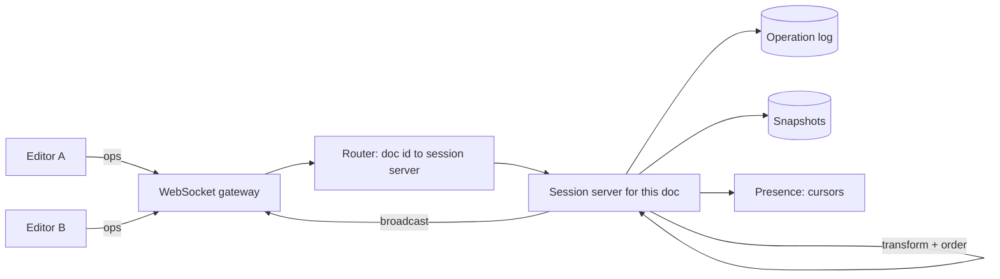

# Design Google Docs: Real-Time Collaborative Editor Mock Interview

> **Prerequisites:** [Previous lesson: Design Dropbox / Google Drive: Cloud File Storage Mock Interview](../30-design-dropbox-google-drive/README.md) and the [Interview Framework track](../../21-interview-framework/README.md).
> **Estimated Reading Time:** 15–20 minutes
> **Target Audience:** Engineers practising the full 9-step system design interview on a classic prompt: several people editing the same document live without overwriting each other.

> [!NOTE]
> **In one line:** Collaborative editing needs a way to **merge concurrent edits so every client converges to the same document**; the two main approaches are operational transformation (OT) and CRDTs.

> [!TIP]
> **The Golden Rule:** Send small operations, not whole documents; route each document's edits through one session server that orders them; and persist an operation log with periodic snapshots.

---

## Step 1. Clarify the Problem

Open with questions, not boxes. Everything else is ordinary: auth, storage, sharing. The interview is about how concurrent edits converge.

**Questions to ask the interviewer, and the answer we assume:**

| Question | Assumed answer |
| :--- | :--- |
| Editors per document? | Up to 100 concurrent, typically 2 to 5 |
| Offline? | Short disconnects, not long offline edits |
| Features? | Text with formatting, cursors, comments |
| History? | Full revision history |
| Scale? | 10M daily active documents, 5 operations per second per active document |

> Say it aloud: *"Before I draw anything, let me confirm the scope and the numbers."* That one sentence earns the first minutes of the interview.

---

## Step 2. Functional and Non-Functional Requirements

**Functional (what the system does):**

- Several users edit the same document and see each other's changes within a few hundred milliseconds.
- Show collaborators' cursors and selections.
- Save automatically and keep revision history.
- Share with view, comment or edit permissions.

**Non-functional (how well it does it):**

| Quality | Target | Why it drives the design |
| :--- | :--- | :--- |
| Convergence | All clients reach the same state | The core guarantee |
| Latency | Remote edits in under 300 ms | Feels live |
| Durability | No lost edits | People's work |
| Availability | 99.95% | Used all day |

---

## Step 3. Scope: In and Out

**In scope:** Edit synchronisation, session routing, persistence, presence.

**Out of scope (say it explicitly, then move on):**

- Rich object embedding.
- Spreadsheets and slides.
- Full-text search.

---

## Step 4. Capacity Estimation

Assumptions: 10M active documents at peak, an average of 3 editors each, 2 operations per second per document, 100 bytes per operation.

| Quantity | Calculation | Result |
| :--- | :--- | :--- |
| Operations per second | `docs * ops` | **20M ops/s** |
| Broadcast deliveries per second | `operations_per_second * (editors - 1)` | **40M deliveries/s** |
| Session servers | `docs / per_server` | **500 servers** |
| Operation log per day | `operations_per_second * bytes_ * 86400 / 1e12` | **173 TB/day** |

**What the numbers tell you:** 20M operations per second is split across documents, so each document's load is tiny (2 ops/s). The scalable unit is the document: route all editors of one document to one session server, and 500 servers each holding 20,000 active documents handle the peak.

---

## Step 5. API Design

| Endpoint | Purpose | Notes |
| :--- | :--- | :--- |
| `WS /v1/docs/{id}/session` | Join a document session | Sends ops, receives ops and presence. |
| `GET /v1/docs/{id}` | Load the latest snapshot plus recent ops | On open. |
| `GET /v1/docs/{id}/revisions` | History | From snapshots and the op log. |
| `PUT /v1/docs/{id}/permissions` | Share | Roles per user. |

The client sends operations such as `insert(position, text)` with the revision number they were based on, and the server acknowledges with the assigned order.

---

## Step 6. Data Model

| Entity / Store | Key fields | Why this store |
| :--- | :--- | :--- |
| Operation log (per document, ordered) | `doc_id`, `revision`, `op`, `author`, `ts` | Append-only source of truth |
| Snapshots | `doc_id`, `revision`, content | Fast load, bound log replay |
| Document metadata | Owner, permissions, title | Relational |
| Session state (in memory) | Connected clients, cursors | Ephemeral |

Persist every operation, snapshot every few hundred operations, and rebuild any revision by replaying from the nearest snapshot.

---

## Step 7. High-Level Architecture



**Walk the diagram in this order:** clients send operations through a gateway to the one session server that owns the document; it orders and transforms them, appends them to the log, and broadcasts the result to all other editors.

---

## Step 8. Deep Dives and Bottlenecks

### 1. Convergence: OT versus CRDT

**Operational transformation**: the server orders operations; when an operation arrives that was based on an older revision, it is transformed against the operations it missed so its intent is preserved (for example, an insert shifts if someone inserted earlier text). It needs a central server and careful transform functions. **CRDTs** give every character a unique id so operations commute and merge in any order without a central orderer, at the cost of more metadata. Pick OT with a central server for simplicity, or a CRDT if offline editing matters.

### 2. Session routing and ordering

All editors of a document connect to the same session server (consistent hash on the document id), which assigns each operation a revision number, so order is total per document. If that server fails, another loads the snapshot and replays the log, and clients reconnect and resend unacknowledged operations.

### 3. Persistence and presence

Append each operation to the log before acknowledging, snapshot periodically, and compact old history. Cursors and selections are ephemeral state sent over the same channel and never persisted. Throttle presence updates so cursor movement does not flood the network.

---

## Step 9. Trade-offs, Failures and Security

**Trade-offs to state aloud:**

| Decision | Option A | Option B | Pick and why |
| :--- | :--- | :--- | :--- |
| Convergence | OT with central server | CRDT | OT for online editing with a server; CRDT for offline-first |
| Routing | Any server | One session server per document | One per document: simple total order |
| Persistence | Store snapshots only | Log plus snapshots | Both: history and fast load |

**Failure modes and mitigations:**

| Failure | What users see | Mitigation |
| :--- | :--- | :--- |
| Session server crash | Brief pause | New server replays the log; clients resend unacknowledged ops |
| Client disconnect | Edits queue | Rebase pending operations on reconnect |
| Op log growth | Slow load | Snapshots and compaction |

**Security and abuse:** Check permissions on every operation, validate operation shape and size, rate-limit per user, and keep per-document access isolated so a session server cannot leak other documents.

---

## Runnable Example: Transforming two concurrent inserts

Alice and Bob both start from 'AC'. Alice inserts B at 1, Bob inserts D at 2. Applying them in either order, with transformation, gives the same text.

```python
def apply(text, op):
    pos, ch = op
    return text[:pos] + ch + text[pos:]

def transform(op, against):
    # shift op right if the other insert happened at or before it
    (pos, ch), (opos, _) = op, against
    return (pos + 1 if opos <= pos else pos, ch)

base = "AC"
alice = (1, "B")   # AC -> ABC
bob = (2, "D")     # AC -> ACD

# server order: alice first, then bob (transformed against alice)
s1 = apply(apply(base, alice), transform(bob, alice))
# server order: bob first, then alice (transformed against bob)
s2 = apply(apply(base, bob), transform(alice, bob))
print(s1, s2, s1 == s2)
print("naive:", apply(apply(base, alice), bob))
```

Output (produced by running this exact code):

```text
ABCD ABCD True
naive: ABDC
```

With transformation both orders converge to `ABCD`. Without it, applying Bob's original position to Alice's changed text produces `ABDC`, which is why concurrent edits need transformation.

---

## Common Mistakes

- Sending the whole document on every keystroke.
- Last-write-wins on the document.
- Letting any server handle any edit with no single orderer.
- No snapshots, so loading replays a huge log.
- Persisting cursor positions.

---

## Interview Questions and Answers

<details>
<summary><strong>Q1: How do concurrent edits converge?</strong></summary>

OT transforms an operation against concurrent ones it missed, using a server-assigned order; CRDTs give each element a unique id so operations commute.

</details>

<details>
<summary><strong>Q2: OT or CRDT?</strong></summary>

OT with a central session server is simpler for online editing; CRDTs suit offline-first and peer-to-peer at the cost of more metadata.

</details>

<details>
<summary><strong>Q3: How do you scale to many documents?</strong></summary>

Shard by document: one session server owns each active document, picked by consistent hashing.

</details>

<details>
<summary><strong>Q4: How do you store history?</strong></summary>

An append-only operation log plus periodic snapshots, so any revision is a replay from the nearest snapshot.

</details>

<details>
<summary><strong>Q5: What happens if the session server dies?</strong></summary>

Another server loads the snapshot and log, and clients reconnect and resend unacknowledged operations.

</details>

---

## One-Page Cheat Sheet

| Step | What to say or draw |
| :--- | :--- |
| Clarify | Live co-editing, cursors, history, 100 editors max |
| Capacity | 20M ops/s total, ~500 session servers |
| API | WebSocket session, load, revisions, permissions |
| Data | Op log, snapshots, metadata, ephemeral presence |
| Deep dive | OT vs CRDT, routing, persistence |
| Trade-off | Central OT versus CRDT |

---

## Further Reading

- Ellis and Gibbs, *Concurrency control in groupware systems* (1989), the original OT paper.
- Google Drive Blog, *What's different about the new Google Docs*, and Figma's article on multiplayer technology.

---

## Next

Continue with [Location Tracking System Design: Live Maps, Geohash, 2M Writes/s](../32-location-tracking-system-design/README.md).
