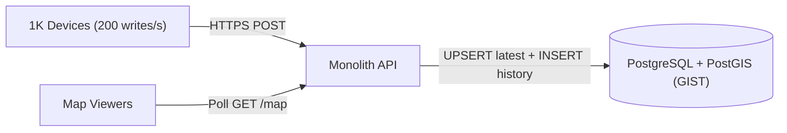
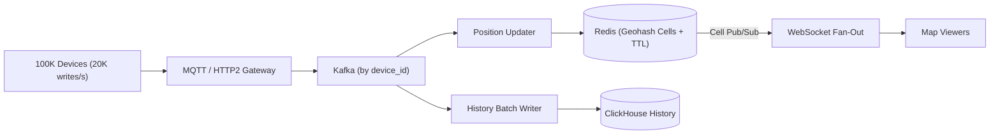
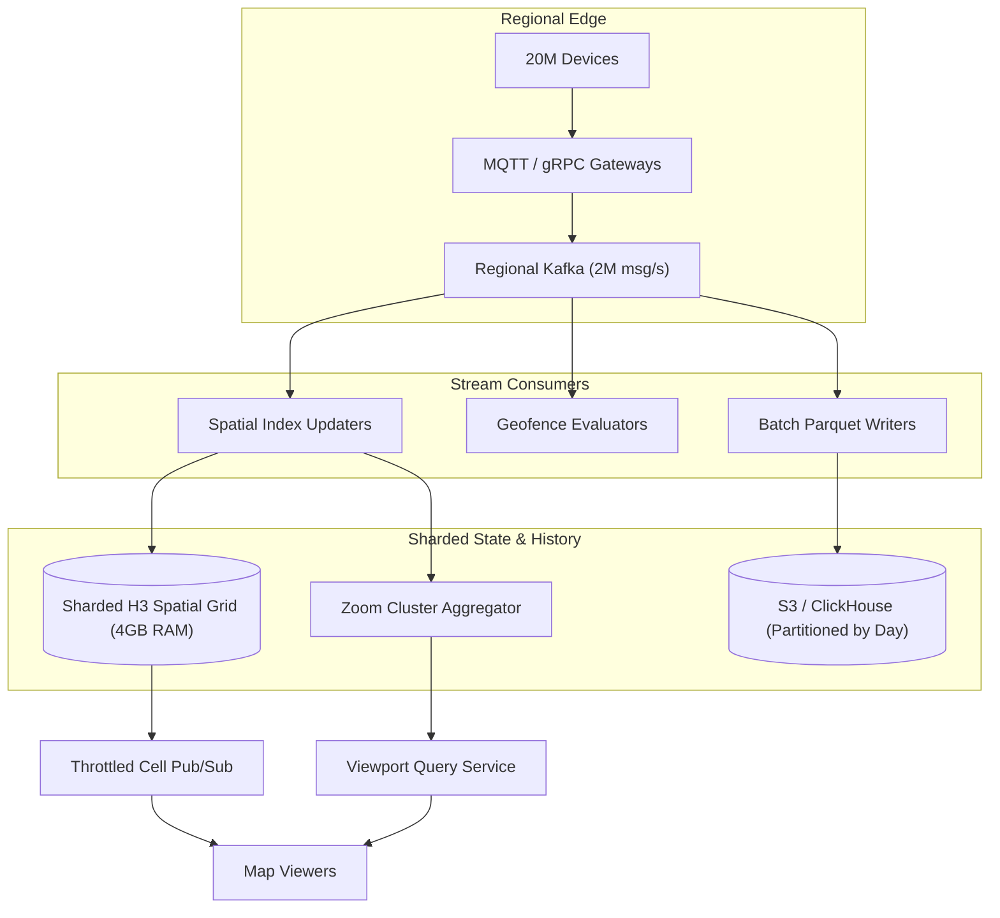
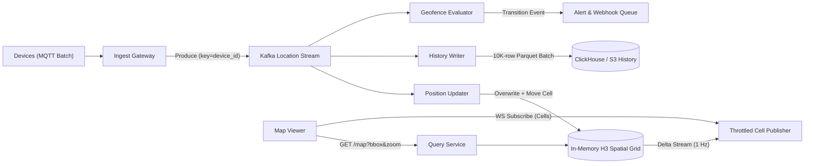
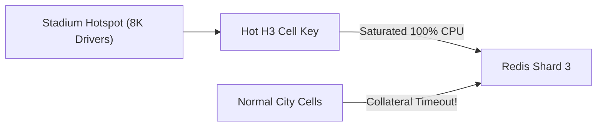

# Location Tracking System Design: Live Maps, Geohash, 2M Writes/s

> **Difficulty:** Hard (Senior / Staff System Design)
> **Prerequisites:** [Previous lesson: Design Google Docs: Real-Time Collaborative Editor Mock Interview](../31-design-google-docs/README.md) and the [Interview Framework track](../../21-interview-framework/README.md).
> **Estimated Reading Time:** 25 minutes
> **Target Audience:** Engineers practising the full system design interview on a classic prompt: ingesting millions of live location updates and showing them on a map.

> [!NOTE]
> **In one line:** Live location tracking is **a high-rate write firehose of tiny coordinates where only the latest value matters for live queries**, paired with spatial indexing (Geohash / H3 / S2) and a durable stream for history and geofencing.

> [!TIP]
> **The Golden Rule:** Treat the current position as an in-memory overwrite indexed by spatial cell, decouple history and geofencing via a partitioned stream, and push live map updates only to viewers subscribed to the visible cells.

---

## 1. Clarifying Questions, Functional & Non-Functional Requirements

Open with scoping questions. Location tracking combines three distinct workload shapes in one system: a **2M writes/s ingestion firehose**, **low-latency spatial range queries**, and **real-time WebSocket fan-out** to map viewers.

> Say it aloud: *"Before I draw anything, let me confirm the device count, update frequency, and query patterns."*

### Clarifying Questions & Assumed Answers

| Question | Assumed Answer | Architectural Impact |
| :--- | :--- | :--- |
| Who/what is being tracked? | Vehicles, couriers, and mobile phones (20M devices) | Lightweight protocols (MQTT/gRPC) + batching for battery |
| How often do devices report? | Every 5 seconds while moving (50% active at peak) | 10M active devices / 5s = **2M updates/s** |
| What queries must we support? | Point lookup (`device_id`), viewport (`bbox`), geofence alerts | Requires both `device_id -> pos` and `cell -> {devices}` |
| How long is history retained? | 90 days of location trails | ~1.2 PB raw; requires columnar storage + downsampling |
| What is out of scope? | Turn-by-turn routing, ETA prediction, map tile rendering | Keeps focus on ingestion, spatial index, and fan-out |

### Functional Requirements

1. **Location Ingestion:** Devices continuously report `(device_id, lat, lng, timestamp, speed, bearing)`.
2. **Latest Position Lookup:** Query the current position of a specific device in single-digit milliseconds.
3. **Viewport / Proximity Query:** Return all active devices within a map bounding box (`south, west, north, east`), clustered at low zoom levels.
4. **Live Map Streaming:** Push real-time movement updates to dispatchers/users viewing a region.
5. **Geofencing Alerts:** Emit `ENTER` / `EXIT` events when a device crosses a polygon boundary.

### Non-Functional Requirements

| Quality | Target | Why It Drives the Design |
| :--- | :--- | :--- |
| **Write Throughput** | 2M location pings/sec sustained | Rules out synchronous disk-backed RDBMS updates |
| **Freshness** | End-to-end visibility < 2 seconds | Requires streaming + in-memory spatial state |
| **Query Latency** | Viewport query p99 < 200 ms | Interactive map panning/zooming |
| **Storage Efficiency** | Low cost for 90-day trails | Columnar compression (Parquet/ClickHouse) + downsampling |
| **Availability** | 99.95% | Mission-critical for logistics and ride-hailing |

---

## 2. Back-of-the-Envelope Capacity Estimation

Assume **20M total devices**, **50% active at peak** (10M moving devices), reporting every **5 seconds**, with **80 bytes** per location payload.

### Worked Capacity Equations

1. **Peak Write Rate ($Q_{\text{write}}$):**

$$Q_{\text{write}} = \frac{10^7\text{ active devices}}{5\text{ s}} = 2 \times 10^6\text{ updates/s (2M writes/s)}$$

2. **Ingest Bandwidth ($BW_{\text{in}}$):**

$$BW_{\text{in}} = 2 \times 10^6\text{ updates/s} \times 80\text{ B} = 160\text{ MB/s} \approx 1.28\text{ Gbps}$$

3. **In-Memory Current-Position Store ($M_{\text{live}}$):** Each device record (coordinates, timestamp, cell ID, hash/index overhead) takes ~200 bytes:

$$M_{\text{live}} = 2 \times 10^7\text{ devices} \times 200\text{ B} = 4\text{ GB RAM}$$

4. **90-Day History Storage ($S_{\text{90d}}$):** Assuming an average of 50% peak utilization over 24h (1M avg updates/s):

$$S_{\text{90d}} = 10^6\text{ updates/s} \times 80\text{ B} \times 86{,}400\text{ s/day} \times 90\text{ days} \approx 622\text{ TB (1.24 PB at 2M avg)}$$

With columnar delta encoding (gorilla/zstd on coordinates & timestamps, ~5:1 compression) and downsampling trails > 7 days old from 5s to 60s (12:1 reduction), 90-day storage drops to **~25 TB**.

### Capacity Summary Table

| Metric | Formula / Assumption | Estimate |
| :--- | :--- | :--- |
| **Peak Updates/s** | $10\text{M active} / 5\text{ s}$ | **2M writes/s** |
| **Ingest Bandwidth** | $2\text{M} \times 80\text{ B}$ | **160 MB/s** |
| **Live State RAM** | $20\text{M devices} \times 200\text{ B}$ | **4 GB** (fits easily in Redis cluster) |
| **90-Day Raw History** | $1\text{M–2M/s} \times 80\text{ B} \times 86{,}400 \times 90$ | **622 TB – 1.24 PB** (~25 TB compressed/downsampled) |

> **What the numbers tell you:** 4 GB of live state is tiny—the entire world's 20M devices fit in RAM on a handful of nodes. The hard part is **not memory size**; it is **2M overwrites/sec** and **1.2 PB of cold history**.

---

## 3. Core API Contracts & Data Model

### API Contracts

| Protocol / Endpoint | Purpose | Notes |
| :--- | :--- | :--- |
| `POST /v1/locations` (or MQTT `pub`) | Ingest batch of pings | `[{ "device_id": "d_1", "lat": 12.97, "lng": 77.59, "ts": 1710000000 }]` |
| `GET /v1/devices/{id}/location` | Latest position | $O(1)$ lookup from in-memory store |
| `GET /v1/map?bbox=s,w,n,e&zoom=14` | Viewport query | Returns devices or grid clusters depending on `zoom` |
| `WS /v1/subscribe?bbox=s,w,n,e` | Live map updates | Server maps `bbox` to spatial cells and pushes throttled deltas |
| `POST /v1/geofences` | Create geofence | GeoJSON polygon + webhook/alert topic |

### Data Model & Storage Engines

| Store | Key / Partitioning | Engine Choice | Why This Store |
| :--- | :--- | :--- | :--- |
| **Latest Position Index** | `device_id -> (lat, lng, cell_id, ts)` and `cell_id -> Set(device_id)` | Redis Cluster / In-Memory Go/Rust Service | Overwrite-in-place at 2M ops/s; TTL auto-evicts offline devices |
| **Location Stream** | Partitioned by `device_id` | Apache Kafka / Redpanda | Preserves per-device ordering; decouples consumers |
| **Location History** | Partitioned by `(day, device_id)` | ClickHouse / Apache Iceberg + S3 | Columnar compression, fast time-range trail scans |
| **Geofence Index** | Polygon R-Tree indexed by `cell_id` | In-Memory Spatial Index + Postgres | $O(1)$ candidate fence lookup per cell |

---

## 4. Stage 1 (100 - 1K Users): Baseline Monolith & Single Database

At 1,000 devices (~200 writes/s), we use a single backend service and PostgreSQL with the **PostGIS** extension.

### Component-by-Component Build
1. **HTTP Ingest + Query Monolith:** Receives `POST /v1/locations`, upserts into `device_locations`, and inserts into `location_history`.
2. **PostgreSQL + PostGIS:** Uses a `GEOGRAPHY(POINT, 4326)` column with a `GIST` spatial index for `ST_Within` viewport and geofence queries.



### What Breaks at 10K Users?
- **GIST Index Lock Contention:** Updating a PostGIS spatial index on every ping causes severe B-tree/R-tree page splits and WAL bloat at >2,000 writes/s.
- **Polling Storm:** 10,000 viewers polling `GET /map` every 2 seconds execute 5,000 spatial scans/s, saturating CPU.
- **History Table Bloat:** `location_history` grows by ~170M rows/day, slowing down `VACUUM` and index scans.

---

## 5. Stage 2 (10K - 100K Users): Caching, Read Replicas & Async Offload

At 100K devices (~20K writes/s), we remove the disk database from the hot write path and introduce **Kafka** + **Redis** + **Geohash**.

### Component-by-Component Additions
1. **MQTT / HTTP2 Ingest Gateway:** Terminates persistent device connections and publishes batches directly to Kafka.
2. **Kafka Stream (`locations` topic):** Buffers spikes and partitions by `device_id`.
3. **In-Memory Spatial Store (Redis Geo / Cell Sets):** Replaces PostGIS for live positions. Devices are indexed by **Geohash** (e.g., precision 6, ~1.2 km × 0.6 km).
4. **Async History Consumer:** Batches 10,000 points at a time into TimescaleDB / ClickHouse.
5. **WebSocket Fan-Out Service:** Viewers subscribe to Geohash cells in their viewport instead of polling.



### What Breaks at 1M Users?
- **Single Redis Cluster Hot-Cell Skew:** A major city center (e.g., Manhattan or Bengaluru CBD) maps thousands of devices to one Geohash cell key, creating a hot shard in Redis.
- **Geohash Edge Cases:** Rectangular Geohashes distort near the poles and require querying 8 neighbors; H3 (hexagons) or S2 (hierarchical cells) give uniform neighbor distances.
- **Unbounded WebSocket Broadcasts:** A zoomed-out viewer looking at an entire country subscribes to thousands of cells, overwhelming their browser and server egress.

---

## 6. Stage 3 (1M - 10M+ Users): Sharding, Partitioning & Multi-Region Scale

At 20M devices (2M writes/s), we shard the spatial index by **H3 / S2 cell** with sub-sharding for hot cities, and introduce **adaptive zoom clustering**.

### Component-by-Component Additions
1. **Regional Ingest & Kafka Clusters:** Devices connect to the nearest regional PoP (US, EU, APAC) to minimize RTT and keep regional data compliant (GDPR).
2. **Sharded In-Memory Spatial Grid (Go/Rust Stateful Nodes or Redis Cluster):** Partitioned by **H3 Resolution 5** (~250 km²). Hot cells are further sub-sharded by `hash(device_id) % N` to eliminate single-shard hotspots.
3. **Adaptive Zoom Aggregator:** Maintains pre-aggregated counts at coarser H3 resolutions (Res 2–4). Zoomed-out map queries read cluster counts instead of individual device coordinates.
4. **Columnar Lakehouse (ClickHouse / Iceberg on S3):** Partitions history by `(region, day)`, compacts after 7 days, and downsamples to 1-minute intervals.



---

## 7. Final Full Production Architecture & End-to-End Flows



### End-to-End Update & Fan-Out Sequence

```mermaid
sequenceDiagram
  participant D as Device (d_42)
  participant GW as MQTT Gateway
  participant K as Kafka (part: d_42)
  participant PU as Position Updater
  participant CS as Spatial Grid (RAM)
  participant PUB as Cell Publisher
  participant V as Map Viewer

  D->>GW: Publish(d_42, lat, lng, ts)
  GW->>K: Produce(key=d_42)
  GW-->>D: PUBACK
  K->>PU: Consume batch
  PU->>PU: Validate speed & compute H3 cell
  PU->>CS: Update d_42 pos; if cell changed, remove old cell, add new cell
  CS-->>PUB: Emit delta to cell subscribers
  Note over PUB: Coalesce updates per viewer every 1000 ms
  PUB-->>V: WS Push([{d_42, lat, lng}])
```

---

## 8. Deep-Dive Bottlenecks & Algorithmic Trade-Offs

### 1. Spatial Indexing: Geohash vs. Google S2 vs. Uber H3

| Index | Cell Shape | Neighbor Uniformity | Best Use Case |
| :--- | :--- | :--- | :--- |
| **Geohash** | Rectangle (Base-32) | Poor (8 neighbors, varying distances, polar distortion) | Simple Redis/SQL prefix queries |
| **Google S2** | Projected Sphere Quadtree | Good (4 edge-neighbors, 8 total) | Hierarchical containment & geofencing |
| **Uber H3** | Hexagon | **Best** (6 equidistant neighbors, zero edge/corner ambiguity) | **Supply/demand heatmaps, smoothing, live maps** |

### 2. Handling Cell Transitions Atomically
When a device moves from `cell_A` to `cell_B`, a naive non-atomic update (`SREM cell_A d_42` then `SADD cell_B d_42`) can briefly lose the device or show it in two places.
- **Solution:** Store `prev_cell` inside the `device_id` record. Execute a Lua script (in Redis) or single-shard mutex (in custom Go/Rust grid) that removes from `prev_cell`, adds to `new_cell`, and updates `device_id` metadata atomically.

### 3. Geofence Evaluation at 2M Writes/s
Testing every device against 100,000 polygons on every ping is $2 \times 10^{11}$ checks/sec—impossible.
- **Solution:** Pre-index every geofence polygon into the H3 cells it overlaps (marking cells as `FULLY_INSIDE`, `FULLY_OUTSIDE`, or `BOUNDARY`).
- On a ping, look up the device's cell in $O(1)$:
  - If `FULLY_OUTSIDE`: 0 polygon checks.
  - If `FULLY_INSIDE`: immediately know it's inside without ray-casting.
  - If `BOUNDARY`: run point-in-polygon ray-casting only against the 1–3 fences touching that cell.
- Compare with `device.prev_fences` to emit `ENTER` or `EXIT` only on state transitions.

---

## 9. Failure Modes, Reliability & Backpressure Mitigations

| Failure Mode | User Impact | Mitigation Strategy |
| :--- | :--- | :--- |
| **In-Memory Grid Node Crash** | Devices in that shard disappear for a few seconds | Devices ping every 5s, so the grid naturally self-heals within 5s! For instant recovery, replay the last 30s from Kafka or promote a read replica |
| **Noisy / Spoofed GPS Pings** | Markers teleport across oceans or trigger false geofences | Reject pings with impossible implied velocity (e.g., $> 300\text{ km/h}$ for cars) or `accuracy > 100m`; apply Kalman filter on client/server |
| **Stale / Offline Devices** | Parked cars clutter the map forever | Set a **TTL (e.g., 120 seconds)** on live positions; background sweeper or Redis keyspace expiration evicts silent devices |
| **Viewer Egress Flood** | High-density city sends 10,000 updates/s to one browser | Enforce **1 Hz coalescing** per viewer socket + cap max individual markers per viewport at 500 (switch to clusters above threshold) |
| **Kafka Consumer Lag** | Map shows positions delayed by >10s | Auto-scale stateless consumer pods; shed non-critical analytics consumers first; drop intermediate points for the *same* device if lag > 5s (keep only latest) |

---

## 10. Production War Story & Real-World Reference

### The "Stadium Concert Exit" Hot-Shard Meltdown
At a ride-sharing company, 40,000 attendees exited a stadium simultaneously and opened their apps while 8,000 drivers converged on the pickup zone.
- All 8,000 drivers and 40,000 viewers mapped to **two H3 Resolution-6 cells**.
- The Redis shard owning those two cells hit 100% CPU from `SMEMBERS` + `PUBSUB` fan-out, causing viewport timeouts across the entire city because other cells shared that shard.



**The Fix:**
1. **Virtual Sub-Sharding:** Split any cell exceeding 1,000 devices into $K=16$ virtual sub-buckets (`cell_id#0` .. `cell_id#15`) distributed across shards.
2. **Viewer Coalescing & Edge Caching:** Viewport responses for popular cells are cached for 1 second at the Query Service, turning 40,000 identical `SMEMBERS` calls into **1 read/second**.

---

## 11. Core Component Implementation (4 Languages)

Below is the **In-Memory Spatial Grid & Viewport Query Engine** with atomic cell transitions and stale-device TTL eviction.

````carousel
```go
package spatial

import (
	"math"
	"sync"
	"time"
)

type Point struct {
	DeviceID string
	Lat, Lng float64
	Updated  time.Time
}

type cellKey struct{ X, Y int }

type SpatialGrid struct {
	mu       sync.RWMutex
	cellSize float64
	ttl      time.Duration
	devices  map[string]Point
	cells    map[cellKey]map[string]struct{}
}

func NewSpatialGrid(cellSizeDeg float64, ttl time.Duration) *SpatialGrid {
	return &SpatialGrid{
		cellSize: cellSizeDeg,
		ttl:      ttl,
		devices:  make(map[string]Point),
		cells:    make(map[cellKey]map[string]struct{}),
	}
}

func (g *SpatialGrid) cellOf(lat, lng float64) cellKey {
	return cellKey{
		X: int(math.Floor(lat / g.cellSize)),
		Y: int(math.Floor(lng / g.cellSize)),
	}
}

// Upsert atomically updates a device's position and moves it between cells if needed.
func (g *SpatialGrid) Upsert(deviceID string, lat, lng float64, now time.Time) {
	g.mu.Lock()
	defer g.mu.Unlock()

	newCell := g.cellOf(lat, lng)
	if prev, ok := g.devices[deviceID]; ok {
		oldCell := g.cellOf(prev.Lat, prev.Lng)
		if oldCell != newCell {
			delete(g.cells[oldCell], deviceID)
			if len(g.cells[oldCell]) == 0 {
				delete(g.cells, oldCell)
			}
		}
	}

	g.devices[deviceID] = Point{DeviceID: deviceID, Lat: lat, Lng: lng, Updated: now}
	if g.cells[newCell] == nil {
		g.cells[newCell] = make(map[string]struct{})
	}
	g.cells[newCell][deviceID] = struct{}{}
}

// QueryViewport returns all non-expired devices inside the bounding box.
func (g *SpatialGrid) QueryViewport(south, west, north, east float64, now time.Time) []Point {
	g.mu.RLock()
	defer g.mu.RUnlock()

	minX, maxX := int(math.Floor(south/g.cellSize)), int(math.Floor(north/g.cellSize))
	minY, maxY := int(math.Floor(west/g.cellSize)), int(math.Floor(east/g.cellSize))

	var out []Point
	for x := minX; x <= maxX; x++ {
		for y := minY; y <= maxY; y++ {
			for id := range g.cells[cellKey{x, y}] {
				p := g.devices[id]
				if now.Sub(p.Updated) <= g.ttl && p.Lat >= south && p.Lat <= north && p.Lng >= west && p.Lng <= east {
					out = append(out, p)
				}
			}
		}
	}
	return out
}
```
<!-- slide -->
```typescript
export interface DevicePoint {
  deviceId: string;
  lat: number;
  lng: number;
  updatedAtMs: number;
}

export class SpatialGrid {
  private devices = new Map<string, DevicePoint>();
  private cells = new Map<string, Set<string>>();

  constructor(private readonly cellSizeDeg = 0.05, private readonly ttlMs = 120_000) {}

  private cellKey(lat: number, lng: number): string {
    return `${Math.floor(lat / this.cellSizeDeg)}:${Math.floor(lng / this.cellSizeDeg)}`;
  }

  upsert(deviceId: string, lat: number, lng: number, nowMs = Date.now()): void {
    const newCell = this.cellKey(lat, lng);
    const prev = this.devices.get(deviceId);
    if (prev) {
      const oldCell = this.cellKey(prev.lat, prev.lng);
      if (oldCell !== newCell) {
        const bucket = this.cells.get(oldCell);
        bucket?.delete(deviceId);
        if (bucket && bucket.size === 0) this.cells.delete(oldCell);
      }
    }

    this.devices.set(deviceId, { deviceId, lat, lng, updatedAtMs: nowMs });
    let bucket = this.cells.get(newCell);
    if (!bucket) {
      bucket = new Set();
      this.cells.set(newCell, bucket);
    }
    bucket.add(deviceId);
  }

  queryViewport(south: number, west: number, north: number, east: number, nowMs = Date.now()): DevicePoint[] {
    const minX = Math.floor(south / this.cellSizeDeg);
    const maxX = Math.floor(north / this.cellSizeDeg);
    const minY = Math.floor(west / this.cellSizeDeg);
    const maxY = Math.floor(east / this.cellSizeDeg);

    const results: DevicePoint[] = [];
    for (let x = minX; x <= maxX; x++) {
      for (let y = minY; y <= maxY; y++) {
        const bucket = this.cells.get(`${x}:${y}`);
        if (!bucket) continue;
        for (const id of bucket) {
          const p = this.devices.get(id);
          if (p && nowMs - p.updatedAtMs <= this.ttlMs && p.lat >= south && p.lat <= north && p.lng >= west && p.lng <= east) {
            results.push(p);
          }
        }
      }
    }
    return results;
  }
}
```
<!-- slide -->
```python
import math
import time
from dataclasses import dataclass


@dataclass(frozen=True)
class DevicePoint:
    device_id: str
    lat: float
    lng: float
    updated_at: float


class SpatialGrid:
    def __init__(self, cell_size_deg: float = 0.05, ttl_sec: float = 120.0) -> None:
        self.cell_size = cell_size_deg
        self.ttl = ttl_sec
        self.devices: dict[str, DevicePoint] = {}
        self.cells: dict[tuple[int, int], set[str]] = {}

    def _cell(self, lat: float, lng: float) -> tuple[int, int]:
        return (math.floor(lat / self.cell_size), math.floor(lng / self.cell_size))

    def upsert(self, device_id: str, lat: float, lng: float, now: float | None = None) -> None:
        ts = now if now is not None else time.time()
        new_cell = self._cell(lat, lng)
        prev = self.devices.get(device_id)
        if prev is not None:
            old_cell = self._cell(prev.lat, prev.lng)
            if old_cell != new_cell:
                bucket = self.cells.get(old_cell)
                if bucket:
                    bucket.discard(device_id)
                    if not bucket:
                        del self.cells[old_cell]

        self.devices[device_id] = DevicePoint(device_id, lat, lng, ts)
        self.cells.setdefault(new_cell, set()).add(device_id)

    def query_viewport(
        self, south: float, west: float, north: float, east: float, now: float | None = None
    ) -> list[DevicePoint]:
        ts = now if now is not None else time.time()
        min_x, max_x = math.floor(south / self.cell_size), math.floor(north / self.cell_size)
        min_y, max_y = math.floor(west / self.cell_size), math.floor(east / self.cell_size)

        found: list[DevicePoint] = []
        for x in range(min_x, max_x + 1):
            for y in range(min_y, max_y + 1):
                for dev_id in self.cells.get((x, y), ()):
                    p = self.devices[dev_id]
                    if ts - p.updated_at <= self.ttl and south <= p.lat <= north and west <= p.lng <= east:
                        found.append(p)
        return found
```
<!-- slide -->
```csharp
using System;
using System.Collections.Generic;

public record DevicePoint(string DeviceId, double Lat, double Lng, DateTimeOffset UpdatedAt);

public sealed class SpatialGrid
{
    private readonly double _cellSize;
    private readonly TimeSpan _ttl;
    private readonly Dictionary<string, DevicePoint> _devices = new();
    private readonly Dictionary<(int X, int Y), HashSet<string>> _cells = new();
    private readonly object _lock = new();

    public SpatialGrid(double cellSizeDeg = 0.05, int ttlSeconds = 120)
    {
        _cellSize = cellSizeDeg;
        _ttl = TimeSpan.FromSeconds(ttlSeconds);
    }

    private (int X, int Y) CellOf(double lat, double lng) =>
        ((int)Math.Floor(lat / _cellSize), (int)Math.Floor(lng / _cellSize));

    public void Upsert(string deviceId, double lat, double lng, DateTimeOffset? now = null)
    {
        var ts = now ?? DateTimeOffset.UtcNow;
        var newCell = CellOf(lat, lng);
        lock (_lock)
        {
            if (_devices.TryGetValue(deviceId, out var prev))
            {
                var oldCell = CellOf(prev.Lat, prev.Lng);
                if (oldCell != newCell && _cells.TryGetValue(oldCell, out var oldBucket))
                {
                    oldBucket.Remove(deviceId);
                    if (oldBucket.Count == 0) _cells.Remove(oldCell);
                }
            }

            _devices[deviceId] = new DevicePoint(deviceId, lat, lng, ts);
            if (!_cells.TryGetValue(newCell, out var bucket))
            {
                bucket = new HashSet<string>();
                _cells[newCell] = bucket;
            }
            bucket.Add(deviceId);
        }
    }

    public List<DevicePoint> QueryViewport(double south, double west, double north, double east, DateTimeOffset? now = null)
    {
        var ts = now ?? DateTimeOffset.UtcNow;
        int minX = (int)Math.Floor(south / _cellSize), maxX = (int)Math.Floor(north / _cellSize);
        int minY = (int)Math.Floor(west / _cellSize), maxY = (int)Math.Floor(east / _cellSize);
        var results = new List<DevicePoint>();

        lock (_lock)
        {
            for (int x = minX; x <= maxX; x++)
            {
                for (int y = minY; y <= maxY; y++)
                {
                    if (!_cells.TryGetValue((x, y), out var bucket)) continue;
                    foreach (var id in bucket)
                    {
                        var p = _devices[id];
                        if (ts - p.UpdatedAt <= _ttl && p.Lat >= south && p.Lat <= north && p.Lng >= west && p.Lng <= east)
                            results.Add(p);
                    }
                }
            }
        }
        return results;
    }
}
```
````

---

## 12. Verification, Load Testing & CLI Diagnostics

```bash
# 1. Verify Redis Geo / Cell throughput with redis-benchmark
redis-benchmark -t set,hset -n 1000000 -c 100 -P 16 -q

# 2. Check Kafka consumer group lag for location-history-writer
kafka-consumer-groups.sh --bootstrap-server kafka:9092 --describe --group location-history-writer

# 3. Inspect ClickHouse columnar compression ratio on 90-day location trails
clickhouse-client --query "
  SELECT table, formatReadableSize(sum(bytes_on_disk)) AS disk,
         formatReadableSize(sum(data_uncompressed_bytes)) AS raw,
         round(sum(data_uncompressed_bytes)/sum(bytes_on_disk), 2) AS ratio
  FROM system.parts WHERE active AND table = 'location_history' GROUP BY table;"

# 4. Simulate 50K concurrent MQTT device pings using emqtt_bench
emqtt_bench pub -c 50000 -I 5000 -t "v1/locations/%i" -s 80 -h mqtt-gateway.local
```

---

## 13. Common Interview Mistakes & Red Flags

1. **Updating a disk-backed SQL row on every ping:** 2M `UPDATE` queries/s with spatial index maintenance will melt any RDBMS.
2. **Scanning all 20M devices for a viewport query:** Ignoring spatial indexing turns a 5 ms cell lookup into a multi-second full scan.
3. **Broadcasting every update to every viewer:** Viewers only care about cells inside their current map viewport, throttled to ~1 Hz.
4. **Storing 90 days of 5-second raw pings in OLTP Postgres:** Costs ~1.2 PB uncompressed; use columnar storage + downsampling for older trails.
5. **Forgetting device TTLs:** Parked or turned-off devices become "ghost markers" on the map forever without a TTL.
6. **Ignoring hot-cell skew:** A stadium or airport puts thousands of devices into one Geohash/H3 cell, requiring sub-sharding or query caching.
7. **Evaluating every geofence polygon on every ping:** Without cell-based fence pre-filtering, geofencing becomes $O(N_{\text{pings}} \times N_{\text{fences}})$.

---

## 14. Key Terminology & Glossary

| Key Term | Definition |
| :--- | :--- |
| **Geohash** | A hierarchical spatial data structure encoding `(lat, lng)` into a Base-32 string where shared prefixes mean spatial proximity. |
| **Uber H3** | A hexagonal hierarchical spatial index with 6 equidistant neighbors, avoiding corner-distance ambiguity. |
| **Google S2** | A spherical geometry library projecting the Earth onto cube faces subdivided into Hilbert-curve quadtree cells. |
| **Viewport Query (`bbox`)** | A spatial range query returning all devices or clusters inside a rectangular map screen. |
| **Geofence** | A virtual geographic boundary (polygon or radius) that triggers `ENTER` or `EXIT` alerts when crossed. |
| **MQTT** | A lightweight publish/subscribe binary protocol designed for low-battery, high-latency mobile/IoT telemetry. |
| **Downsampling** | Reducing historical trail resolution (e.g., 5s -> 60s or Douglas-Peucker simplification) to slash cold storage costs. |
| **Coalescing (1 Hz)** | Buffering multiple position updates for a device and sending only the latest point once per second to map viewers. |
| **Hot-Cell Skew** | Uneven load where dense urban hotspots (airports, stadiums) overload a single spatial shard. |
| **Kalman Filter** | A statistical filter used to smooth noisy GPS coordinates and reject impossible velocity spikes. |

---

## 15. Interview Follow-Up Questions (12 Q&As)

### Basic Conceptual Questions

<details>
<summary><strong>Q1: Why use an in-memory store for current positions instead of PostgreSQL + PostGIS? [BASIC]</strong></summary>

At 2M writes/s, only the latest position matters for live queries. Overwriting 4 GB of state in RAM handles millions of ops/sec with sub-millisecond latency, whereas disk-backed B-tree/GIST index updates saturate IOPS and WAL fsyncs.

</details>

<details>
<summary><strong>Q2: Why partition Kafka by `device_id` instead of `cell_id`? [BASIC]</strong></summary>

Partitioning by `device_id` guarantees that all pings from the same device are processed **in chronological order** by the same consumer. This is essential for detecting geofence `ENTER/EXIT` transitions and computing speed/filtering GPS noise.

</details>

<details>
<summary><strong>Q3: How do you handle a device that turns off or loses battery? [BASIC]</strong></summary>

Attach a TTL (e.g., 120 seconds) to every live position entry. If no ping arrives before the TTL expires, the device is automatically evicted from the live spatial index so ghost markers do not linger on the map.

</details>

<details>
<summary><strong>Q4: Why batch location updates on the mobile client? [BASIC]</strong></summary>

Waking up a cellular radio every 5 seconds drains battery rapidly. Sampling GPS every 5 seconds and batch-uploading 3–6 points every 15–30 seconds (when real-time dispatch isn't critical) cuts radio wakeups and TLS/TCP overhead by 80%.

</details>

### Scenario-Based Architecture Questions

<details>
<summary><strong>Q5: A user zooms out to view the entire continent of Europe. How do you prevent sending 2M markers to their browser? [SCENARIO]</strong></summary>

Use **zoom-level adaptive clustering**. At low zoom levels, the Query Service reads pre-aggregated counts from coarse H3/S2 cells (e.g., Resolution 3) and returns cluster bubbles (`{lat, lng, count: 45200}`) instead of individual devices. Individual markers are only returned when `zoom >= 13` and capped at e.g. 500 points.

</details>

<details>
<summary><strong>Q6: How do you efficiently evaluate 50,000 geofences at 2M pings/sec? [SCENARIO]</strong></summary>

Pre-index all geofence polygons into spatial cells (`FULLY_INSIDE`, `FULLY_OUTSIDE`, `BOUNDARY`). On each ping, look up the device's cell in $O(1)$ and only run point-in-polygon math for `BOUNDARY` fences overlapping that specific cell. Compare against the device's previous fence set to emit `ENTER`/`EXIT` transitions.

</details>

<details>
<summary><strong>Q7: How do you handle a map viewer panning across the city smoothly? [SCENARIO]</strong></summary>

The client calculates the delta between the old viewport's cells and the new viewport's cells, then sends `UNSUBSCRIBE(old_cells)` and `SUBSCRIBE(new_cells)` over the existing WebSocket, plus a single `GET /map` fetch for the newly exposed cells.

</details>

<details>
<summary><strong>Q8: How do you cut the 1.2 PB 90-day history storage cost by 95%? [SCENARIO]</strong></summary>

Write trails in 10,000-row batches to columnar storage (ClickHouse or Parquet on S3) which achieves ~5:1 delta compression. After 7 days, run a compaction job that downsamples trails using the **Douglas-Peucker** line-simplification algorithm (keeping turns, dropping collinear highway points), reducing points by 10–15x.

</details>

### Advanced & Tricky Interview Questions

<details>
<summary><strong>Q9: How do you handle the "Geohash boundary problem" where two nearby drivers fall into different cells? [TRICKY]</strong></summary>

A viewport query converts the bounding box into *all* overlapping cells (typically 4–9 cells), not just the center cell. For radius/k-NN queries around a point, always query the target cell plus its 6 (H3) or 8 (Geohash) surrounding neighbor cells.

</details>

<details>
<summary><strong>Q10: What happens if an in-memory spatial shard crashes and loses 1M live positions? [TRICKY]</strong></summary>

Two layers of protection: (1) Since active devices ping every 5 seconds, the shard naturally repopulates 100% of active devices within 5 seconds! (2) To avoid even a 5-second gap, either maintain an async Redis replica per shard or have the replacement node seek its Kafka consumer offset back by 30 seconds and replay the last 60M messages in ~2 seconds.

</details>

<details>
<summary><strong>Q11: How do you prevent a hot shard when 10,000 drivers gather at an airport or stadium? [TRICKY]</strong></summary>

Use **virtual sub-sharding** for dense cells: append `hash(device_id) % K` (e.g., $K=16$) to hot cell keys so writes spread across 16 shards. On the read path, query services cache hot cell snapshots for 1 second so thousands of viewers share a single read.

</details>

<details>
<summary><strong>Q12: How do you filter out GPS "teleportation" (multipath reflections off skyscrapers)? [TRICKY]</strong></summary>

Maintain the device's last valid `(lat, lng, ts)` in the Position Updater. Compute implied speed $v = \Delta d / \Delta t$. If $v > v_{\max}$ (e.g., 300 km/h) or reported GPS accuracy radius > 100 m, flag the point as an outlier, drop it from live map fan-out, and wait for the next consistent ping.

</details>

---

## 16. One-Page Master Cheat Sheet

```text
+------------------------------------------------------------------------------+
|              LOCATION TRACKING SYSTEM DESIGN: MASTER CHEAT SHEET             |
+------------------------------------------------------------------------------+
| SCALE: 20M devices | 2M writes/s | 160 MB/s in | 4 GB RAM | 1.2 PB raw/90d   |
| SLAs : Freshness <2s | Viewport p99 <200ms | 99.95% Availability             |
+------------------------------------------------------------------------------+
| ARCHITECTURE:                                                                |
|  1. Devices batch pings via MQTT/HTTP2 -> Ingest Gateway -> Kafka (by devID).|
|  2. Position Updater maintains 4 GB H3/Geohash spatial grid in RAM (with TTL)|
|  3. History Writer batches 10K points -> ClickHouse/Parquet (downsampled >7d)|
|  4. Geofence Evaluator checks only BOUNDARY fences in device's current cell. |
|  5. Viewers query /map (clustered at low zoom) & subscribe to cells at 1 Hz. |
+------------------------------------------------------------------------------+
| KEY INTERVIEW TRADE-OFFS:                                                    |
|  * In-Memory Grid vs Disk DB: Overwrite-in-place in RAM handles 2M writes/s. |
|  * H3 vs Geohash: H3 hexagons give uniform 6-neighbor distance for maps.     |
|  * Hot-Cell Skew: Sub-shard dense cells by device_id % K + 1s read cache.    |
+------------------------------------------------------------------------------+
```

| Stage | Devices / Rate | Architecture Highlight | Primary Bottleneck Solved |
| :--- | :--- | :--- | :--- |
| **Stage 1** | 1K / 200 writes/s | Monolith + PostgreSQL/PostGIS | Simple spatial queries for MVP |
| **Stage 2** | 100K / 20K writes/s | Kafka + Redis Geohash + ClickHouse | RDBMS index lock contention & polling |
| **Stage 3** | 20M / 2M writes/s | Sharded H3 Grid + Sub-sharding + Zoom Clusters | Hot-cell skew & 1.2 PB history cost |

---

## Further Reading

- Uber engineering, *H3: Uber's Hexagonal Hierarchical Spatial Index*.
- Google S2 geometry library documentation.

---

## Next

Continue with [Design a Leaderboard: Redis Sorted Sets, Real-Time Ranks, 50M Players](../33-design-a-leaderboard/README.md).
