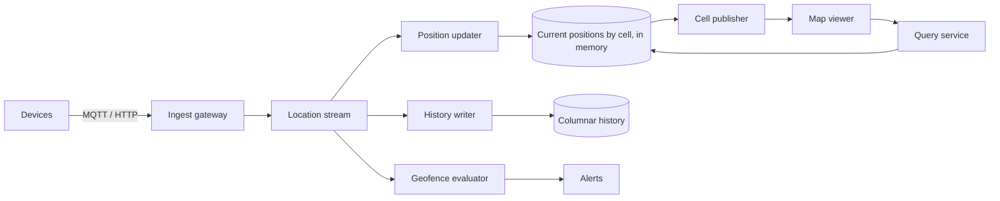

# Location Tracking System Design: Live Maps, Geohash, 2M Writes/s

> **Prerequisites:** [Previous lesson: Design Google Docs: Real-Time Collaborative Editor Mock Interview](../31-design-google-docs/README.md) and the [Interview Framework track](../../21-interview-framework/README.md).
> **Estimated Reading Time:** 15–20 minutes
> **Target Audience:** Engineers practising the full 9-step system design interview on a classic prompt: ingesting millions of live location updates and showing them on a map.

> [!NOTE]
> **In one line:** Live location tracking is **a very high write rate of tiny points where only the latest value matters**, plus nearby and geofence queries, so it is built around an in-memory spatial index and a stream.

> [!TIP]
> **The Golden Rule:** Treat the current position as an overwrite in memory, send history to a log, index by geographic cell, and push updates to viewers by subscription to the cells they are looking at.

---

## Step 1. Clarify the Problem

Open with questions, not boxes. A write firehose, a spatial query and a fan-out to watchers: three different load shapes in one system.

**Questions to ask the interviewer, and the answer we assume:**

| Question | Assumed answer |
| :--- | :--- |
| Who is tracked? | Vehicles, couriers and phones, 20M devices |
| Update rate? | Every 5 seconds while moving |
| Queries? | Where is X, who is within a region, geofence enter/exit alerts |
| History? | Keep 90 days of trails |
| Scale? | 2M writes per second at peak |

> Say it aloud: *"Before I draw anything, let me confirm the scope and the numbers."* That one sentence earns the first minutes of the interview.

---

## Step 2. Functional and Non-Functional Requirements

**Functional (what the system does):**

- Devices report their location.
- Show the current position of a device.
- Show all devices within a map viewport.
- Raise alerts when a device enters or leaves a geofence.

**Non-functional (how well it does it):**

| Quality | Target | Why it drives the design |
| :--- | :--- | :--- |
| Write throughput | 2M updates per second | The defining load |
| Freshness | Visible within 2 seconds | Live maps |
| Query latency | Viewport query under 200 ms | Interactive map |
| Cost | Cheap history | Vast volume of old points |

---

## Step 3. Scope: In and Out

**In scope:** Ingest, current-position store, spatial queries, live updates, geofences, history.

**Out of scope (say it explicitly, then move on):**

- Routing and ETA.
- Map tile rendering.
- Billing.

---

## Step 4. Capacity Estimation

Assumptions: 20M devices, an update every 5 seconds while active, half active at peak, 80 bytes per update, 90 days of history.

| Quantity | Calculation | Result |
| :--- | :--- | :--- |
| Updates per second | `devices * active / interval` | **2M updates/s** |
| Ingest bandwidth | `updates_per_second * bytes_ / 1e6` | **160 MB/s** |
| History storage for 90 days | `updates_per_second * bytes_ * 86400 * days / 1e12` | **1.2K TB** |
| Latest-position memory | `devices * 200 / 1e9` | **4 GB** |

**What the numbers tell you:** 2M updates per second is only 160 MB/s of data. The current position of 20M devices fits in about 4 GB of memory, so queries are served from memory. History is the cost driver: about 1.2 PB for 90 days, so it goes to cheap columnar storage with downsampling of old trails.

---

## Step 5. API Design

| Endpoint | Purpose | Notes |
| :--- | :--- | :--- |
| `POST /v1/locations` | Batch of updates | Device id, lat, lng, timestamp, speed. Via MQTT or HTTP/2. |
| `GET /v1/devices/{id}/location` | Latest position | From memory. |
| `GET /v1/map?bbox=&zoom=` | Devices in a viewport | Spatial query, capped and clustered. |
| `WS /v1/subscribe?bbox=` | Live updates for a region | Pushes changes in subscribed cells. |
| `POST /v1/geofences` | Define a fence | Polygon plus rules. |

Devices should batch updates and send over a lightweight protocol (MQTT) to save battery and bandwidth.

---

## Step 6. Data Model

| Entity / Store | Key fields | Why this store |
| :--- | :--- | :--- |
| Current position store (in-memory, sharded by cell) | `device_id`, lat, lng, ts; cell index | Overwrite on each update |
| Location stream (Kafka) | Every update, partitioned by device | Feeds history, geofences, analytics |
| History store (columnar, by day) | `device_id`, `ts`, lat, lng | Trails, replay, analytics |
| Geofence index | Fence polygons by cell | Fast enter/exit checks |

Partition the stream by device id so one device's points stay ordered, and the current store by cell so viewport queries touch few shards.

---

## Step 7. High-Level Architecture



**Walk the diagram in this order:** devices send updates to the gateway, which writes to a stream; consumers update the in-memory current store, append history and evaluate geofences; viewers query by viewport and subscribe to cell updates.

---

## Step 8. Deep Dives and Bottlenecks

### 1. Spatial indexing

Divide the map into cells (geohash, S2 or H3). Each device is stored in the cell of its latest position, and moving between cells updates two entries. A viewport query converts the bounding box into a set of cells and reads those; at low zoom levels return clusters or sampled points so a million devices never reach the browser.

### 2. Live fan-out

Viewers subscribe to the cells in their viewport. When a device updates, the publisher sends it only to subscribers of that cell. Throttle and batch updates per viewer (for example every second) so a busy map does not flood the client. Stale devices that stop reporting are removed after a timeout.

### 3. Geofences and history

On each update, look up the fences covering the device's cell and test point-in-polygon only for those. Compare with the device's previous state to detect enter and exit transitions, then emit an event. History goes to columnar storage partitioned by day, and old trails are downsampled (keep one point per minute) to cut cost.

---

## Step 9. Trade-offs, Failures and Security

**Trade-offs to state aloud:**

| Decision | Option A | Option B | Pick and why |
| :--- | :--- | :--- | :--- |
| Current position | Database row updated in place | In-memory store | In-memory: overwrite rate is too high for a disk database |
| Viewer updates | Poll | Subscribe by cell | Subscribe: pushes only relevant changes |
| History | All points forever | Downsample old | Downsample: cost |

**Failure modes and mitigations:**

| Failure | What users see | Mitigation |
| :--- | :--- | :--- |
| Ingest spike | Delay | Stream buffers; consumers scale |
| In-memory node loss | Positions missing briefly | Rebuild from the stream and the next updates in seconds |
| Noisy GPS | Jumpy marker | Filter by speed and accuracy, smooth on the client |

**Security and abuse:** Authenticate devices, encrypt in transit, limit who can see whom, minimise retention of personal location history and allow users to delete it, and rate-limit queries.

---

## Runnable Example: Cell index and viewport query

Devices are stored by grid cell, so a viewport query reads only the cells it overlaps.

```python
CELL = 0.1

def cell(lat, lng):
    return (int(lat // CELL), int(lng // CELL))

devices = {"a": (12.97, 77.59), "b": (12.99, 77.61), "c": (28.61, 77.20), "d": (12.95, 77.64)}
index = {}
for d, (la, lo) in devices.items():
    index.setdefault(cell(la, lo), set()).add(d)

def in_viewport(south, west, north, east):
    cells = {(x, y) for x in range(int(south // CELL), int(north // CELL) + 1)
                    for y in range(int(west // CELL), int(east // CELL) + 1)}
    found = set()
    for c in cells:
        for d in index.get(c, ()):
            la, lo = devices[d]
            if south <= la <= north and west <= lo <= east:
                found.add(d)
    return sorted(found)

print(in_viewport(12.9, 77.5, 13.1, 77.7))
print("cells touched:", len({(x, y) for x in range(129, 132) for y in range(775, 778)}))
```

Output (produced by running this exact code):

```text
['a', 'b', 'd']
cells touched: 9
```

The Bengaluru viewport finds the three nearby devices and never touches Delhi's device `c`, because the query reads only the cells overlapping the viewport.

---

## Common Mistakes

- Updating a disk database row per ping.
- Scanning all devices for a viewport query.
- Sending every update to every viewer.
- Keeping full-resolution history forever.
- No timeout for devices that stop reporting.

---

## Interview Questions and Answers

<details>
<summary><strong>Q1: How do you handle 2M writes per second?</strong></summary>

Overwrite in an in-memory store and send every point to a partitioned stream; history is written in batches to columnar storage.

</details>

<details>
<summary><strong>Q2: How do you answer a viewport query?</strong></summary>

Convert the bounding box to grid cells, read those cells from the in-memory index, and cluster or sample at low zoom.

</details>

<details>
<summary><strong>Q3: How do viewers get live updates?</strong></summary>

They subscribe to the cells in their viewport and receive batched updates for those cells only.

</details>

<details>
<summary><strong>Q4: How do geofences work?</strong></summary>

Index fences by cell, test point-in-polygon only for fences in the device's cell, and emit transitions.

</details>

<details>
<summary><strong>Q5: How do you control history cost?</strong></summary>

Columnar storage by day and downsampling of older trails.

</details>

---

## One-Page Cheat Sheet

| Step | What to say or draw |
| :--- | :--- |
| Clarify | 20M devices, 5 s updates, viewport and geofences |
| Capacity | 2M updates/s, 160 MB/s, ~4 GB current state, ~1.2 PB history |
| API | post locations, latest, viewport, subscribe, geofence |
| Data | In-memory by cell, stream, columnar history, fences |
| Deep dive | Spatial index, live fan-out, geofences |
| Trade-off | Memory for current state, downsampled history |

---

## Further Reading

- Uber engineering, *H3: Uber's Hexagonal Hierarchical Spatial Index*.
- Google S2 geometry library documentation.

---

## Next

Continue with [Design a Leaderboard: Redis Sorted Sets, Real-Time Ranks, 50M Players](../33-design-a-leaderboard/README.md).
