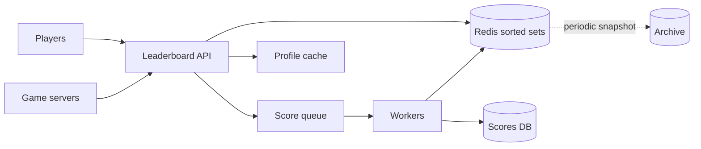

# Design a Leaderboard: Redis Sorted Sets, Real-Time Ranks, 50M Players

> **Prerequisites:** [Previous lesson: Location Tracking System Design: Live Maps, Geohash, 2M Writes/s](../32-location-tracking-system-design/README.md) and the [Interview Framework track](../../21-interview-framework/README.md).
> **Estimated Reading Time:** 15–20 minutes
> **Target Audience:** Engineers practising the full 9-step system design interview on a classic prompt: ranking tens of millions of players by score, in real time.

> [!NOTE]
> **In one line:** A leaderboard is **a sorted set**: you need rank, top-N and 'my neighbours' queries to be fast while scores update constantly, which is exactly what Redis sorted sets provide.

> [!TIP]
> **The Golden Rule:** Keep the live ranking in a sorted set (O(log n) updates and rank), shard by leaderboard or score range when one node is too small, and treat the database as the durable record.

---

## Step 1. Clarify the Problem

Open with questions, not boxes. The data structure is the answer, and the interview is about when one sorted set stops being enough.

**Questions to ask the interviewer, and the answer we assume:**

| Question | Assumed answer |
| :--- | :--- |
| Boards? | Global, per-region and weekly |
| Queries? | Top 100, my rank, players near me |
| Update rate? | Score changes at match end |
| Ties? | Earlier achiever ranks higher |
| Scale? | 50M players, 20K score updates per second at peak |

> Say it aloud: *"Before I draw anything, let me confirm the scope and the numbers."* That one sentence earns the first minutes of the interview.

---

## Step 2. Functional and Non-Functional Requirements

**Functional (what the system does):**

- Submit or update a player's score.
- Get the top N players.
- Get a player's rank and score.
- Get the players ranked just above and below a given player.

**Non-functional (how well it does it):**

| Quality | Target | Why it drives the design |
| :--- | :--- | :--- |
| Query latency | Under 20 ms | Shown on every game screen |
| Update latency | Rank updated within a second | Immediate feedback |
| Accuracy | Exact for top ranks, approximate allowed far down | Users care about their neighbourhood |
| Availability | 99.95% | Game feature |

---

## Step 3. Scope: In and Out

**In scope:** Score updates, ranking queries, sharding, periodic boards.

**Out of scope (say it explicitly, then move on):**

- Anti-cheat internals.
- Matchmaking.
- Rewards.

---

## Step 4. Capacity Estimation

Assumptions: 50M players, 20K updates per second at peak, one sorted set entry about 64 bytes, three boards each.

| Quantity | Calculation | Result |
| :--- | :--- | :--- |
| Sorted set memory per board | `players * bytes_ / 1e9` | **3.2 GB** |
| Total across boards | `sorted_set_memory_per_board * boards` | **9.6 GB** |
| Updates per second per board | `updates / boards` | **6.7K updates/s** |

**What the numbers tell you:** About 3.2 GB per board fits on one large node and about 10 GB for three boards is modest. A single Redis node handles 100K simple operations per second, so even 20K updates per second plus reads fit, which is why the simplest design (one sorted set per board) goes surprisingly far.

---

## Step 5. API Design

| Endpoint | Purpose | Notes |
| :--- | :--- | :--- |
| `POST /v1/boards/{id}/scores` | Submit score | Body: player id, score. Idempotent per match id. |
| `GET /v1/boards/{id}/top?n=100` | Top N | From the sorted set. |
| `GET /v1/boards/{id}/players/{p}` | Rank and score | `ZREVRANK`. |
| `GET /v1/boards/{id}/players/{p}/around?k=5` | Neighbours | Rank range query. |

Use the match id as an idempotency key so a retried submission does not double-count.

---

## Step 6. Data Model

| Entity / Store | Key fields | Why this store |
| :--- | :--- | :--- |
| Redis sorted set per board | member = player id, score = points | O(log n) update and rank, O(log n + k) range |
| Scores DB | `player`, `board`, `score`, `updated_at` | Durable record, rebuild source |
| Player profiles cache | Names and avatars | Hydrate the top list |
| Season archive | Final standings | Cheap history |

For ties, encode a secondary key into the score (for example score × 2^32 plus an inverted timestamp) so the earlier achiever ranks higher.

---

## Step 7. High-Level Architecture



**Walk the diagram in this order:** game servers submit scores, a queue and workers apply them to Redis and the database, and read requests go straight to the sorted set and hydrate names from a cache.

---

## Step 8. Deep Dives and Bottlenecks

### 1. Sorted set operations

`ZADD` updates a score, `ZREVRANK` returns a rank, `ZREVRANGE 0 99` returns the top 100, and a range around a player's rank gives neighbours; all are O(log n) plus the result size. This is a skip list internally. Write to Redis and the database through a queue so a spike does not lose scores.

### 2. When one set is too big

At hundreds of millions of players, shard. **Shard by board** (per region, per season) is simplest. For one huge global board, shard by score range: top ranges are small and exact, lower ranges are larger and approximate. A player's global rank is then the sum of the sizes of higher ranges plus rank within their range. Alternatively, keep exact ranks only for the top 10,000 and give percentile approximations below.

### 3. Periodic boards and recovery

Weekly boards are separate sets with an expiry, rolled over by a scheduled job that archives the final standings. If Redis loses data, rebuild the set from the scores database. Use replicas for read capacity, and cache the top 100 for a second to absorb heavy read traffic.

---

## Step 9. Trade-offs, Failures and Security

**Trade-offs to state aloud:**

| Decision | Option A | Option B | Pick and why |
| :--- | :--- | :--- | :--- |
| Ranking store | SQL `ORDER BY` | Redis sorted set | Sorted set: rank queries in O(log n) |
| Exactness | Exact everywhere | Exact top, approximate tail | Exact top and neighbourhood, percentile elsewhere |
| Update path | Synchronous | Queued | Queued: absorbs spikes |

**Failure modes and mitigations:**

| Failure | What users see | Mitigation |
| :--- | :--- | :--- |
| Redis node loss | Missing ranks | Replica failover; rebuild from the scores DB |
| Score spike at match end | Backlog | Queue and batch writes |
| Duplicate submission | Double counting | Idempotent match ids |

**Security and abuse:** Validate scores server-side (the game server signs submissions), rate-limit submissions, detect impossible scores, and never trust the client's reported score.

---

## Runnable Example: Rank and neighbours with tie-breaking

Scores are encoded with an inverted timestamp so an earlier achiever outranks a later one on equal points.

```python
import bisect

def key(score, ts):
    return (-score, ts)  # higher score first, earlier time first

board = []  # sorted list of (key, player)
def submit(player, score, ts):
    bisect.insort(board, (key(score, ts), player))

for p, s, t in [("ann", 900, 1), ("bob", 950, 2), ("cat", 900, 3), ("dan", 700, 4), ("eve", 990, 5)]:
    submit(p, s, t)

def rank(player):
    return 1 + next(i for i, (_, p) in enumerate(board) if p == player)

print("top 3:", [p for _, p in board[:3]])
print("rank of cat:", rank("cat"))
r = rank("ann") - 1
print("around ann:", [p for _, p in board[max(0, r - 1): r + 2]])
```

Output (produced by running this exact code):

```text
top 3: ['eve', 'bob', 'ann']
rank of cat: 4
around ann: ['bob', 'ann', 'cat']
```

`ann` and `cat` both have 900 but `ann` reached it first, so ann ranks above cat, and the neighbour query is a simple slice around a player's rank.

---

## Common Mistakes

- Sorting in SQL on every request.
- Recomputing ranks by scanning.
- No tie-break rule.
- Trusting client-submitted scores.
- No way to rebuild after losing the cache.

---

## Interview Questions and Answers

<details>
<summary><strong>Q1: Why a sorted set?</strong></summary>

It keeps members ordered by score and gives O(log n) update, rank and range queries.

</details>

<details>
<summary><strong>Q2: How do you get a player's rank?</strong></summary>

`ZREVRANK` on the sorted set, then hydrate neighbours with a range query.

</details>

<details>
<summary><strong>Q3: What if one set is too large?</strong></summary>

Shard by board, or by score range with exact top ranges and approximate lower ranges.

</details>

<details>
<summary><strong>Q4: How do you handle ties?</strong></summary>

Encode a secondary key such as an inverted timestamp into the score.

</details>

<details>
<summary><strong>Q5: How do you survive a Redis failure?</strong></summary>

Replicas for failover and a rebuild from the scores database.

</details>

---

## One-Page Cheat Sheet

| Step | What to say or draw |
| :--- | :--- |
| Clarify | Global and weekly boards, top N, my rank, 50M players |
| Capacity | ~3.2 GB/board, 20K updates/s |
| API | submit, top N, rank, around me |
| Data | Redis sorted sets, scores DB, profile cache |
| Deep dive | Sorted set ops, sharding by range, rollover |
| Trade-off | Exact top, approximate tail |

---

## Further Reading

- Redis documentation: sorted sets (`ZADD`, `ZREVRANK`, `ZREVRANGE`).
- Redis blog, *Building leaderboards with sorted sets*.

---

## Next

Continue with [Design a Recommendation System: Candidate Funnel, Feature Store, Ranking](../34-design-a-recommendation-system/README.md).
