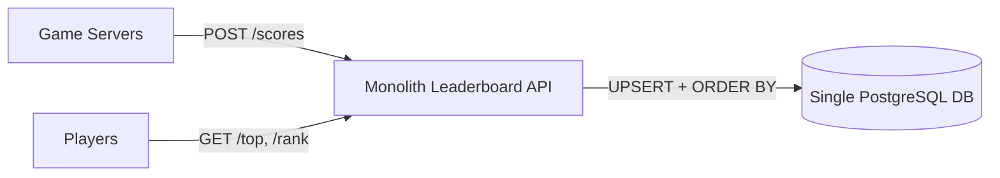
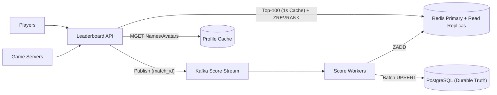
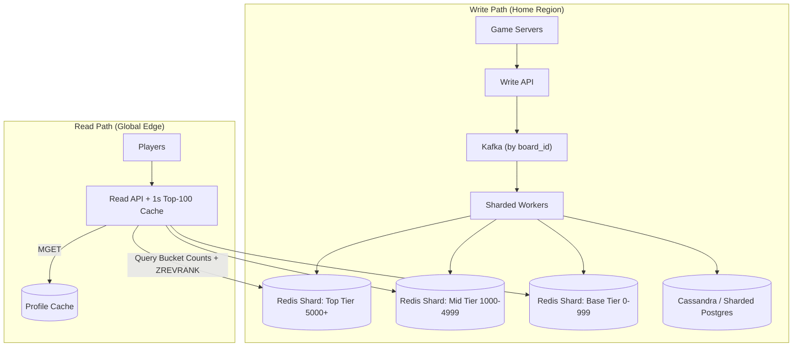
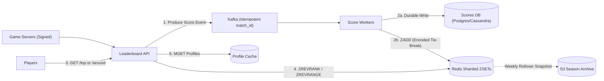
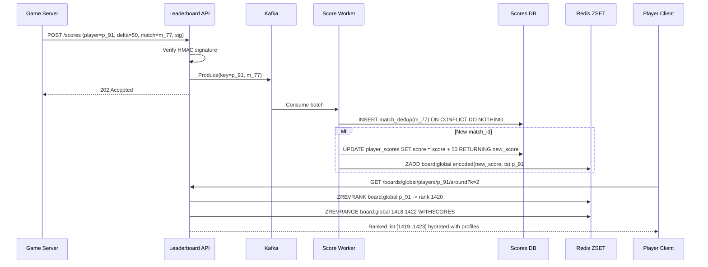

# Design a Leaderboard: Redis Sorted Sets, Real-Time Ranks, 50M Players

> **Difficulty:** Medium-Hard (Senior System Design)
> **Prerequisites:** [Previous lesson: Location Tracking System Design: Live Maps, Geohash, 2M Writes/s](../32-location-tracking-system-design/README.md) and the [Interview Framework track](../../21-interview-framework/README.md).
> **Estimated Reading Time:** 24 minutes
> **Target Audience:** Engineers practising the full system design interview on a classic prompt: ranking tens of millions of players by score, in real time.

> [!NOTE]
> **In one line:** A real-time leaderboard is **a dynamic sorted index**: you need `O(log N)` score updates, rank lookups, Top-N queries, and "players near me" slices simultaneously, which is why Redis Sorted Sets (Skip Lists + Hash Tables) are the canonical building block—until one shard gets too big and you must shard by score range.

> [!TIP]
> **The Golden Rule:** Keep live rankings in an in-memory Sorted Set for `O(log N)` updates and rank queries, encode tie-breakers into the score, treat the SQL/NoSQL database as the durable source of truth, and shard by score range when a single board exceeds one node's memory or CPU.

---

## 1. Clarifying Questions, Functional & Non-Functional Requirements

Open with scoping questions. Almost everyone says "Redis ZSET" in the first 30 seconds; what separates a Senior/Staff candidate is knowing **tie-breaking encoding**, **idempotency**, **recovery from Redis loss**, and **how to shard a single 500M-player global board**.

> Say it aloud: *"Before I draw anything, let me confirm the board types, query patterns, tie-breaking rules, and peak update rate."*

### Clarifying Questions & Assumed Answers

| Question | Assumed Answer | Architectural Impact |
| :--- | :--- | :--- |
| What leaderboards are needed? | Global, regional, and rolling weekly/seasonal boards | Natural sharding by `board_id` + TTL/rollover jobs |
| What queries must be fast? | Top 100, player's exact rank, and $\pm 5$ neighbors around me | Requires `ZREVRANGE`, `ZREVRANK`, and rank-range slicing |
| When do scores update? | At match end (20K score updates/s at peak, 50M players) | Write-heavy bursts at match/tournament end |
| How are ties broken? | Earlier achiever ranks higher | Secondary timestamp encoded into the 64-bit float score |
| What is out of scope? | Anti-cheat ML, matchmaking, reward payout transactions | Keeps focus on ranking engine, durability, and sharding |

### Functional Requirements

1. **Submit / Increment Score:** Update a player's score idempotently when a match finishes.
2. **Top-N Query:** Fetch the top 100 players with hydrated usernames, avatars, and scores.
3. **Player Rank Lookup:** Return a specific player's 1-based global/regional rank and score.
4. **Relative Neighbors ("Around Me"):** Return the $k$ players ranked immediately above and below a given player.
5. **Seasonal Rollover:** Archive final standings at the end of a week/season and reset active boards cleanly.

### Non-Functional Requirements

| Quality | Target | Why It Drives the Design |
| :--- | :--- | :--- |
| **Read Latency** | p99 < 20 ms | Rendered on every post-match screen and lobby |
| **Write Freshness** | Rank visible within < 1 second | Immediate gratification after a match |
| **Accuracy** | Exact for Top 10K and neighbors; approximate acceptable in tail | Users care deeply about Top 100 and local rank |
| **Durability** | Zero lost match scores (`RPO = 0`) | Redis alone is volatile; requires durable DB + rebuild path |
| **Availability** | 99.95% | Core engagement loop for the game |

---

## 2. Back-of-the-Envelope Capacity Estimation

Assume **50M active players**, **3 active boards** per player (Global, Regional, Weekly), **20K score updates/sec** at peak, and **100K read QPS** (post-match rank checks + lobby Top-100 views).

### Worked Capacity Equations

1. **Memory per Sorted Set Entry:** In Redis, a `ZSET` stores a Skip List node (~32 B pointers/score) + a Dict hash entry (~32 B) + `player_id` string (~16 B) $\approx$ **80 bytes/entry** (with allocator overhead).

2. **Memory per 50M-Player Board ($M_{\text{board}}$):**

$$M_{\text{board}} = 5 \times 10^7\text{ players} \times 80\text{ B} = 4.0\text{ GB}$$

3. **Total Live Ranking Memory Across 3 Boards ($M_{\text{total}}$):**

$$M_{\text{total}} = 4.0\text{ GB} \times 3 = 12.0\text{ GB (plus } \approx 25\% \text{ headroom} = 15\text{ GB)}$$

4. **Update Rate per Board ($Q_{\text{write}}$):**

$$Q_{\text{write/board}} = \frac{20{,}000\text{ updates/s}}{3\text{ boards}} \approx 6{,}667\text{ updates/s}$$

5. **Daily Durable Score Log Storage ($S_{\text{day}}$):** Assuming 20K avg/peak blended to 10K avg writes/s at 100 B/event:

$$S_{\text{day}} = 10{,}000 \times 100\text{ B} \times 86{,}400\text{ s/day} \approx 86.4\text{ GB/day}$$

### Capacity Summary Table

| Metric | Formula / Assumption | Estimate |
| :--- | :--- | :--- |
| **Players per Global Board** | Given | **50M players** |
| **Memory per Board** | $50\text{M} \times 80\text{ B}$ | **4.0 GB** |
| **Total Memory (3 Boards)** | $3 \times 4.0\text{ GB}$ | **12.0 GB** (fits on 1–3 Redis nodes) |
| **Peak Write QPS** | Given | **20K updates/s** (~6.7K/board) |
| **Peak Read QPS** | 5:1 read-to-write ratio | **100K reads/s** |

> **What the numbers tell you:** A single modern Redis node handles ~100K simple `ZADD`/`ZREVRANK` ops/sec and easily holds 12 GB in RAM. So **one Redis Sorted Set per board** works up to tens of millions of players! You only need score-range sharding when a single board hits **100M+ players** or **>80K ops/sec**.

---

## 3. Core API Contracts & Data Model

### API Contracts

| Endpoint | Purpose | Request / Response Notes |
| :--- | :--- | :--- |
| `POST /v1/boards/{board_id}/scores` | Submit match score | `{ "player_id": "p_91", "delta": 25, "match_id": "m_8821", "sig": "..." }` (idempotent on `match_id`) |
| `GET /v1/boards/{board_id}/top?limit=100` | Top-N leaderboard | Returns ranked list hydrated with `display_name`, `avatar_url`, `score`, `rank` |
| `GET /v1/boards/{board_id}/players/{player_id}` | Player rank & score | Uses `ZREVRANK` + `ZSCORE` |
| `GET /v1/boards/{board_id}/players/{player_id}/around?k=5` | Neighbors slice | Fetches `[rank - k, rank + k]` via `ZREVRANGE` |

### Data Model & Storage Engines

| Store | Key / Schema | Engine Choice | Why This Store |
| :--- | :--- | :--- | :--- |
| **Live Ranking Index** | `ZSET key = board:{id}`, `member = player_id`, `score = encoded_float64` | Redis Sorted Set | $O(\log N)$ `ZADD`, `ZREVRANK`, and $O(\log N + K)$ `ZREVRANGE` |
| **Durable Score Ledger** | `PK: (board_id, player_id)`, `score`, `updated_at`, `match_id` (unique index) | PostgreSQL / Cassandra | Durable source of truth; idempotency; rebuilds Redis on failure |
| **Player Profile Cache** | `player:{id} -> {name, avatar, country}` | Redis Hash / Memcached | Hydrates Top-100 and neighbor IDs without hitting SQL |
| **Season Archive** | `PK: (board_id, season_id, rank)` | S3 Parquet / Postgres | Immutable historical standings after weekly rollover |

---

## 4. Stage 1 (100 - 1K Users): Baseline Monolith & Single Database

At 100–1,000 players (~10 updates/s), we don't even need Redis. A single PostgreSQL table with an index on `(board_id, score DESC)` handles everything.

### Component-by-Component Build
1. **Leaderboard API Monolith:** Validates game-server signature, inserts into `match_dedup`, updates `player_scores`, and serves read queries.
2. **Single PostgreSQL Database:** Uses `RANK() OVER (ORDER BY score DESC)` or `COUNT(*) WHERE score > my_score` to compute ranks.



### What Breaks at 10K Users?
- **`COUNT(*)` / `OFFSET` Full Index Scans:** Computing a player's rank at position #45,000 via `COUNT(*) WHERE score > X` scans 45,000 index entries on every single read, spiking DB CPU to 100%.
- **Row-Lock Contention:** Concurrent match-end updates on `player_scores` + index maintenance slow down reads.

---

## 5. Stage 2 (10K - 100K Users): Caching, Read Replicas & Async Offload

At 100K–1M players (~2K updates/s), we move live ranking to **Redis Sorted Sets**, add **Kafka** for durable async writes, and cache Top-100 + player profiles.

### Component-by-Component Additions
1. **Redis Sorted Set (`ZSET`):** Replaces SQL `ORDER BY` for all rank, Top-N, and neighbor queries in $O(\log N)$.
2. **Idempotent Score Queue (Kafka):** Game servers push score events to Kafka; workers deduplicate by `match_id`, update Redis (`ZADD`), and batch-upsert PostgreSQL.
3. **Top-100 Micro-Cache (1s TTL):** Since 80% of reads request `GET /top?limit=100`, caching the hydrated Top-100 JSON in local API memory/Redis for 1 second absorbs massive read spikes.
4. **Profile Cache (`MGET`):** Hydrates `player_id`s returned by `ZREVRANGE` in a single batch call.



### What Breaks at 1M - 50M+ Users?
- **Single-Threaded Redis CPU Saturation:** One Redis primary executing 20K `ZADD` + 80K `ZREVRANK` ops/sec on a single thread hits 100% CPU (even with read replicas, writes all hit the primary).
- **Memory Limit on One Node:** If a game grows to 500M players ($\approx 40\text{ GB}$ per board) across 10 boards ($\approx 400\text{ GB}$), it no longer fits on a single Redis instance.
- **Hot-Key Hydration:** Hydrating 100 profiles per request for 100K reads/s creates 10M profile lookups/sec if not cached together with the Top-100 response.

---

## 6. Stage 3 (1M - 10M+ Users): Sharding, Partitioning & Multi-Region Scale

At 50M–500M players, we shard across two dimensions: **by `board_id`** first, and **by score range** when a single global board is still too large for one Redis node.

### Component-by-Component Additions
1. **Board-Level Sharding (Consistent Hash):** Regional, friend, and event boards are distributed across a Redis Cluster by `board_id`.
2. **Score-Range Sharding for Mega-Boards:** Split a single 100M-player global board into $K$ score buckets (e.g., `[0..1000)`, `[1000..5000)`, `[5000..∞)`), each on its own Redis shard.
   - Maintain a small **Bucket Count Table** (`shard_0: 42M`, `shard_1: 7.9M`, `shard_2: 100K`).
   - A player's global rank = `(sum of counts in all higher buckets) + ZREVRANK(player in own bucket)`.
3. **Approximate Tail (Histogram / Count-Min):** Players outside the Top 100K only need percentile or approximate rank (e.g., "Top 12%"), updated asynchronously every 30 seconds via a score histogram.
4. **Multi-Region Read Replicas + Local Edge Hydration:** Global players read Top-100 and ranks from local regional Redis replicas; score writes route to the board's home region.



---

## 7. Final Full Production Architecture & End-to-End Flows



### End-to-End Score Submission & Neighbor Query Sequence



---

## 8. Deep-Dive Bottlenecks & Algorithmic Trade-Offs

### 1. Tie-Breaking Without Breaking `float64` Precision
Redis Sorted Sets store scores as **IEEE 754 64-bit floating-point numbers**, which have **53 bits of exact integer significand** ($2^{53} \approx 9 \times 10^{15}$).
- If we want **higher score first**, and **earlier timestamp first** on ties:
  - Allocate 30 bits for `score` (supports scores up to $10^9$) and 23 bits for `(MAX_TS - relative_ts)` (supports ~97 days in 1-second resolution, or a weekly season in millisecond resolution).
  - Formula:
    $$\text{encoded} = (\text{score} \ll 23) + (\text{EPOCH\_END} - \text{ts})$$
  - Because `encoded` fits strictly within 53 bits, IEEE 754 `double` represents it with **zero precision loss**.
- **Alternative (Redis 5+):** If scores exceed $10^9$ or you need microsecond tie-breaking, store scores in `ZSET` with equal float values and use lexicographical ordering (`ZRANGEBYLEX`)—though this only works when all members have score `0` and you encode `score:ts:player_id` in the member string.

### 2. Score-Range Sharding Math & Cross-Shard Boundary Moves
When a player's score crosses from `Shard 2 [1000..4999]` into `Shard 1 [5000..∞)`:
1. The worker executes a two-step move: `ZREM shard_2 p_91` and `ZADD shard_1 new_score p_91`, plus `DECR count:shard_2` and `INCR count:shard_1`.
2. **Dynamic Rebalancing:** If `shard_1` grows too large (>10M players), a background splitter picks the median score of `shard_1` using `ZRANGE shard_1 5000000 5000000 WITHSCORES` and splits it into two ranges.

### 3. Rebuild Speed After Total Redis Loss
Suppose an entire Redis shard dies and its replica is also corrupted. How fast can we rebuild 50M rows from PostgreSQL/Cassandra?
- Running 50M individual `ZADD` commands sequentially takes ~500 seconds.
- **Optimization:** Stream rows from DB in batches of 10,000 and use **Redis Pipelining** (`ZADD board score1 p1 score2 p2 ...` with 1,000 members per command). At 500K entries/sec per pipeline connection, 50M players rebuild in **~100 seconds** (or **~20 seconds** across 5 parallel streams).

---

## 9. Failure Modes, Reliability & Backpressure Mitigations

| Failure Mode | User Impact | Mitigation Strategy |
| :--- | :--- | :--- |
| **Redis Primary Crash** | Write stall for 5–15s | Redis Sentinel / Cluster promotes replica automatically; Kafka buffers incoming score events during failover without dropping any match |
| **Duplicate Match Submission** | Player's score doubles on retry | Require `match_id` idempotency key; deduplicate in Scores DB (`UNIQUE(match_id)`) before applying `ZADD` |
| **Tournament End Write Spike** | 10x normal QPS (200K/s) | Kafka absorbs burst; Score Workers coalesce multiple updates for the same player in a batch and pipeline `ZADD` to Redis |
| **Top-100 Read Storm (Thundering Herd)** | 100K/s identical `ZREVRANGE 0 99` | Single-flight / 1-second local in-memory cache in API servers; only 1 request/sec per API pod hits Redis |
| **Cheating / Client Score Tampering** | Fake 999,999,999 scores on Top 10 | Never accept scores directly from mobile/browser clients; only authoritative **Game Servers** submit HMAC-signed score deltas |

---

## 10. Production War Story & Real-World Reference

### The "53-Bit Float Truncation" Tie-Breaker Bug
A gaming studio launched a global seasonal tournament with 20M players. To break ties, they encoded `score * 10_000_000_000 + (MAX_TS - ts_ms)` into a Redis `ZSET` score.
- The combined number exceeded $2^{53}$ ($9.007 \times 10^{15}$).
- Redis silently rounded the least significant bits when converting to `float64`.
- Result: Players who achieved the same score hours apart had identical rounded `float64` scores, causing Redis to fall back to **alphabetical `player_id` tie-breaking**—and players whose names started with `a` unfairly beat everyone else.

**The Fix:** Enforce a strict bit-budget check (`bits(score) + bits(inverted_ts) <= 53`) at compile time using `uint64` shifted into the 53-bit mantissa, and store season-relative seconds (22 bits = 48 days) instead of Unix epoch milliseconds (41 bits).

---

## 11. Core Component Implementation (4 Languages)

Below is the **Tie-Break Score Encoder & Leaderboard Service** implementing 53-bit safe score encoding, `SubmitScore`, `TopN`, and `AroundPlayer`.

````carousel
```go
package leaderboard

import (
	"errors"
	"sort"
	"sync"
)

const (
	tsBits    = 22               // ~48 days in seconds
	maxRelTs  = (1 << tsBits) - 1
	maxScore  = (1 << (53 - tsBits)) - 1 // 2^31 - 1 (~2.14B)
)

// EncodeScore packs (score, inverted relative timestamp) into <=53 bits for exact float64.
func EncodeScore(score int64, relTsSeconds int64) (float64, error) {
	if score < 0 || score > maxScore || relTsSeconds < 0 || relTsSeconds > maxRelTs {
		return 0, errors.New("score or timestamp exceeds 53-bit precision budget")
	}
	packed := (uint64(score) << tsBits) | uint64(maxRelTs-relTsSeconds)
	return float64(packed), nil
}

type Entry struct {
	PlayerID string
	Score    int64
	Encoded  float64
}

type Board struct {
	mu      sync.RWMutex
	players map[string]Entry
	dedup   map[string]struct{}
}

func NewBoard() *Board {
	return &Board{players: make(map[string]Entry), dedup: make(map[string]struct{})}
}

func (b *Board) Submit(matchID, playerID string, delta, relTs int64) error {
	b.mu.Lock()
	defer b.mu.Unlock()
	if _, seen := b.dedup[matchID]; seen {
		return nil // idempotent
	}
	cur := b.players[playerID].Score + delta
	enc, err := EncodeScore(cur, relTs)
	if err != nil {
		return err
	}
	b.players[playerID] = Entry{PlayerID: playerID, Score: cur, Encoded: enc}
	b.dedup[matchID] = struct{}{}
	return nil
}

func (b *Board) sorted() []Entry {
	list := make([]Entry, 0, len(b.players))
	for _, e := range b.players {
		list = append(list, e)
	}
	sort.Slice(list, func(i, j int) bool {
		if list[i].Encoded != list[j].Encoded {
			return list[i].Encoded > list[j].Encoded
		}
		return list[i].PlayerID < list[j].PlayerID
	})
	return list
}

func (b *Board) Around(playerID string, k int) (int, []Entry) {
	b.mu.RLock()
	defer b.mu.RUnlock()
	list := b.sorted()
	for idx, e := range list {
		if e.PlayerID == playerID {
			lo := max(0, idx-k)
			hi := min(len(list), idx+k+1)
			return idx + 1, list[lo:hi]
		}
	}
	return -1, nil
}
```
<!-- slide -->
```typescript
const TS_BITS = 22;
const MAX_REL_TS = (1 << TS_BITS) - 1;
const MAX_SCORE = 2 ** (53 - TS_BITS) - 1;

export function encodeScore(score: number, relTsSeconds: number): number {
  if (score < 0 || score > MAX_SCORE || relTsSeconds < 0 || relTsSeconds > MAX_REL_TS) {
    throw new RangeError("Score or timestamp exceeds 53-bit IEEE-754 integer budget");
  }
  // Use multiplication instead of 32-bit bitwise shift in JS
  return score * (1 << TS_BITS) + (MAX_REL_TS - relTsSeconds);
}

export interface BoardEntry {
  playerId: string;
  score: number;
  encoded: number;
}

export class Leaderboard {
  private players = new Map<string, BoardEntry>();
  private processedMatches = new Set<string>();

  submit(matchId: string, playerId: string, delta: number, relTsSeconds: number): void {
    if (this.processedMatches.has(matchId)) return;
    const prev = this.players.get(playerId)?.score ?? 0;
    const nextScore = prev + delta;
    const encoded = encodeScore(nextScore, relTsSeconds);
    this.players.set(playerId, { playerId, score: nextScore, encoded });
    this.processedMatches.add(matchId);
  }

  private sorted(): BoardEntry[] {
    return [...this.players.values()].sort((a, b) =>
      b.encoded !== a.encoded ? b.encoded - a.encoded : a.playerId.localeCompare(b.playerId)
    );
  }

  around(playerId: string, k: number): { rank: number; neighbors: BoardEntry[] } {
    const list = this.sorted();
    const idx = list.findIndex((e) => e.playerId === playerId);
    if (idx === -1) return { rank: -1, neighbors: [] };
    return {
      rank: idx + 1,
      neighbors: list.slice(Math.max(0, idx - k), Math.min(list.length, idx + k + 1)),
    };
  }
}
```
<!-- slide -->
```python
from dataclasses import dataclass

TS_BITS = 22
MAX_REL_TS = (1 << TS_BITS) - 1
MAX_SCORE = (1 << (53 - TS_BITS)) - 1


def encode_score(score: int, rel_ts_seconds: int) -> float:
    if not (0 <= score <= MAX_SCORE) or not (0 <= rel_ts_seconds <= MAX_REL_TS):
        raise ValueError("Score or timestamp exceeds 53-bit float64 precision budget")
    packed = (score << TS_BITS) | (MAX_REL_TS - rel_ts_seconds)
    return float(packed)


@dataclass(frozen=True)
class Entry:
    player_id: str
    score: int
    encoded: float


class Leaderboard:
    def __init__(self) -> None:
        self._players: dict[str, Entry] = {}
        self._seen_matches: set[str] = set()

    def submit(self, match_id: str, player_id: str, delta: int, rel_ts_seconds: int) -> None:
        if match_id in self._seen_matches:
            return
        new_score = (self._players[player_id].score if player_id in self._players else 0) + delta
        enc = encode_score(new_score, rel_ts_seconds)
        self._players[player_id] = Entry(player_id, new_score, enc)
        self._seen_matches.add(match_id)

    def _sorted(self) -> list[Entry]:
        return sorted(self._players.values(), key=lambda e: (-e.encoded, e.player_id))

    def around(self, player_id: str, k: int = 2) -> tuple[int, list[Entry]]:
        board = self._sorted()
        for idx, entry in enumerate(board):
            if entry.player_id == player_id:
                return idx + 1, board[max(0, idx - k) : idx + k + 1]
        return -1, []
```
<!-- slide -->
```csharp
using System;
using System.Collections.Generic;
using System.Linq;

public record BoardEntry(string PlayerId, long Score, double Encoded);

public sealed class Leaderboard
{
    private const int TsBits = 22;
    private const long MaxRelTs = (1L << TsBits) - 1;
    private const long MaxScore = (1L << (53 - TsBits)) - 1;

    private readonly Dictionary<string, BoardEntry> _players = new();
    private readonly HashSet<string> _seenMatches = new();
    private readonly object _lock = new();

    public static double EncodeScore(long score, long relTsSeconds)
    {
        if (score < 0 || score > MaxScore || relTsSeconds < 0 || relTsSeconds > MaxRelTs)
            throw new ArgumentOutOfRangeException("Score or timestamp exceeds 53-bit float64 budget.");
        long packed = (score << TsBits) | (MaxRelTs - relTsSeconds);
        return (double)packed;
    }

    public void Submit(string matchId, string playerId, long delta, long relTsSeconds)
    {
        lock (_lock)
        {
            if (!_seenMatches.Add(matchId)) return;
            long prev = _players.TryGetValue(playerId, out var existing) ? existing.Score : 0;
            long nextScore = prev + delta;
            _players[playerId] = new BoardEntry(playerId, nextScore, EncodeScore(nextScore, relTsSeconds));
        }
    }

    public (int Rank, List<BoardEntry> Neighbors) Around(string playerId, int k)
    {
        lock (_lock)
        {
            var sorted = _players.Values
                .OrderByDescending(e => e.Encoded)
                .ThenBy(e => e.PlayerId, StringComparer.Ordinal)
                .ToList();

            int idx = sorted.FindIndex(e => e.PlayerId == playerId);
            if (idx < 0) return (-1, new List<BoardEntry>());
            int start = Math.Max(0, idx - k);
            int count = Math.Min(sorted.Count - start, idx - start + k + 1);
            return (idx + 1, sorted.GetRange(start, count));
        }
    }
}
```
````

---

## 12. Verification, Load Testing & CLI Diagnostics

```bash
# 1. Benchmark Redis ZADD and ZREVRANK on a 1M-member sorted set
redis-benchmark -t zadd -n 100000 -r 1000000 -c 50 -q

# 2. Inspect Top-10 and player rank directly via redis-cli
redis-cli ZREVRANGE board:global 0 9 WITHSCORES
redis-cli ZREVRANK board:global "player_42"

# 3. Check memory footprint of a live sorted set
redis-cli MEMORY USAGE board:global SAMPLES 5

# 4. Verify 53-bit tie-breaker encoding in Python
python3 -c '
TS_BITS = 22
MAX_TS = (1 << TS_BITS) - 1
enc = lambda s, t: float((s << TS_BITS) | (MAX_TS - t))
assert enc(900, 10) > enc(900, 11), "Earlier achiever must rank higher"
assert enc(901, 999) > enc(900, 1), "Higher score must always win"
print("Tie-breaker invariant passed!")
'
```

---

## 13. Common Interview Mistakes & Red Flags

1. **Running `SELECT ... ORDER BY score DESC` on PostgreSQL for every request:** Fails catastrophically under concurrent reads and writes.
2. **Ignoring tie-breaking:** Two players with 900 points get sorted arbitrarily by `player_id` string order.
3. **Exceeding 53 bits in Redis `float64` scores:** Packing `score * 1e13 + timestamp_ms` silently corrupts tie-breaking due to IEEE 754 rounding.
4. **Trusting client-submitted scores:** Allowing a mobile client to `POST /scores {"score": 999999}` guarantees immediate leaderboard hacking.
5. **No idempotency key on score submission:** Network retries after a match double-award points.
6. **Treating Redis as the only store:** If Redis restarts without AOF or crashes, all player scores are permanently lost unless backed by a durable Scores DB.
7. **Forgetting to hydrate profiles separately:** Storing JSON blobs (`{"name":"Alice","avatar":"..."}`) as the `ZSET` member breaks `ZADD` updates when Alice changes her username (creating duplicate entries).

---

## 14. Key Terminology & Glossary

| Key Term | Definition |
| :--- | :--- |
| **Redis Sorted Set (`ZSET`)** | A dual data structure (Skip List + Hash Table) mapping unique members to `float64` scores in $O(\log N)$ time. |
| **Skip List** | A probabilistic multi-level linked list enabling $O(\log N)$ search, insertion, and rank counting. |
| **`ZREVRANK`** | Redis command returning the 0-based descending rank of a member in $O(\log N)$ time. |
| **`ZREVRANGE`** | Redis command returning a slice of members by rank range in $O(\log N + K)$ time. |
| **IEEE 754 `float64` Mantissa** | The 53-bit significand in a double-precision float that guarantees exact integer representation up to $9 \times 10^{15}$. |
| **Score-Range Sharding** | Partitioning a single massive leaderboard into contiguous score buckets across multiple Redis nodes. |
| **Idempotency Key (`match_id`)** | A unique identifier ensuring retried score submissions are applied at most once. |
| **Profile Hydration** | Enriching ranked `player_id`s with display names and avatars via a batch `MGET` cache lookup. |
| **Season Rollover** | Scheduled archival of a periodic board's final standings to cold storage before resetting for the next season. |
| **Redis Pipelining** | Batching multiple commands into a single TCP round-trip to accelerate bulk rebuilds and writes. |

---

## 15. Interview Follow-Up Questions (12 Q&As)

### Basic Conceptual Questions

<details>
<summary><strong>Q1: Why is a Redis Sorted Set faster than SQL `ORDER BY` for leaderboards? [BASIC]</strong></summary>

SQL `OFFSET` / `COUNT(*)` scans $O(N)$ index rows to compute a rank, whereas Redis `ZSET` maintains span counts on its Skip List levels, returning `ZREVRANK` and `ZREVRANGE` in $O(\log N)$ time in RAM.

</details>

<details>
<summary><strong>Q2: Why should the `ZSET` member be `player_id` rather than a JSON string with the player's name? [BASIC]</strong></summary>

`ZSET` uniqueness is keyed on the member string. If you embed mutable fields like `display_name` or `avatar` in the member, changing a username creates a duplicate player entry on the board. Always store immutable `player_id` in the `ZSET` and hydrate profiles via `MGET`.

</details>

<details>
<summary><strong>Q3: How do you handle ties so the earlier achiever ranks higher? [BASIC]</strong></summary>

Encode `(score << K) | (MAX_TS - relative_ts)` into the `ZSET` score, keeping the total bit width $\le 53$ bits so `float64` represents it exactly.

</details>

<details>
<summary><strong>Q4: What happens if Redis crashes and loses all in-memory data? [BASIC]</strong></summary>

In normal operation, a Redis replica promotes via Sentinel/Cluster. In a total cluster loss, workers stream all `(player_id, score)` rows from the durable Scores DB using pipelined `ZADD` batches (1,000 per command), rebuilding 50M rows in ~1–2 minutes.

</details>

### Scenario-Based Architecture Questions

<details>
<summary><strong>Q5: How do you design a "Friends-Only" leaderboard for 50M players? [SCENARIO]</strong></summary>

Do **not** maintain 50M separate Redis `ZSET`s (huge memory waste). Instead, fetch the user's friend IDs (typically $\le 500$) from the Social Graph service, run a pipelined `ZMSCORE board:global friend_1 friend_2 ...` (or query the Scores DB), and sort those $\le 500$ scores in memory in < 1 ms.

</details>

<details>
<summary><strong>Q6: A weekly tournament ends at 00:00 UTC Sunday. How do you roll over cleanly? [SCENARIO]</strong></summary>

Use time-bucketed keys like `board:weekly:2026-W12`. At 00:00 UTC, clients automatically switch to `board:weekly:2026-W13` (zero downtime, no `DEL` lock). An async job dumps `2026-W12` to S3 Parquet for rewards/history and sets a 7-day TTL on the old Redis key.

</details>

<details>
<summary><strong>Q7: How do you prevent a Top-100 read storm when 1M players open the app simultaneously? [SCENARIO]</strong></summary>

Cache the already-hydrated Top-100 JSON payload in the API tier (local RAM or edge CDN) with a **1-second TTL** and single-flight coalescing. Even at 500K QPS, Redis only serves 1 `ZREVRANGE 0 99` per second per API instance.

</details>

<details>
<summary><strong>Q8: A player complains their score jumped twice after a flaky mobile network retry. How do you fix it? [SCENARIO]</strong></summary>

Attach a unique `match_id` to every score submission. The Score Worker inserts `match_id` into a deduplication table (`UNIQUE(match_id)`) inside the same DB transaction that increments the player's score; duplicate retries are silently ignored.

</details>

### Advanced & Tricky Interview Questions

<details>
<summary><strong>Q9: How do you shard a single global leaderboard of 500M players across 20 Redis nodes? [TRICKY]</strong></summary>

Shard by **score range** (not `hash(player_id)`, which would require scatter-gather for `Top-100`). Each shard owns a contiguous score range and tracks its total member count. Global rank = `sum(counts of higher shards) + ZREVRANK(in player's shard)`. Top-100 only queries the highest shard.

</details>

<details>
<summary><strong>Q10: In score-range sharding, what happens if 90% of players have score `0` or `100`? [TRICKY]</strong></summary>

The lowest bucket becomes a hotspot. Mitigate by (1) excluding `score == 0` players from Redis until they earn their first point (lazy insertion), and (2) using **approximate percentile histograms** for the bottom 99% tail rather than exact `ZREVRANK` across 400M casual players.

</details>

<details>
<summary><strong>Q11: What if we need to support `ZINCRBY` AND tie-breaking at the same time? [TRICKY]</strong></summary>

You cannot use raw `ZINCRBY` with bit-packed scores because incrementing the score wouldn't update the inverted timestamp bits! Instead, compute the new score in the Scores DB (or a Redis Lua script that unpacks `score`, adds `delta`, re-packs with the new `rel_ts`, and calls `ZADD`).

</details>

<details>
<summary><strong>Q12: How do you detect and quarantine a cheater who submits an impossible score? [TRICKY]</strong></summary>

(1) Only accept HMAC-signed payloads from authoritative game servers, never clients. (2) Enforce sanity bounds in the worker (max points per minute). (3) Flag anomalies asynchronously; if banned, `ZREM` the player from Redis and mark `is_banned = true` in the Scores DB so future rebuilds exclude them.

</details>

---

## 16. One-Page Master Cheat Sheet

```text
+------------------------------------------------------------------------------+
|                   DESIGN A LEADERBOARD: MASTER CHEAT SHEET                   |
+------------------------------------------------------------------------------+
| SCALE: 50M players | 4 GB/board | 20K writes/s | 100K reads/s | p99 <20ms    |
+------------------------------------------------------------------------------+
| CORE ARCHITECTURE:                                                           |
|  1. Write Path: Game Server -> API -> Kafka (match_id) -> Worker             |
|     -> Scores DB (Idempotent + Durable) + Redis ZSET (ZADD).                 |
|  2. Tie-Break : Pack (score << 22) | (MAX_TS - rel_ts) <= 53 bits (float64). |
|  3. Read Path : Top-100 (1s cache), ZREVRANK, ZREVRANGE + MGET Profile Cache.|
|  4. Sharding  : Shard by board_id first; shard mega-boards by score range.   |
|  5. Friends   : ZMSCORE for <=500 friend IDs + sort in app memory (<1ms).    |
+------------------------------------------------------------------------------+
| KEY INTERVIEW TRADE-OFFS:                                                    |
|  * Redis ZSET vs SQL ORDER BY: O(log N) in RAM vs O(N) index scans.          |
|  * Score-Range Sharding vs Hash Sharding: Hash breaks Top-N; Range keeps it  |
|    on 1 shard and computes global rank via higher-bucket counts.             |
+------------------------------------------------------------------------------+
```

| Stage | Players / Rate | Architecture Highlight | Primary Bottleneck Solved |
| :--- | :--- | :--- | :--- |
| **Stage 1** | 1K / 10 writes/s | Monolith + PostgreSQL `ORDER BY` | Simple MVP |
| **Stage 2** | 100K / 2K writes/s | Redis `ZSET` + Kafka + Profile Cache | SQL `COUNT(*)` rank scan & write locks |
| **Stage 3** | 50M–500M / 20K+ w/s | Score-Range Sharding + 1s Top-100 Cache | Single-node Redis CPU/RAM limit |

---

## Further Reading

- Redis documentation: sorted sets (`ZADD`, `ZREVRANK`, `ZREVRANGE`).
- Redis blog, *Building leaderboards with sorted sets*.

---

## Next

Continue with [Design a Recommendation System: Candidate Funnel, Feature Store, Ranking](../34-design-a-recommendation-system/README.md).
