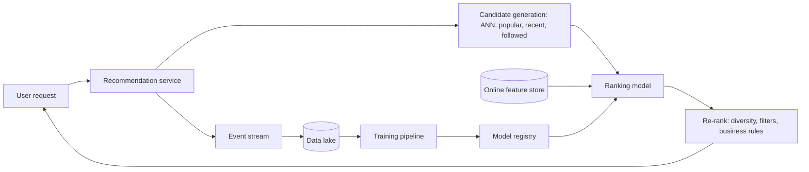

# Design a Recommendation System: Candidate Funnel, Feature Store, Ranking

> **Prerequisites:** [Previous lesson: Design a Leaderboard: Redis Sorted Sets, Real-Time Ranks, 50M Players](../33-design-a-leaderboard/README.md) and the [Interview Framework track](../../21-interview-framework/README.md).
> **Estimated Reading Time:** 15–20 minutes
> **Target Audience:** Engineers practising the full 9-step system design interview on a classic prompt: choosing a few items out of millions for each user.

> [!NOTE]
> **In one line:** A recommender is **a funnel**: cheap retrieval narrows millions of items to hundreds of candidates, a ranking model scores them with rich features, and rules finalise the list, all within a latency budget.

> [!TIP]
> **The Golden Rule:** Spend little per item early and more per item later. Precompute what you can, serve features from a low-latency store, and keep training and serving features identical.

---

## Step 1. Clarify the Problem

Open with questions, not boxes. Do not start with the model. Start with the funnel, the data flow and the feedback loop.

**Questions to ask the interviewer, and the answer we assume:**

| Question | Assumed answer |
| :--- | :--- |
| What is recommended? | Videos on a home page |
| Signals? | Views, watch time, likes, searches |
| Latency? | Under 200 ms for a page of 30 items |
| Freshness? | New items eligible within minutes |
| Scale? | 100M DAU, 10M items, 10 recommendation requests per user per day |

> Say it aloud: *"Before I draw anything, let me confirm the scope and the numbers."* That one sentence earns the first minutes of the interview.

---

## Step 2. Functional and Non-Functional Requirements

**Functional (what the system does):**

- Return a personalised, ranked list of items for a user.
- Update recommendations as the user interacts.
- Surface new items and diversify results.
- Log impressions and clicks for training.

**Non-functional (how well it does it):**

| Quality | Target | Why it drives the design |
| :--- | :--- | :--- |
| Latency | p99 under 200 ms | Home page load |
| Relevance | Optimise engagement and satisfaction | Product goal |
| Freshness | New items within minutes | Content is time sensitive |
| Scale | Billions of requests a day | Large user base |

---

## Step 3. Scope: In and Out

**In scope:** Candidate generation, ranking, features, serving, feedback loop.

**Out of scope (say it explicitly, then move on):**

- Model research details.
- Ads ranking.
- Content moderation.

---

## Step 4. Capacity Estimation

Assumptions: 100M DAU, 10 requests per user per day, 10M items, ranking 500 candidates per request.

| Quantity | Calculation | Result |
| :--- | :--- | :--- |
| Requests per second | `dau * reqs / 86400` | **11.6K req/s** |
| Items scored per second | `requests_per_second * candidates` | **5.8M scores/s** |
| Item embedding table | `items * dim * 4 / 1e9` | **2.56 GB** |

**What the numbers tell you:** 11.6K requests per second times 500 candidates is 5.8M model scores per second, which needs batching and GPUs or fast CPU models. The item embedding table is only about 2.6 GB, so approximate nearest-neighbour search runs in memory.

---

## Step 5. API Design

| Endpoint | Purpose | Notes |
| :--- | :--- | :--- |
| `GET /v1/recommendations?user=&n=30` | Home feed | Returns ranked item ids with reasons. |
| `POST /v1/events` | Log impressions, clicks, watch time | Async to a stream. |
| `GET /v1/items/{id}/related` | Similar items | Item-to-item retrieval. |

Always return something: if the model service is slow, fall back to popular items for the user's region so the page never breaks.

---

## Step 6. Data Model

| Entity / Store | Key fields | Why this store |
| :--- | :--- | :--- |
| Feature store (online, key-value) | User and item features, recent history | Sub-5 ms lookups |
| Feature store (offline) | Same features at training time | Prevents training/serving skew |
| Item embedding index (ANN) | Vectors for similarity retrieval | In-memory HNSW or IVF |
| Event stream and data lake | Impressions, clicks, outcomes | Training data |
| Model registry | Versioned models | Safe rollout |

Compute each feature once with the same code for training and serving, or the model sees different inputs in production than in training.

---

## Step 7. High-Level Architecture



**Walk the diagram in this order:** a request fetches a few hundred candidates from several sources, ranks them using features from the store, re-ranks for diversity and rules, and returns a page; events flow back to training.

---

## Step 8. Deep Dives and Bottlenecks

### 1. The candidate funnel

Stage 1 retrieval produces about 500 candidates from several cheap sources: nearest neighbours of the user embedding, items similar to recent views, trending items and followed creators. Stage 2 ranking scores them with a heavier model using user, item and context features. Stage 3 re-ranking removes duplicates and already-seen items and enforces diversity and policy. Each stage is cheaper per item than the next.

### 2. Features, training and skew

Log the features used at serving time and train on that log, so the model trains on exactly what it will see. Keep an online store for low-latency lookup and an offline store for training, populated by the same transformations. Near-real-time features (last 10 minutes of activity) come from a stream processor.

### 3. Cold start, freshness and evaluation

New items have no history, so give them exploration traffic and content-based embeddings; new users get popular and onboarding signals. Evaluate offline with ranking metrics, then with A/B tests on watch time and retention. Roll out models gradually and monitor, because a bad model degrades every request.

---

## Step 9. Trade-offs, Failures and Security

**Trade-offs to state aloud:**

| Decision | Option A | Option B | Pick and why |
| :--- | :--- | :--- | :--- |
| Retrieval | Exact search | Approximate nearest neighbour | ANN: millions of items in milliseconds with small recall loss |
| Scoring | One big model on all items | Funnel | Funnel: cost per item grows with stage |
| Objective | Clicks | Long-term satisfaction | Blend: pure clicks reward clickbait |

**Failure modes and mitigations:**

| Failure | What users see | Mitigation |
| :--- | :--- | :--- |
| Model service slow | Slow page | Timeout, fall back to popular items |
| Feature store outage | Missing features | Default features and a simpler model |
| Bad model release | Engagement drop | Canary, A/B guardrails, quick rollback |

**Security and abuse:** Respect privacy settings and regional laws on personalisation, avoid using sensitive attributes, filter unsafe content before ranking, and guard against manipulation by fake engagement.

---

## Runnable Example: Two-stage funnel

Cheap retrieval keeps the top candidates by dot-product similarity, then a ranker adds a freshness boost.

```python
user = [1.0, 0.5]
items = {
    "a": ([0.9, 0.4], 1),   # (embedding, age in days)
    "b": ([0.1, 0.9], 0),
    "c": ([1.0, 0.6], 30),
    "d": ([0.2, 0.1], 2),
}

def dot(u, v):
    return sum(x * y for x, y in zip(u, v))

candidates = sorted(items, key=lambda i: dot(user, items[i][0]), reverse=True)[:3]
print("candidates:", candidates)

def rank_score(i):
    emb, age = items[i]
    return dot(user, emb) + 0.5 / (1 + age)

print("ranked:", sorted(candidates, key=rank_score, reverse=True))
```

Output (produced by running this exact code):

```text
candidates: ['c', 'a', 'b']
ranked: ['a', 'c', 'b']
```

Retrieval drops the least similar item cheaply, and the ranker then reorders the survivors, promoting the fresher item `a` above the slightly more similar but 30-day-old `c`.

---

## Common Mistakes

- Scoring every item with the heavy model.
- Training on features that differ from serving features.
- No fallback when the model is slow.
- Optimising only for clicks.
- No plan for new items and new users.

---

## Interview Questions and Answers

<details>
<summary><strong>Q1: Why a multi-stage funnel?</strong></summary>

Scoring millions of items with a rich model is impossible in 200 ms. Cheap retrieval narrows to hundreds, then ranking spends compute only on those.

</details>

<details>
<summary><strong>Q2: What is training-serving skew?</strong></summary>

Features computed differently in training and production, so the model sees different inputs. Avoid it by logging serving features and sharing transformation code.

</details>

<details>
<summary><strong>Q3: How do you handle cold start?</strong></summary>

Content-based embeddings and exploration traffic for new items, popularity and onboarding signals for new users.

</details>

<details>
<summary><strong>Q4: How do you evaluate?</strong></summary>

Offline ranking metrics first, then A/B tests on engagement and retention with guardrail metrics.

</details>

<details>
<summary><strong>Q5: What if the model is down?</strong></summary>

Return a precomputed popular or recently watched list so the page still renders.

</details>

---

## One-Page Cheat Sheet

| Step | What to say or draw |
| :--- | :--- |
| Clarify | Home feed, signals, 200 ms, 100M DAU |
| Capacity | 11.6K req/s, 5.8M scores/s, ~2.6 GB embeddings |
| API | recommendations, events, related |
| Data | Online/offline feature store, ANN index, event stream |
| Deep dive | Funnel, features and skew, cold start |
| Trade-off | ANN, blended objective |

---

## Further Reading

- Covington et al., *Deep Neural Networks for YouTube Recommendations* (RecSys 2016).
- Eugene Yan, *System Design for Recommendations and Search*.

---

## Next

Continue with [Design a RAG Knowledge Assistant: Hybrid Search, Permissions, Citations](../35-design-a-rag-knowledge-assistant/README.md).
