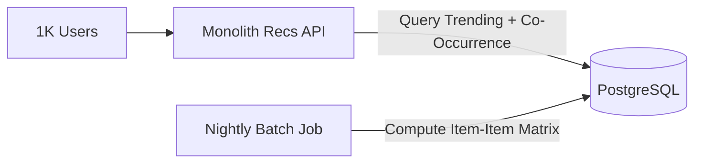
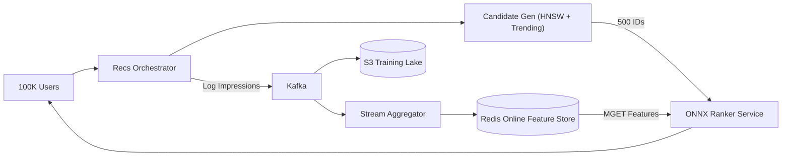
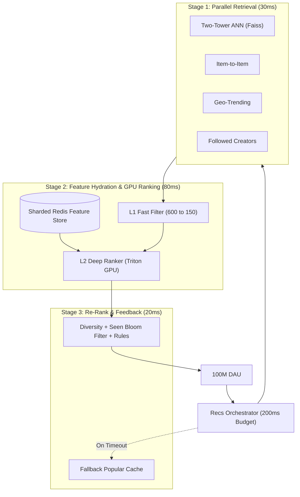
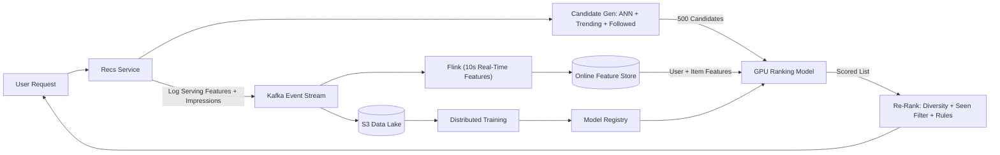
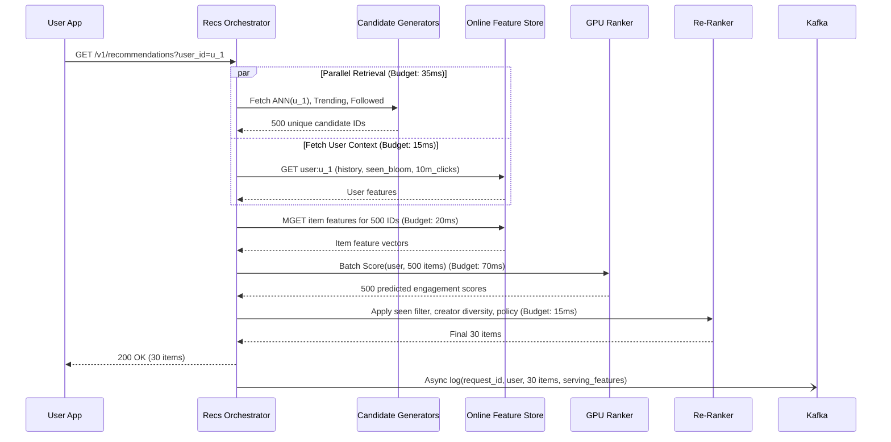

# Design a Recommendation System: Candidate Funnel, Feature Store, Ranking

> **Difficulty:** Hard (Staff / Principal System Design)
> **Prerequisites:** [Previous lesson: Design a Leaderboard: Redis Sorted Sets, Real-Time Ranks, 50M Players](../33-design-a-leaderboard/README.md) and the [Interview Framework track](../../21-interview-framework/README.md).
> **Estimated Reading Time:** 26 minutes
> **Target Audience:** Engineers practising the full system design interview on a classic prompt: choosing a few items out of millions for each user in under 200 ms.

> [!NOTE]
> **In one line:** A production recommender is **a multi-stage funnel**: cheap retrieval (ANN + heuristics) narrows 10M items to ~500 candidates, a ranking model scores those 500 using an online feature store, and business/diversity rules finalize the top 30—all within a strict 200 ms latency budget.

> [!TIP]
> **The Golden Rule:** Spend micro-cents per item at the top of the funnel and heavy GPU/CPU compute only on the final few hundred candidates; log serving features at inference time to eliminate training-serving skew.

---

## 1. Clarifying Questions, Functional & Non-Functional Requirements

Open with scoping questions about the **funnel**, **latency budget**, and **feedback loop**—not neural network layer architectures. In a systems interview, the bottleneck is serving 5.8M model scores/sec in under 200 ms while keeping features fresh.

> Say it aloud: *"Before I draw anything, let me confirm the item catalog size, latency SLA, freshness requirements, and request volume."*

### Clarifying Questions & Assumed Answers

| Question | Assumed Answer | Architectural Impact |
| :--- | :--- | :--- |
| What are we recommending? | Videos / posts on a home feed (page of 30 items) | High read QPS; strong cold-start & freshness needs |
| What user signals exist? | Views, watch time, likes, skips, searches | Requires streaming feature aggregation + event lake |
| What is the latency SLA? | p99 < 200 ms end-to-end | Forces multi-stage funnel + strict per-stage budgets |
| How fast must new items appear? | Eligible within 2–5 minutes of upload | Streaming embedding indexing + exploration traffic |
| What is the target scale? | 100M DAU, 10 req/user/day, 10M active items | ~11.6K QPS avg (~35K peak), 500 candidates/req |

### Functional Requirements

1. **Personalized Ranked Feed:** Return 30 tailored items for a user on home page load.
2. **Real-Time Adaptation:** Reflect recent clicks/skips from the last 5–10 minutes in subsequent requests.
3. **Diversity & Policy Filtering:** Deduplicate already-seen items, enforce creator diversity, and filter unsafe content.
4. **Feedback & Feature Logging:** Log impressions, clicks, watch time, and serving features for offline training.

### Non-Functional Requirements

| Quality | Target | Why It Drives the Design |
| :--- | :--- | :--- |
| **Serving Latency** | p99 < 200 ms | Home page perceived speed |
| **Freshness** | New items indexed < 5 min; session features < 10 s | Stale feeds kill engagement |
| **Resilience** | Graceful degradation (never return an empty feed) | Fallback to trending/popular cache on model timeout |
| **Consistency** | Zero training-serving skew | Shared feature definitions + serving-time feature logging |
| **Scope (Out)** | Ad auctions, video transcoding, content moderation ML | Explicitly excluded to focus on the recsys pipeline |

---

## 2. Back-of-the-Envelope Capacity Estimation

Assume **100M DAU**, **10 feed requests/user/day**, **10M active items**, **128-dim float32 embeddings**, and **500 candidates** scored per request.

### Worked Capacity Equations

1. **Average & Peak Request Rate ($Q_{\text{req}}$):**

$$Q_{\text{avg}} = \frac{10^8\text{ DAU} \times 10\text{ req/day}}{86{,}400\text{ s/day}} \approx 11{,}574\text{ req/s}$$

With a $3\times$ peak-to-average diurnal multiplier:

$$Q_{\text{peak}} \approx 35{,}000\text{ req/s}$$

2. **Model Scoring Throughput ($Q_{\text{score}}$):** Scoring 500 candidates per request:

$$Q_{\text{score, avg}} = 11{,}574 \times 500 \approx 5.79 \times 10^6\text{ scores/s (5.8M/s)}$$

$$Q_{\text{score, peak}} = 35{,}000 \times 500 = 17.5\text{M scores/s}$$

3. **Item Embedding Index Memory ($M_{\text{emb}}$):** 10M items $\times$ 128 dims $\times$ 4 bytes (`float32`):

$$M_{\text{emb}} = 10^7 \times 128 \times 4\text{ B} = 5.12\text{ GB (2.56 GB with int8/FP16 quantization)}$$

4. **Impression & Event Log Volume ($S_{\text{day}}$):** Logging 30 impressions per request at 500 bytes each (including feature snapshot IDs):

$$S_{\text{day}} = 10^9\text{ req/day} \times 30 \times 500\text{ B} = 15\text{ TB/day}$$

### Capacity Summary Table

| Metric | Formula / Assumption | Estimate |
| :--- | :--- | :--- |
| **Request QPS** | $100\text{M} \times 10 / 86{,}400$ | **11.6K QPS avg** (~35K peak) |
| **Candidate Scores/s** | $\text{QPS} \times 500\text{ candidates}$ | **5.8M/s avg** (17.5M/s peak) |
| **Item Embedding RAM** | $10\text{M} \times 128 \times 4\text{ B}$ | **5.12 GB** (fits in RAM per ANN shard) |
| **Event / Feature Log** | $1\text{B req} \times 30 \times 500\text{ B}$ | **15 TB/day** (~3 TB/day compressed) |

> **What the numbers tell you:** Scoring 10M items per request ($1.16 \times 10^{11}$ scores/s) is physically impossible. Narrowing to 500 candidates via in-memory ANN (5.12 GB) reduces compute by **20,000x**, making 5.8M–17.5M scores/s achievable with batched GPU/ONNX inference.

---

## 3. Core API Contracts & Data Model

### API Contracts

| Endpoint | Purpose | Request / Response Notes |
| :--- | :--- | :--- |
| `GET /v1/recommendations?user_id=u_1&limit=30` | Fetch ranked home feed | Returns `request_id`, `items: [{id, reason, score}]`, `ttl` |
| `POST /v1/events` | Log impressions, clicks, watch time | `{ "request_id": "req_9", "user_id": "u_1", "item_id": "v_42", "event": "watch", "duration_s": 48 }` |
| `GET /v1/items/{item_id}/related?limit=20` | Item-to-item recommendations | Uses item embedding ANN lookup |

### Data Model & Storage Engines

| Store | Key / Schema | Engine Choice | Why This Store |
| :--- | :--- | :--- | :--- |
| **ANN Vector Index** | `item_id -> float32[128]` (HNSW / IVF-PQ) | Faiss / Milvus / Vespa | Sub-15 ms approximate nearest-neighbor retrieval over 10M items |
| **Online Feature Store** | `user_id -> {recent_ids, embeds, stats}`, `item_id -> {ctr_1h, age}` | Redis Cluster / DynamoDB | Sub-5 ms batch `MGET` for 500 candidates |
| **Offline Feature Store** | Point-in-time historical features | Apache Iceberg / BigQuery / Feast | Generates leak-free training datasets |
| **Event Stream & Lake** | `(request_id, user_id, item_id, features_blob, label)` | Kafka + S3 Parquet | Captures serving-time features for training |
| **Model Registry** | `model_name:version`, ONNX/TensorRT weights, metrics | MLflow / S3 | Safe canary rollouts and instant rollback |

---

## 4. Stage 1 (100 - 1K Users): Baseline Monolith & Single Database

At 1,000 users and 10,000 items (~1 QPS), you do **not** deploy a Two-Tower neural network or Faiss cluster. Start with popularity + basic collaborative filtering in PostgreSQL.

### Component-by-Component Build
1. **Recommendation Monolith:** Queries top trending items in the user's preferred categories, filters out already-watched items from `user_history`, and returns 30 items.
2. **PostgreSQL + Cron Job:** A nightly SQL/Python job computes item-item co-occurrence counts (`also_watched`) and caches top lists in a table.



### What Breaks at 10K Users?
- **SQL `NOT IN (watched_ids)` Slowdown:** As users watch thousands of items, anti-join queries in Postgres degrade past 500 ms.
- **Zero Real-Time Personalization:** Nightly batch jobs miss what a user just searched or clicked 30 seconds ago.

---

## 5. Stage 2 (10K - 100K Users): Caching, Read Replicas & Async Offload

At 100K users and 1M items (~100 QPS), we introduce the **Two-Stage Funnel**, **Redis Feature Store**, and **Kafka Event Stream**.

### Component-by-Component Additions
1. **Candidate Generator (In-Memory ANN + Heuristics):** Retrieves ~300 candidates from HNSW (user embedding vs. item embeddings) + 100 trending + 100 followed creators.
2. **Online Feature Store (Redis):** Stores user's last 50 watched item IDs and precomputed item stats (CTR, age, category).
3. **Lightweight Ranker (GBDT / Small MLP):** Scores the 500 candidates in ~20 ms using ONNX Runtime inside the ranking service.
4. **Kafka Event Pipeline:** Streams clicks/impressions to update Redis real-time counters and archive to S3 for daily retraining.



### What Breaks at 1M - 100M Users?
- **Single-Node ANN & Feature Store Bottlenecks:** Scoring 500 candidates $\times$ 35K peak QPS = 17.5M scores/s saturates CPU ONNX servers; Redis hits network bandwidth limits fetching 500 feature vectors per request.
- **Training-Serving Skew:** Computing features differently in Python batch training vs. Go/C++ serving silently degrades model AUC.

---

## 6. Stage 3 (1M - 10M+ Users): Sharding, Partitioning & Multi-Region Scale

At 100M DAU (10M items, 35K peak QPS), we parallelize retrieval across specialized candidate towers, batch-score on **GPU Inference Servers**, and enforce **Feature Logging**.

### Component-by-Component Additions
1. **Sharded Multi-Source Retrieval:** Four parallel candidate generators (Two-Tower ANN, Item-to-Item Graph, Geo-Trending, Followed Creators) each return ~150 candidates within a strict **30 ms** timeout.
2. **Two-Phase Ranking (Pre-Ranker + Heavy GPU Ranker):** Optional L1 linear/distilled scorer narrows 600 $\to$ 150, then L2 Deep Learning model (e.g., DCNv2 / Transformer) scores 150 on Triton/TensorRT GPUs in **60 ms**.
3. **Sharded Feature Store + Local Request Cache:** Item features (shared across users) are cached in local RAM on Ranker pods for 60s, cutting Redis `MGET` traffic by **90%**.
4. **Streaming Feature Pipeline (Flink):** Updates 5-minute sliding window user/item engagement counts in < 10 seconds.



---

## 7. Final Full Production Architecture & End-to-End Flows



### End-to-End Request & Latency Budget Sequence



---

## 8. Deep-Dive Bottlenecks & Algorithmic Trade-Offs

### 1. Approximate Nearest Neighbor (ANN): HNSW vs. IVF-PQ

| Algorithm | Recall@100 | Memory Footprint | Build / Update Speed | Best Use Case |
| :--- | :--- | :--- | :--- | :--- |
| **HNSW** | Highest (97–99%) | High (graph edges + full vectors) | Fast incremental inserts | **< 50M items in RAM, high recall** |
| **IVF-PQ** | Good (90–95%) | Very Low (quantized codes, 4–10x smaller) | Requires periodic centroid retraining | **100M–1B+ items, memory-bound** |

### 2. Eliminating Training-Serving Skew
Training-serving skew occurs when offline training computes a feature differently from online serving (e.g., offline uses 24h UTC calendar day CTR while online uses rolling 24h).
- **Gold-Standard Fix:** **Log-and-Wait (Feature Logging)**. When the Ranker scores a request, it logs the exact feature vector it received to Kafka. The offline training pipeline joins those logged serving features with delayed labels (clicks/watch time) 1 hour later. The model trains on *exact* production inputs.

### 3. Cold-Start Items & Exploration
New videos have zero clicks/impressions, so collaborative filtering ignores them.
- **Content-Based Embeddings:** Generate initial embeddings from title, tags, thumbnail, and audio/video frames so new items enter the ANN index within 2 minutes.
- **Exploration Slot (Bandits / Epsilon-Greedy):** Reserve 1–2 slots per page (e.g., positions 4 and 12) for fresh items (< 2 hours old) using Upper Confidence Bound (UCB) or Thompson Sampling to gather unbiased engagement labels.

---

## 9. Failure Modes, Reliability & Backpressure Mitigations

| Failure Mode | User Impact | Mitigation Strategy |
| :--- | :--- | :--- |
| **GPU Ranker Timeout (>100 ms)** | Feed fails to load | **Graceful degradation:** Bypass L2 ranker, sort Stage 1 candidates by retrieval score + freshness, or serve regional trending cache |
| **Online Feature Store Partial Outage** | Missing item/user stats | Fill missing features with learned **default/mean values**; model continues with degraded accuracy rather than 500 error |
| **Bad Model Deployment** | Engagement / watch time drops 15% | Canary rollout (1% $\to$ 5% $\to$ 25%) with automated **A/B guardrail alerts** (crash rate, empty-feed rate, short-bounce rate) and instant registry rollback |
| **Echo Chamber / Filter Bubble** | Users see repetitive content | Enforce **MMR (Maximal Marginal Relevance)** or sliding-window creator/topic caps in Stage 3 Re-Ranking |
| **Bot / Click-Farm Manipulation** | Spam videos trend globally | Filter anomalous engagement bursts (same IP/device cluster) in Flink before updating trending counters or training logs |

---

## 10. Production War Story & Real-World Reference

### The "Null-Feature Default" Silent Collapse
A major video platform deployed a new ranking model that relied heavily on `creator_7d_avg_watch_time`. Two weeks later, a schema migration in the Flink feature job accidentally renamed the Redis field from `c_7d_wt` to `creator_7d_wt`.
- The Ranker didn't crash—it silently fell back to `0.0` for `creator_7d_wt` on 100% of requests.
- Because `0.0` looked like a brand-new creator, the model's exploration boost kicked in for *every* video, flooding home feeds with low-quality spam and dropping overall watch time by 12% over 48 hours before anyone noticed.

**The Fix:**
1. **Contract-Driven Feature Registry:** Generate both Flink producers and Ranker consumers from a single Protobuf/Feast schema.
2. **Feature-Drift & Null-Rate Alerts:** Page on-call if any feature's missing/default rate exceeds 1% in production inference logs.

---

## 11. Core Component Implementation (4 Languages)

Below is the **Multi-Stage Recommendation Funnel** (Stage 1 Cosine Similarity Retrieval + Stage 2 Feature-Weighted Ranking + Stage 3 Diversity Re-Ranking).

````carousel
```go
package recsys

import (
	"math"
	"sort"
)

type Item struct {
	ID       string
	Creator  string
	Emb      []float64
	AgeHours float64
	CTR      float64
}

type ScoredItem struct {
	Item  Item
	Score float64
}

func dot(a, b []float64) float64 {
	var sum float64
	for i := range a {
		sum += a[i] * b[i]
	}
	return sum
}

// Recommend runs Stage 1 (ANN retrieval), Stage 2 (feature ranker), and Stage 3 (creator diversity).
func Recommend(userEmb []float64, catalog []Item, seen map[string]bool, topK int) []ScoredItem {
	// Stage 1: Cheap retrieval (top 50 by dot product, excluding seen)
	var candidates []ScoredItem
	for _, it := range catalog {
		if seen[it.ID] {
			continue
		}
		candidates = append(candidates, ScoredItem{Item: it, Score: dot(userEmb, it.Emb)})
	}
	sort.Slice(candidates, func(i, j int) bool { return candidates[i].Score > candidates[j].Score })
	if len(candidates) > 50 {
		candidates = candidates[:50]
	}

	// Stage 2: Heavier ranking with CTR + freshness decay
	for i := range candidates {
		it := candidates[i].Item
		freshness := 1.0 / (1.0 + math.Log1p(it.AgeHours))
		candidates[i].Score = 0.6*candidates[i].Score + 0.25*it.CTR + 0.15*freshness
	}
	sort.Slice(candidates, func(i, j int) bool { return candidates[i].Score > candidates[j].Score })

	// Stage 3: Re-rank for creator diversity (max 2 items per creator)
	var final []ScoredItem
	creatorCount := make(map[string]int)
	for _, c := range candidates {
		if creatorCount[c.Item.Creator] >= 2 {
			continue
		}
		creatorCount[c.Item.Creator]++
		final = append(final, c)
		if len(final) == topK {
			break
		}
	}
	return final
}
```
<!-- slide -->
```typescript
export interface Item {
  id: string;
  creator: string;
  emb: number[];
  ageHours: number;
  ctr: number;
}

export interface ScoredItem {
  item: Item;
  score: number;
}

function dot(a: number[], b: number[]): number {
  let sum = 0;
  for (let i = 0; i < a.length; i++) sum += a[i] * b[i];
  return sum;
}

export function recommend(userEmb: number[], catalog: Item[], seen: Set<string>, topK = 10): ScoredItem[] {
  // Stage 1: Retrieval (top 50)
  const candidates = catalog
    .filter((it) => !seen.has(it.id))
    .map((item) => ({ item, score: dot(userEmb, item.emb) }))
    .sort((a, b) => b.score - a.score)
    .slice(0, 50);

  // Stage 2: Feature-based Ranking
  const ranked = candidates
    .map(({ item, score }) => {
      const freshness = 1.0 / (1.0 + Math.log1p(item.ageHours));
      return { item, score: 0.6 * score + 0.25 * item.ctr + 0.15 * freshness };
    })
    .sort((a, b) => b.score - a.score);

  // Stage 3: Diversity Re-Ranking (max 2 per creator)
  const result: ScoredItem[] = [];
  const counts = new Map<string, number>();
  for (const entry of ranked) {
    const c = counts.get(entry.item.creator) ?? 0;
    if (c >= 2) continue;
    counts.set(entry.item.creator, c + 1);
    result.push(entry);
    if (result.length === topK) break;
  }
  return result;
}
```
<!-- slide -->
```python
import math
from dataclasses import dataclass


@dataclass(frozen=True)
class Item:
    id: str
    creator: str
    emb: tuple[float, ...]
    age_hours: float
    ctr: float


def dot(a: tuple[float, ...], b: tuple[float, ...]) -> float:
    return sum(x * y for x, y in zip(a, b))


def recommend(user_emb: tuple[float, ...], catalog: list[Item], seen: set[str], top_k: int = 10) -> list[tuple[Item, float]]:
    # Stage 1: Cheap retrieval (top 50 unseen)
    candidates = [
        (it, dot(user_emb, it.emb))
        for it in catalog
        if it.id not in seen
    ]
    candidates.sort(key=lambda x: x[1], reverse=True)
    candidates = candidates[:50]

    # Stage 2: Ranking with CTR and freshness boost
    ranked: list[tuple[Item, float]] = []
    for it, sim in candidates:
        freshness = 1.0 / (1.0 + math.log1p(it.age_hours))
        score = 0.6 * sim + 0.25 * it.ctr + 0.15 * freshness
        ranked.append((it, score))
    ranked.sort(key=lambda x: x[1], reverse=True)

    # Stage 3: Creator diversity re-ranking (max 2 per creator)
    final: list[tuple[Item, float]] = []
    creator_counts: dict[str, int] = {}
    for it, score in ranked:
        if creator_counts.get(it.creator, 0) >= 2:
            continue
        creator_counts[it.creator] = creator_counts.get(it.creator, 0) + 1
        final.append((it, score))
        if len(final) == top_k:
            break
    return final
```
<!-- slide -->
```csharp
using System;
using System.Collections.Generic;
using System.Linq;

public record Item(string Id, string Creator, double[] Emb, double AgeHours, double Ctr);
public record ScoredItem(Item Item, double Score);

public static class Recommender
{
    private static double Dot(double[] a, double[] b)
    {
        double sum = 0;
        for (int i = 0; i < a.Length; i++) sum += a[i] * b[i];
        return sum;
    }

    public static List<ScoredItem> Recommend(double[] userEmb, IEnumerable<Item> catalog, HashSet<string> seen, int topK = 10)
    {
        // Stage 1: Cheap retrieval (top 50 unseen)
        var candidates = catalog
            .Where(it => !seen.Contains(it.Id))
            .Select(it => new ScoredItem(it, Dot(userEmb, it.Emb)))
            .OrderByDescending(x => x.Score)
            .Take(50);

        // Stage 2: Feature-weighted ranking
        var ranked = candidates
            .Select(c =>
            {
                double freshness = 1.0 / (1.0 + Math.Log(1.0 + c.Item.AgeHours));
                double score = 0.6 * c.Score + 0.25 * c.Item.Ctr + 0.15 * freshness;
                return new ScoredItem(c.Item, score);
            })
            .OrderByDescending(x => x.Score);

        // Stage 3: Creator diversity re-ranking (max 2 per creator)
        var final = new List<ScoredItem>(topK);
        var creatorCounts = new Dictionary<string, int>();
        foreach (var entry in ranked)
        {
            creatorCounts.TryGetValue(entry.Item.Creator, out int count);
            if (count >= 2) continue;
            creatorCounts[entry.Item.Creator] = count + 1;
            final.Add(entry);
            if (final.Count == topK) break;
        }
        return final;
    }
}
```
````

---

## 12. Verification, Load Testing & CLI Diagnostics

```bash
# 1. Benchmark Redis Online Feature Store MGET latency for 500-item batches
redis-cli --latency-history -i 5

# 2. Load test Triton GPU Inference Server with perf_analyzer (batch=500)
perf_analyzer -m recsys_ranker_v4 -u inference-triton:8001 -i grpc --concurrency-range 16:64

# 3. Check Kafka impression-log consumer lag
kafka-consumer-groups.sh --bootstrap-server kafka:9092 --describe --group feature-logger

# 4. Verify offline NDCG@30 and AUC before promoting a model from MLflow
python3 -c '
import math
def ndcg_at_k(rels, k=5):
    dcg = sum(r / math.log2(i + 2) for i, r in enumerate(rels[:k]))
    idcg = sum(r / math.log2(i + 2) for i, r in enumerate(sorted(rels, reverse=True)[:k]))
    return dcg / idcg if idcg else 0.0
print("NDCG@5:", round(ndcg_at_k([1, 0, 1, 1, 0]), 4))
'
```

---

## 13. Common Interview Mistakes & Red Flags

1. **Trying to score all 10M items with a deep neural network:** Violates the 200 ms latency budget by orders of magnitude.
2. **Starting with model equations instead of the system funnel:** Spending 20 minutes on attention layers while ignoring feature stores, caching, and fallbacks.
3. **Ignoring training-serving skew:** Computing offline features in Spark differently from online serving features in Redis.
4. **Optimizing purely for Click-Through Rate (CTR):** Rewards clickbait and harms long-term retention; blend watch time, completion rate, and satisfaction surveys.
5. **No fallback when the Ranker or Feature Store times out:** Returning HTTP 500 on the home feed instead of falling back to trending/cached items.
6. **Forgetting to filter already-seen items:** Showing the same video 5 times in a row destroys user trust.
7. **Ignoring item cold start:** Brand-new uploads never get impressions without content-based embeddings and exploration slots.

---

## 14. Key Terminology & Glossary

| Key Term | Definition |
| :--- | :--- |
| **Candidate Funnel** | Multi-stage architecture narrowing millions of items to hundreds (retrieval), scoring them (ranking), and applying rules (re-ranking). |
| **Two-Tower Model** | A neural architecture encoding users and items into separate vectors so retrieval reduces to fast dot-product ANN search. |
| **ANN (HNSW / IVF-PQ)** | Approximate Nearest Neighbor index trading <2% recall for sub-15 ms vector search over millions of items. |
| **Online Feature Store** | Low-latency KV store (Redis/DynamoDB) serving precomputed user and item features in < 5 ms. |
| **Training-Serving Skew** | Discrepancy between feature values seen during offline training and online inference, causing silent accuracy drops. |
| **Feature Logging** | Recording the exact feature vector used at serving time to Kafka so offline training uses identical inputs. |
| **Cold Start** | The challenge of recommending new items (no interactions) or serving new users (no history). |
| **MMR / Diversity Re-Ranking** | Post-ranking step penalizing near-duplicates or repetitive creators to keep the feed varied. |
| **NDCG@K** | Normalized Discounted Cumulative Gain; an offline ranking metric rewarding relevant items placed higher in the top $K$. |
| **Multi-Armed Bandit (Exploration)** | Allocating a small fraction of feed slots to uncertain/new items to gather unbiased training feedback. |

---

## 15. Interview Follow-Up Questions (12 Q&As)

### Basic Conceptual Questions

<details>
<summary><strong>Q1: Why use a 3-stage funnel (Retrieval → Ranking → Re-Ranking) instead of one model? [BASIC]</strong></summary>

A heavy deep-learning model takes ~0.1–1 ms per item, so scoring 10M items takes hours. Cheap retrieval (ANN + heuristics) narrows 10M $\to$ 500 in 30 ms, ranking scores those 500 with rich cross-features in 70 ms, and re-ranking enforces business/diversity rules in 15 ms.

</details>

<details>
<summary><strong>Q2: What is the difference between an Online Feature Store and an Offline Feature Store? [BASIC]</strong></summary>

The **Online Feature Store** (Redis/DynamoDB) is optimized for point lookups (`MGET` 500 keys in < 5 ms) holding only the latest feature values. The **Offline Feature Store** (Iceberg/BigQuery) stores months of historical point-in-time snapshots for bulk training without data leakage.

</details>

<details>
<summary><strong>Q3: How do you prevent showing a user items they have already watched? [BASIC]</strong></summary>

Maintain a per-user **Bloom filter** or recent-ID set (last 1,000–5,000 watched IDs) in the Online Feature Store, and filter out matches in Stage 1/Stage 3.

</details>

<details>
<summary><strong>Q4: What happens if the GPU Ranking Service crashes or times out? [BASIC]</strong></summary>

Set a strict 80 ms timeout on the Ranker call. On timeout, degrade gracefully by sorting Stage 1 retrieval candidates with a lightweight heuristic (similarity + freshness) or returning a precomputed regional trending list so the home feed always renders.

</details>

### Scenario-Based Architecture Questions

<details>
<summary><strong>Q5: A user watches 3 cooking videos in a row. How does the feed adapt within 30 seconds? [SCENARIO]</strong></summary>

Impression/watch events stream into Kafka $\to$ Flink aggregates the user's last 10-minute interactions into Redis (`user:recent_cats`, `user:short_term_emb`). On the next feed refresh, Candidate Generation includes an Item-to-Item tower seeded from those 3 recent videos, and the Ranker reads the updated Redis session features.

</details>

<details>
<summary><strong>Q6: How do you ensure a brand-new video gets discovered within 5 minutes of upload? [SCENARIO]</strong></summary>

(1) Upon upload, an async pipeline generates a content embedding from title/tags/frames and inserts it into the live HNSW index within 2 minutes. (2) A dedicated "Fresh Exploration" candidate source surfaces new items into 1–2 exploration slots on relevant users' feeds via Thompson Sampling.

</details>

<details>
<summary><strong>Q7: How do you evaluate whether Model B is better than Model A? [SCENARIO]</strong></summary>

First evaluate offline on held-out serving-logged data using **NDCG@30** and **AUC**. If it passes, run an online **A/B test** (1–5% traffic) measuring long-term engagement (session watch time, 7-day retention) alongside guardrail metrics (latency, bounce rate, negative feedback).

</details>

<details>
<summary><strong>Q8: Fetching 500 item feature vectors from Redis on 35K QPS is 17.5M key reads/s. How do you cut that? [SCENARIO]</strong></summary>

Item features (unlike user features) are shared across all users and tolerate 30–60s staleness. Cache popular item feature vectors in **local in-process RAM** (e.g., Ristretto/Caffeine) on each Ranker pod with a 60s TTL, eliminating 85–90% of Redis `MGET` network calls.

</details>

### Advanced & Tricky Interview Questions

<details>
<summary><strong>Q9: How do you eliminate training-serving skew mathematically and operationally? [TRICKY]</strong></summary>

Use **serving-time feature logging**: log the exact feature vector passed into the Ranker to Kafka at inference time, then join it with delayed user outcomes (clicks/watches) 1 hour later in the Data Lake. Additionally, define all streaming/batch transforms in a single shared feature registry (e.g., Feast) so logic is never duplicated.

</details>

<details>
<summary><strong>Q10: How do you avoid "position bias" when training on logged clicks? [TRICKY]</strong></summary>

Items shown at position #1 get clicked far more than position #20 regardless of quality. Mitigate by (1) including `display_position` as a feature during training and setting it to a constant/zero at inference time, or (2) applying **Inverse Propensity Scoring (IPS)** weights derived from randomized position-swap experiments.

</details>

<details>
<summary><strong>Q11: What if a Two-Tower ANN index becomes stale as item popularity shifts? [TRICKY]</strong></summary>

The Two-Tower model primarily captures semantic/collaborative affinity, which changes slowly. Recompute full item embeddings every few hours/daily, while using **streaming incremental inserts** for new items and letting the Stage 2 Ranker (which reads real-time 5-minute CTR/velocity from Redis) handle rapid popularity shifts.

</details>

<details>
<summary><strong>Q12: How do you prevent clickbait from dominating the feed? [TRICKY]</strong></summary>

Replace single-objective CTR optimization with a **multi-task learning (MTL)** objective combining $P(\text{click})$, $E[\text{watch\_time}]$, $P(\text{like})$, and $-P(\text{quick\_bounce/report})$. A clickbait video with high CTR but 2-second bounce time gets heavily penalized in the final utility score.

</details>

---

## 16. One-Page Master Cheat Sheet

```text
+------------------------------------------------------------------------------+
|               DESIGN A RECOMMENDATION SYSTEM: MASTER CHEAT SHEET             |
+------------------------------------------------------------------------------+
| SCALE: 100M DAU | 11.6K-35K QPS | 5.8M-17.5M scores/s | 5.1 GB Embeddings    |
| SLAs : p99 <200ms (Retrieval 35ms, Features 20ms, GPU Rank 70ms, Rules 15ms) |
+------------------------------------------------------------------------------+
| 3-STAGE FUNNEL:                                                              |
|  1. Retrieval (10M -> 500): Two-Tower ANN (HNSW/IVF-PQ) + Trending + Followed|
|  2. Ranking (500 -> 50): Batch GPU/ONNX Ranker + Redis Online Feature Store. |
|  3. Re-Ranking (50 -> 30): Seen Bloom Filter, Creator Diversity, Policy.     |
|  4. Feedback Loop: Log serving features -> Kafka -> Flink (10s) & Data Lake. |
+------------------------------------------------------------------------------+
| KEY INTERVIEW TRADE-OFFS:                                                    |
|  * Funnel vs Single Model: 20,000x compute reduction fits 200ms SLA.         |
|  * Feature Logging vs Recomputing: Eliminates training-serving skew.         |
|  * Multi-Task Objective vs Pure CTR: Prevents clickbait & optimizes retention|
+------------------------------------------------------------------------------+
```

| Stage | Users / QPS | Architecture Highlight | Primary Bottleneck Solved |
| :--- | :--- | :--- | :--- |
| **Stage 1** | 1K / 1 QPS | Monolith + SQL Trending + Co-Occurrence | Simple MVP |
| **Stage 2** | 100K / 100 QPS | HNSW + Redis Feature Store + ONNX + Kafka | Real-time personalization & SQL `NOT IN` |
| **Stage 3** | 100M / 35K QPS | Multi-Source Retrieval + GPU Ranker + Feature Logging | 17.5M scores/s & training-serving skew |

---

## Further Reading

- Covington et al., *Deep Neural Networks for YouTube Recommendations* (RecSys 2016).
- Eugene Yan, *System Design for Recommendations and Search*.

---

## Next

Continue with [Design a RAG Knowledge Assistant: Hybrid Search, Permissions, Citations](../35-design-a-rag-knowledge-assistant/README.md).
