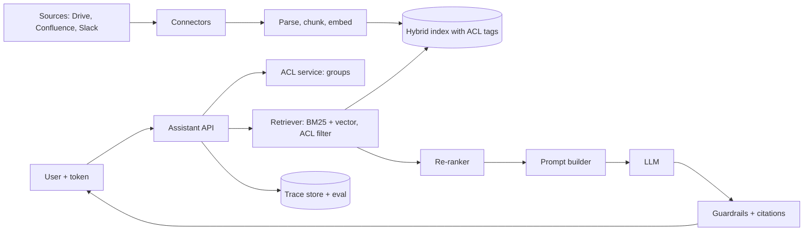

# Design a RAG Knowledge Assistant: Hybrid Search, Permissions, Citations

> **Prerequisites:** [Previous lesson: Design a Recommendation System: Candidate Funnel, Feature Store, Ranking](../34-design-a-recommendation-system/README.md) and the [Interview Framework track](../../21-interview-framework/README.md).
> **Estimated Reading Time:** 15–20 minutes
> **Target Audience:** Engineers practising the full 9-step system design interview on a classic prompt: answering employee questions from company documents with citations and permissions.

> [!NOTE]
> **In one line:** A RAG assistant is **retrieval first, generation second**: find the right permitted passages with hybrid search, give them to the model, and return an answer that cites its sources.

> [!TIP]
> **The Golden Rule:** Enforce document permissions at retrieval time, never rely on the prompt to hide data, and measure retrieval quality separately from answer quality.

---

## Step 1. Clarify the Problem

Open with questions, not boxes. This system fails in quiet ways: wrong chunks, stale documents and leaked access. Design for relevance, permissions and evaluation.

**Questions to ask the interviewer, and the answer we assume:**

| Question | Assumed answer |
| :--- | :--- |
| Sources? | Confluence, Google Drive, Slack and PDFs |
| Access control? | Users see only what they may open |
| Answers? | Short answer with citations; say 'I don't know' when unsure |
| Freshness? | Changes searchable within 15 minutes |
| Scale? | 20K employees, 5M documents, 50 questions per second at peak |

> Say it aloud: *"Before I draw anything, let me confirm the scope and the numbers."* That one sentence earns the first minutes of the interview.

---

## Step 2. Functional and Non-Functional Requirements

**Functional (what the system does):**

- Ingest and keep documents in sync from many sources.
- Answer questions grounded in retrieved passages with citations.
- Respect each user's permissions.
- Collect feedback and evaluate quality.

**Non-functional (how well it does it):**

| Quality | Target | Why it drives the design |
| :--- | :--- | :--- |
| Security | No cross-permission leakage | The top enterprise risk |
| Groundedness | Answers supported by sources | Trust |
| Latency | First token under 2 s | Interactive |
| Freshness | Within 15 minutes | Documents change |

---

## Step 3. Scope: In and Out

**In scope:** Ingestion, chunking, hybrid retrieval, permissions, generation, evaluation.

**Out of scope (say it explicitly, then move on):**

- Model training.
- Agentic multi-step workflows (next lesson).
- Source system administration.

---

## Step 4. Capacity Estimation

Assumptions: 5M documents, 10 chunks each of 500 tokens, 1,024-dimension embeddings, 50 questions per second at peak, 4,000 tokens of context per question.

| Quantity | Calculation | Result |
| :--- | :--- | :--- |
| Total chunks | `docs * chunks` | **50M chunks** |
| Vector storage (float32) | `total_chunks * dim * 4 / 1e12` | **0.205 TB** |
| Prompt tokens per day at peak rate (10 h) | `qps * ctx * 36000 / 1e9` | **7.2 B tokens** |
| Prompt cost per day | `prompt_tokens_per_day_at_peak_rate__10_h_ * price * 1000` | **21.6K USD (at $3 per M tokens)** |

**What the numbers tell you:** 50M chunks with 1,024-dimensional vectors need about 0.2 TB, which fits a vector index with quantisation. Token cost, not storage, dominates: billions of prompt tokens a day cost tens of thousands of dollars, so retrieve few, relevant chunks and cache common questions.

---

## Step 5. API Design

| Endpoint | Purpose | Notes |
| :--- | :--- | :--- |
| `POST /v1/ask` | Ask a question | Streams an answer with citations. Identity from the token. |
| `POST /v1/feedback` | Thumbs, corrections | Linked to the retrieval trace. |
| Internal `connector.sync()` | Pull changes from a source | Incremental by change token. |
| `GET /v1/answers/{id}/sources` | Show passages used | For auditing. |

Stream tokens as they are generated and return the citation list with the final message, so users see progress within a second.

---

## Step 6. Data Model

| Entity / Store | Key fields | Why this store |
| :--- | :--- | :--- |
| Document store | Source id, URL, ACL, version, text | Source of truth for chunks |
| Vector + keyword index | Chunk text, embedding, `doc_id`, ACL tags | Hybrid retrieval with filters |
| ACL cache | User to groups | Permission filters |
| Trace store | Query, retrieved chunks, answer, feedback | Evaluation and debugging |

Store ACL tags (groups) on every chunk and filter by the caller's groups inside the search query, not after.

---

## Step 7. High-Level Architecture



**Walk the diagram in this order:** connectors sync and index documents with their permissions; a question is filtered by the user's groups, retrieved with hybrid search, re-ranked, sent to the model with the passages, and the answer returns with citations and a logged trace.

---

## Step 8. Deep Dives and Bottlenecks

### 1. Chunking and hybrid retrieval

Split documents along structure (headings, paragraphs) into 300 to 800 token chunks with a little overlap and attach metadata (title, section, date). Combine keyword search (BM25, good for names and codes) with vector search (good for meaning), merge with reciprocal rank fusion, then re-rank the top 50 with a cross-encoder down to 5 to 8 chunks.

### 2. Permissions

Index each chunk with the groups allowed to read it and apply the user's groups as a filter in the retrieval query, so forbidden text is never retrieved and never reaches the model. Sync permission changes quickly (a revoked user must lose access within minutes), and re-check access when showing a citation link.

### 3. Grounding and evaluation

Instruct the model to answer only from the provided passages and to say it does not know otherwise; require citations and check that cited passages support each claim. Evaluate retrieval (is the right chunk in the top k?) separately from generation (is the answer faithful?) with a labelled question set, and track both after every change.

---

## Step 9. Trade-offs, Failures and Security

**Trade-offs to state aloud:**

| Decision | Option A | Option B | Pick and why |
| :--- | :--- | :--- | :--- |
| Search | Vector only | Hybrid with re-ranking | Hybrid: names, codes and meaning all matter |
| Permissions | Filter in the prompt | Filter in retrieval | In retrieval: the model must never see forbidden text |
| Chunk size | Small | Large | Medium chunks with overlap, tuned on an eval set |

**Failure modes and mitigations:**

| Failure | What users see | Mitigation |
| :--- | :--- | :--- |
| Stale index | Outdated answers | Incremental sync, show document date, re-index on change |
| Poor retrieval | Confident wrong answers | Hybrid search, re-ranking, 'I don't know' threshold |
| Permission lag | Revoked user still sees text | Fast ACL sync and access re-check on display |

**Security and abuse:** Permission filtering at retrieval, prompt-injection defences (treat retrieved text as data, not instructions), PII redaction, audit logs of questions and sources, and no training on customer data without consent.

---

## Runnable Example: Permission-filtered retrieval

Only chunks the caller may read are considered, then ranked by a simple keyword score.

```python
chunks = [
    {"id": 1, "text": "vacation policy allows 25 days per year", "groups": {"all"}},
    {"id": 2, "text": "salary bands for engineers are confidential", "groups": {"hr"}},
    {"id": 3, "text": "engineers get 25 days of vacation plus holidays", "groups": {"all", "eng"}},
]

def retrieve(query, user_groups, k=2):
    words = set(query.lower().split())
    allowed = [c for c in chunks if c["groups"] & user_groups]
    scored = [(len(words & set(c["text"].split())), c["id"]) for c in allowed]
    return [cid for score, cid in sorted(scored, reverse=True)[:k] if score > 0]

print("employee:", retrieve("engineers salary bands", {"all"}))
print("hr:      ", retrieve("engineers salary bands", {"all", "hr"}))
```

Output (produced by running this exact code):

```text
employee: [3]
hr:       [2, 3]
```

The employee never retrieves the confidential salary chunk, while an HR user does; the filter is applied before ranking, so forbidden text cannot reach the model.

---

## Common Mistakes

- Hiding restricted data with a prompt instruction.
- Vector-only search.
- Ignoring document freshness and permission changes.
- Judging only the final answer, not retrieval.
- Stuffing the context with too many chunks.

---

## Interview Questions and Answers

<details>
<summary><strong>Q1: How do you enforce permissions?</strong></summary>

Index ACL tags on chunks and filter by the user's groups inside the retrieval query, so unauthorised text is never retrieved or sent to the model.

</details>

<details>
<summary><strong>Q2: Why hybrid search?</strong></summary>

Keyword search finds exact names and codes, vector search finds meaning; fusion plus a re-ranker beats either alone.

</details>

<details>
<summary><strong>Q3: How do you reduce hallucinations?</strong></summary>

Answer only from retrieved passages, require citations, verify support, and say 'I don't know' below a relevance threshold.

</details>

<details>
<summary><strong>Q4: How do you evaluate?</strong></summary>

A labelled question set measuring retrieval recall and answer faithfulness separately, plus user feedback.

</details>

<details>
<summary><strong>Q5: How do you control cost?</strong></summary>

Fewer, better chunks, caching frequent questions, a smaller model for simple queries and prompt compression.

</details>

---

## One-Page Cheat Sheet

| Step | What to say or draw |
| :--- | :--- |
| Clarify | Sources, ACLs, citations, 5M docs |
| Capacity | 50M chunks, ~0.2 TB vectors, token cost dominates |
| API | ask (stream), feedback, connector sync |
| Data | Doc store, hybrid index with ACL tags, traces |
| Deep dive | Chunking and hybrid, permissions, grounding and eval |
| Trade-off | Filter in retrieval, hybrid search |

---

## Further Reading

- Lewis et al., *Retrieval-Augmented Generation for Knowledge-Intensive NLP Tasks* (2020).
- OWASP Top 10 for LLM Applications.

---

## Next

Continue with [Design an Enterprise AI Agent Platform: Harness, Tools, MCP, Multi-Agent](../36-design-an-enterprise-ai-agent-platform/README.md).
