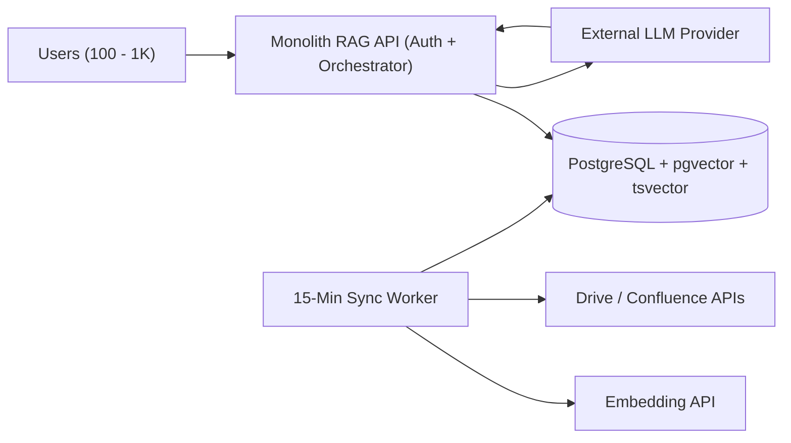
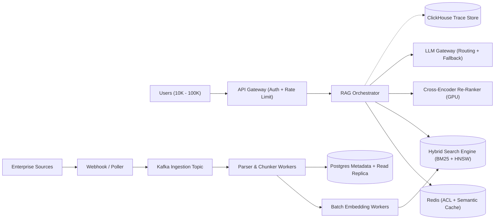
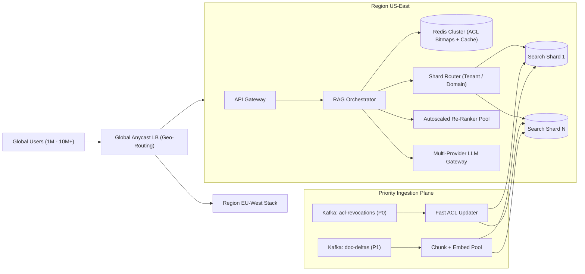
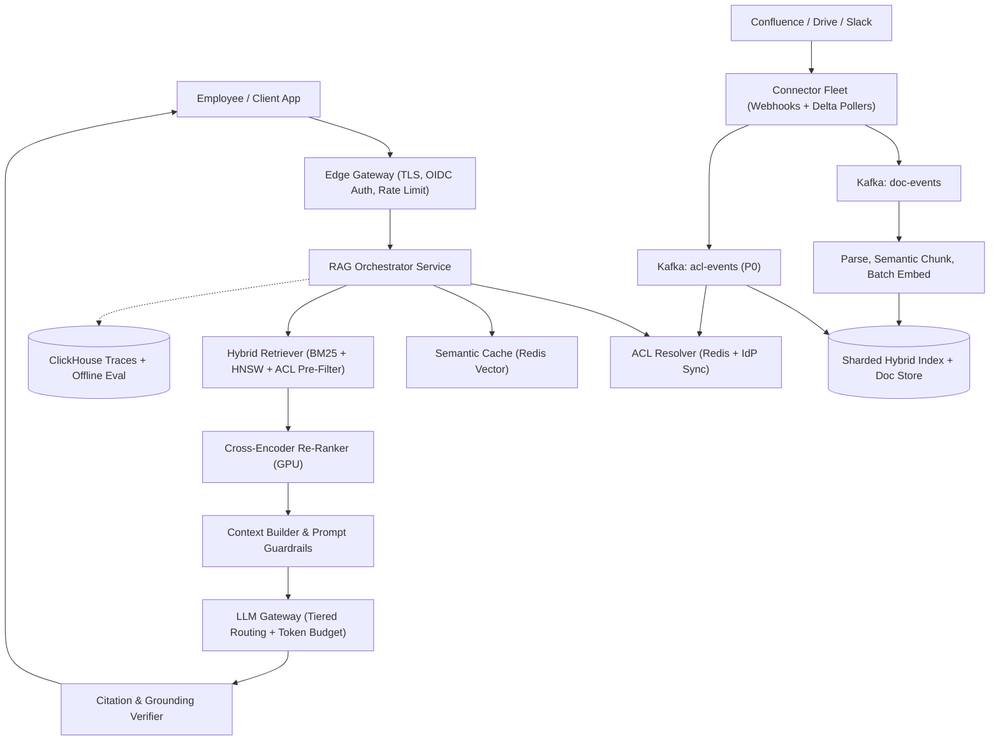
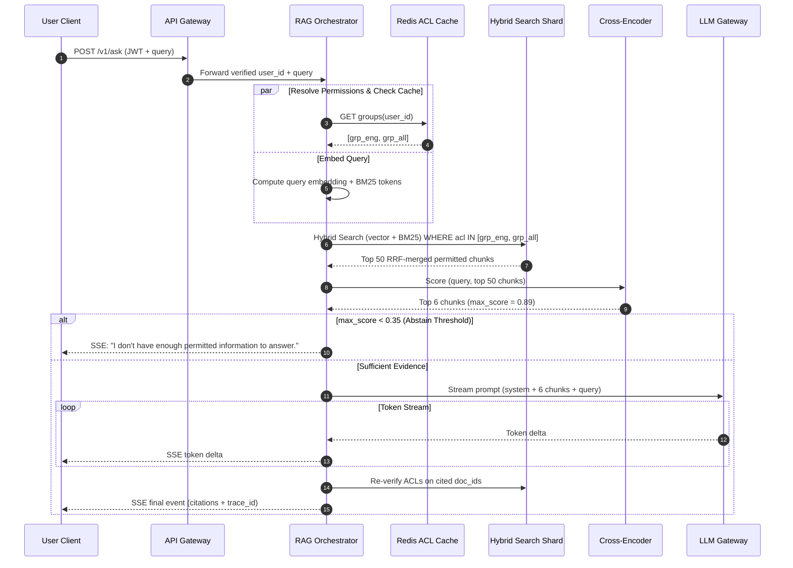

# Design a RAG Knowledge Assistant: Hybrid Search, Permissions, Citations

> **Difficulty:** Senior / Staff (L5–L6)
> **Prerequisites:** [Previous lesson: Design a Recommendation System: Candidate Funnel, Feature Store, Ranking](../34-design-a-recommendation-system/README.md) and the [Interview Framework track](../../21-interview-framework/README.md).
> **Estimated Reading Time:** 25–30 minutes
> **Target Audience:** Engineers practising the full system design interview on a classic enterprise AI prompt: answering employee questions from company documents with hybrid search, ACL enforcement, and grounded citations.

> [!NOTE]
> **In one line:** An enterprise RAG assistant is **retrieval first, generation second**: find the exact permitted passages with hybrid search and cross-encoder re-ranking, feed only those passages to the LLM, and return a streamed answer with verifiable citations.

> [!TIP]
> **The Golden Rule:** Enforce document permissions (ACLs) at retrieval time inside the search index—never rely on the prompt to hide confidential data—and measure retrieval recall separately from generation faithfulness.

---

## 1. Clarifying Questions, Functional & Non-Functional Requirements

Open the interview by scoping the problem before drawing a single box. Enterprise RAG systems fail in quiet, high-impact ways: stale chunks, missed exact identifiers (like Jira ticket IDs or error codes), hallucinated claims, and cross-permission data leaks.

### Clarifying Questions & Assumed Scope

| Question | Assumed Interview Answer | Architectural Consequence |
| :--- | :--- | :--- |
| **Document Sources?** | Confluence, Google Drive, Slack, and PDFs | Need incremental connector framework with format-specific parsers |
| **Access Control?** | Strict parity with source ACLs (users see only what they may open) | Pre-filter ACL tags inside the search engine; re-check on display |
| **Answer Behavior?** | Concise streamed answer with inline citations; say "I don't know" if unsupported | Grounding threshold + citation verifier + SSE streaming |
| **Freshness SLA?** | Document edits and permission revocations searchable within 15 minutes | Incremental CDC/webhook ingestion + fast ACL sidecar sync |
| **Scale Target?** | 20K employees (growing to multi-tenant 1M+ users), 5M–50M docs, 50–2,000 QPS | Hybrid index sharding, semantic caching, tiered LLM routing |
| **Out of Scope?** | Model pre-training/fine-tuning, multi-step autonomous tool execution, source admin UI | Focus on ingestion, hybrid retrieval, ACLs, generation, and eval |

### Functional Requirements

1. **Incremental Ingestion & Parsing:** Connect to enterprise repositories, extract text/tables/headings, chunk semantically, and track document versions.
2. **Permission-Aware Hybrid Retrieval:** Combine dense vector search (semantic meaning) with sparse keyword search (BM25 for exact names/codes), strictly filtered by the caller's effective ACL groups.
3. **Grounded Generation & Citations:** Synthesize answers strictly from retrieved passages, attach clickable `[1]`, `[2]` source citations, and abstain when evidence is insufficient.
4. **Feedback & Offline Evaluation:** Capture thumbs-up/down, link them to full retrieval/generation traces, and run automated regression suites.

### Non-Functional Requirements

| Quality Attribute | Target SLA | Design Driver |
| :--- | :--- | :--- |
| **Security (Zero Leakage)** | 0 cross-permission leaks | ACL pre-filtering in search + post-retrieval auth re-check |
| **Latency (TTFT)** | Time-to-first-token $< 1.5\text{ s}$ (p95) | Parallel ACL lookup + hybrid search + SSE token streaming |
| **Freshness** | Content $< 15\text{ min}$; ACL revocation $< 60\text{ s}$ | Event-driven webhooks + separate ACL-to-Group cache |
| **Faithfulness** | $> 95\%$ claims supported by cited chunks | Cross-encoder re-ranking + relevance cutoff + NLI verifier |
| **Availability** | $99.9\%$ for query path | Multi-AZ stateless API, replicated indexes, LLM fallback routing |

---

## 2. Back-of-the-Envelope Capacity Estimation

Assume a baseline enterprise deployment of **5M documents** (scaling to **50M documents** in Stage 3), averaging **10 chunks per document** (500 tokens/chunk), **1,024-dimensional** embeddings (`float32`), **50 QPS** peak (growing to **2,000 QPS** at 10M-user scale), and **4,000 input tokens** + **400 output tokens** per query.

### 1. Total Chunks & Vector Storage

$$\text{Total Chunks} = 5\times 10^{6}\text{ docs} \times 10\text{ chunks/doc} = 5\times 10^{7}\text{ chunks}$$

$$\text{Raw Vector Size (float32)} = 5\times 10^{7} \times 1024 \times 4\text{ bytes} = 2.048\times 10^{11}\text{ bytes} \approx 204.8\text{ GB}$$

With HNSW graph overhead ($\approx 1.5\times$) and BM25 inverted index + chunk text metadata ($\approx 100\text{ GB}$), total active index footprint is:

$$\text{Total Index RAM/SSD} \approx (204.8 \times 1.5) + 100 \approx 407.2\text{ GB}$$

Applying `int8` scalar quantization reduces vector memory by $4\times$ to $\approx 51.2\text{ GB}$ with $< 1\%$ recall loss when paired with re-ranking.

### 2. Query Throughput & LLM Token Cost

At 50 QPS over an 8-hour workday ($28,800\text{ s}$) with an average utilization factor of $0.5$ ($\approx 25\text{ QPS}$ average):

$$\text{Daily Queries} = 25\text{ QPS} \times 28{,}800\text{ s} = 720{,}000\text{ queries/day}$$

$$\text{Daily Input Tokens} = 720{,}000 \times 4{,}000 = 2.88\times 10^{9}\text{ tokens/day}$$

$$\text{Daily Output Tokens} = 720{,}000 \times 400 = 2.88\times 10^{8}\text{ tokens/day}$$

At $\$3.00 / 1\text{M}$ input tokens and $\$15.00 / 1\text{M}$ output tokens:

$$\text{Daily LLM Cost} = (2{,}880 \times \$3.00) + (288 \times \$15.00) = \$8{,}640 + \$4{,}320 = \$12{,}960/\text{day} \approx \$388{,}800/\text{month}$$

### Capacity Summary Table

| Metric | 20K Employees (Baseline) | 1M+ Users (Multi-Tenant Scale) | Key Takeaway |
| :--- | :--- | :--- | :--- |
| **Chunks Indexed** | 50M chunks | 500M chunks | Sharding required above ~50M vectors/node |
| **Vector Footprint (`float32` / `int8`)** | 205 GB / 51 GB | 2.05 TB / 512 GB | `int8` quantization + SSD-backed HNSW saves $4\times$ RAM |
| **Peak Query Rate** | 50 QPS | 2,000 QPS | Semantic cache hit rate of $30\%$ saves $\$116\text{K}/\text{mo}$ |
| **Daily LLM Token Spend** | $\$12.96\text{K}/\text{day}$ | $\$518\text{K}/\text{day}$ | Token cost dominates storage by $100\times$ |

---

## 3. Core API Contracts & Data Model

### Primary API Endpoints

| Endpoint | Method | Purpose | Key Request / Response Semantics |
| :--- | :--- | :--- | :--- |
| `/v1/ask` | `POST` | Submit a question | Accepts `{query, conversation_id, filters}`; returns `text/event-stream` (SSE) with token deltas and final `citations[]` |
| `/v1/feedback` | `POST` | Record user rating | Accepts `{trace_id, rating, correction}`; links to retrieval & prompt trace |
| `/v1/answers/{id}/sources` | `GET` | Audit cited passages | Re-verifies user ACLs before returning chunk text and deep links |
| `/internal/connectors/sync` | `POST` | Trigger incremental sync | Accepts `{source_id, change_token}`; enqueues delta jobs |

### Streaming Response Contract (`POST /v1/ask`)

```json
{
  "trace_id": "tr_98f2a1c4",
  "answer": "Engineers receive 25 days of paid vacation annually [1], plus regional public holidays [2].",
  "abstained": false,
  "citations": [
    {
      "index": 1,
      "doc_id": "conf_44192",
      "title": "2026 Employee Benefits Handbook",
      "url": "https://wiki.corp.internal/pages/44192",
      "chunk_id": "conf_44192_c04",
      "score": 0.94
    }
  ]
}
```

### Core Data Model

| Store | Schema / Key Fields | Purpose & Access Pattern |
| :--- | :--- | :--- |
| **Document Store (Postgres / S3)** | `doc_id`, `source_type`, `external_url`, `content_hash`, `acl_groups[]`, `updated_at` | Source of truth for raw docs, deduplication hashes, and metadata |
| **Hybrid Search Index (OpenSearch / Qdrant)** | `chunk_id`, `doc_id`, `text`, `embedding_int8`, `acl_groups[]` (keyword array), `updated_at` | Dual BM25 + HNSW vector index with pre-filtered `acl_groups` |
| **ACL Directory Cache (Redis)** | `user_id -> Set<group_id>` with 60s TTL + pub/sub invalidation | Sub-millisecond resolution of transitive AD/Okta/Drive groups |
| **Trace & Eval Store (ClickHouse / BigQuery)** | `trace_id`, `user_id`, `query`, `retrieved_chunk_ids[]`, `rerank_scores[]`, `latency_ms`, `feedback` | Append-only observability, cost attribution, and offline eval |

---

## 4. Stage 1 (100 - 1K Users): Baseline Monolith & Single Database

At 100–1,000 users (< 2 QPS, ~100K documents), simplicity and correctness trump distributed scale. We build the system component by component on a single unified stack.

### Component-by-Component Build

1. **API & Orchestrator Service (Single Python/Go Process):** Terminates TLS, validates the user's OIDC JWT, resolves their group memberships, and orchestrates retrieval + LLM calls.
2. **PostgreSQL with `pgvector` + `tsvector`:** Stores documents, chunks, ACL arrays (`TEXT[]` with GIN index), and vector embeddings (`pgvector` HNSW) in one ACID database.
3. **Cron-Based Connector Worker:** Runs every 15 minutes inside the same service cluster, polling Drive/Confluence APIs for modified files, chunking text, and calling an embedding API.
4. **Direct LLM Client:** Formats the top-5 chunks into a system prompt and streams the response via SSE directly to the user.



### What Breaks at 10K Users?

- **Database CPU Saturation:** Running `pgvector` HNSW + `tsvector` GIN intersection queries on 5M+ chunks inside a single Postgres instance saturates CPU and evicts hot index pages from `shared_buffers`.
- **No Re-ranking Precision:** Top-$k$ from raw cosine + BM25 without a cross-encoder drops precision on complex multi-clause queries.
- **Sync Lag & Rate Limits:** A 15-minute polling cron hits third-party API rate limits and delays permission revocations, creating a security window.

---

## 5. Stage 2 (10K - 100K Users): Caching, Read Replicas & Async Offload

At 10K–100K users (50–250 QPS, 5M–15M documents), we decouple ingestion from serving, introduce a dedicated hybrid search engine, and add caching and re-ranking.

### Component-by-Component Additions

1. **Event-Driven Ingestion Pipeline (Kafka + Workers):** Webhooks/CDC push document change events to Kafka. Stateless parser/chunker workers process documents asynchronously and batch embedding requests.
2. **Dedicated Hybrid Search Engine (OpenSearch / Qdrant + Elasticsearch):** Separates vector + BM25 search from transactional metadata in Postgres. Supports native pre-filtering on `acl_groups`.
3. **Redis ACL & Semantic Cache:** Caches `user_id -> group_ids` (TTL 60s, invalidated on IdP webhook) and caches exact/semantic query responses keyed by `(query_embedding_cluster, sorted_acl_groups_hash)`.
4. **Cross-Encoder Re-Ranker Service (GPU):** Takes the top 50 RRF-merged candidates and scores `(query, chunk)` pairs jointly, keeping the top 6 for the LLM.
5. **Async Trace & Eval Pipeline:** Streams query traces to ClickHouse without blocking the user response path.



### What Breaks at 1M Users?

- **Single-Cluster Vector Index Limit:** A single hybrid search cluster (> 100M chunks) experiences long GC pauses, slow shard rebalancing, and tail-latency spikes ($p99 > 800\text{ ms}$) during heavy concurrent ingestion.
- **Global ACL Fan-Out:** Large enterprises have users belonging to 500+ nested groups; passing huge `acl_groups` arrays in every search filter slows down inverted index intersections.
- **Single-Region LLM & GPU Bottlenecks:** Cross-encoder GPU pools and single-provider LLM quotas throttle at 1,000+ QPS.

---

## 6. Stage 3 (1M - 10M+ Users): Sharding, Partitioning & Multi-Region Scale

At 1M–10M+ users (2,000+ QPS, 500M+ chunks across thousands of organizations or business units), we shard the index, isolate ingestion lanes, and deploy multi-region serving.

### Component-by-Component Additions

1. **Tenant / Domain-Sharded Search Clusters:** Partition hybrid indexes by `tenant_id` (or `org_unit_hash`) so each shard holds $\le 20\text{M}$ chunks, keeping HNSW graphs memory-resident and bounding blast radius.
2. **Pre-Computed ACL Bitmaps / Group Compression:** Flatten nested IdP groups asynchronously into compact integer IDs or Roaring Bitmaps cached at the search node level, reducing filter evaluation from milliseconds to microseconds.
3. **Multi-Region Active-Active Serving + Tiered LLM Gateway:** Route users to the nearest regional RAG stack; use a central LLM Gateway that routes simple queries to fast, low-cost models (e.g., Haiku/Flash) and complex queries to frontier models, with automatic circuit breaking across providers.
4. **Dedicated Priority Lanes for Ingestion:** Separate `acl-updates` (high-priority Kafka topic, $< 30\text{ s}$ SLA) from `bulk-reindex` (low-priority topic) so a Confluence backfill never delays a permission revocation.



---

## 7. Final Full Production Architecture & End-to-End Flows

Combining all three stages yields a resilient, permission-safe, cost-bounded production RAG architecture.

### Complete Production Architecture



### End-to-End Query Sequence Diagram



---

## 8. Deep-Dive Bottlenecks & Algorithmic Trade-Offs

### 1. Chunking Strategy & Context Window Packing

Fixed-size 500-token splitting breaks tables, code blocks, and headings. Use **structure-aware hierarchical chunking**: split on Markdown/HTML headings first, keep tables intact, cap leaf chunks at 400–600 tokens with a 10% overlap, and prepend the document title + section breadcrumb (`[Benefits Handbook > PTO > Vacation]`) to every chunk before embedding.

### 2. Hybrid Retrieval + Reciprocal Rank Fusion (RRF)

Dense vectors capture semantics ("PTO" $\leftrightarrow$ "annual leave") but fail on exact strings (`ERR_CONNECTION_REFUSED`, `PROJ-4912`). BM25 excels at exact lexical matches. Combine both result lists using **Reciprocal Rank Fusion**:

$$\text{RRF}(d) = \sum_{r \in \{\text{BM25}, \text{Vector}\}} \frac{1}{k + \text{rank}_r(d)}, \quad k = 60$$

RRF requires zero score normalization across incompatible scales (cosine $[-1, 1]$ vs. unbounded BM25) and reliably surfaces candidates for the cross-encoder.

### 3. Pre-Filtering vs. Post-Filtering for ACLs

| Approach | How It Works | Failure Mode | Verdict |
| :--- | :--- | :--- | :--- |
| **Post-Filtering** | Fetch top-50 vectors globally, then drop unauthorized chunks | If 49 of top 50 are restricted, user gets 1 chunk (recall collapse) | **Never use** |
| **Pre-Filtering (Bitmap)** | Intersect `acl_groups` inverted index bitmap before/during HNSW traversal | Slightly slower graph traversal if user has $< 1\%$ access | **Mandatory** |
| **Prompt Filtering** | Pass all chunks to LLM and ask it to "ignore secret ones" | Prompt injection trivially extracts restricted text | **Critical Security Bug** |

### 4. Retrieval vs. Generation Evaluation (RAG Triad)

Measure retrieval and generation independently on a golden dataset of 500+ `(question, expected_doc_ids, reference_answer)` tuples:
- **Retrieval:** $\text{Recall}@k$ and $\text{MRR}$ (Mean Reciprocal Rank). If the right chunk isn't in top-6, the LLM cannot succeed.
- **Generation:** **Context Faithfulness** (are all claims entailed by the retrieved chunks?) and **Answer Relevance** (does it answer the question?).

---

## 9. Failure Modes, Reliability & Backpressure Mitigations

| Failure Mode | User-Visible Symptom | Root Cause | Concrete Mitigation |
| :--- | :--- | :--- | :--- |
| **Permission Revocation Lag** | Fired/transferred user still sees restricted snippets | Cached `user_groups` or stale search index ACLs | Dedicated P0 Kafka topic for ACL events ($< 30\text{ s}$); re-verify live ACLs before rendering citations |
| **Indirect Prompt Injection** | Model ignores instructions or leaks context | Malicious text hidden in an indexed Confluence page/PDF | Delimit retrieved chunks as untrusted XML (`<context>`); strip instruction-like patterns; output DLP scanner |
| **Vector Index Tail Latency** | $p99$ latency spikes $> 3\text{ s}$ during bulk sync | Heavy HNSW segment merges compete with query I/O | Separate write-optimized indexing nodes from read replicas, or throttle ingestion workers during peak hours |
| **LLM Provider Outage / 429** | Queries fail with 500/504 errors | Upstream model rate limit or regional outage | Multi-provider LLM gateway with circuit breakers, exponential backoff, and automatic fallback to secondary model |
| **Hallucinated Citations** | Citation `[1]` points to an unrelated doc | Model fabricates or swaps bracket indices | Post-generation citation aligner (NLI / regex check) verifying every `[i]` maps to a provided `chunk_id` |

---

## 10. Production War Story & Real-World Reference

### Incident Post-Mortem: The "All-Hands" Permission Leak & Re-Index Storm (SEV-1)

- **Context:** A 30,000-employee enterprise deployed an internal RAG assistant syncing Google Drive and Confluence.
- **Trigger:** An HR administrator accidentally shared a folder containing executive compensation bands with `company-all@`, then reverted the permission 4 minutes later.
- **What Went Wrong:**
  1. The connector ingested the `company-all` ACL tag within 2 minutes, but the **ACL revocation event** was queued behind a 4-hour Confluence full-reindex backlog in the single shared Kafka topic.
  2. Even after the search index was updated 4 hours later, the **Semantic Cache** returned cached answers generated during the 4-minute window because cache keys only hashed `(query, model)` without including the user's `acl_groups_hash` or a document version epoch.
- **Root Cause:** Coupled ingestion queues (no priority lane for ACL revocations) and an ACL-blind semantic cache.
- **Fix Implemented:**
  1. Split ingestion into `P0-acl-sync` (dedicated consumer group, $< 15\text{ s}$ SLA) and `P2-content-sync`.
  2. Keyed the semantic cache by `(query_cluster, acl_groups_hash)` and added a synchronous live-ACL check on cited `doc_id`s before streaming the final citation payload.
  3. Added automated canary probes that grant and immediately revoke test permissions every 5 minutes to alert if revocation SLA exceeds 60 seconds.

---

## 11. Core Component Implementation (4 Languages)

Below is a production-grade **Permission-Aware Hybrid Retriever with Reciprocal Rank Fusion (RRF)** in Go, TypeScript, Python, and C#. It enforces ACL pre-filtering *before* scoring and fuses BM25 + vector rankings.

````carousel
```go
package rag

import (
	"math"
	"sort"
	"strings"
)

type Chunk struct {
	ID        string
	DocID     string
	Text      string
	Embedding []float64
	ACLGroups map[string]struct{}
}

type SearchResult struct {
	Chunk    Chunk
	RRFScore float64
}

func cosineSimilarity(a, b []float64) float64 {
	var dot, normA, normB float64
	for i := range a {
		dot += a[i] * b[i]
		normA += a[i] * a[i]
		normB += b[i] * b[i]
	}
	if normA == 0 || normB == 0 {
		return 0
	}
	return dot / (math.Sqrt(normA) * math.Sqrt(normB))
}

func hasAccess(chunkGroups, userGroups map[string]struct{}) bool {
	for g := range userGroups {
		if _, ok := chunkGroups[g]; ok {
			return true
		}
	}
	return false
}

// HybridSearch pre-filters by ACLs, ranks by BM25-like keyword overlap + cosine, and fuses via RRF.
func HybridSearch(chunks []Chunk, queryText string, queryVec []float64, userGroups map[string]struct{}, topK int) []SearchResult {
	var permitted []Chunk
	for _, c := range chunks {
		if hasAccess(c.ACLGroups, userGroups) {
			permitted = append(permitted, c)
		}
	}

	type scored struct {
		idx   int
		score float64
	}
	vecScores := make([]scored, len(permitted))
	kwScores := make([]scored, len(permitted))
	qTerms := strings.Fields(strings.ToLower(queryText))

	for i, c := range permitted {
		vecScores[i] = scored{i, cosineSimilarity(queryVec, c.Embedding)}
		lower := strings.ToLower(c.Text)
		hits := 0.0
		for _, t := range qTerms {
			if strings.Contains(lower, t) {
				hits++
			}
		}
		kwScores[i] = scored{i, hits}
	}

	sort.Slice(vecScores, func(i, j int) bool { return vecScores[i].score > vecScores[j].score })
	sort.Slice(kwScores, func(i, j int) bool { return kwScores[i].score > kwScores[j].score })

	const rrfK = 60.0
	rrf := make(map[int]float64)
	for rank, s := range vecScores {
		rrf[s.idx] += 1.0 / (rrfK + float64(rank+1))
	}
	for rank, s := range kwScores {
		if s.score > 0 {
			rrf[s.idx] += 1.0 / (rrfK + float64(rank+1))
		}
	}

	results := make([]SearchResult, 0, len(rrf))
	for idx, score := range rrf {
		results = append(results, SearchResult{Chunk: permitted[idx], RRFScore: score})
	}
	sort.Slice(results, func(i, j int) bool { return results[i].RRFScore > results[j].RRFScore })
	if len(results) > topK {
		results = results[:topK]
	}
	return results
}
```
<!-- slide -->
```typescript
export interface Chunk {
  id: string;
  docId: string;
  text: string;
  embedding: number[];
  aclGroups: Set<string>;
}

export interface SearchResult {
  chunk: Chunk;
  rrfScore: number;
}

function cosineSimilarity(a: number[], b: number[]): number {
  let dot = 0, normA = 0, normB = 0;
  for (let i = 0; i < a.length; i++) {
    dot += a[i] * b[i];
    normA += a[i] * a[i];
    normB += b[i] * b[i];
  }
  return normA === 0 || normB === 0 ? 0 : dot / (Math.sqrt(normA) * Math.sqrt(normB));
}

export function hybridSearch(
  chunks: Chunk[],
  queryText: string,
  queryVec: number[],
  userGroups: Set<string>,
  topK = 5
): SearchResult[] {
  // 1. Pre-filter strictly by user ACL groups before any scoring
  const permitted = chunks.filter((c) => {
    for (const g of userGroups) {
      if (c.aclGroups.has(g)) return true;
    }
    return false;
  });

  const terms = queryText.toLowerCase().split(/\s+/).filter(Boolean);

  const vecRanked = permitted
    .map((c, idx) => ({ idx, score: cosineSimilarity(queryVec, c.embedding) }))
    .sort((a, b) => b.score - a.score);

  const kwRanked = permitted
    .map((c, idx) => {
      const lower = c.text.toLowerCase();
      const score = terms.reduce((acc, t) => acc + (lower.includes(t) ? 1 : 0), 0);
      return { idx, score };
    })
    .sort((a, b) => b.score - a.score);

  // 2. Reciprocal Rank Fusion (k = 60)
  const rrfK = 60;
  const rrfScores = new Map<number, number>();
  vecRanked.forEach((item, rank) => {
    rrfScores.set(item.idx, (rrfScores.get(item.idx) ?? 0) + 1 / (rrfK + rank + 1));
  });
  kwRanked.forEach((item, rank) => {
    if (item.score > 0) {
      rrfScores.set(item.idx, (rrfScores.get(item.idx) ?? 0) + 1 / (rrfK + rank + 1));
    }
  });

  return Array.from(rrfScores.entries())
    .map(([idx, rrfScore]) => ({ chunk: permitted[idx], rrfScore }))
    .sort((a, b) => b.rrfScore - a.rrfScore)
    .slice(0, topK);
}
```
<!-- slide -->
```python
from dataclasses import dataclass
import math
from typing import Dict, List, Set, Tuple


@dataclass(frozen=True)
class Chunk:
    chunk_id: str
    doc_id: str
    text: str
    embedding: Tuple[float, ...]
    acl_groups: Set[str]


def cosine_similarity(a: Tuple[float, ...], b: Tuple[float, ...]) -> float:
    dot = sum(x * y for x, y in zip(a, b))
    norm_a = math.sqrt(sum(x * x for x in a))
    norm_b = math.sqrt(sum(y * y for y in b))
    return 0.0 if norm_a == 0.0 or norm_b == 0.0 else dot / (norm_a * norm_b)


def hybrid_search(
    chunks: List[Chunk],
    query_text: str,
    query_vec: Tuple[float, ...],
    user_groups: Set[str],
    top_k: int = 5,
    rrf_k: int = 60,
) -> List[Tuple[Chunk, float]]:
    # 1. Pre-filter: unauthorized chunks never enter ranking or reach the LLM
    permitted = [c for c in chunks if c.acl_groups & user_groups]
    if not permitted:
        return []

    terms = set(query_text.lower().split())

    vec_ranked = sorted(
        ((i, cosine_similarity(query_vec, c.embedding)) for i, c in enumerate(permitted)),
        key=lambda x: x[1],
        reverse=True,
    )
    kw_ranked = sorted(
        ((i, len(terms & set(c.text.lower().split()))) for i, c in enumerate(permitted)),
        key=lambda x: x[1],
        reverse=True,
    )

    # 2. Reciprocal Rank Fusion
    rrf: Dict[int, float] = {}
    for rank, (idx, _) in enumerate(vec_ranked, start=1):
        rrf[idx] = rrf.get(idx, 0.0) + 1.0 / (rrf_k + rank)
    for rank, (idx, score) in enumerate(kw_ranked, start=1):
        if score > 0:
            rrf[idx] = rrf.get(idx, 0.0) + 1.0 / (rrf_k + rank)

    ranked = sorted(rrf.items(), key=lambda x: x[1], reverse=True)[:top_k]
    return [(permitted[idx], score) for idx, score in ranked]
```
<!-- slide -->
```csharp
using System;
using System.Collections.Generic;
using System.Linq;

public record Chunk(string Id, string DocId, string Text, double[] Embedding, HashSet<string> AclGroups);
public record SearchResult(Chunk Chunk, double RrfScore);

public static class HybridRetriever
{
    private static double CosineSimilarity(double[] a, double[] b)
    {
        double dot = 0, normA = 0, normB = 0;
        for (int i = 0; i < a.Length; i++)
        {
            dot += a[i] * b[i];
            normA += a[i] * a[i];
            normB += b[i] * b[i];
        }
        return (normA == 0 || normB == 0) ? 0 : dot / (Math.Sqrt(normA) * Math.Sqrt(normB));
    }

    public static List<SearchResult> Search(
        IReadOnlyList<Chunk> chunks,
        string queryText,
        double[] queryVec,
        HashSet<string> userGroups,
        int topK = 5)
    {
        // 1. Strict ACL pre-filter before any scoring
        var permitted = chunks.Where(c => c.AclGroups.Overlaps(userGroups)).ToList();
        if (permitted.Count == 0) return new List<SearchResult>();

        var terms = queryText.ToLowerInvariant()
            .Split(' ', StringSplitOptions.RemoveEmptyEntries);

        var vecRanked = permitted
            .Select((c, idx) => (idx, score: CosineSimilarity(queryVec, c.Embedding)))
            .OrderByDescending(x => x.score)
            .ToList();

        var kwRanked = permitted
            .Select((c, idx) =>
            {
                var lower = c.Text.ToLowerInvariant();
                int hits = terms.Count(t => lower.Contains(t));
                return (idx, score: hits);
            })
            .OrderByDescending(x => x.score)
            .ToList();

        // 2. Reciprocal Rank Fusion (k = 60)
        const double rrfK = 60.0;
        var rrf = new Dictionary<int, double>();
        for (int rank = 0; rank < vecRanked.Count; rank++)
        {
            int idx = vecRanked[rank].idx;
            rrf[idx] = rrf.GetValueOrDefault(idx) + 1.0 / (rrfK + rank + 1);
        }
        for (int rank = 0; rank < kwRanked.Count; rank++)
        {
            if (kwRanked[rank].score > 0)
            {
                int idx = kwRanked[rank].idx;
                rrf[idx] = rrf.GetValueOrDefault(idx) + 1.0 / (rrfK + rank + 1);
            }
        }

        return rrf
            .OrderByDescending(kv => kv.Value)
            .Take(topK)
            .Select(kv => new SearchResult(permitted[kv.Key], kv.Value))
            .ToList();
    }
}
```
````

---

## 12. Verification, Load Testing & CLI Diagnostics

```bash
# 1. Verify ACL pre-filtering in OpenSearch / Elasticsearch hybrid query
curl -s -X POST "https://search.internal:9200/rag_chunks_v3/_search" \
  -H "Content-Type: application/json" \
  -d '{
    "size": 10,
    "query": {
      "bool": {
        "filter": [{ "terms": { "acl_groups": ["grp_eng", "grp_all"] } }],
        "should": [
          { "match": { "text": "vacation policy PROJ-402" } },
          { "knn": { "embedding": { "vector": [0.012, -0.044], "k": 50 } } }
        ]
      }
    }
  }' | jq '.hits.total.value'

# 2. Measure SSE Time-To-First-Token (TTFT) and total stream time
curl -N -s -w "\nTTFT: %{time_starttransfer}s | Total: %{time_total}s\n" \
  -H "Authorization: Bearer $OIDC_TOKEN" \
  -H "Content-Type: application/json" \
  -d '{"query":"How many vacation days do engineers get?"}' \
  https://rag.internal/v1/ask

# 3. Check Kafka consumer lag on P0 ACL revocation topic (alert if lag > 100)
kafka-consumer-groups.sh --bootstrap-server kafka:9092 \
  --describe --group acl-sync-workers | awk 'NR>1 {print $1, $2, "LAG:", $6}'

# 4. Run offline RAG evaluation suite (Recall@5 + Faithfulness)
python -m eval.run_suite --dataset data/golden_500.jsonl --top-k 6 --min-recall 0.90
```

---

## 13. Common Interview Mistakes & Red Flags

1. **Filtering permissions in the system prompt:** Asking the LLM "only reveal this if the user is in HR" is a catastrophic security vulnerability vulnerable to trivial prompt injection.
2. **Post-filtering vector search results:** Fetching global top-50 vectors and dropping unauthorized ones causes zero-result answers for restricted users when popular global docs dominate.
3. **Vector-only search without BM25:** Fails on product SKUs, Jira IDs, error codes (`0x80040154`), and exact employee names.
4. **Ignoring ingestion/ACL freshness:** Treating ingestion as a one-time batch script instead of an incremental pipeline with a high-priority ACL revocation lane.
5. **Evaluating only the final answer:** Without separate $\text{Recall}@k$ metrics, teams waste weeks tuning prompts when the retriever never found the right passage.
6. **Stuffing 30 chunks into the context window:** Increases latency, skyrockets token cost, and triggers the "lost in the middle" degradation in LLM attention.
7. **ACL-blind semantic caching:** Returning a cached answer to User B that was synthesized from documents only User A could read.

---

## 14. Key Terminology & Glossary

| Term | Precise Definition |
| :--- | :--- |
| **Hybrid Search** | Combining dense vector similarity (semantic meaning) with sparse lexical search (BM25) to maximize recall. |
| **Reciprocal Rank Fusion (RRF)** | Score-agnostic rank aggregation formula $\sum \frac{1}{k + \text{rank}_i}$ that merges multiple ranked lists. |
| **Cross-Encoder Re-Ranker** | A transformer model that processes `(query, passage)` jointly with full cross-attention for high-precision scoring of top-50 candidates. |
| **ACL Pre-Filtering** | Applying user group permissions inside the search index before/during candidate retrieval so unauthorized text never leaves the index. |
| **RAG Triad** | Evaluation framework measuring Context Relevance, Groundedness (Faithfulness), and Answer Relevance independently. |
| **Time-to-First-Token (TTFT)** | Elapsed time from API request receipt until the first streamed answer token reaches the client. |
| **Scalar Quantization (`int8`)** | Compressing 32-bit floats to 8-bit integers to cut vector RAM usage by $4\times$ with minimal recall impact. |
| **Indirect Prompt Injection** | Adversarial instructions embedded inside indexed documents designed to hijack the LLM when retrieved. |
| **Abstention Threshold** | Minimum re-ranker score below which the assistant refuses to answer ("I don't know") rather than hallucinate. |
| **Semantic Cache** | Cache keyed by query embedding similarity + caller ACL hash to serve repeated questions without calling the LLM. |

---

## 15. Interview Follow-Up Questions (12 Q&As)

### Basic Conceptual Questions

<details>
<summary><strong>Q1: Why do we need both BM25 and vector search in enterprise RAG? [BASIC]</strong></summary>

Dense embeddings capture semantic paraphrases (e.g., "PTO" matches "annual leave"), while BM25 excels at exact lexical tokens like Jira ticket keys (`ENG-1042`), error codes, acronyms, and proper nouns. Combining them via RRF consistently outperforms either alone.

</details>

<details>
<summary><strong>Q2: What is the difference between a bi-encoder and a cross-encoder? [BASIC]</strong></summary>

A bi-encoder embeds queries and documents independently so document vectors can be pre-computed and indexed in HNSW for millisecond retrieval. A cross-encoder concatenates `(query, chunk)` and runs full self-attention across both; it is too slow for 50M chunks ($O(N)$), so we use it only to re-rank the top 50 candidates down to 6.

</details>

<details>
<summary><strong>Q3: How do you enforce document permissions without slowing down search? [BASIC]</strong></summary>

Store flattened `acl_groups` as an indexed keyword array on every chunk, cache `user_id -> groups` in Redis, and pass the caller's groups as a pre-filter bitmap inside the search query. Unauthorized chunks are excluded during index traversal and never reach the re-ranker or LLM.

</details>

<details>
<summary><strong>Q4: Why stream responses with SSE instead of waiting for the full LLM output? [BASIC]</strong></summary>

Generating 400 tokens takes 3–6 seconds. Streaming via Server-Sent Events (SSE) delivers the first token in under 1.5 seconds, dramatically improving perceived responsiveness while allowing final citation verification at the end of the stream.

</details>

### Scenario-Based Architecture Questions

<details>
<summary><strong>Q5: A user loses access to a confidential HR folder in Google Drive. How do you ensure they cannot query it 30 seconds later? [SCENARIO]</strong></summary>

Route IdP/Drive permission webhooks to a dedicated `P0-acl-events` Kafka topic separate from bulk document re-indexing. Workers update the `acl_groups` field on affected chunks (or update a fast document-level ACL sidecar) and publish a Redis invalidation for the user's group cache. Additionally, re-verify live permissions for cited `doc_id`s before returning citations.

</details>

<details>
<summary><strong>Q6: Your CFO says LLM API costs hit $400K/month. How do you cut costs by 60% without hurting quality? [SCENARIO]</strong></summary>

1) Deploy a semantic cache keyed by `(query_cluster, acl_hash)` to absorb ~30% of repeated HR/IT questions. 2) Route simple factual lookups to a smaller model (e.g., 8B/Haiku) and reserve frontier models for multi-doc synthesis. 3) Tighten re-ranking from 12 chunks to 5–6 high-precision chunks, cutting input tokens by 50%.

</details>

<details>
<summary><strong>Q7: Users report the assistant gives confident wrong answers about newly updated policies. How do you debug and fix? [SCENARIO]</strong></summary>

Inspect the `trace_id` in ClickHouse to separate retrieval failure from generation failure. If the old chunk was retrieved, check connector lag and implement `content_hash` deduplication + `updated_at` recency boosting in RRF. If the new chunk was retrieved but ignored, lower the LLM temperature, add explicit grounding instructions, and raise the re-ranker abstention threshold.

</details>

<details>
<summary><strong>Q8: How do you handle multi-page PDFs with complex financial tables? [SCENARIO]</strong></summary>

Naive fixed-token chunking splits table rows from column headers, destroying meaning. Use layout-aware PDF parsers (e.g., Unstructured / Docling) to extract tables as intact Markdown/HTML blocks, prepend the table caption and parent section heading, and store them as dedicated table chunks.

</details>

### Advanced & Tricky Interview Questions

<details>
<summary><strong>Q9: How do you prevent semantic caching from leaking data across users with different permissions? [TRICKY]</strong></summary>

Never key a semantic cache solely on the query embedding. Include a canonical hash of the user's sorted `acl_groups` in the cache key—or better, cache the *retrieved `chunk_ids` + generated answer* and verify that the current caller's `acl_groups` intersect with every cached `chunk_id`'s ACL before serving a cache hit.

</details>

<details>
<summary><strong>Q10: A user belongs to 800 nested Active Directory groups, causing search latency to spike 10x. How do you fix this? [TRICKY]</strong></summary>

Instead of passing 800 string group names in every search query, map groups to compact 32-bit integers and pre-compute Roaring Bitmaps per user or use a two-tier ACL model: expand small groups on the chunk, or evaluate a fast sidecar document-level ACL bitmask inside the search shard plugin.

</details>

<details>
<summary><strong>Q11: How do you defend against an employee hiding an indirect prompt injection inside a public Confluence page? [TRICKY]</strong></summary>

Wrap all retrieved passages in strict structural delimiters (e.g., `<untrusted_context>...</untrusted_context>`) and instruct the model to treat them purely as data. Strip hidden HTML/CSS text during ingestion, run a lightweight prompt-injection classifier on retrieved chunks, and enforce a DLP/output filter so the LLM cannot render external markdown image links (``) that exfiltrate data.

</details>

<details>
<summary><strong>Q12: How do you handle "multi-hop" questions where the answer requires connecting two separate documents? [TRICKY]</strong></summary>

Single-shot retrieval fails when Doc A mentions "Project Apollo" and Doc B defines "Project Apollo's budget." Use **query decomposition / iterative retrieval**: have a fast planner model rewrite the query into sub-queries, run parallel hybrid searches, or perform a second retrieval hop conditioned on entities extracted from the first hop's top chunks.

</details>

---

## 16. One-Page Master Cheat Sheet

```text
+-----------------------------------------------------------------------------+
|            ENTERPRISE RAG KNOWLEDGE ASSISTANT - MASTER CHEAT SHEET          |
+-----------------------------------------------------------------------------+
| 1. GOLDEN RULE : Permissions in retrieval index (pre-filter), NEVER prompt. |
| 2. SCALE MATH  : 50M chunks -> ~205GB float32 (~51GB int8).                 |
|                  50 QPS * 4K tok -> ~2.9B in-tokens/day (~$13K/day LLM).    |
| 3. RETRIEVAL   : Structure chunking -> Hybrid (BM25 + HNSW) -> RRF (k=60)   |
|                  -> Cross-Encoder Re-Rank (50 -> 6) -> Abstain if < 0.35.   |
| 4. FRESHNESS   : Separate Kafka P0 (ACL revocations <60s) from P1 (docs).   |
| 5. CACHING     : Semantic cache MUST include ACL hash / chunk ACL check.    |
| 6. EVALUATION  : Measure Retrieval (Recall@k, MRR) != Generation (Faithful).|
+-----------------------------------------------------------------------------+
```

| Stage | Users / Scale | Core Architecture | Breaking Point |
| :--- | :--- | :--- | :--- |
| **Stage 1** | 100 – 1K | Monolith API + `pgvector` + `tsvector` + 15m cron | DB CPU saturation at 5M chunks |
| **Stage 2** | 10K – 100K | Kafka ingestion + OpenSearch + Redis ACL + Cross-Encoder | Single index tail latency + 800-group ACLs |
| **Stage 3** | 1M – 10M+ | Tenant-sharded index + ACL bitmaps + Multi-region LLM GW | Cross-region consistency & cost governance |

---

## Further Reading

- Lewis et al., *Retrieval-Augmented Generation for Knowledge-Intensive NLP Tasks* (2020).
- OWASP Top 10 for LLM Applications (Prompt Injection, Sensitive Information Disclosure).
- Cormack, Clarke, & Buettcher, *Reciprocal Rank Fusion Outperforms Condorcet and Individual Rank Learning Methods* (SIGIR 2009).

---

## Next

Continue with [Design an Enterprise AI Agent Platform: Harness, Tools, MCP, Multi-Agent](../36-design-an-enterprise-ai-agent-platform/README.md).
