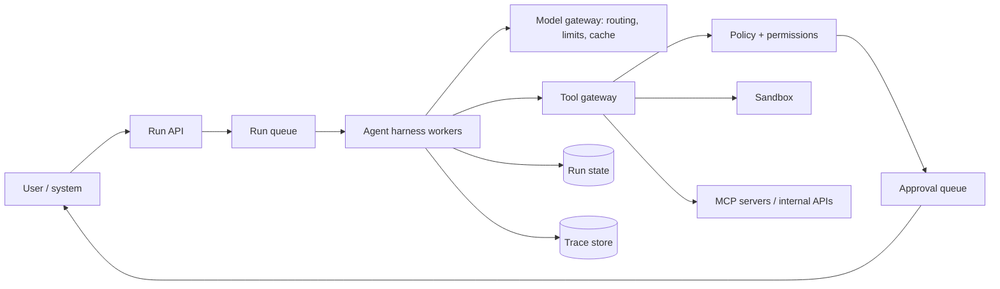

# Design an Enterprise AI Agent Platform: Harness, Tools, MCP, Multi-Agent

> **Prerequisites:** [Previous lesson: Design a RAG Knowledge Assistant: Hybrid Search, Permissions, Citations](../35-design-a-rag-knowledge-assistant/README.md) and the [Interview Framework track](../../21-interview-framework/README.md).
> **Estimated Reading Time:** 15–20 minutes
> **Target Audience:** Engineers practising the full 9-step system design interview on a classic prompt: running AI agents that call tools safely for many teams.

> [!NOTE]
> **In one line:** An agent platform is **a controlled loop around a model**: the harness repeatedly asks the model what to do, runs the chosen tool with permissions and limits, feeds the result back, and stops on a goal, a budget or a human check.

> [!TIP]
> **The Golden Rule:** The model proposes, the platform disposes. Every tool call is authorised, sandboxed, logged and budgeted outside the model, and risky actions need approval.

---

## Step 1. Clarify the Problem

Open with questions, not boxes. Agents are non-deterministic and powerful. The interview is about control: permissions, limits, observability and failure handling.

**Questions to ask the interviewer, and the answer we assume:**

| Question | Assumed answer |
| :--- | :--- |
| Use cases? | Internal assistants that read tickets, query data and open pull requests |
| Tools? | Connect via MCP and internal APIs |
| Autonomy? | Autonomous for reads, approval for writes |
| Tenancy? | Many teams with separate permissions and budgets |
| Scale? | 10,000 agent runs per hour, 30 model calls per run |

> Say it aloud: *"Before I draw anything, let me confirm the scope and the numbers."* That one sentence earns the first minutes of the interview.

---

## Step 2. Functional and Non-Functional Requirements

**Functional (what the system does):**

- Run an agent on a task with a goal and tools.
- Call tools with the user's permissions.
- Pause for human approval on risky actions.
- Record a full trace and enforce budgets.

**Non-functional (how well it does it):**

| Quality | Target | Why it drives the design |
| :--- | :--- | :--- |
| Safety | No unauthorised or runaway actions | The primary risk |
| Reliability | Resume after failures | Runs last minutes |
| Observability | Full replayable trace | Debugging non-determinism |
| Cost control | Budgets per run and tenant | Loops can burn money |

---

## Step 3. Scope: In and Out

**In scope:** Harness loop, tool gateway, permissions, state, approvals, traces, budgets.

**Out of scope (say it explicitly, then move on):**

- Model training.
- Prompt authoring UI.
- A specific agent's business logic.

---

## Step 4. Capacity Estimation

Assumptions: 10,000 runs per hour, 30 model calls per run, 8 tool calls per run, 6,000 tokens per model call, average run 2 minutes.

| Quantity | Calculation | Result |
| :--- | :--- | :--- |
| Model calls per second | `runs_hour * calls / 3600` | **83.3 calls/s** |
| Tool calls per second | `runs_hour * tools / 3600` | **22.2 calls/s** |
| Concurrent runs | `runs_hour / 60 * minutes` | **333 runs** |
| Tokens per day | `runs_hour * 24 * calls * tokens / 1e9` | **43.2 B tokens** |

**What the numbers tell you:** About 83 model calls per second and 22 tool calls per second are modest, and about 330 runs are active at once. Tokens are the cost: roughly 43 billion a day, so budgets, context trimming and caching are core features, not extras.

---

## Step 5. API Design

| Endpoint | Purpose | Notes |
| :--- | :--- | :--- |
| `POST /v1/runs` | Start a run | Goal, agent id, budget. Returns run id. |
| `GET /v1/runs/{id}` | Status and trace | Steps, tool calls, cost. |
| `POST /v1/runs/{id}/approve` | Approve or reject a pending action | Human in the loop. |
| `POST /v1/runs/{id}/cancel` | Stop | Kill switch. |

Runs are asynchronous: start returns immediately and clients stream events or poll, because a run can last minutes.

---

## Step 6. Data Model

| Entity / Store | Key fields | Why this store |
| :--- | :--- | :--- |
| Run state store | Run id, step, messages, pending action, budget used | Durable so a run can resume |
| Trace store (append-only) | Every model call and tool call with inputs and outputs | Audit, replay, evaluation |
| Tool registry | Tool schema, permissions, risk level, owner | Governance |
| Policy store | Per-tenant limits and approval rules | Enforced by the gateway |

Persist state after every step so a crashed worker resumes from the last completed step instead of restarting the whole run.

---

## Step 7. High-Level Architecture



**Walk the diagram in this order:** a run is queued, a harness worker loops between the model gateway and the tool gateway, the tool gateway checks policy and may pause for approval, and every step is persisted and traced.

---

## Step 8. Deep Dives and Bottlenecks

### 1. The harness loop and limits

Loop: build context, call the model, parse the proposed action, validate it against the tool schema, execute through the tool gateway, append the result, repeat. Stop on completion, a step cap, a token or cost budget, a wall-clock limit or detection of a repeating loop. Compact old messages so the context stays within the window and cost stays bounded.

### 2. Tool gateway and permissions

Tools run as the end user or a scoped service identity, never with broad platform credentials. The gateway checks each call against policy (allowed tool, argument constraints, rate limits), classifies risk (read, write, destructive), and queues risky ones for human approval. Execution happens in a sandbox with network and filesystem limits. Treat tool outputs as untrusted data, because they can contain prompt injection.

### 3. Durability, observability and evaluation

Store state after each step for resume and idempotent retry (a tool call has an idempotency key). Emit a trace for every model and tool call with latency, tokens and cost, so a run can be replayed and audited. Run an evaluation suite of scenario tasks against each prompt, model or tool change before rollout, and monitor success rate, cost per task and approval rate in production.

---

## Step 9. Trade-offs, Failures and Security

**Trade-offs to state aloud:**

| Decision | Option A | Option B | Pick and why |
| :--- | :--- | :--- | :--- |
| Autonomy | Fully autonomous | Approval for risky actions | Approvals for writes and destructive actions |
| State | In memory | Durable per step | Durable: resume and audit |
| Model access | Direct calls | Central gateway | Gateway: routing, budgets, caching, redaction |

**Failure modes and mitigations:**

| Failure | What users see | Mitigation |
| :--- | :--- | :--- |
| Runaway loop | Cost spike | Step, token and time budgets; loop detection; kill switch |
| Tool timeout | Stalled run | Timeouts, retries with idempotency, fallback or fail clearly |
| Prompt injection via tool output | Unauthorised action | Treat outputs as data, least-privilege tools, approvals, output filtering |

**Security and abuse:** Least-privilege scoped credentials per run, sandboxed execution, policy checks and approvals for risky actions, data-loss prevention on inputs and outputs, a full audit trail, and defences against prompt injection from retrieved or tool-provided text.

---

## Runnable Example: A bounded agent loop

The loop stops on a step limit or a budget, and a risky tool pauses for approval instead of running.

```python
TOOLS = {"search": "read", "send_email": "write"}

def fake_model(history):
    plan = ["search", "search", "send_email", "done"]
    return plan[min(len(history), len(plan) - 1)]

def run(goal, max_steps=6, budget=3):
    history, spent = [], 0
    for step in range(max_steps):
        action = fake_model(history)
        if action == "done":
            return "finished", history
        spent += 1
        if spent > budget:
            return "stopped: budget", history
        if TOOLS[action] == "write":
            return f"paused for approval of {action}", history
        history.append(action)
    return "stopped: step limit", history

print(run("find the report"))
```

Output (produced by running this exact code):

```text
('paused for approval of send_email', ['search', 'search'])
```

The agent performs two read-only searches and then pauses at the email step, because writes require human approval; the budget and step limit make a runaway loop impossible.

---

## Common Mistakes

- Giving agents broad credentials.
- No step, cost or time limits.
- Keeping state only in memory.
- Trusting tool output as instructions.
- No trace, so failures cannot be replayed.

---

## Interview Questions and Answers

<details>
<summary><strong>Q1: How do you keep agents safe?</strong></summary>

Policy and permission checks in a tool gateway, least-privilege credentials, sandboxing, approvals for risky actions and budgets enforced outside the model.

</details>

<details>
<summary><strong>Q2: How do you resume a failed run?</strong></summary>

Persist state after each step and use idempotency keys on tool calls, so a worker resumes from the last completed step.

</details>

<details>
<summary><strong>Q3: How do you stop runaway cost?</strong></summary>

Per-run and per-tenant token and step budgets, time limits, loop detection and a kill switch.

</details>

<details>
<summary><strong>Q4: What about prompt injection?</strong></summary>

Treat retrieved and tool-provided text as untrusted data, restrict tool scope, require approvals for sensitive actions and filter outputs.

</details>

<details>
<summary><strong>Q5: How do you evaluate agents?</strong></summary>

A suite of scenario tasks measuring success, cost and safety, run before every prompt, model or tool change, and production monitoring.

</details>

---

## One-Page Cheat Sheet

| Step | What to say or draw |
| :--- | :--- |
| Clarify | Tools via MCP, approvals for writes, multi-team |
| Capacity | 83 model calls/s, ~330 concurrent runs, ~43B tokens/day |
| API | start run, status/trace, approve, cancel |
| Data | Run state, trace store, tool registry, policies |
| Deep dive | Harness loop, tool gateway, durability and eval |
| Trade-off | Approvals for risk, central model gateway |

---

## Further Reading

- Anthropic, *Building effective agents*.
- Model Context Protocol specification.

---

## Next

Continue with [Design a Multi-Tenant SaaS Platform: Isolation, Routing, Noisy Neighbors](../37-design-a-multi-tenant-saas-platform/README.md).
