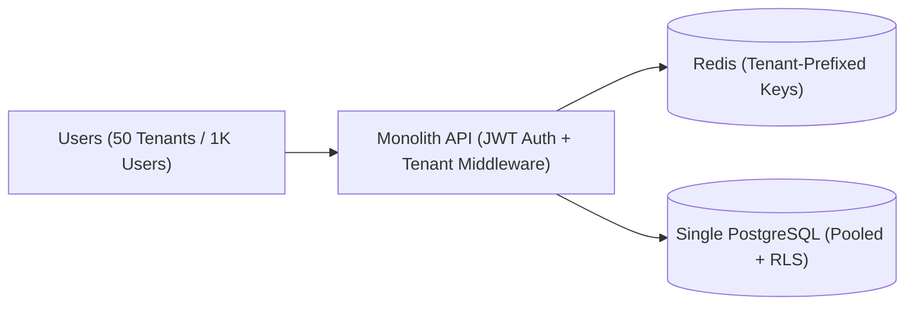
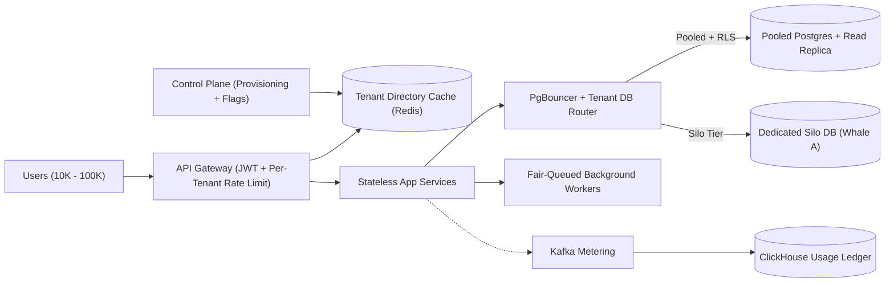
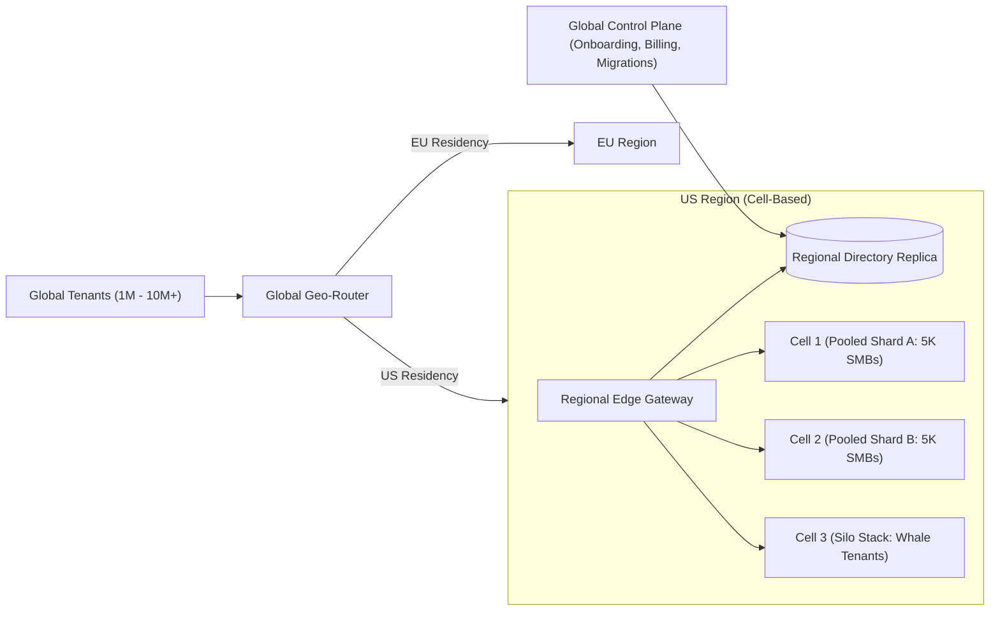
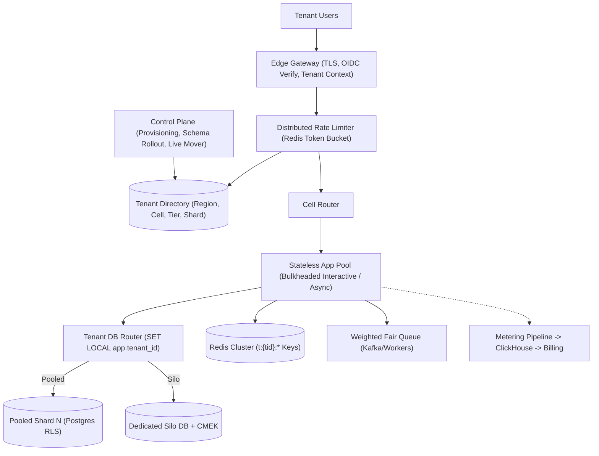

# Design a Multi-Tenant SaaS Platform: Isolation, Routing, Noisy Neighbors

> **Difficulty:** Senior / Staff (L5–L6)
> **Prerequisites:** [Previous lesson: Design an Enterprise AI Agent Platform: Harness, Tools, MCP, Multi-Agent](../36-design-an-enterprise-ai-agent-platform/README.md) and the [Interview Framework track](../../21-interview-framework/README.md).
> **Estimated Reading Time:** 25–30 minutes
> **Target Audience:** Engineers practising the full system design interview on a classic enterprise architecture prompt: one application serving thousands of customer organizations safely with strict isolation and noisy-neighbor protection.

> [!NOTE]
> **In one line:** A multi-tenant SaaS platform **shares compute and operational control planes across customers while strictly isolating their data, encryption keys, and performance**: every request carries a cryptographically verified `tenant_id`, and every layer enforces it.

> [!TIP]
> **The Golden Rule:** Derive `tenant_id` exclusively from the verified auth token—never from client headers or query params—enforce it at the database layer via Row-Level Security (RLS) or dedicated silos, prefix every cache/queue key with `tenant_id`, and give whales a seamless migration path to dedicated shards.

---

## 1. Clarifying Questions, Functional & Non-Functional Requirements

Open the interview by framing the two existential risks of multi-tenancy: **cross-tenant data leakage** (one missing `WHERE` clause ends the company) and **noisy neighbors** (one tenant's batch import degrades p99 latency for 19,999 others).

### Clarifying Questions & Assumed Scope

| Question | Assumed Interview Answer | Architectural Consequence |
| :--- | :--- | :--- |
| **Tenant Distribution?** | 20,000 orgs (5 to 50,000 users each), growing to 200K orgs / 10M+ users | Power-law skew: pooled infra for SMBs, silo/dedicated for whales |
| **Isolation & Compliance?** | Strict logical isolation; regulated enterprise tiers require dedicated DBs + CMEK | Tiered isolation (`Pooled`, `Bridge`, `Silo`) driven by Tenant Directory |
| **Data Residency?** | EU, US, APAC regional pinning | Control plane routes tenants to regional data planes; zero cross-region replication |
| **Customization?** | Feature flags, branding, RBAC—no custom tenant code execution | Config-driven multi-tenancy; single deployable codebase |
| **Scale Target?** | 5M users, 20K RPS peak (growing to 10M+ users, 100K+ RPS) | Sharded pooled DBs, weighted fair queuing, cell-based architecture |
| **Out of Scope?** | Specific SaaS product domain logic, Stripe/ERP billing UI, custom code plugins | Focus on isolation, routing, noisy-neighbor control, metering, lifecycle |

### Functional Requirements

1. **Automated Tenant Onboarding & Offboarding:** Provision tenant metadata, regional placement, and storage tier via API; support GDPR export and cryptographic erasure on offboard.
2. **Tenant-Scoped Authentication & Routing:** Resolve verified OIDC/JWT claims to `tenant_id`, tier, and shard location at the edge.
3. **Metering & Plan Enforcement:** Track API calls, storage, and background jobs per tenant; enforce plan quotas and soft/hard rate limits.
4. **Zero-Downtime Schema Migrations & Tier Promotion:** Roll out schema changes safely across thousands of tenants and promote a growing tenant from `Pooled` to `Silo` without downtime.

### Non-Functional Requirements

| Quality Attribute | Target SLA | Design Driver |
| :--- | :--- | :--- |
| **Data Isolation** | 0 cross-tenant leaks | Token-derived `tenant_id` + DB Row-Level Security (RLS) + key prefixing |
| **Performance Fairness** | Whale spike $< 5\%$ impact on others | Per-tenant token buckets, connection caps, and weighted fair queues |
| **Availability** | $99.95\%$ data plane; blast-radius isolation | Cell-based / shard-isolated architecture |
| **Unit Economics** | High gross margin on $99\%$ SMB tenants | Dense pooling with automated tiering only for paying whales |
| **Operability** | Deploy once for all 20K+ tenants | Single codebase + feature flags + canary per-tenant migrations |

---

## 2. Back-of-the-Envelope Capacity Estimation

Assume **20,000 tenants**, **5M total users**, and **20,000 RPS** peak traffic following a classic **80/20 (or 99/50) power-law distribution**: the top $1\%$ of tenants generate $50\%$ of all traffic.

### 1. Power-Law Traffic Skew

$$\text{Large (Whale) Tenants} = 20{,}000 \times 0.01 = 200\text{ tenants}$$

$$\text{Whale Traffic} = 20{,}000\text{ RPS} \times 0.50 = 10{,}000\text{ RPS} \implies \frac{10{,}000}{200} = 50\text{ RPS/whale (avg)}$$

$$\text{SMB Traffic} = 20{,}000\text{ RPS} \times 0.50 = 10{,}000\text{ RPS} \implies \frac{10{,}000}{19{,}800} \approx 0.505\text{ RPS/SMB}$$

A single top-10 whale tenant bursting at $10\times$ average generates **500–2,000 RPS**—more than 2,000 SMB tenants combined.

### 2. Storage, Connection & Metering Volume

Assuming an average of 50 MB structured data per SMB tenant and 50 GB per whale tenant:

$$\text{Total DB Storage} = (19{,}800 \times 50\text{ MB}) + (200 \times 50\text{ GB}) = 0.99\text{ TB} + 10\text{ TB} \approx 11\text{ TB}$$

At 20,000 RPS, if each request emits 1 lightweight metering event (~200 bytes):

$$\text{Metering Ingestion} = 20{,}000\text{ events/s} \times 200\text{ B} = 4\text{ MB/s} \approx 345\text{ GB/day}$$

### Capacity Summary Table

| Metric | 20K Tenants (Baseline) | 200K Tenants / 10M+ Users | Architectural Implication |
| :--- | :--- | :--- | :--- |
| **Peak Throughput** | 20K RPS | 100K+ RPS | Edge rate limiting + horizontal stateless app tier |
| **Whale vs. SMB Skew** | 200 whales = 50% load | 2,000 whales = 50% load | Silo/dedicated shards for whales; dense pooling for SMBs |
| **Active DB Storage** | ~11 TB | ~110 TB | Shard pooled DBs at ~2 TB/shard; isolate whale DBs |
| **Metering Events** | 20K events/s | 100K+ events/s | Async Kafka $\rightarrow$ ClickHouse/Flink aggregation (never sync DB writes) |

---

## 3. Core API Contracts & Data Model

### Primary Control & Data Plane Endpoints

| Endpoint | Method | Plane | Purpose & Security Contract |
| :--- | :--- | :--- | :--- |
| `/v1/tenants` | `POST` | Control | Onboard tenant (`name`, `plan`, `region`, `isolation_tier`); provisions directory + infra |
| `/v1/tenants/{id}/tier` | `PATCH` | Control | Promote/migrate tenant between `pooled` and `silo` tiers |
| `/v1/tenants/{id}` | `DELETE` | Control | Offboard: export archive, purge pooled/silo DBs, caches, search, and KMS keys |
| `/v1/usage` | `GET` | Control | Query metered API, storage, and compute consumption vs. plan limits |
| `/v1/*` (Any App Call) | `*` | Data | Carries `Authorization: Bearer <JWT>`; gateway extracts `tid` claim and injects `X-Tenant-Context` |

### Core Data Model

| Store | Schema / Key Fields | Purpose & Isolation Mechanism |
| :--- | :--- | :--- |
| **Tenant Directory (Control Plane)** | `tenant_id`, `plan`, `region`, `isolation_tier` (`pooled`\|`bridge`\|`silo`), `shard_id`, `db_dsn_ref`, `kms_key_id`, `status` | Authoritative routing & policy metadata; replicated to regional edge caches |
| **Pooled App DB (PostgreSQL)** | Every table has `tenant_id UUID NOT NULL` + composite PK `(tenant_id, id)` | Enforces `ALTER TABLE ... ENABLE ROW LEVEL SECURITY` using `current_setting('app.tenant_id')` |
| **Silo App DB (Dedicated PG)** | Identical schema per dedicated DB/cluster | Physical isolation for whales and HIPAA/FedRAMP tenants |
| **Cache & Queue Keys (Redis/Kafka)** | `t:{tenant_id}:session:{id}`, `t:{tenant_id}:rate` | Mandatory key prefixing enforced by client SDK wrapper |
| **Usage Ledger (ClickHouse)** | `tenant_id`, `metric_name`, `value`, `ts` | Append-only metering rollup for billing and quota alerts |

---

## 4. Stage 1 (100 - 1K Users): Baseline Monolith & Single Database

At 100–1,000 users (~50 tenants, < 20 RPS), speed of iteration matters most, *provided* foundational tenant isolation is baked into the database from Day 1.

### Component-by-Component Build

1. **Monolith API + Auth Middleware:** Validates JWT, extracts `tenant_id` from the signed claim, and rejects any request where a URL/body `tenant_id` mismatches the token.
2. **Single PostgreSQL Database with Row-Level Security (RLS):** Every table includes `tenant_id`, and the ORM/connection middleware executes `SET LOCAL app.tenant_id = '<uuid>'` inside every transaction so even a buggy developer query cannot leak rows.
3. **Tenant-Prefixed Redis Cache:** A single Redis instance stores sessions and rate-limit counters using a mandatory `TenantCacheClient` wrapper that prepends `t:{tenant_id}:`.



### What Breaks at 10K Users?

- **Noisy-Neighbor Connection Exhaustion:** One tenant running an unindexed report holds 80 of 100 Postgres connections, starving all other tenants.
- **Missing Per-Tenant Rate Limits:** A misconfigured customer script loops at 500 RPS and saturates the monolith CPU.
- **Enterprise Compliance Blockers:** Large prospects refuse to sign contracts unless they get dedicated database isolation or EU data residency.

---

## 5. Stage 2 (10K - 100K Users): Caching, Read Replicas & Async Offload

At 10K–100K users (~2,000–5,000 tenants, 2,000–5,000 RPS), we introduce the **Control Plane / Data Plane split**, tiered isolation (`Pooled` + `Silo`), per-tenant rate limiting, and async bulkheads.

### Component-by-Component Additions

1. **API Gateway + Tenant Directory Cache:** Gateway authenticates the JWT, fetches tenant routing/plan metadata from a local Redis/in-memory cache (backed by the Control Plane Tenant Directory), and enforces per-tenant token-bucket rate limits.
2. **Connection Pooler (PgBouncer) + Read Replicas:** PgBouncer in transaction-pooling mode multiplexes thousands of app connections; heavy read analytics route to read replicas.
3. **Hybrid Pooled + Silo Storage Routing:** A `TenantDbRouter` inspects `isolation_tier`: SMB tenants route to the Pooled DB (with RLS), while Whale/Regulated tenants route to dedicated Silo DBs.
4. **Weighted Fair Queuing (WFQ) & Bulkheads:** Background jobs (CSV imports, webhooks) run on separate worker pools from interactive APIs, using per-tenant fair queues so one tenant's 100K-row import does not delay another's password reset.
5. **Async Metering Pipeline (Kafka $\rightarrow$ ClickHouse):** Services emit usage events non-blockingly to Kafka for billing and quota enforcement.



### What Breaks at 1M Users?

- **Single Pooled Database Write & Vacuum Limit:** At 15,000+ pooled tenants (~10 TB), a single Postgres primary hits IOPS ceilings, `AUTOVACUUM` lags, and `ALTER TABLE` locks impact thousands of customers at once.
- **Single-Region Latency & Residency:** Global customers in EU/APAC experience 150ms+ RTT and violate GDPR data residency rules.
- **Global Blast Radius:** A bad deployment or noisy neighbor in the shared app cluster can degrade all tenants simultaneously.

---

## 6. Stage 3 (1M - 10M+ Users): Sharding, Partitioning & Multi-Region Scale

At 1M–10M+ users (20K–200K tenants, 20K–100K+ RPS), we move to a **Cell-Based, Multi-Region Architecture** with sharded pooled databases and automated live tenant migration.

### Component-by-Component Additions

1. **Regional Data Planes (Data Residency):** Global DNS/Geo-LB routes `eu.saas.com` and `us.saas.com` to independent regional stacks. The Global Control Plane stores only non-PII routing metadata (`tenant_id -> region, cell_id`).
2. **Cell-Based Architecture (Blast-Radius Isolation):** Each region is partitioned into independent **Cells** (e.g., 5,000 SMB tenants or 20 whales per cell) with dedicated app pools, Redis, and sharded Postgres clusters. A noisy neighbor or bad deploy in Cell 3 cannot affect Cell 1 or Cell 2.
3. **Sharded Pooled Databases + Live Tenant Mover:** Pooled DBs are sharded by `hash(tenant_id)` (or explicit directory mapping). When an SMB tenant grows into a whale, a **Dual-Write + CDC Backfill** tool migrates their rows from a pooled shard to a dedicated Silo DB with $< 5\text{ s}$ cutover downtime.
4. **Per-Tenant Encryption (CMEK / Envelope Encryption):** Sensitive columns/blobs are encrypted with a tenant-specific Data Encryption Key (DEK) wrapped by the tenant's KMS key, enabling instant cryptographic erasure on offboarding.



---

## 7. Final Full Production Architecture & End-to-End Flows

### Complete Production Architecture



### End-to-End Request & Isolation Sequence

```mermaid
sequenceDiagram
  autonumber
  participant U as Tenant User
  participant GW as Edge Gateway
  participant RL as Redis Rate Limiter
  participant DIR as Tenant Directory
  participant APP as App Service
  participant DB as Pooled DB (Postgres RLS)

  U->>GW: GET /v1/invoices (Authorization: Bearer JWT)
  GW->>GW: Verify JWT signature & extract tid="t_acme"
  GW->>RL: Check token bucket for t_acme (plan=pro, limit=500/s)
  alt Quota Exceeded
    RL-->>GW: Reject (tokens=0)
    GW-->>U: 429 Too Many Requests (Retry-After: 1s)
  else Allowed
    RL-->>GW: Allow
    GW->>DIR: Lookup routing for t_acme (cached)
    DIR-->>GW: region=us-east, tier=pooled, shard=shard_04
    GW->>APP: Forward request + signed X-Tenant-Context: t_acme
    APP->>DB: BEGIN; SET LOCAL app.tenant_id = 't_acme';
    APP->>DB: SELECT * FROM invoices LIMIT 50;
    Note over DB: Postgres RLS appends WHERE tenant_id = 't_acme'
    DB-->>APP: Only Acme rows returned
    APP->>DB: COMMIT;
    APP-->>U: 200 OK (invoices)
  end
```

---

## 8. Deep-Dive Bottlenecks & Algorithmic Trade-Offs

### 1. Isolation Models: Pooled vs. Bridge vs. Silo

| Model | Physical Layout | Cost / Tenant | Isolation Strength | Operational Overhead |
| :--- | :--- | :--- | :--- | :--- |
| **Pooled** | Shared DB, shared tables, `tenant_id` column + RLS | Lowest ($\$0.05/\text{mo}$) | Logical (enforced by DB RLS) | Low (one schema migration) |
| **Bridge** | Shared DB cluster, separate `schema` per tenant | Medium | Logical + namespace separation | High above 1,000 schemas (catalog bloat) |
| **Silo** | Dedicated DB instance (or full cell) per tenant | Highest ($\$50–\$500/\text{mo}$) | Physical + dedicated IOPS/KMS | Automated IaC provisioning required |

**Why avoid Bridge (Schema-per-Tenant) at 20K+ tenants?** PostgreSQL stores table/index metadata in `pg_class` and `pg_attribute`. At 20,000 schemas $\times$ 50 tables = 1,000,000 tables, `pg_catalog` bloats, connection pooler caches thrash, and schema migrations take hours. Prefer **Pooled (with RLS)** + **Silo** for whales.

### 2. PgBouncer Transaction Pooling vs. Postgres RLS

A classic production trap: `SET app.tenant_id = '...'` is **session-scoped**, so in **transaction-pooling mode** (PgBouncer), the next tenant's transaction on the same backend connection could inherit the previous tenant's `tenant_id`!
**Fix:** Always use `SET LOCAL app.tenant_id = '...'` inside an explicit `BEGIN ... COMMIT` transaction block, which automatically resets at transaction end, or pass `tenant_id` via `DISCARD ALL` / connection-level reset.

### 3. Live Tenant Migration (Pooled $\rightarrow$ Silo) Without Downtime

When an SMB tenant becomes a whale:
1. **Provision** the target Silo DB and update `TenantDirectory.migration_state = DUAL_WRITE`.
2. **Backfill** historical rows for `tenant_id` via CDC/batch copy.
3. **Verify** row counts and checksums match between Pooled Shard and Silo DB.
4. **Cutover:** Briefly pause writes for that single `tenant_id` (1–3 seconds), drain in-flight transactions, flip `TenantDirectory` to `tier = silo, dsn = silo_dsn`, and resume.

### 4. Noisy-Neighbor Fair Queuing

In a shared FIFO queue, Tenant A enqueuing 50,000 jobs blocks Tenant B's 1 job for minutes. Use **Weighted Fair Queuing (WFQ)** or **Stochastic Fair Queuing**: assign each tenant a virtual queue (or shard key) and schedule round-robin weighted by plan tier (`enterprise: 4`, `pro: 2`, `free: 1`).

---

## 9. Failure Modes, Reliability & Backpressure Mitigations

| Failure Mode | User-Visible Symptom | Root Cause | Concrete Mitigation |
| :--- | :--- | :--- | :--- |
| **Cross-Tenant Data Leak** | Tenant A sees Tenant B's invoices | Developer omitted `WHERE tenant_id` or cache key lacked `tid` | Enforce DB Row-Level Security (`FORCE ROW LEVEL SECURITY`) + mandatory `TenantCacheClient` prefixing + CI cross-tenant penetration tests |
| **Noisy-Neighbor DB Lockup** | All pooled tenants time out | One tenant runs a massive `UPDATE` or unindexed `LIKE '%foo%'` | Per-tenant `statement_timeout` (5s), per-tenant active connection cap, and automatic throttling/migration to Silo |
| **Tenant Directory Outage** | Edge gateway rejects all requests | Central Control Plane DB unreachable | Replicate Tenant Directory to regional Redis + in-process L1 cache with 60s stale-while-revalidate fallback |
| **Broken Schema Migration** | 500 errors across all 20K tenants | Non-backward-compatible `ALTER TABLE` (e.g., `DROP COLUMN`) | Expand-and-contract migrations; run canary on internal test tenants first, then roll out cell-by-cell |
| **PgBouncer Session Leak** | Wrong tenant context on pooled connection | Using `SET` instead of `SET LOCAL` in transaction pooling | Enforce `SET LOCAL` inside explicit transactions + assert `current_setting('app.tenant_id')` is non-empty |

---

## 10. Production War Story & Real-World Reference

### Incident Post-Mortem: The Unprefixed Cache Key & Whale Export Storm (SEV-1)

- **Context:** A B2B SaaS platform serving 12,000 organizations ran a shared Redis cluster and a pooled PostgreSQL primary.
- **Trigger:** Two events occurred on the same Tuesday: a new microservice cached `/v1/dashboard/summary` by `user_id` without `tenant_id`, and a whale tenant kicked off a 2-million-row CSV export.
- **What Went Wrong:**
  1. A consultant who belonged to two organizations switched orgs; the dashboard service returned the cached summary from Org A while they were logged into Org B.
  2. Simultaneously, the whale's CSV export ran inside the interactive API pool, exhausting all 400 Postgres connections and spiking p99 latency from 45ms to 14s for all 12,000 tenants.
- **Root Cause:** Cache key lacked `tenant_id` namespace, and interactive + batch workloads shared the same DB connection pool and worker queue.
- **Fix Implemented:**
  1. Replaced raw Redis clients with a `TenantScopedCache` library that panics/throws if `tenant_id` is missing from the execution context and automatically prefixes `t:{tenant_id}:`.
  2. Isolated batch exports onto a dedicated **WFQ worker pool** reading exclusively from an async **read replica** with `statement_timeout = 10s`.
  3. Promoted the top 50 whale tenants to dedicated Silo DBs using the automated live tenant mover.

---

## 11. Core Component Implementation (4 Languages)

Below is a production-grade **Tenant Context Guard, Token-Bucket Rate Limiter, and Tenant-Scoped Cache Key Builder** in Go, TypeScript, Python, and C#.

````carousel
```go
package multitenant

import (
	"context"
	"errors"
	"fmt"
	"sync"
	"time"
)

type ctxKey string

const tenantCtxKey ctxKey = "tenant_id"

var ErrMissingTenant = errors.New("security: missing tenant_id in context")

func WithTenant(ctx context.Context, tenantID string) (context.Context, error) {
	if tenantID == "" {
		return nil, ErrMissingTenant
	}
	return context.WithValue(ctx, tenantCtxKey, tenantID), nil
}

func TenantFromContext(ctx context.Context) (string, error) {
	tid, ok := ctx.Value(tenantCtxKey).(string)
	if !ok || tid == "" {
		return "", ErrMissingTenant
	}
	return tid, nil
}

// CacheKey enforces mandatory tenant prefixing so cross-tenant cache collisions are impossible.
func CacheKey(ctx context.Context, resource string) (string, error) {
	tid, err := TenantFromContext(ctx)
	if err != nil {
		return "", err
	}
	return fmt.Sprintf("t:%s:%s", tid, resource), nil
}

// TenantLimiter implements per-tenant token-bucket rate limiting for noisy-neighbor protection.
type TenantLimiter struct {
	mu      sync.Mutex
	buckets map[string]*bucket
	rate    float64
	burst   float64
}

type bucket struct {
	tokens float64
	last   time.Time
}

func NewTenantLimiter(ratePerSec, burst float64) *TenantLimiter {
	return &TenantLimiter{
		buckets: make(map[string]*bucket),
		rate:    ratePerSec,
		burst:   burst,
	}
}

func (l *TenantLimiter) Allow(ctx context.Context) (bool, error) {
	tid, err := TenantFromContext(ctx)
	if err != nil {
		return false, err
	}
	l.mu.Lock()
	defer l.mu.Unlock()

	now := time.Now()
	b, ok := l.buckets[tid]
	if !ok {
		b = &bucket{tokens: l.burst, last: now}
		l.buckets[tid] = b
	}

	elapsed := now.Sub(b.last).Seconds()
	b.tokens = min(l.burst, b.tokens+elapsed*l.rate)
	b.last = now

	if b.tokens < 1.0 {
		return false, nil
	}
	b.tokens -= 1.0
	return true, nil
}
```
<!-- slide -->
```typescript
import { AsyncLocalStorage } from "async_hooks";

const tenantStorage = new AsyncLocalStorage<string>();

export function runWithTenant<T>(tenantId: string, fn: () => T): T {
  if (!tenantId) throw new Error("Security: tenantId is required");
  return tenantStorage.run(tenantId, fn);
}

export function requireTenantId(): string {
  const tid = tenantStorage.getStore();
  if (!tid) throw new Error("Security: missing tenantId in async context");
  return tid;
}

export function tenantCacheKey(resource: string): string {
  return `t:${requireTenantId()}:${resource}`;
}

interface Bucket {
  tokens: number;
  lastMs: number;
}

export class TenantRateLimiter {
  private buckets = new Map<string, Bucket>();

  constructor(private readonly ratePerSec: number, private readonly burst: number) {}

  allow(): boolean {
    const tid = requireTenantId();
    const now = Date.now();
    let b = this.buckets.get(tid);
    if (!b) {
      b = { tokens: this.burst, lastMs: now };
      this.buckets.set(tid, b);
    }

    const elapsedSec = (now - b.lastMs) / 1000;
    b.tokens = Math.min(this.burst, b.tokens + elapsedSec * this.ratePerSec);
    b.lastMs = now;

    if (b.tokens < 1) return false;
    b.tokens -= 1;
    return true;
  }
}
```
<!-- slide -->
```python
from contextvars import ContextVar
from dataclasses import dataclass
import time
from typing import Dict

_tenant_ctx: ContextVar[str] = ContextVar("tenant_id", default="")


class MissingTenantError(RuntimeError):
    pass


def set_tenant(tenant_id: str):
    if not tenant_id:
        raise MissingTenantError("tenant_id cannot be empty")
    return _tenant_ctx.set(tenant_id)


def require_tenant() -> str:
    tid = _tenant_ctx.get()
    if not tid:
        raise MissingTenantError("Security: missing tenant_id in context")
    return tid


def tenant_cache_key(resource: str) -> str:
    return f"t:{require_tenant()}:{resource}"


@dataclass
class _Bucket:
    tokens: float
    last_ts: float


class TenantRateLimiter:
    """Per-tenant token bucket to isolate noisy neighbors."""

    def __init__(self, rate_per_sec: float, burst: float) -> None:
        self.rate = rate_per_sec
        self.burst = burst
        self._buckets: Dict[str, _Bucket] = {}

    def allow(self) -> bool:
        tid = require_tenant()
        now = time.monotonic()
        b = self._buckets.get(tid)
        if b is None:
            b = _Bucket(tokens=self.burst, last_ts=now)
            self._buckets[tid] = b

        elapsed = now - b.last_ts
        b.tokens = min(self.burst, b.tokens + elapsed * self.rate)
        b.last_ts = now

        if b.tokens < 1.0:
            return False
        b.tokens -= 1.0
        return True
```
<!-- slide -->
```csharp
using System;
using System.Collections.Concurrent;
using System.Threading;

public static class TenantContext
{
    private static readonly AsyncLocal<string?> CurrentTenant = new();

    public static void Set(string tenantId)
    {
        if (string.IsNullOrWhiteSpace(tenantId))
            throw new UnauthorizedAccessException("Security: tenantId is required.");
        CurrentTenant.Value = tenantId;
    }

    public static string Require() =>
        CurrentTenant.Value ?? throw new UnauthorizedAccessException("Security: missing tenantId in context.");

    public static string CacheKey(string resource) => $"t:{Require()}:{resource}";
}

public class TenantRateLimiter
{
    private sealed class Bucket
    {
        public double Tokens;
        public long LastTicks;
    }

    private readonly ConcurrentDictionary<string, Bucket> _buckets = new();
    private readonly double _ratePerSec;
    private readonly double _burst;

    public TenantRateLimiter(double ratePerSec, double burst)
    {
        _ratePerSec = ratePerSec;
        _burst = burst;
    }

    public bool Allow()
    {
        var tid = TenantContext.Require();
        var now = DateTime.UtcNow.Ticks;
        var bucket = _buckets.GetOrAdd(tid, _ => new Bucket { Tokens = _burst, LastTicks = now });

        lock (bucket)
        {
            var elapsedSec = (now - bucket.LastTicks) / (double)TimeSpan.TicksPerSecond;
            bucket.Tokens = Math.Min(_burst, bucket.Tokens + elapsedSec * _ratePerSec);
            bucket.LastTicks = now;

            if (bucket.Tokens < 1.0) return false;
            bucket.Tokens -= 1.0;
            return true;
        }
    }
}
```
````

---

## 12. Verification, Load Testing & CLI Diagnostics

```bash
# 1. Verify PostgreSQL Row-Level Security (RLS) enforces isolation at the DB layer
psql "$DATABASE_URL" -c "
  BEGIN;
  SET LOCAL app.tenant_id = 't_acme';
  SELECT count(*), array_agg(DISTINCT tenant_id) FROM invoices;
  COMMIT;
"

# 2. Automated cross-tenant penetration test (must return 403 or empty, never Tenant B data)
curl -s -o /dev/null -w "%{http_code}\n" \
  -H "Authorization: Bearer $ACME_JWT" \
  -H "X-Tenant-Id: t_globex" \
  https://api.saas.internal/v1/invoices/inv_globex_99

# 3. Inspect PgBouncer pool saturation by tenant/database
psql -p 6432 -U pgbouncer pgbouncer -c "SHOW POOLS;"

# 4. Simulate a noisy-neighbor burst (500 RPS for Acme) while measuring Globex p99 latency
hey -z 30s -q 500 -H "Authorization: Bearer $ACME_JWT" https://api.saas.internal/v1/invoices &
hey -z 30s -q 10  -H "Authorization: Bearer $GLOBEX_JWT" https://api.saas.internal/v1/invoices
```

---

## 13. Common Interview Mistakes & Red Flags

1. **Trusting a client-supplied `X-Tenant-Id` header or URL param:** An attacker simply changes the header to another company's ID; `tenant_id` must come strictly from the verified JWT/OIDC claim.
2. **Relying on developers to remember `WHERE tenant_id = ?`:** One missed `WHERE` clause in an admin endpoint leaks the entire database; enforce Row-Level Security (RLS) centrally.
3. **Choosing Schema-per-Tenant for 20,000+ tenants:** Causes `pg_catalog` bloat and multi-hour schema migrations; use Pooled (RLS) + Silo instead.
4. **Using `SET` instead of `SET LOCAL` with PgBouncer transaction pooling:** Leaks tenant sessions across pooled database connections.
5. **Unprefixed Redis keys or shared Kafka topics without fair queuing:** Causes silent cross-tenant cache leaks and batch-job starvation.
6. **No migration path from Pooled to Silo:** When a small customer upgrades to Enterprise/HIPAA, you need an automated live mover without downtime.
7. **Ignoring offboarding & backup deletion:** GDPR "right to be forgotten" requires purging search indexes, caches, and rotating/destroying tenant KMS keys.

---

## 14. Key Terminology & Glossary

| Term | Precise Definition |
| :--- | :--- |
| **Pooled Model** | Multiple tenants share the same database tables, logically separated by `tenant_id` and Row-Level Security. |
| **Bridge Model** | Tenants share a database instance but each receives a dedicated logical schema (poor fit above ~1K tenants). |
| **Silo Model** | Dedicated database (or full infrastructure stack) per tenant for maximum isolation and compliance. |
| **Row-Level Security (RLS)** | Database-enforced predicate (`tenant_id = current_setting('app.tenant_id')`) applied automatically to every query. |
| **Noisy Neighbor** | A tenant whose traffic spike or heavy query degrades performance for other tenants on shared infrastructure. |
| **Cell-Based Architecture** | Partitioning the platform into self-contained blast-radius units (cells), each serving a subset of tenants. |
| **Tenant Directory** | Control-plane metadata store mapping `tenant_id` to region, cell, isolation tier, shard, and plan limits. |
| **Control Plane vs. Data Plane** | Separation between tenant management/provisioning/billing (control) and live customer request handling (data). |
| **Weighted Fair Queuing (WFQ)** | Scheduling algorithm giving every tenant fair share of worker capacity weighted by plan tier. |
| **CMEK (Customer-Managed Keys)** | Envelope encryption where tenant data is encrypted with keys controlled/revocable by the customer. |

---

## 15. Interview Follow-Up Questions (12 Q&As)

### Basic Conceptual Questions

<details>
<summary><strong>Q1: Where should `tenant_id` come from on every API request? [BASIC]</strong></summary>

Strictly from the cryptographically verified authentication token (JWT/OIDC claim) at the API Gateway. Never trust a client-supplied header, query string, or JSON body field, as clients can spoof them.

</details>

<details>
<summary><strong>Q2: What are the three SaaS data isolation models, and when do you use each? [BASIC]</strong></summary>

1) **Pooled** (shared tables + RLS) for $95\%+$ of SMB tenants to maximize unit economics; 2) **Bridge** (schema per tenant) for moderate scale ($< 1\text{K}$ tenants); 3) **Silo** (dedicated DB/stack) for large whales and regulated enterprise customers.

</details>

<details>
<summary><strong>Q3: How do you prevent cross-tenant data leaks in Redis and object storage (S3)? [BASIC]</strong></summary>

Wrap all cache and storage clients in a tenant-aware SDK that extracts `tenant_id` from request context and enforces mandatory key prefixing (`t:{tenant_id}:...` in Redis, `s3://bucket/{region}/{tenant_id}/...` with scoped IAM session policies).

</details>

<details>
<summary><strong>Q4: What is the difference between the Control Plane and the Data Plane? [BASIC]</strong></summary>

The **Control Plane** handles tenant onboarding, billing, feature flags, and routing metadata. The **Data Plane** serves live customer API traffic. Separating them ensures a control-plane deploy or outage never takes down customer traffic.

</details>

### Scenario-Based Architecture Questions

<details>
<summary><strong>Q5: A $50/month customer accidentally runs a script hitting your API at 3,000 RPS. How do you protect everyone else? [SCENARIO]</strong></summary>

Enforce distributed per-tenant token-bucket rate limits at the Edge Gateway (`429 Too Many Requests`), cap per-tenant concurrent DB connections, set `statement_timeout = 5s` in Postgres, and isolate background jobs behind Weighted Fair Queuing.

</details>

<details>
<summary><strong>Q6: A startup customer on your Pooled tier grows 100x and signs an Enterprise HIPAA contract requiring a Silo DB. How do you migrate them without downtime? [SCENARIO]</strong></summary>

Use an automated **Live Tenant Mover**: provision the Silo DB, enable dual-writes for that `tenant_id`, backfill historical rows via CDC/batch copy, verify row checksums, briefly pause writes for that single tenant (1–3s), flip the Tenant Directory pointer to the Silo DSN, and resume.

</details>

<details>
<summary><strong>Q7: How do you roll out a database schema migration across 50 pooled shards and 200 silo DBs safely? [SCENARIO]</strong></summary>

Use backward-compatible **expand-and-contract** migrations orchestrated by a deployment controller: run the migration on internal canary tenants first, then roll out wave-by-wave across cells/silos with automated error-rate checks and instant pause on failure.

</details>

<details>
<summary><strong>Q8: An enterprise customer cancels and invokes GDPR Article 17 (Right to Erasure). How do you guarantee complete deletion? [SCENARIO]</strong></summary>

Mark the tenant `OFFBOARDING` in the Directory (immediately revoking tokens), run an asynchronous purge workflow across Pooled/Silo DBs, Redis prefixes, and search indexes, and **destroy the tenant's KMS Data Encryption Key** so any residual backup snapshots become cryptographically unreadable.

</details>

### Advanced & Tricky Interview Questions

<details>
<summary><strong>Q9: We enabled PostgreSQL RLS with PgBouncer transaction pooling, and suddenly Tenant A saw Tenant B's data. Why? [TRICKY]</strong></summary>

The app used session-level `SET app.tenant_id = 'A'` instead of transaction-scoped `SET LOCAL app.tenant_id = 'A'`. When PgBouncer returned the backend connection to the pool after Tenant A's query, Tenant B's transaction reused the same connection and inherited `app.tenant_id = 'A'`. Always use `SET LOCAL` inside an explicit `BEGIN...COMMIT` block.

</details>

<details>
<summary><strong>Q10: How do you handle a user who belongs to multiple tenants (e.g., an accounting consultant)? [TRICKY]</strong></summary>

Keep the user's global identity (`user_id`) separate from their active tenant session. During login or workspace switch, issue a tenant-scoped JWT containing a single `tid` claim for the currently selected workspace, so every downstream request remains strictly single-tenant scoped.

</details>

<details>
<summary><strong>Q11: How do you support EU data residency while still maintaining a global login experience (`app.saas.com`)? [TRICKY]</strong></summary>

Use a lightweight global **Identity & Routing Lookup** that stores only `(email_domain/user_hash -> region_endpoint)` without customer PII. On login, the global edge redirects or proxies the user's session to their pinned regional Data Plane (`eu.saas.com`), where all user data, DBs, and backups reside exclusively.

</details>

<details>
<summary><strong>Q12: Why do top SaaS companies like Slack and Shopify use Cell-Based Architecture instead of one giant multi-tenant cluster? [TRICKY]</strong></summary>

One giant cluster has an unbounded blast radius: a bad config push, BGP hiccup, or runaway noisy neighbor can take down $100\%$ of customers. **Cells** cap blast radius (e.g., $\le 5\%$ of tenants per cell), simplify capacity planning (stamp out identical cells), and enable safe progressive rollouts.

</details>

---

## 16. One-Page Master Cheat Sheet

```text
+-----------------------------------------------------------------------------+
|            MULTI-TENANT SAAS PLATFORM - MASTER CHEAT SHEET                  |
+-----------------------------------------------------------------------------+
| 1. GOLDEN RULE : Derive tenant_id from verified JWT ONLY. Never client param|
| 2. SKEW MATH   : Top 1% whales = 50% traffic -> Pooled (RLS) + Silo whales. |
| 3. DB ISOLATION: Pooled = tenant_id + FORCE RLS + SET LOCAL (PgBouncer!).   |
| 4. CACHE/QUEUE : Mandatory t:{tenant_id}:* prefix; WFQ for background jobs. |
| 5. NOISY NEIGH.: Edge token bucket + DB statement_timeout + Cell isolation. |
| 6. LIFECYCLE   : Dual-write + CDC live mover; CMEK crypto-erasure offboard. |
+-----------------------------------------------------------------------------+
```

| Stage | Scale | Core Architecture | Breaking Point |
| :--- | :--- | :--- | :--- |
| **Stage 1** | 100 – 1K | Monolith + Single Postgres (RLS) + Prefixed Redis | Connection exhaustion; no rate limits |
| **Stage 2** | 10K – 100K | Control/Data split + PgBouncer + Pooled/Silo + WFQ | Single pooled DB IOPS; single-region latency |
| **Stage 3** | 1M – 10M+ | Regional Data Planes + Cells + Sharded DBs + Live Mover | Cross-cell global analytics & compliance |

---

## Further Reading

- AWS Well-Architected SaaS Lens and *SaaS Tenant Isolation Strategies* whitepaper.
- Microsoft Azure Architecture Center, *Multitenant SaaS patterns*.
- PostgreSQL Documentation, *Row Security Policies (RLS)*.

---

## Next

That is the last full design problem. Continue with [Track 23: Revision and Mock Interviews](../../23-revision-and-mock-interviews/README.md).
