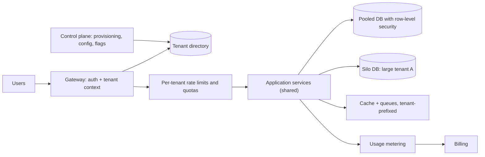

# Design a Multi-Tenant SaaS Platform: Isolation, Routing, Noisy Neighbors

> **Prerequisites:** [Previous lesson: Design an Enterprise AI Agent Platform: Harness, Tools, MCP, Multi-Agent](../36-design-an-enterprise-ai-agent-platform/README.md) and the [Interview Framework track](../../21-interview-framework/README.md).
> **Estimated Reading Time:** 15–20 minutes
> **Target Audience:** Engineers practising the full 9-step system design interview on a classic prompt: one application serving thousands of customer organisations safely.

> [!NOTE]
> **In one line:** A multi-tenant SaaS platform **shares infrastructure across customers while isolating their data and performance**: every request carries a tenant identity, and every layer enforces it.

> [!TIP]
> **The Golden Rule:** Put the tenant id in every request, every query and every cache key, enforce it centrally, and give large tenants a way to move to dedicated resources. Isolation by default, sharing for efficiency.

---

## Step 1. Clarify the Problem

Open with questions, not boxes. The two big risks are data leaking between tenants and one tenant slowing everyone else (the noisy neighbour). Design for both from the start.

**Questions to ask the interviewer, and the answer we assume:**

| Question | Assumed answer |
| :--- | :--- |
| Tenants? | 20,000 organisations from 5 users to 50,000 users |
| Isolation? | Strict data isolation; some customers want dedicated infrastructure |
| Customisation? | Branding and configuration, not custom code |
| Compliance? | Data residency by region |
| Scale? | 5M users in total, 20K requests per second |

> Say it aloud: *"Before I draw anything, let me confirm the scope and the numbers."* That one sentence earns the first minutes of the interview.

---

## Step 2. Functional and Non-Functional Requirements

**Functional (what the system does):**

- Onboard a tenant and provision its resources.
- Authenticate users and scope all access to their tenant.
- Enforce per-plan limits and usage metering.
- Support tenant-level configuration and data export or deletion.

**Non-functional (how well it does it):**

| Quality | Target | Why it drives the design |
| :--- | :--- | :--- |
| Isolation | No cross-tenant data access | Trust and compliance |
| Fairness | One tenant cannot starve others | Predictable performance |
| Efficiency | Shared infrastructure | Unit economics |
| Operability | Upgrade everyone at once | One codebase |

---

## Step 3. Scope: In and Out

**In scope:** Tenant model, data isolation tiers, routing, noisy-neighbour control, metering, lifecycle.

**Out of scope (say it explicitly, then move on):**

- The product's business features.
- Billing provider integration details.
- Custom code per tenant.

---

## Step 4. Capacity Estimation

Assumptions: 20,000 tenants following a power law (top 1% generate 50% of traffic), 20K requests per second, 5M users.

| Quantity | Calculation | Result |
| :--- | :--- | :--- |
| Big tenants | `tenants * top_fraction` | **200 tenants** |
| Traffic from big tenants | `rps * top_share` | **10K req/s** |
| Average per small tenant | `rps * (1 - top_share) / (tenants * (1 - top_fraction))` | **0.505 req/s** |

**What the numbers tell you:** 200 large tenants generate 10,000 requests per second (50 each), while the 19,800 small ones average about 0.5. That skew is the design driver: the small tenants should share cheaply, while the large ones need quotas, their own shards or dedicated stacks.

---

## Step 5. API Design

| Endpoint | Purpose | Notes |
| :--- | :--- | :--- |
| `POST /v1/tenants` | Onboard | Creates tenant, picks region and tier, provisions resources. |
| Every API call | Carries tenant identity | From the token; never from a client-supplied parameter. |
| `GET /v1/usage` | Metering | Per tenant, per plan limit. |
| `DELETE /v1/tenants/{id}` | Offboard | Export, then delete across all stores. |

Derive the tenant from the verified token, never from a request body or URL the client controls, so one tenant cannot name another.

---

## Step 6. Data Model

| Entity / Store | Key fields | Why this store |
| :--- | :--- | :--- |
| Tenant directory (control plane) | `tenant_id`, plan, region, tier, shard, status | Routing and policy source |
| Shared database, tenant_id column | Rows tagged by tenant, with row-level security | Pooled model for small tenants |
| Schema- or database-per-tenant | Dedicated schema or DB | Silo model for large or regulated tenants |
| Cache and queue keys | Prefixed by tenant id | Prevent cross-tenant leakage |
| Usage store | Metered events per tenant | Billing and limits |

Offer a spectrum: pooled (shared tables), bridge (schema per tenant) and silo (dedicated database or stack), and let the directory say which a tenant uses.

---

## Step 7. High-Level Architecture



**Walk the diagram in this order:** the gateway authenticates and attaches the tenant context, looks up routing in the directory, applies per-tenant limits, and the shared application reads data from the pooled store or the tenant's dedicated store.

---

## Step 8. Deep Dives and Bottlenecks

### 1. Isolation models and routing

**Pooled**: all tenants share tables with a `tenant_id` column and row-level security, which is cheapest and scales to many small tenants but has the highest leak risk if a query forgets the filter, so enforce it in the data layer, not in each query. **Bridge**: a schema per tenant. **Silo**: a database or whole stack per tenant for large or regulated customers. The tenant directory maps each tenant to its tier and shard, and a router sends requests accordingly, so a tenant can move tiers without code changes.

### 2. Noisy neighbours

Apply per-tenant rate limits, concurrency caps and queue fairness (weighted fair queuing, so one tenant's backlog does not delay others). Meter CPU, queries and storage per tenant and throttle or move heavy ones to dedicated shards. Use bulkheads (separate pools for background jobs versus interactive requests) and per-tenant connection limits on the database.

### 3. Lifecycle, data residency and operations

Provision a tenant by writing the directory entry and creating resources from templates, automatically. Place a tenant's data in its chosen region and keep the directory authoritative for it. Run schema migrations across all tenants with a rollout that handles failures per tenant. Offboarding exports and then deletes data from every store, including caches, search indices and backups according to policy.

---

## Step 9. Trade-offs, Failures and Security

**Trade-offs to state aloud:**

| Decision | Option A | Option B | Pick and why |
| :--- | :--- | :--- | :--- |
| Data model | Pooled | Silo per tenant | Hybrid: pooled for most, silo for large or regulated tenants |
| Tenant identity | Request parameter | Verified token claim | Token claim: cannot be forged by the client |
| Fairness | First come first served | Per-tenant quotas and fair queuing | Quotas and fair queuing |

**Failure modes and mitigations:**

| Failure | What users see | Mitigation |
| :--- | :--- | :--- |
| Query missing tenant filter | Data leak | Row-level security in the database; automated tests that try cross-tenant access |
| Noisy tenant | Others slow | Quotas, fair queuing, move to dedicated shard |
| Bad migration | Some tenants broken | Per-tenant rollout, canaries and rollback |

**Security and abuse:** Tenant context from the verified identity on every request, row-level security, tenant-prefixed cache and queue keys, per-tenant encryption keys for sensitive data, audit logs per tenant, and regular tests that attempt cross-tenant access.

---

## Runnable Example: Tenant-scoped access and fair rate limits

A tenant-scoped repository cannot read another tenant's rows, and a per-tenant limiter stops one tenant from consuming the shared capacity.

```python
rows = [("acme", "invoice-1"), ("acme", "invoice-2"), ("globex", "invoice-9")]

class Repo:
    def __init__(self, tenant):
        self.tenant = tenant
    def list(self):
        return [r for t, r in rows if t == self.tenant]

print(Repo("acme").list())
print(Repo("globex").list())

limit = {"acme": 3, "globex": 3}
used = {"acme": 0, "globex": 0}
def allow(tenant):
    if used[tenant] >= limit[tenant]:
        return False
    used[tenant] += 1
    return True

print("acme noisy:", [allow("acme") for _ in range(5)])
print("globex still ok:", allow("globex"))
```

Output (produced by running this exact code):

```text
['invoice-1', 'invoice-2']
['invoice-9']
acme noisy: [True, True, True, False, False]
globex still ok: True
```

Each tenant sees only its own rows, and the noisy tenant is cut off after its quota of three while the other tenant is unaffected, which is the noisy-neighbour protection.

---

## Common Mistakes

- Trusting a client-supplied tenant id.
- Relying on every developer to add `WHERE tenant_id`.
- No per-tenant limits.
- Cache keys without the tenant prefix.
- No path to move a big tenant to dedicated resources.

---

## Interview Questions and Answers

<details>
<summary><strong>Q1: How do you isolate tenant data?</strong></summary>

Tenant id from the verified token, enforced centrally with row-level security (or a schema or database per tenant), and tenant-prefixed cache and queue keys.

</details>

<details>
<summary><strong>Q2: Pooled or siloed?</strong></summary>

Hybrid: pooled is cheap for many small tenants; silo for large, regulated or demanding ones, chosen via the tenant directory.

</details>

<details>
<summary><strong>Q3: How do you stop noisy neighbours?</strong></summary>

Per-tenant rate limits, concurrency caps, fair queuing, resource metering and moving heavy tenants to dedicated shards.

</details>

<details>
<summary><strong>Q4: How do you handle data residency?</strong></summary>

The directory records each tenant's region, routing and storage follow it, and cross-region copies are avoided.

</details>

<details>
<summary><strong>Q5: How do you migrate schemas?</strong></summary>

A controlled rollout across tenants with per-tenant success tracking, canaries first and the ability to roll back.

</details>

---

## One-Page Cheat Sheet

| Step | What to say or draw |
| :--- | :--- |
| Clarify | 20K tenants, strict isolation, residency |
| Capacity | 1% of tenants make 50% of traffic |
| API | onboard, tenant from token, usage, offboard |
| Data | Tenant directory, pooled with RLS, silo for big tenants |
| Deep dive | Isolation tiers, noisy neighbours, lifecycle |
| Trade-off | Hybrid isolation, quotas |

---

## Further Reading

- AWS Well-Architected SaaS Lens and *SaaS Tenant Isolation Strategies* whitepaper.
- Microsoft Azure Architecture Center, *Multitenant SaaS patterns*.

---

## Next

That is the last full design problem. Continue with [Track 23: Revision and Mock Interviews](../../23-revision-and-mock-interviews/README.md).
