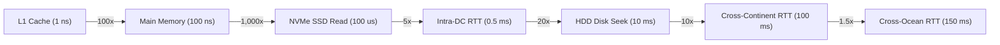
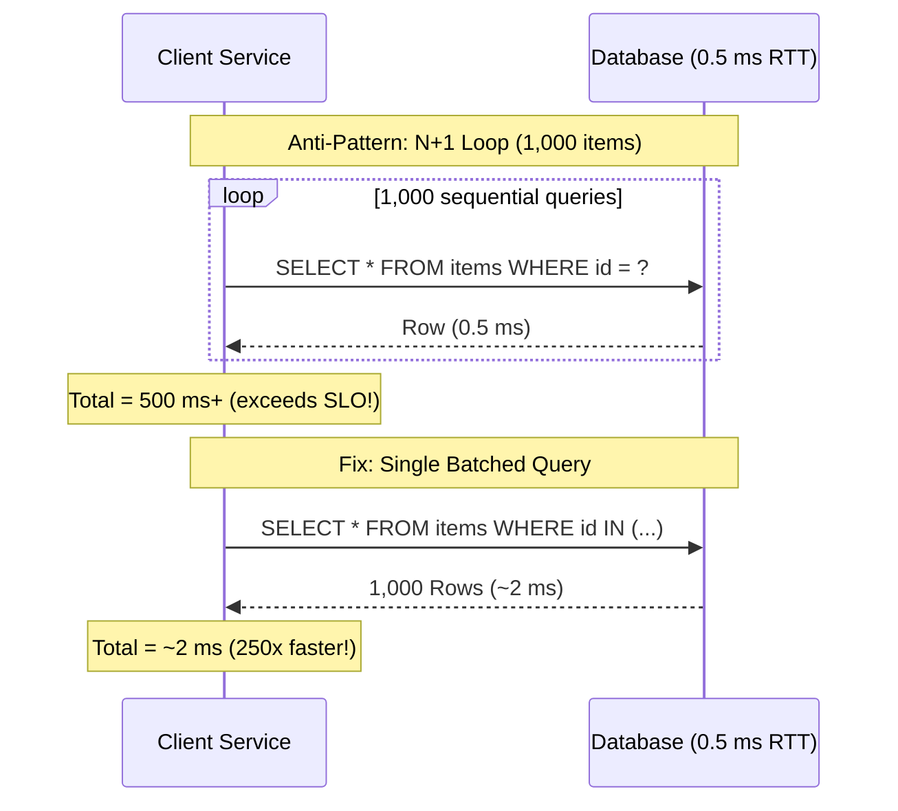

# System Design Numbers to Memorize: Latency, Nines and Powers of Two

> **Prerequisites:** [Lesson 37: Design a Multi-Tenant SaaS Platform](../../22-interview-design-problems/37-design-a-multi-tenant-saas-platform/README.md).
> **Estimated Reading Time:** 22–28 minutes
> **Target Audience:** Anyone who freezes when asked to estimate, and wants a small set of numbers to carry into every interview.

> [!NOTE]
> **In one line:** You do not need exact figures, only **orders of magnitude** you can trust: how long things take, how big powers of two are, and what each extra "nine" of availability costs.

> [!TIP]
> **The Golden Rule:** Memorise ratios, not decimals. Knowing that memory is about 1,000 times faster than SSD and SSD about 100 times faster than a cross-region call is worth more than any single exact number.

---

## 1. Core Concept & Why Interviewers Test It

Back-of-the-envelope estimation (BOTE) is not an arithmetic pop quiz; it is a **feasibility filter**. In a 45-minute system design interview, you cannot benchmark hardware. Instead, you use a handful of physical constants and order-of-magnitude ratios to prove that your proposed architecture will not collapse under its own latency, bandwidth, storage, or availability budget.

When an interviewer asks, *"Can a single PostgreSQL node handle this?"* or *"Why do we need a cache here?"*, they are listening for three signals:

1. **Physical Intuition (Orders of Magnitude):** You immediately know that an in-memory lookup (~100 ns) is ~1,000x faster than an NVMe SSD random read (~100 us), which is ~5x faster than an intra-DC network hop (~0.5 ms), which is ~100–300x faster than a cross-ocean round trip (~150 ms).
2. **Bottleneck Identification:** You compute QPS, payload bandwidth, and storage growth in under 90 seconds, rounding aggressively (`86,400 s -> 10^5 s`), so you spend the remaining 40 minutes on architecture rather than long multiplication.
3. **Reliability Realism:** You understand what "four nines" (99.99%) actually buys (52.6 minutes of downtime/year) and why chaining two 99.9% services drops availability to 99.8% unless you add redundancy without shared fate.

---

## 2. Quantitative Foundations & Back-of-the-Envelope Math

### Latency Numbers Every Engineer Should Know

These figures are rounded orders of magnitude (originating with Jeff Dean and updated for modern NVMe/10GbE hardware). Always state them as approximations.

| Operation | Approximate Time | Order of Magnitude | Useful Engineering Comparison |
| :--- | :--- | :--- | :--- |
| CPU L1 cache reference | ~1 ns | $10^{-9}$ s | Baseline register/cache speed |
| CPU L2 cache reference | ~4 ns | $4 \times 10^{-9}$ s | 4x slower than L1 |
| Mutex lock / unlock | ~25 ns | $2.5 \times 10^{-8}$ s | Contention-free synchronization |
| Main memory (RAM) reference | ~100 ns | $10^{-7}$ s | 100x slower than L1 |
| Compress 1 KB with Snappy/LZ4 | ~2–3 us | $10^{-6}$ s | Cheaper than sending 1 KB over network |
| Read 1 MB sequentially from RAM | ~10–50 us | $10^{-5}$ s | Memory bandwidth ~20–100 GB/s |
| NVMe SSD random read (4 KB) | ~50–100 us | $10^{-4}$ s | ~1,000x slower than RAM |
| Intra-datacenter network RTT | ~0.5 ms | $5 \times 10^{-4}$ s | 1 network hop = ~5,000 RAM reads |
| Read 1 MB sequentially from SSD | ~0.5–1 ms | $10^{-3}$ s | ~1–2 GB/s NVMe sequential |
| Spinning HDD disk seek | ~10 ms | $10^{-2}$ s | 100x slower than SSD random read |
| Cross-continent RTT (US/EU) | ~50–100 ms | $10^{-1}$ s | Bounded by speed of light in fiber |
| Cross-ocean RTT (US to Asia) | ~150 ms | $1.5 \times 10^{-1}$ s | Cannot be tuned away by code |

### Powers of Two, Data Sizes, and Time Constants

| Power of 2 | Exact / Approx Value | Binary / SI Unit | Concrete Example |
| :--- | :--- | :--- | :--- |
| $2^{10}$ | 1,024 (~$10^3$) | 1 KB | Short JSON payload or log line |
| $2^{20}$ | ~1,048,576 (~$10^6$) | 1 MB | Compressed photo thumbnail |
| $2^{30}$ | ~$1.07 \times 10^9$ (~$10^9$) | 1 GB | 10–20 min of 1080p compressed video |
| $2^{40}$ | ~$1.10 \times 10^{12}$ (~$10^{12}$) | 1 TB | Large single-node PostgreSQL shard |
| $2^{50}$ | ~$1.13 \times 10^{15}$ (~$10^{15}$) | 1 PB | Weekly telemetry for a large SaaS |

**Standard Object Sizes:** ASCII char = 1 byte; UTF-8 char = 1–4 bytes; 64-bit integer / timestamp = 8 bytes; UUID = 16 bytes binary (36 bytes text); Tweet-sized record with metadata = ~300–500 bytes; 1080p JPEG photo = 2–5 MB; 1 minute of 1080p H.264 video = 50–100 MB.

**Time & Traffic Shortcuts:**
- $1\text{ day} = 86,400\text{ s} \approx 10^5\text{ s}$ (rounding to $10^5$ is a 15% underestimate—safe for quick mental division, adjust up by 15% if tight).
- $1\text{ month} \approx 2.6 \times 10^6\text{ s}$; $1\text{ year} \approx 3.15 \times 10^7\text{ s}$ ($\pi \times 10^7\text{ s}$).
- $1\text{M requests/day} = \frac{10^6}{86,400} \approx 11.6\text{ RPS}$ ($\approx 12\text{ RPS}$). $100\text{M/day} \approx 1,157\text{ RPS}$.

### Core Mathematical Formulas

**1. Peak QPS & Bandwidth:**
$$\text{QPS}_{\text{avg}} = \frac{N_{\text{daily}}}{86,400}, \quad \text{QPS}_{\text{peak}} = k_{\text{peak}} \cdot \text{QPS}_{\text{avg}} \quad (k_{\text{peak}} \in [2, 10])$$
$$\text{Bandwidth (Bytes/s)} = \text{QPS}_{\text{peak}} \times \text{Payload Size (Bytes)}, \quad \text{Gbps} = \frac{\text{Bytes/s} \times 8}{10^9}$$

**2. Little's Law (Concurrency & Queue Depth):**
$$L = \lambda \cdot W$$
Where $L$ is average concurrent requests in the system, $\lambda$ is arrival rate (RPS), and $W$ is average response time (seconds).

*Worked Example:* An API handles $\lambda = 2,000\text{ RPS}$ with mean latency $W = 50\text{ ms} = 0.05\text{ s}$. Concurrent in-flight requests:
$$L = 2,000 \times 0.05 = 100\text{ concurrent connections/threads}$$
If a downstream DB slows down to $W = 2\text{ s}$, concurrency jumps to $L = 2,000 \times 2 = 4,000$, exhausting a 200-connection pool and causing a cascading outage.

**3. Series and Parallel Availability:**
$$A_{\text{series}} = \prod_{i=1}^{n} A_i, \quad A_{\text{parallel}} = 1 - \prod_{i=1}^{n} (1 - A_i)$$

*Worked Example:* Two services with $A_1 = 0.999$ and $A_2 = 0.999$ in series yield $A_{\text{series}} = 0.999^2 = 0.998001$ ($99.8\%$, doubling downtime from 8.76 h/yr to 17.5 h/yr). Two independent $99\%$ ($0.99$) replicas in parallel yield $A_{\text{parallel}} = 1 - (1 - 0.99)^2 = 1 - 0.0001 = 0.9999$ ($99.99\%$).

---

## 3. Decision Matrices & Trade-Off Rules

### Component Throughput & Capacity Matrix

| Component | Typical Single-Node Throughput | Latency (p50 / p99) | Primary Bottleneck |
| :--- | :--- | :--- | :--- |
| Stateless API Server (Go/Java/Node) | 1,000–10,000 RPS | 1–10 ms / 20–50 ms | CPU (JSON/TLS) or downstream I/O |
| Redis (in-memory, single-threaded) | 80,000–120,000 ops/sec | 0.3 ms / 1–2 ms | Single CPU core, network PPS, RAM size |
| PostgreSQL / MySQL (OLTP) | 2,000–15,000 QPS (simple) | 1–5 ms / 15–50 ms | Disk IOPS (writes), locks, connection count |
| Apache Kafka (per broker) | 100K–500K msgs/sec | 2–5 ms / 15–30 ms | Network NIC, page cache, disk seq write |
| 1 Gbps / 10 Gbps NIC | 125 MB/s / 1.25 GB/s | < 0.1 ms | TCP overhead (~80–85% usable throughput) |
| NVMe SSD (enterprise) | 100K–500K IOPS | 50–100 us | Queue depth, write amplification |

### Availability "Nines" & Engineering Cost Matrix

| Availability | Common Name | Downtime / Year | Downtime / Month | Downtime / Week | Architectural Requirement |
| :--- | :--- | :--- | :--- | :--- | :--- |
| 99% | Two nines | 3.65 days | 7.2 hours | 1.68 hours | Single instance + manual restart/backups |
| 99.9% | Three nines | 8.76 hours | 43.8 minutes | 10.1 minutes | Multi-AZ load balancer + auto-scaling + managed DB |
| 99.95% | Three-and-a-half | 4.38 hours | 21.9 minutes | 5.04 minutes | Automated failover + health checks + zero-downtime deploys |
| 99.99% | Four nines | 52.6 minutes | 4.38 minutes | 1.01 minutes | Multi-AZ active-active + circuit breakers + automated rollback |
| 99.999% | Five nines | 5.26 minutes | 26.3 seconds | 6.05 seconds | Multi-region active-active + chaos testing + zero manual ops |

---

## 4. Visual Architecture & Request Flows

### The Latency Hierarchy (Logarithmic Scale)



### The N+1 Network Hop Trap vs. Batching



---

## 5. Deep-Dive Pattern 1: Availability Math, Chaining & Shared Fate

In interviews, candidates frequently claim *"Our system is 99.99% available because we put it behind a load balancer."* That claim fails under scrutiny for two reasons: **serial dependency chaining** and **shared-fate failures**.

1. **Serial Chaining:** Every synchronous dependency on the critical path multiplies availability. If your API Gateway (99.99%), Auth Service (99.95%), Order Service (99.9%), and Payment Gateway (99.9%) are all called synchronously in sequence:
   $$A_{\text{total}} = 0.9999 \times 0.9995 \times 0.999 \times 0.999 \approx 0.9974 \text{ (99.74\% = 22.8 hours/year downtime)}$$
   **Architectural Fix:** Remove non-critical synchronous dependencies from the hot path (e.g., verify JWT locally instead of calling Auth Service; queue analytics/emails asynchronously) and degrade gracefully when optional dependencies fail.

2. **Shared-Fate Failures:** Parallel redundancy $A_{\text{parallel}} = 1 - (1 - A)^n$ assumes **statistical independence**. In reality, two replicas fail together when they share:
   - The same Availability Zone (power/network cut)
   - The same bad configuration push or database migration
   - The same control plane, DNS provider, or TLS certificate expiry
   - Cascading overload (when Replica A dies, 100% of traffic hits Replica B and kills it too)

> [!WARNING]
> **The #1 Availability Trap:** Calculating $1 - (1 - 0.999)^2 = 99.9999\%$ for two servers in the same rack or sharing a single primary database. Your system's availability is bounded by its weakest single point of failure (SPOF).

---

## 6. Deep-Dive Pattern 2: Tail Latency Amplification in Fan-Out

Mean latency lies in distributed systems. When a user request fans out to $N$ backend partitions or microservices in parallel, the user waits for the **slowest** of the $N$ responses.

Suppose each backend shard has a 99th percentile (p99) latency of 100 ms, meaning 1% of requests take $> 100\text{ ms}$ ($P(\text{fast}) = 0.99$). If a single user request fans out to $N = 100$ shards:
$$P(\text{all } N \text{ shards fast}) = 0.99^{100} \approx 0.366$$
$$P(\text{at least 1 shard slow}) = 1 - 0.99^{100} \approx 0.634 \text{ (63.4\%!)}$$

Over **63% of user requests** now experience tail latency ($> 100\text{ ms}$), even though each individual shard hits its 99% SLO!

**Mitigations:**
- **Hedged Requests (Tail at Scale):** If a request to Shard A has not returned after the p95 threshold (e.g., 15 ms), send a duplicate request to Shard A's replica and take whichever returns first (adds ~5% extra load, cuts p99 by >80%).
- **Scatter-Gather Budgets:** Return partial results (e.g., 98 of 100 search shards) at the deadline instead of blocking the entire page.

---

## 7. Deep-Dive Pattern 3: Storage, Bandwidth & ID Space Sizing

Every estimation interview requires sizing three dimensions cleanly:

1. **ID Space & Combinatorics:**
   - **Base62** (`[a-zA-Z0-9]`): 62 characters per position.
     - 6 chars: $62^6 \approx 5.68 \times 10^{10}$ (~56.8 billion)
     - 7 chars: $62^7 \approx 3.52 \times 10^{12}$ (~3.5 trillion — standard URL shortener)
   - **64-bit Integer (Snowflake ID):** $2^{64} \approx 1.84 \times 10^{19}$ (8 bytes). Allocates 41 bits for ms timestamp (~69 years), 10 bits for machine ID (1,024 nodes), 12 bits for sequence (4,096 IDs/ms/node).
   - **UUIDv4:** 128 bits = 16 bytes binary, 36 bytes as hyphenated hex string. Avoid as clustered primary key in MySQL/InnoDB due to random B-tree page splits (use UUIDv7 or ULID instead).

2. **Storage & Replication Multiplier:**
   Always multiply raw data size by:
   - **Replication factor** (typically $3\times$ for durability)
   - **Index & metadata overhead** ($1.2\times$ to $1.5\times$)
   - **Headroom** (keep disks below 70–80% full to avoid compaction/fragmentation cliffs)

3. **Bits vs. Bytes (Network Sizing):**
   Network interfaces are rated in **bits/sec** (Gbps); payloads are measured in **Bytes** (KB/MB). Divide Gbps by 8 (or by 10 to account for TCP/IP/TLS framing overhead) to get usable MB/s:
   $$1\text{ Gbps} \approx 125\text{ MB/s theoretical} \approx 100\text{ MB/s usable}$$

---

## 8. How This Scales: 1K vs 100K vs 10M+ Users

Assume a social/SaaS app where each Daily Active User (DAU) makes 20 API calls/day and writes 1 KB of data/day (5x peak-to-average).

| Dimension | 1K DAU (Startup) | 100K DAU (Growth) | 10M+ DAU (Hyperscale) |
| :--- | :--- | :--- | :--- |
| Daily Requests | 20,000 / day | 2M / day | 200M+ / day |
| Average QPS | ~0.23 RPS | ~23 RPS | ~2,315 RPS |
| Peak QPS (5x) | ~1.2 RPS | ~115 RPS | ~11,575 RPS |
| Daily New Data | 1 MB / day (~365 MB/yr) | 100 MB / day (~36.5 GB/yr) | 10 GB / day (~3.65 TB/yr raw, ~11 TB/yr @ 3x) |
| Peak Egress (10 KB/resp) | ~12 KB/s | ~1.15 MB/s (~9 Mbps) | ~115 MB/s (~1 Gbps) |
| Compute & Data Stack | 1 VM + 1 Managed Postgres | 2–4 Stateless APIs + Redis + Primary/Replica DB | Auto-scaled K8s + CDN + Sharded DB + Kafka |
| Availability Target | 99% (3.65 days/yr) | 99.9% (8.76 h/yr) | 99.99% (52.6 min/yr) |

---

## 9. Failure Modes, Traps & Recovery

| Failure Mode / Trap | Why It Happens | Production Consequence | Recovery / Prevention |
| :--- | :--- | :--- | :--- |
| **Bits vs. Bytes Confusion** | Treating 1 Gbps as 1 GB/s (8x error) | Under-provisioned NICs saturate at 125 MB/s | Always divide Mbps/Gbps by 8 (or 10 for usable) |
| **N+1 Network Loops** | Calling DB/RPC inside a `for` loop | 1,000 items * 0.5 ms = 500 ms per request | Batch queries (`WHERE id IN (...)`), DataLoader |
| **Shared-Fate Redundancy** | Putting 2 replicas in same AZ / same DB | Both die together on AZ/DB outage | Multi-AZ placement, cell isolation, chaos testing |
| **Ignoring Peak-to-Average** | Sizing for avg QPS instead of peak | System crashes during morning spike / flash sale | Size compute for 3–10x peak + autoscaling buffer |
| **Tail Latency Amplification** | Fanning out to 50+ shards synchronously | p99 of 1 shard becomes p50 of the user page | Hedged requests, scatter-gather timeouts |
| **Unbounded Retry Storms** | 3 retries across 3 layers = $3^3 = 27\times$ load | Recovering DB is immediately crushed again | Retry budgets (max 10% overhead), backoff + jitter |

---

## 10. Production War Story & Real-World Reference

### The 500 ms Checkout Cliff (N+1 + Tail Latency Amplification)

A mid-sized e-commerce platform (50M requests/day, ~580 avg RPS, ~3,000 peak RPS) migrated its monolith to microservices. During their first Black Friday load test, checkout p99 latency spiked from **120 ms to 4.2 seconds**, and thread pools exhausted (`Little's Law`: $L = 3,000 \times 4.2 = 12,600$ concurrent threads).

**Root Cause:**
1. The Cart Service fetched 25 items per order and made **25 sequential RPC calls** to the Inventory Service (`25 * 0.8 ms = 20 ms` nominal).
2. Under load, Inventory Service p99 degraded to 150 ms. By tail latency amplification, $P(\text{at least 1 slow call in 25}) = 1 - 0.99^{25} = 22.2\%$, pushing nearly 1 in 4 checkouts over 150 ms—and when retries kicked in without a budget, Inventory load tripled.

**Fix:** Replaced the 25-call loop with a single batched `CheckInventoryBatch(sku_ids[])` RPC (1 round trip) and added a 10% retry budget + circuit breaker. Checkout p99 dropped to **42 ms** and survived 4x Black Friday traffic.

---

## 11. Executable Reference Tooling (4 Languages)

This reference calculator computes annual/monthly downtime, series/parallel availability, average/peak QPS, bandwidth (MB/s and Gbps), and fan-out tail latency probability.

````carousel
```go
package main

import (
	"fmt"
	"math"
)

const (
	SecondsPerDay  = 86400.0
	MinutesPerYear = 365.0 * 24.0 * 60.0
)

func downtimeMinutesPerYear(avail float64) float64 {
	return MinutesPerYear * (1.0 - avail)
}

func seriesAvailability(avails []float64) float64 {
	res := 1.0
	for _, a := range avails {
		res *= a
	}
	return res
}

func parallelAvailability(avails []float64) float64 {
	failAll := 1.0
	for _, a := range avails {
		failAll *= (1.0 - a)
	}
	return 1.0 - failAll
}

func fanoutSlowProb(singleP99 float64, shards int) float64 {
	return 1.0 - math.Pow(singleP99, float64(shards))
}

func main() {
	for _, a := range []float64{0.99, 0.999, 0.9999, 0.99999} {
		fmt.Printf("%.3f%% -> %.1f min/year\n", a*100, downtimeMinutesPerYear(a))
	}
	fmt.Printf("Series (2x 99.9%%): %.4f%%\n", seriesAvailability([]float64{0.999, 0.999})*100)
	fmt.Printf("Parallel (2x 99%%): %.4f%%\n", parallelAvailability([]float64{0.99, 0.99})*100)

	dailyReq := 100_000_000.0
	avgQPS := dailyReq / SecondsPerDay
	peakQPS := avgQPS * 5.0
	gbps := (peakQPS * 10_000.0 * 8.0) / 1e9
	fmt.Printf("100M/day -> Avg: %.1f RPS, Peak(5x): %.1f RPS, Egress(10KB): %.3f Gbps\n", avgQPS, peakQPS, gbps)
	fmt.Printf("Fan-out 100 shards @ p99=0.99 -> %.1f%% requests hit tail\n", fanoutSlowProb(0.99, 100)*100)
}
```
<!-- slide -->
```typescript
const SECONDS_PER_DAY = 86_400;
const MINUTES_PER_YEAR = 365 * 24 * 60;

const downtimePerYearMin = (avail: number): number => MINUTES_PER_YEAR * (1 - avail);

const seriesAvailability = (avails: number[]): number =>
  avails.reduce((acc, a) => acc * a, 1);

const parallelAvailability = (avails: number[]): number =>
  1 - avails.reduce((acc, a) => acc * (1 - a), 1);

const fanoutSlowProb = (singleP99: number, shards: number): number =>
  1 - Math.pow(singleP99, shards);

for (const a of [0.99, 0.999, 0.9999, 0.99999]) {
  console.log(`${(a * 100).toFixed(3)}% -> ${downtimePerYearMin(a).toFixed(1)} min/year`);
}

console.log(`Series (2x 99.9%): ${(seriesAvailability([0.999, 0.999]) * 100).toFixed(4)}%`);
console.log(`Parallel (2x 99%): ${(parallelAvailability([0.99, 0.99]) * 100).toFixed(4)}%`);

const avgQps = 100_000_000 / SECONDS_PER_DAY;
const peakQps = avgQps * 5;
const gbps = (peakQps * 10_000 * 8) / 1e9;
console.log(`100M/day -> Avg: ${avgQps.toFixed(1)} RPS, Peak(5x): ${peakQps.toFixed(1)} RPS, Egress: ${gbps.toFixed(3)} Gbps`);
console.log(`Fan-out 100 shards @ p99=0.99 -> ${(fanoutSlowProb(0.99, 100) * 100).toFixed(1)}% slow`);
```
<!-- slide -->
```python
SECONDS_PER_DAY = 86_400
MINUTES_PER_YEAR = 365 * 24 * 60

def downtime_minutes_per_year(avail: float) -> float:
    return MINUTES_PER_YEAR * (1.0 - avail)

def series_availability(avails: list[float]) -> float:
    res = 1.0
    for a in avails:
        res *= a
    return res

def parallel_availability(avails: list[float]) -> float:
    fail_all = 1.0
    for a in avails:
        fail_all *= (1.0 - a)
    return 1.0 - fail_all

def fanout_slow_prob(single_p99: float, shards: int) -> float:
    return 1.0 - (single_p99 ** shards)

if __name__ == "__main__":
    for a in (0.99, 0.999, 0.9999, 0.99999):
        print(f"{a:.3%} -> {downtime_minutes_per_year(a):8.1f} min/year")

    print(f"Series (2x 99.9%): {series_availability([0.999, 0.999]):.4%}")
    print(f"Parallel (2x 99%): {parallel_availability([0.99, 0.99]):.4%}")

    avg_qps = 100_000_000 / SECONDS_PER_DAY
    peak_qps = avg_qps * 5
    gbps = (peak_qps * 10_000 * 8) / 1e9
    print(f"100M/day -> Avg: {avg_qps:.1f} RPS, Peak(5x): {peak_qps:.1f} RPS, Egress: {gbps:.3f} Gbps")
    print(f"Fan-out 100 shards @ p99=0.99 -> {fanout_slow_prob(0.99, 100):.1%} slow")
```
<!-- slide -->
```csharp
using System;
using System.Linq;

class CapacityEstimator
{
    const double SecondsPerDay = 86400.0;
    const double MinutesPerYear = 365.0 * 24.0 * 60.0;

    static double DowntimeMinPerYear(double avail) => MinutesPerYear * (1.0 - avail);
    static double SeriesAvail(params double[] avails) => avails.Aggregate(1.0, (a, b) => a * b);
    static double ParallelAvail(params double[] avails) => 1.0 - avails.Aggregate(1.0, (a, b) => a * (1.0 - b));
    static double FanoutSlowProb(double singleP99, int shards) => 1.0 - Math.Pow(singleP99, shards);

    static void Main()
    {
        foreach (var a in new[] { 0.99, 0.999, 0.9999, 0.99999 })
            Console.WriteLine($"{a:P3} -> {DowntimeMinPerYear(a),8:F1} min/year");

        Console.WriteLine($"Series (2x 99.9%): {SeriesAvail(0.999, 0.999):P4}");
        Console.WriteLine($"Parallel (2x 99%): {ParallelAvail(0.99, 0.99):P4}");

        double avgQps = 100_000_000.0 / SecondsPerDay;
        double peakQps = avgQps * 5.0;
        double gbps = (peakQps * 10_000.0 * 8.0) / 1e9;
        Console.WriteLine($"100M/day -> Avg: {avgQps:F1} RPS, Peak(5x): {peakQps:F1} RPS, Egress: {gbps:F3} Gbps");
        Console.WriteLine($"Fan-out 100 shards @ p99=0.99 -> {FanoutSlowProb(0.99, 100):P1} slow");
    }
}
```
````

---

## 12. Verification & CLI Diagnostics

Verify real-world latency, bandwidth, and math on any Linux/macOS/WSL terminal:

```bash
# 1. Measure DNS, TCP connect, TLS handshake, and TTFB in milliseconds
curl -o /dev/null -s -w "dns:%{time_namelookup}s tcp:%{time_connect}s tls:%{time_appconnect}s ttfb:%{time_starttransfer}s total:%{time_total}s\n" https://example.com

# 2. Measure intra-DC or cross-region RTT with ping
ping -c 5 8.8.8.8

# 3. Quick BOTE verification in Python (QPS, storage, fan-out)
python3 -c '
daily = 50_000_000
avg_rps = daily / 86400
print(f"Avg RPS: {avg_rps:.1f}, Peak (5x): {avg_rps*5:.1f}")
print(f"62^7 IDs: {62**7:,}")
print(f"100-shard p99 hit rate: {1 - 0.99**100:.1%}")
'

# 4. Check local disk sequential write speed (flush to disk)
dd if=/dev/zero of=/tmp/test_seq.img bs=1M count=256 oflag=direct 2>&1 | tail -n 1 && rm -f /tmp/test_seq.img
```

---

## 13. Common Interview Mistakes & Red Flags

| Common Mistake (Red Flag) | Why It Fails | Staff-Level Answer |
| :--- | :--- | :--- |
| Quoting latency as exact (`"SSD is 93.4 us"`) | Hardware varies; signals rote memorization | *"SSD random read is ~100 us—about 1,000x slower than RAM."* |
| Mixing Gbps and GB/s (`"1 Gbps = 1 GB/s"`) | Off by a factor of 8x; breaks NIC sizing | *"1 Gbps is ~125 MB/s raw, ~100 MB/s usable after framing."* |
| Ignoring N+1 calls in a loop | 1,000 * 0.5 ms = 500 ms of pure network wait | *"We must batch this into a single query or pipeline."* |
| Claiming `99.99%` from two nodes in one AZ | Shared fate (AZ, DB, deploy) breaks independence | *"Multi-AZ eliminates rack/AZ SPOF, but DB failover still bounds RTO."* |
| Doing long multiplication aloud for 3 minutes | Wastes precious architecture design time | *"Let's round 86,400 to 10^5 s—100M/day is ~1,200 RPS."* |
| Sizing only for average QPS | Real traffic is diurnal and bursty | *"Avg is 1,200 RPS; assuming 5x peak, we size for 6,000 RPS."* |

---

## 14. Key Terminology & Glossary

| Term | Definition |
| :--- | :--- |
| **Order of Magnitude** | A factor of 10; used to compare relative costs (ns vs us vs ms) without false precision. |
| **Availability (Nines)** | Percentage of time a system is operational; each extra nine reduces allowed downtime by 10x. |
| **Series Availability** | Product of availabilities of synchronous dependencies on the critical path ($A_1 \times A_2$). |
| **Parallel Availability** | Availability of redundant independent components ($1 - \prod (1 - A_i)$). |
| **Shared Fate** | A correlated failure mode where "redundant" components fail together (same AZ, config, or DB). |
| **Little's Law** | $L = \lambda W$: average concurrency equals arrival rate times average latency. |
| **Tail Latency (p99)** | The 99th percentile latency; 1% of requests are slower than this threshold. |
| **Tail Amplification** | In a fan-out to $N$ nodes, the probability of hitting at least one slow node rises as $1 - (1 - p)^N$. |
| **Peak-to-Average Ratio** | Multiplier (typically 2x–10x) between daily average traffic and peak burst traffic. |
| **Base62** | Encoding using `[0-9a-zA-Z]`; 7 characters yield $62^7 \approx 3.52 \times 10^{12}$ unique IDs. |
| **RTT (Round-Trip Time)** | Time for a packet to travel to a destination and back; bounded by speed of light in fiber. |
| **IOPS** | Input/Output Operations Per Second; primary bottleneck for random database reads/writes on disk. |

---

## 15. Interview Follow-Up Questions (12 Q&As)

### Basic Conceptual Questions

<details>
<summary><strong>Q1: [BASIC] Memory, SSD, and a cross-region call: roughly how do they compare?</strong></summary>

Main memory is ~100 nanoseconds, NVMe SSD random read is ~100 microseconds, and a cross-region call is ~100 milliseconds. Each step is roughly **1,000 times slower** than the one before it.

</details>

<details>
<summary><strong>Q2: [BASIC] How many requests per second is 100 million per day?</strong></summary>

About **1,157 RPS** (often rounded to **1,200 RPS**), calculated as $10^8 / 86,400$. For capacity planning, multiply by a peak-to-average factor of 3–5x (~3,500–6,000 peak RPS).

</details>

<details>
<summary><strong>Q3: [BASIC] What does 99.99% availability allow per year?</strong></summary>

About **52.6 minutes** of total downtime per year (or ~4.4 minutes per month).

</details>

<details>
<summary><strong>Q4: [BASIC] How big is 62^7, and why does it appear in interviews?</strong></summary>

$62^7 \approx 3.52\text{ trillion}$ ($3.52 \times 10^{12}$). It is the standard capacity for a **7-character Base62 URL shortener**—enough for 1,000 new URLs/second for over 110 years.

</details>

### Scenario-Based Architecture Questions

<details>
<summary><strong>Q5: [SCENARIO] Two services at 99.9% are called in sequence. What is the combined availability, and how do you fix it?</strong></summary>

Because availabilities multiply in series, $0.999 \times 0.999 = 0.998001$ (**99.8%**, doubling downtime to 17.5 hours/year). Fix it by removing one from the synchronous path (async queue), caching responses with stale-while-revalidate, or adding fallback degradation.

</details>

<details>
<summary><strong>Q6: [SCENARIO] You need to serve 50,000 RPS of 20 KB JSON responses. How many 1 Gbps NICs do you need at minimum?</strong></summary>

Bandwidth = $50,000 \times 20\text{ KB} = 1,000,000\text{ KB/s} = 1\text{ GB/s} = 8\text{ Gbps}$. A 1 Gbps NIC carries ~100 MB/s usable, so you need at least **10x 1 Gbps NICs** (or a single **10 Gbps NIC** running near saturation—practically 2x 10 Gbps for headroom).

</details>

<details>
<summary><strong>Q7: [SCENARIO] Why does round-trip time across regions matter so much in system design?</strong></summary>

Cross-continent (~50–100 ms) and cross-ocean (~150 ms) RTTs are bounded by the speed of light in fiber (~200,000 km/s). Code optimization cannot beat physics. You must reduce round trips (batching, pipelining), move read replicas/CDNs closer to users, or use async replication.

</details>

<details>
<summary><strong>Q8: [SCENARIO] An API handles 1,000 RPS with 20 ms latency. A DB lock pushes latency to 2 seconds. What happens according to Little's Law?</strong></summary>

Concurrency $L = \lambda W$ jumps from $1,000 \times 0.02 = 20$ in-flight requests to $1,000 \times 2 = 2,000$ in-flight requests. If your server thread pool or DB connection pool is capped at 200, the service immediately exhausts its pool and begins timing out all requests.

</details>

### Advanced & Tricky Interview Questions

<details>
<summary><strong>Q9: [TRICKY] A search query fans out to 100 shards, each with p99 = 50 ms. What percentage of user searches will exceed 50 ms?</strong></summary>

$1 - 0.99^{100} \approx 63.4\%$ of user searches will wait longer than 50 ms. This is **tail latency amplification**. Mitigate with hedged requests or partial-result scatter-gather deadlines.

</details>

<details>
<summary><strong>Q10: [TRICKY] Why might two redundant 99.9% database replicas NOT give you 99.9999% availability?</strong></summary>

Because $1 - (1 - 0.999)^2 = 99.9999\%$ assumes independent failures. In production, replicas suffer **shared fate**: a bad schema migration, corrupted WAL, control-plane bug, or region-wide DNS/BGP outage takes down both simultaneously.

</details>

<details>
<summary><strong>Q11: [TRICKY] Why is 86,400 rounded to 100,000 safe in some calculations and dangerous in others?</strong></summary>

Dividing daily requests by $10^5$ instead of $86,400$ **underestimates** QPS by ~15% (11.6 becomes 10), which is fine when multiplied by a 3–5x peak factor. However, multiplying by $10^5$ **overestimates** daily storage by 15%. Always state the rounding direction.

</details>

<details>
<summary><strong>Q12: [TRICKY] Why does compressing a 10 KB payload for 20 us before sending over a 100 Mbps link improve end-to-end latency?</strong></summary>

Sending 10 KB over 100 Mbps (~10 MB/s) takes ~1,000 us (1 ms). Compressing it 3x (to ~3.3 KB) costs ~20–30 us of CPU and saves ~670 us of network transfer—a **net ~640 us win** per request, plus 3x less egress cost.

</details>

---

## 16. One-Page Master Cheat Sheet

```text
+-----------------------------------------------------------------------------+
|                SYSTEM DESIGN NUMBERS: ONE-PAGE CHEAT SHEET                  |
+-----------------------------------------------------------------------------+
| LATENCY HIERARCHY (10x - 1000x JUMPS)                                       |
|   L1 Cache: 1 ns  ->  RAM: 100 ns  ->  NVMe SSD: 100 us  ->  DC RTT: 0.5 ms |
|   HDD Seek: 10 ms ->  Cross-Continent: 50-100 ms  ->  Cross-Ocean: 150 ms   |
|                                                                             |
| TRAFFIC & SIZE SHORTCUTS                                                    |
|   1 day = 86,400 s (~10^5 s)    |  1M req/day = 11.6 RPS (~12 RPS)          |
|   1 month = 2.6M s              |  1 year = 31.5M s                         |
|   1 Gbps = 125 MB/s (~100 MB/s) |  62^7 = 3.5 trillion IDs                  |
|                                                                             |
| AVAILABILITY NINES & FORMULAS                                               |
|   99%     = 3.65 days/yr  (7.2 h/mo)   |  Series:   A1 * A2                 |
|   99.9%   = 8.76 hours/yr (43.8 m/mo)  |  Parallel: 1 - (1 - A1)(1 - A2)    |
|   99.99%  = 52.6 min/yr   (4.4 m/mo)   |  Little's Law: L = lambda * W      |
|   99.999% = 5.26 min/yr   (26.3 s/mo)  |  Fan-out Tail: 1 - (0.99)^N        |
+-----------------------------------------------------------------------------+
```

| Category | Rule of Thumb |
| :--- | :--- |
| **Throughput** | API Server: 1–10K RPS; Redis: ~100K ops/s; RDBMS: 2–15K QPS |
| **Object Sizes** | Tweet: ~300 B; UUID: 16 B (36 text); Photo: 2–5 MB; Video: 50–100 MB/min |
| **Scaling** | Always size for 3–10x peak QPS and 3x storage replication + 20% headroom |

---

## Further Reading

- Jeff Dean, *Software Engineering Advice from Building Large-Scale Distributed Systems* (the original latency table).
- Colin Scott, *Latency Numbers Every Programmer Should Know* (interactive, year by year).
- Jeffrey Dean & Luiz André Barroso, *The Tail at Scale* (Communications of the ACM, 2013).
- Google SRE Book, *Embracing Risk* and *Service Level Objectives*.

---

## Next

Continue with [Revise Database Choices: SQL vs NoSQL, Indexes, Isolation, Sharding](../02-revise-database-choices/README.md).
