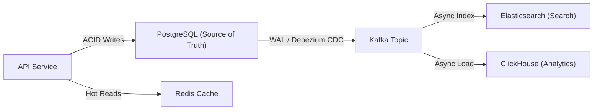
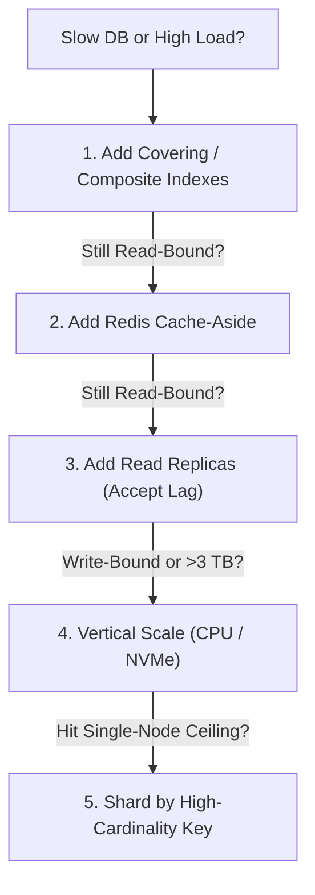

# Revise Database Choices: SQL vs NoSQL, Indexes, Isolation, Sharding

> **Prerequisites:** [Previous lesson: System Design Numbers to Memorize: Latency, Nines and Powers of Two](../01-system-design-numbers-to-memorize/README.md).
> **Estimated Reading Time:** 22–28 minutes
> **Target Audience:** Candidates who know each database type but hesitate when asked which one to choose and why.

> [!NOTE]
> **In one line:** Choose a database by **access pattern and consistency need first**, size second, and brand last.

> [!TIP]
> **The Golden Rule:** Start from the queries: what you read by, what you write, how often, and what must never be wrong. The data model follows the queries, not the other way round.

---

## 1. Core Concept & Why Interviewers Test It

Choosing a database in a system design interview is never about reciting vendor marketing. Interviewers test whether you can map **workload characteristics**—read/write ratio, query predicates, ACID invariants, and growth rate—to the underlying **storage engine** and **distribution model**.

Strong candidates demonstrate three habits:

1. **Query-First Selection:** You state the exact read/write queries before naming PostgreSQL, DynamoDB, or Cassandra.
2. **Engine Awareness:** You know *why* a B-tree excels at point/range reads while an LSM-tree excels at high-throughput writes—and what each sacrifices (write amplification vs. read/space amplification).
3. **Pragmatic Scaling:** You climb the scaling ladder in order (query/index tuning -> caching -> read replicas -> vertical scaling -> sharding) rather than jumping straight to sharding at 100 RPS.

---

## 2. Quantitative Foundations & Back-of-the-Envelope Math

### Storage Engine & Complexity Comparison

| Metric / Operation | B-Tree (PostgreSQL, MySQL InnoDB) | LSM-Tree (RocksDB, Cassandra, ScyllaDB) |
| :--- | :--- | :--- |
| Point Lookup (`WHERE id = ?`) | $O(\log_B N)$ — 3 to 4 page reads | $O(L \cdot \log M)$ — MemTable + Bloom Filters + SSTables |
| Range Scan (`BETWEEN a AND b`) | Fast (sequential leaf pointers) | Moderate (merge-sort across $L$ SSTable levels) |
| Write Path | Random I/O in-place page update + WAL | Sequential append to MemTable + WAL (very fast) |
| Write Amplification (WA) | High (rewriting 4–16 KB pages for 100 B row) | Moderate–High during background compaction |
| Read Amplification (RA) | Low (1–4 pages) | Higher (check multiple SSTable levels if Bloom filter misses) |
| Space Amplification (SA) | ~1.2x–1.5x (page fragmentation) | ~1.1x–2.0x (stale tombstones until compaction) |

### Worked Math: B-Tree Depth & Shard Sizing

**1. B-Tree Height Calculation:**
Assume a 16 KB page size ($B_{\text{page}} = 16,384\text{ B}$), 8-byte key + 8-byte pointer = 16 bytes per index entry, and 70% average fill factor:
$$\text{Fan-out } F = \left\lfloor \frac{16,384 \times 0.7}{16} \right\rfloor \approx 716\text{ keys/node}$$
With height $h = 3$ (root + 2 internal levels + leaf):
$$\text{Max Keys} \approx 716^3 \approx 3.67 \times 10^8\text{ rows (367 million rows in just 3–4 hops!)}$$
With $h = 4$, a single B-tree indexes over **260 billion rows**. This is why indexing turns $O(N)$ scans into $O(1)$–$O(\log N)$ disk seeks.

**2. When to Shard (Storage & IOPS Trigger):**
Suppose a table grows by 50M rows/day at 1 KB/row:
$$\text{Daily Growth} = 50 \times 10^6 \times 1\text{ KB} = 50\text{ GB/day} \approx 18.25\text{ TB/year}$$
With 1.5x index overhead, you need ~27 TB/year. A single primary PostgreSQL node becomes operationally painful to backup/vacuum/failover above **2–5 TB** or **15,000+ write IOPS**, signaling that time-based partitioning or key-based sharding is required.

---

## 3. Decision Matrices & Trade-Off Rules

### Database Selection Matrix by Access Pattern

| Access Pattern & Workload | Best-Fit Database | Why It Fits | Trade-Off / Watch Out For |
| :--- | :--- | :--- | :--- |
| Financial ledgers, orders, strict ACID joins | **Relational (PostgreSQL, MySQL)** | Full ACID, foreign keys, ad-hoc SQL | Manual sharding; vertical write ceiling |
| Massive key-value / wide-column writes | **DynamoDB, Cassandra, ScyllaDB** | Linear horizontal scale, predictable p99 | No joins; queries locked to partition/sort key |
| Evolving schemas, nested aggregates | **Document (MongoDB)** | Flexible JSON/BSON, co-located subdocs | Weak cross-document joins; memory-hungry indexes |
| Full-text, fuzzy, faceted filtering | **Elasticsearch / OpenSearch** | Inverted index, BM25 relevance scoring | Eventual consistency; not a source of truth |
| High-ingest metrics & IoT telemetry | **TimescaleDB, InfluxDB, ClickHouse** | Time-partitioning, columnar compression | High tag cardinality explodes memory |
| Multi-hop social/fraud traversal | **Neo4j, Neptune** | Index-free adjacency ($O(1)$ hop) | Hard to partition across shards |
| Hot counters, leaderboards, sessions | **Redis / Valkey** | Sub-ms in-memory structures (ZSET, Hash) | RAM cost; durability/eviction limits |
| Blobs, media, backups, data lake | **Object Storage (S3, GCS)** | 11 nines durability, ~$0.02/GB/month | High TTFB (~20–50 ms); no random byte writes |

### SQL Isolation Levels & Concurrency Anomalies

| Isolation Level | Dirty Read | Non-Repeatable Read | Phantom Read | Write Skew | Typical Default In |
| :--- | :--- | :--- | :--- | :--- | :--- |
| **Read Uncommitted** | Possible | Possible | Possible | Possible | Rarely used |
| **Read Committed** | Prevented | Possible | Possible | Possible | PostgreSQL, Oracle |
| **Repeatable Read / Snapshot** | Prevented | Prevented | Engine-dependent | **Possible** | MySQL InnoDB (MVCC) |
| **Serializable** | Prevented | Prevented | Prevented | Prevented | Explicit opt-in (financial/booking) |

---

## 4. Visual Architecture & Request Flows

### Polyglot Persistence & CDC Pipeline



### The Database Scaling Ladder (Decision Flow)



---

## 5. Deep-Dive Pattern 1: B-Tree Composite & Covering Indexes

An index is a sorted data structure (typically a B+Tree) that trades **extra storage and slower writes** for logarithmic reads.

1. **Leftmost Prefix Rule:** A composite index on `(country, city, created_at)` sorts rows first by `country`, then `city`, then `created_at`.
   - `WHERE country = 'FR' AND city = 'Paris'` -> **Uses full index** (fast range scan).
   - `WHERE country = 'FR'` -> **Uses index** (leftmost prefix).
   - `WHERE city = 'Paris'` -> **Cannot use index** (requires full scan, because `'Paris'` is scattered across every country).
2. **Covering Index (Index-Only Scan):** Including all `SELECT` columns in the index (e.g., `CREATE INDEX idx ON orders(user_id) INCLUDE (total, status)`) lets the engine satisfy the query directly from index pages without touching the heap table, cutting I/O in half.
3. **Cardinality Rule:** Never create standalone B-tree indexes on low-cardinality booleans (`is_active`). High-cardinality columns (`user_id`, `order_id`) narrow scans immediately.

---

## 6. Deep-Dive Pattern 2: Write Skew & Preventing Double-Booking

Even under **Snapshot Isolation (Repeatable Read)**, two concurrent transactions can read the same snapshot, make disjoint writes, and violate a global invariant. This is **Write Skew**.

**Classic Example (On-Call Doctors / Seat Booking):**
Invariant: *At least 1 doctor must remain on call.* Currently Alice and Bob are both on call.
- **Tx A (Alice):** `SELECT count(*) FROM on_call WHERE shift='night'` -> sees `2`. Updates `Alice.on_call = false`.
- **Tx B (Bob):** `SELECT count(*) FROM on_call WHERE shift='night'` -> sees `2` (snapshot!). Updates `Bob.on_call = false`.
- **Both commit!** Now **0 doctors** are on call.

**Three Ways to Prevent Write Skew:**
1. **`SERIALIZABLE` Isolation:** Detects read-write dependency cycles (SSI in Postgres) and aborts one transaction with `40001 serialization_failure` (client retries).
2. **Explicit Pessimistic Locking:** `SELECT * FROM on_call WHERE shift='night' FOR UPDATE` locks the checked rows.
3. **Materialize the Conflict:** Add a `shift_summary(shift_id, active_count)` row or a unique constraint (`UNIQUE(room_id, time_slot)` for bookings) so both transactions contend on the same row/key.

---

## 7. Deep-Dive Pattern 3: Sharding, Hot Keys & Consistent Hashing

When a single node cannot hold the dataset or absorb the write IOPS, you partition data across $K$ shards.

1. **Range Sharding (`user_id 1..1M -> Shard 1`):** Great for range queries, terrible for sequential IDs or timestamps because **100% of new writes hit the last shard** (hot spot).
2. **Hash Sharding (`hash(key) % K`):** Distributes writes evenly, destroys range queries. Adding a shard changes `K`, requiring massive data migration unless you use **Consistent Hashing** with virtual nodes (vnodes).
3. **Celebrity / Hot-Key Mitigation:** Hashing `user_id` still overloads the shard holding Taylor Swift or a viral tenant. Fix with **key salting** (`user_id + "_" + rand(0, 9)` for writes, scatter-gather on read) or an in-memory local/Redis cache in front of that hot key.

> [!WARNING]
> **The #1 Sharding Trap:** Sharding before exhausting indexes, caching, and vertical scaling. Sharding permanently breaks cross-shard joins, foreign keys, and single-node ACID transactions (requiring 2PC or Sagas).

---

## 8. How This Scales: 1K vs 100K vs 10M+ Users

| Scale Tier | Primary OLTP Store | Read Strategy | Write Strategy | Search & Analytics |
| :--- | :--- | :--- | :--- | :--- |
| **1K Users** | Single PostgreSQL/MySQL | Direct queries + basic indexes | Single primary | `ILIKE` / SQL `GROUP BY` |
| **100K Users** | Primary + 1–2 Read Replicas | Redis cache-aside + replicas for reports | Connection pooling (PgBouncer) | Async CDC to Elasticsearch |
| **10M+ Users** | Sharded Postgres (Citus/Vitess) or DynamoDB/Spanner | Multi-region read replicas + CDN + Redis cluster | Partitioned writes + Kafka write-behind/CDC | Dedicated ClickHouse / BigQuery lakehouse |

---

## 9. Failure Modes, Traps & Recovery

| Failure Mode | Cause | Symptom | Recovery / Mitigation |
| :--- | :--- | :--- | :--- |
| **Replication Lag Read-Your-Writes Bug** | User writes to Primary, immediately reads Replica | User saves profile, refreshes, sees old data | Route user's own reads to Primary for 5s (sticky session) or read from cache |
| **Connection Pool Exhaustion** | 500 app pods * 20 connections = 10,000 DB conns | DB spends 90% CPU context-switching, refuses conns | Put **PgBouncer / RDS Proxy** in transaction-pooling mode in front of DB |
| **UUIDv4 B-Tree Fragmentation** | Random 128-bit PKs insert into random leaf pages | Write IOPS spikes 5x; cache hit rate craters | Use time-ordered **UUIDv7 / ULID / Snowflake** for clustered primary keys |
| **Hot Shard / Celebrity Key** | Skewed traffic to 1 partition key | 1 shard at 100% CPU while 15 shards sit at 5% | Key salting (`key#0..9`) or dedicated cache tier for hot keys |
| **Unindexed Foreign Key / Seq Scan** | Missing index on `WHERE` or `JOIN` column | Latency jumps from 2 ms to 3 s as table hits 10M rows | `EXPLAIN ANALYZE` in CI; `CREATE INDEX CONCURRENTLY` |

---

## 10. Production War Story & Real-World Reference

### The Read-Replica Lag & Connection Storm Outage

A fintech SaaS ran a single PostgreSQL primary with 4 read replicas. During a marketing campaign (8,000 peak RPS), they scaled their Kubernetes API tier from 40 to 200 pods. Within 90 seconds, the primary database became completely unresponsive.

**Root Cause:**
1. Each pod opened a pool of 25 connections -> $200 \times 25 = 5,000$ active connections on PostgreSQL (optimal is ~2–4x CPU cores, ~128–256).
2. A missing composite index on `(tenant_id, status, created_at)` caused a full table scan on a 40M-row table, saturating disk I/O and causing read-replica lag to climb to **45 seconds**, breaking user balance checks.

**Fix:** Deployed **PgBouncer** in transaction-pooling mode (capping real Postgres backends at 150), added the covering composite index online (`CREATE INDEX CONCURRENTLY`), and pinned critical read-after-write queries to the primary. P99 query latency dropped from **1,800 ms to 4 ms**.

---

## 11. Executable Reference Tooling (4 Languages)

This tooling demonstrates both **Composite Index Leftmost Prefix Lookup** and **Consistent Hashing Shard Routing with Virtual Nodes**.

````carousel
```go
package main

import (
	"crypto/sha256"
	"encoding/binary"
	"fmt"
	"sort"
)

type Ring struct {
	vnodes []uint32
	owners map[uint32]string
}

func hashKey(s string) uint32 {
	h := sha256.Sum256([]byte(s))
	return binary.BigEndian.Uint32(h[:4])
}

func NewRing(shards []string, replicas int) *Ring {
	r := &Ring{owners: make(map[uint32]string)}
	for _, s := range shards {
		for i := 0; i < replicas; i++ {
			k := hashKey(fmt.Sprintf("%s#%d", s, i))
			r.vnodes = append(r.vnodes, k)
			r.owners[k] = s
		}
	}
	sort.Slice(r.vnodes, func(i, j int) bool { return r.vnodes[i] < r.vnodes[j] })
	return r
}

func (r *Ring) GetShard(key string) string {
	h := hashKey(key)
	idx := sort.Search(len(r.vnodes), func(i int) bool { return r.vnodes[i] >= h })
	if idx == len(r.vnodes) {
		idx = 0
	}
	return r.owners[r.vnodes[idx]]
}

func main() {
	ring := NewRing([]string{"shard-a", "shard-b", "shard-c"}, 100)
	counts := map[string]int{}
	for i := 0; i < 10000; i++ {
		counts[ring.GetShard(fmt.Sprintf("user:%d", i))]++
	}
	fmt.Println("Key distribution across 3 shards:", counts)
}
```
<!-- slide -->
```typescript
import { createHash } from "crypto";

class ConsistentHashRing {
  private ring: number[] = [];
  private owners = new Map<number, string>();

  constructor(shards: string[], vnodes = 100) {
    for (const shard of shards) {
      for (let i = 0; i < vnodes; i++) {
        const h = this.hash(`${shard}#${i}`);
        this.ring.push(h);
        this.owners.set(h, shard);
      }
    }
    this.ring.sort((a, b) => a - b);
  }

  private hash(key: string): number {
    return createHash("sha256").update(key).digest().readUInt32BE(0);
  }

  getShard(key: string): string {
    const h = this.hash(key);
    let lo = 0, hi = this.ring.length;
    while (lo < hi) {
      const mid = (lo + hi) >> 1;
      if (this.ring[mid] < h) lo = mid + 1;
      else hi = mid;
    }
    const target = this.ring[lo % this.ring.length];
    return this.owners.get(target)!;
  }
}

const ring = new ConsistentHashRing(["shard-a", "shard-b", "shard-c"]);
const dist: Record<string, number> = {};
for (let i = 0; i < 10_000; i++) {
  const s = ring.getShard(`user:${i}`);
  dist[s] = (dist[s] ?? 0) + 1;
}
console.log("Key distribution:", dist);
```
<!-- slide -->
```python
import bisect
import hashlib

# 1. Leftmost Prefix Index Demonstration
rows = [("DE", "Berlin"), ("DE", "Munich"), ("FR", "Lyon"), ("FR", "Paris"), ("IN", "Delhi"), ("IN", "Pune")]
index = sorted(rows)  # composite index on (country, city)

def by_country(c: str):
    lo = bisect.bisect_left(index, (c,))
    hi = bisect.bisect_left(index, (c + "\uffff",))
    return index[lo:hi]

print("Leftmost prefix ('FR'):", by_country("FR"))
print("Non-prefix ('Pune') requires scan:", [r for r in index if r[1] == "Pune"])

# 2. Consistent Hashing Ring
class ConsistentRing:
    def __init__(self, shards: list[str], vnodes: int = 100):
        self.ring: list[int] = []
        self.owners: dict[int, str] = {}
        for s in shards:
            for i in range(vnodes):
                h = int.from_bytes(hashlib.sha256(f"{s}#{i}".encode()).digest()[:4], "big")
                self.ring.append(h)
                self.owners[h] = s
        self.ring.sort()

    def get_shard(self, key: str) -> str:
        h = int.from_bytes(hashlib.sha256(key.encode()).digest()[:4], "big")
        idx = bisect.bisect_left(self.ring, h) % len(self.ring)
        return self.owners[self.ring[idx]]

ring = ConsistentRing(["shard-a", "shard-b", "shard-c"])
dist = {}
for i in range(10_000):
    s = ring.get_shard(f"user:{i}")
    dist[s] = dist.get(s, 0) + 1
print("Consistent hash distribution:", dist)
```
<!-- slide -->
```csharp
using System;
using System.Collections.Generic;
using System.Security.Cryptography;
using System.Text;

class ConsistentRing
{
    private readonly List<uint> _ring = new();
    private readonly Dictionary<uint, string> _owners = new();

    public ConsistentRing(IEnumerable<string> shards, int vnodes = 100)
    {
        foreach (var s in shards)
        {
            for (int i = 0; i < vnodes; i++)
            {
                uint h = Hash($"{s}#{i}");
                _ring.Add(h);
                _owners[h] = s;
            }
        }
        _ring.Sort();
    }

    private static uint Hash(string key)
    {
        var bytes = SHA256.HashData(Encoding.UTF8.GetBytes(key));
        return BitConverter.ToUInt32(bytes, 0);
    }

    public string GetShard(string key)
    {
        uint h = Hash(key);
        int idx = _ring.BinarySearch(h);
        if (idx < 0) idx = ~idx;
        if (idx == _ring.Count) idx = 0;
        return _owners[_ring[idx]];
    }

    static void Main()
    {
        var ring = new ConsistentRing(new[] { "shard-a", "shard-b", "shard-c" });
        var counts = new Dictionary<string, int>();
        for (int i = 0; i < 10000; i++)
        {
            var s = ring.GetShard($"user:{i}");
            counts[s] = counts.GetValueOrDefault(s) + 1;
        }
        foreach (var kv in counts) Console.WriteLine($"{kv.Key}: {kv.Value}");
    }
}
```
````

---

## 12. Verification & CLI Diagnostics

```bash
# 1. Inspect PostgreSQL query plan, buffers, and index usage
psql "$DATABASE_URL" -c "EXPLAIN (ANALYZE, BUFFERS) SELECT id, total FROM orders WHERE user_id = 42 AND status = 'PAID';"

# 2. Check active connections & replication lag in PostgreSQL
psql "$DATABASE_URL" -c "SELECT state, count(*) FROM pg_stat_activity GROUP BY state;"
psql "$DATABASE_URL" -c "SELECT client_addr, state, replay_lag FROM pg_stat_replication;"

# 3. Create an index safely in production without locking writes
psql "$DATABASE_URL" -c "CREATE INDEX CONCURRENTLY idx_orders_user_status ON orders (user_id, status) INCLUDE (total);"

# 4. Check DynamoDB / Redis hot-key or latency diagnostics
redis-cli --latency -h 127.0.0.1 -p 6379
redis-cli --hotkeys
```

---

## 13. Common Interview Mistakes & Red Flags

| Common Mistake (Red Flag) | Why It Fails | Staff-Level Answer |
| :--- | :--- | :--- |
| Naming DynamoDB/MongoDB before stating queries | Tool-driven design instead of requirement-driven | *"Let's define our read/write patterns and ACID invariants first."* |
| Picking NoSQL, then designing a `JOIN` | Wide-column/KV stores lack server-side joins | *"If we need ad-hoc joins and ACID, we use Postgres; if KV scale, we denormalize."* |
| Sharding at 100 RPS / 50 GB | Massive operational complexity for zero gain | *"50 GB fits in RAM/NVMe on one Postgres node; we'll scale vertically first."* |
| Using `created_at` as a shard key | 100% of writes hit the newest shard (hot spot) | *"Use `hash(tenant_id)` or `hash(user_id)` for even write distribution."* |
| Ignoring read-replica staleness | Breaks read-your-writes after user mutations | *"Route critical post-write reads to primary or cache for the lag window."* |
| Using `UUIDv4` as InnoDB primary key | Random inserts fragment B-tree pages | *"Use time-ordered UUIDv7 or Snowflake IDs for sequential B-tree appends."* |

---

## 14. Key Terminology & Glossary

| Term | Definition |
| :--- | :--- |
| **ACID** | Atomicity, Consistency, Isolation, Durability—transactional guarantees of relational DBs. |
| **B-Tree** | Balanced tree optimized for read-heavy workloads and in-place page updates ($O(\log_B N)$). |
| **LSM-Tree** | Log-Structured Merge-tree; buffers writes in MemTable and flushes immutable SSTables sequentially. |
| **Leftmost Prefix Rule** | A composite index `(a, b, c)` accelerates queries on `(a)`, `(a, b)`, and `(a, b, c)`, not `(b)` alone. |
| **Covering Index** | An index containing all columns needed by a query, enabling an index-only scan without heap lookup. |
| **Write Skew** | Concurrency anomaly under Snapshot Isolation where two transactions read overlapping data and make disjoint writes that break an invariant. |
| **MVCC** | Multi-Version Concurrency Control; readers see a consistent snapshot without blocking writers. |
| **Sharding** | Horizontal partitioning of data across independent database nodes by a shard key. |
| **Consistent Hashing** | Hash ring with virtual nodes minimizing key movement ($K/N$) when shards are added or removed. |
| **CDC (Change Data Capture)** | Streaming committed DB changes (via WAL/binlog) to derived stores like search or analytics. |
| **Write Amplification** | Ratio of bytes written to physical storage vs. bytes logically written by the application. |
| **PgBouncer** | Lightweight connection pooler that multiplexes thousands of app connections onto ~100 DB backends. |

---

## 15. Interview Follow-Up Questions (12 Q&As)

### Basic Conceptual Questions

<details>
<summary><strong>Q1: [BASIC] SQL or NoSQL for an e-commerce order system?</strong></summary>

**Relational (PostgreSQL/MySQL)** for orders, inventory, and payments because they require ACID transactions, constraints, and multi-entity consistency. Pair it with Redis for cart/sessions and Elasticsearch (fed via CDC) for product search.

</details>

<details>
<summary><strong>Q2: [BASIC] How do you pick a good shard key?</strong></summary>

Pick a key with **high cardinality**, **even traffic distribution**, and **alignment with the dominant query** (e.g., `hash(user_id)` or `hash(tenant_id)`). Avoid monotonically increasing timestamps or low-cardinality enums.

</details>

<details>
<summary><strong>Q3: [BASIC] What is the leftmost prefix rule in composite indexes?</strong></summary>

A composite index on `(a, b, c)` is sorted by `a` first, then `b`, then `c`. Queries filtering on `a` or `(a, b)` can use binary search on the tree, whereas filtering on `b` alone cannot use the sort order and falls back to a scan.

</details>

<details>
<summary><strong>Q4: [BASIC] When do read replicas NOT help?</strong></summary>

1. When the bottleneck is **writes** (every replica still replays all writes).
2. When reads require **strictly linearizable / zero-lag** data.
3. When the working set exceeds RAM on each replica (disk I/O remains saturated).

</details>

### Scenario-Based Architecture Questions

<details>
<summary><strong>Q5: [SCENARIO] What is write skew and how do you prevent it in a seat-booking system?</strong></summary>

Write skew occurs under Snapshot Isolation when two transactions read the same availability state and book conflicting or over-capacity slots. Prevent it via a **UNIQUE constraint** on `(event_id, seat_id)`, `SELECT ... FOR UPDATE` on the seat row, or `SERIALIZABLE` isolation.

</details>

<details>
<summary><strong>Q6: [SCENARIO] Your analytics dashboard runs heavy `GROUP BY` queries and slows down checkout. How do you isolate it?</strong></summary>

Never run OLAP queries on the OLTP primary. Stream changes via **CDC (Debezium -> Kafka)** into an analytical columnar store (**ClickHouse / BigQuery / Snowflake**) or at minimum route reports to a dedicated read replica.

</details>

<details>
<summary><strong>Q7: [SCENARIO] How do you combine multiple databases in one system without losing consistency?</strong></summary>

Designate **one database as the Source of Truth** (usually relational) and treat all derived stores (Redis cache, Elasticsearch, analytics) as **eventually consistent and rebuildable** via an immutable CDC/outbox event stream.

</details>

<details>
<summary><strong>Q8: [SCENARIO] A multi-tenant SaaS has one "whale" customer generating 40% of all writes. How do you shard?</strong></summary>

Standard `hash(tenant_id)` puts the whale on one overloaded shard. Use **hybrid/directory-based sharding**: give the whale tenant dedicated shard(s) (or salted sub-keys `tenant_id#0..9`) while packing smaller tenants onto shared shards via a lookup routing table.

</details>

### Advanced & Tricky Interview Questions

<details>
<summary><strong>Q9: [TRICKY] B-Tree vs. LSM-Tree: why do LSM-Trees still have read amplification despite Bloom filters?</strong></summary>

Bloom filters eliminate checking SSTables that definitely do *not* contain a key (for point lookups), but they have a ~1% false-positive rate and **do not help range scans** (`WHERE ts BETWEEN t1 AND t2`), which must merge-sort across multiple SSTable levels.

</details>

<details>
<summary><strong>Q10: [TRICKY] Why does `UUIDv4` hurt MySQL InnoDB write performance at 50M+ rows?</strong></summary>

InnoDB clusters table rows physically by the Primary Key. Random UUIDv4 values insert into random B-tree leaf pages across the entire dataset, causing constant buffer-pool cache misses, page splits, and heavy random disk I/O. **UUIDv7** (time-prefixed) restores sequential appends.

</details>

<details>
<summary><strong>Q11: [TRICKY] How do you migrate a 2 TB unsharded table to 8 shards with zero downtime?</strong></summary>

Use **dual-write + CDC backfill**: (1) Deploy shadow writes to the new sharded DB; (2) Backfill historical rows via CDC/snapshot while verifying checksums; (3) Shadow-read and compare results; (4) Gradually shift read traffic (1% -> 100%); (5) Cut over primary writes and decommission old table.

</details>

<details>
<summary><strong>Q12: [TRICKY] Why can't you just add `SERIALIZABLE` isolation everywhere to be safe?</strong></summary>

Serializable isolation (whether 2PL or SSI) incurs higher lock contention or serialization abort rates (`40001`), forcing frequent client retries and capping throughput under hot-row contention. Use Read Committed / Snapshot by default and reserve Serializable for critical invariants.

</details>

---

## 16. One-Page Master Cheat Sheet

```text
+-----------------------------------------------------------------------------+
|                DATABASE CHOICES: ONE-PAGE MASTER CHEAT SHEET                |
+-----------------------------------------------------------------------------+
| SELECTION ORDER: Access Pattern -> Consistency -> Scale -> Product          |
|   ACID + Joins: PostgreSQL / MySQL    |  Massive KV: DynamoDB / Cassandra   |
|   Full-Text:    Elasticsearch         |  Hot State:  Redis / Valkey         |
|   Analytics:    ClickHouse / BigQuery |  Blobs:      S3 / Object Storage    |
|                                                                             |
| INDEXES & ENGINES                                                           |
|   B-Tree: Read-optimized, in-place, O(log_B N) ~3-4 hops for 300M rows      |
|   LSM:    Write-optimized, MemTable + WAL -> SSTables, compaction overhead  |
|   Composite (a,b,c): Leftmost prefix (a), (a,b), (a,b,c); INCLUDE = cover   |
|                                                                             |
| SCALING LADDER (IN ORDER!)                                                  |
|   1. Tune/Index -> 2. Cache -> 3. Read Replicas -> 4. Vertical -> 5. Shard  |
|   Isolation: Read Committed (default) | Serializable/FOR UPDATE (invariants)|
+-----------------------------------------------------------------------------+
```

| Rule | Remember |
| :--- | :--- |
| **Shard Key** | High cardinality, even spread, matches primary query; never raw timestamp |
| **Primary Key** | Prefer monotonic (`BIGINT`, `Snowflake`, `UUIDv7`) over random `UUIDv4` |
| **Connections** | Always use PgBouncer / proxy; keep active DB backends ~2–4x CPU cores |

---

## Further Reading

- Martin Kleppmann, *Designing Data-Intensive Applications*, Chapters 3, 5, 6, and 7.
- Markus Winand, *Use The Index, Luke* (use-the-index-luke.com).
- Alex Petrov, *Database Internals* (B-Trees vs. LSM-Trees and distributed consensus).

---

## Next

Continue with [Revise Caching, Messaging and Consistency: Outbox, Sagas, Idempotency](../03-revise-caching-messaging-and-consistency/README.md).
