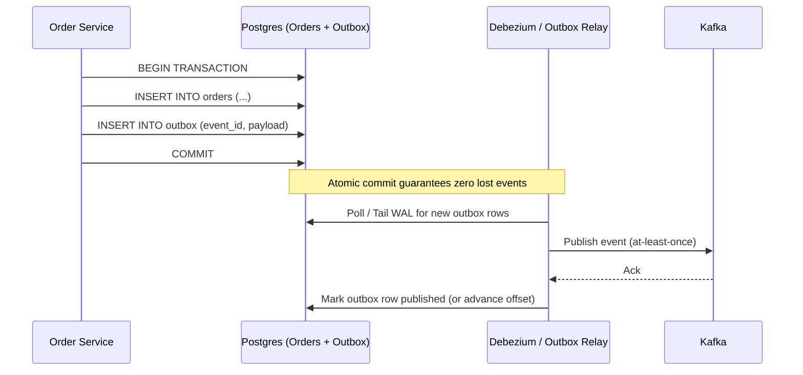
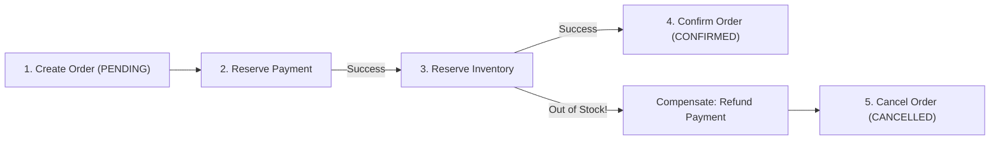

# Revise Caching, Messaging and Consistency: Outbox, Sagas, Idempotency

> **Prerequisites:** [Previous lesson: Revise Database Choices: SQL vs NoSQL, Indexes, Isolation, Sharding](../02-revise-database-choices/README.md).
> **Estimated Reading Time:** 22–28 minutes
> **Target Audience:** Candidates revising how cached, queued and distributed data stays correct, including outbox, sagas and idempotency.

> [!NOTE]
> **In one line:** Caches, queues and distributed writes all trade **freshness and simplicity for speed and scale**; the patterns here are how you keep them correct.

> [!TIP]
> **The Golden Rule:** Assume every message can be delivered twice, every cache can be stale, and every step can fail halfway. Design each operation to be safe to repeat.

---

## 1. Core Concept & Why Interviewers Test It

Once a system outgrows a single database transaction, **distributed state diverges**. Caches go stale, message brokers deliver duplicates, and multi-service workflows fail mid-flight. Interviewers test this module to see if you understand the **physics of asynchronous systems** rather than hand-waving *"we'll just put Kafka and Redis in front of it."*

Strong candidates demonstrate three core reflexes:

1. **Eliminating Dual Writes:** You never write to a database and a message broker in separate network calls without a transactional outbox or CDC relay.
2. **Designing for At-Least-Once Delivery:** You accept that true cross-system exactly-once delivery is impossible; instead, you achieve **exactly-once effect** via at-least-once delivery + idempotent consumers.
3. **Choosing the Right Consistency Model:** You know when to pay for linearizability (payments), when read-your-writes suffices (user profiles), and how Sagas maintain business invariants without 2-Phase Commit (2PC).

---

## 2. Quantitative Foundations & Back-of-the-Envelope Math

### Effective Cache Latency & DB Load Reduction

Let $h \in [0, 1]$ be the cache hit ratio, $T_{\text{cache}}$ the cache latency, and $T_{\text{DB}}$ the database query latency:
$$T_{\text{eff}} = h \cdot T_{\text{cache}} + (1 - h) \cdot T_{\text{DB}}$$
$$\text{DB Load Factor} = 1 - h$$

*Worked Example:* Suppose $T_{\text{cache}} = 0.5\text{ ms}$, $T_{\text{DB}} = 25\text{ ms}$, and incoming read traffic is $50,000\text{ RPS}$:
- At $h = 0.90$ (90% hit rate): $T_{\text{eff}} = 0.9(0.5) + 0.1(25) = 2.95\text{ ms}$, and DB absorbs $5,000\text{ RPS}$.
- At $h = 0.99$ (99% hit rate): $T_{\text{eff}} = 0.99(0.5) + 0.01(25) = 0.745\text{ ms}$, and DB absorbs only **$500\text{ RPS}$** (a **10x reduction** in DB load from a 9% hit-rate improvement!).

### Quorum Consistency Math ($R + W > N$)

In a replicated store with $N$ replicas, write quorum $W$, and read quorum $R$:
$$R + W > N \implies \text{Strong overlap (at least 1 replica has the latest write)}$$
$$R + W \le N \implies \text{Eventual consistency (reads may miss latest write)}$$

*Worked Example:* With $N = 3$ replicas:
- $W = 2, R = 2 \implies 2 + 2 = 4 > 3$: Strong read-after-write consistency; tolerates 1 node failure for both reads and writes.
- $W = 1, R = 1 \implies 1 + 1 = 2 \le 3$: Lowest latency, highest availability, but stale reads are possible.

---

## 3. Decision Matrices & Trade-Off Rules

### Caching Patterns Comparison

| Pattern | How It Works | Best Used When | Primary Risk / Failure Mode |
| :--- | :--- | :--- | :--- |
| **Cache-Aside** | App checks cache; on miss, reads DB and populates cache | General read-heavy workloads | Stale reads; thundering herd on key expiry |
| **Read-Through** | Cache provider loads from DB on miss transparently | Standardizing read logic across services | Cache library couples to DB schema |
| **Write-Through** | App writes to cache and DB synchronously | Reads must immediately see fresh writes | Higher write latency; caches cold/unread keys |
| **Write-Behind (Back)** | App writes to cache; cache flushes to DB asynchronously | Extreme write bursts (metrics, counters) | **Data loss** if cache node crashes before flush |
| **Write-Around** | App writes directly to DB, bypassing cache | Write-heavy logs/blobs rarely read back | First read is always a cache miss |

### Consistency Models & CAP / PACELC

| Consistency Model | Formal Guarantee | Real-World Example |
| :--- | :--- | :--- |
| **Linearizable (Strong)** | Every read sees the most recent completed write globally | Bank account balance, inventory lock |
| **Causal** | Operations that are causally related appear in order to all nodes | Comment reply appears only after parent comment |
| **Read-Your-Writes** | A user always sees their own mutations immediately | User updates bio and refreshes profile |
| **Monotonic Reads** | Once a user sees value $v$, they never see an older value $v'$ | Social feed never jumps backward on refresh |
| **Eventual** | If writes stop, all replicas converge to the same state | Video view counts, likes, search index |

**CAP + PACELC:** During a **Partition (P)**, choose **Consistency (C)** or **Availability (A)**. **Else (E)** during normal operation, choose **Latency (L)** or **Consistency (C)**.

---

## 4. Visual Architecture & Request Flows

### Transactional Outbox Pattern (Eliminating Dual Writes)



### Saga Orchestration & Compensating Transactions



---

## 5. Deep-Dive Pattern 1: Cache Invalidation & Stampede Prevention

Updating a cache value in place (`SET key new_val`) creates a **race condition**: if Request A writes `v1` to DB, Request B writes `v2` to DB, and Request B updates the cache before Request A, the cache is stuck with stale `v1` until TTL expires.

**Best Practices:**
1. **Delete on Write (Invalidate), Don't Update:** After the DB transaction commits, execute `DEL key`. Always attach a **TTL** as a safety net in case the `DEL` call fails.
2. **Prevent Cache Stampedes (Thundering Herd):** When a hot key expires at $10,000\text{ RPS}$, thousands of threads miss simultaneously and slam the DB. Fix with:
   - **Request Coalescing (Singleflight):** Only 1 thread per process/key queries the DB; the other 999 await the same promise/future.
   - **Jittered TTLs:** Add $\pm 15\%$ random jitter to TTLs so keys do not expire in lockstep.
   - **Probabilistic Early Refresh (XFetch):** Refresh slightly before TTL expiry when a single request wins a probability roll.
3. **Cache Penetration Protection:** If attackers query non-existent IDs (`id=-999`), every request misses cache and hits DB. Cache **negative results** (`NULL` sentinel with short 30s TTL) or place a **Bloom Filter** in front of the DB.

---

## 6. Deep-Dive Pattern 2: Transactional Outbox & Idempotent Consumers

**The Dual-Write Trap:**
```text
1. DB.commit(order)      -> SUCCEEDS
2. Kafka.publish(event)  -> FAILS (network blip / pod OOM)
Result: Order exists in DB, but Fulfillment & Email never hear about it!
```
Reversing the order (`Kafka.publish` first, then `DB.commit`) is equally broken: if `DB.commit` fails, downstream services process a **phantom order**.

**The Solution (Outbox + Idempotent Consumer):**
1. **Producer Side (Outbox):** Insert the domain row (`orders`) and an event row (`outbox`) inside the **same local ACID transaction**. A separate relay (polling worker or Debezium CDC tailing the WAL) publishes the outbox row to Kafka with at-least-once delivery.
2. **Consumer Side (Idempotency):** Because the relay may crash after `Kafka.publish` but before marking the outbox row sent, the consumer **will** receive duplicate messages. The consumer stores `event_id` in a `processed_events` table **inside the same DB transaction** as its business update:
   ```sql
   BEGIN;
   INSERT INTO processed_events (event_id) VALUES ($1) ON CONFLICT DO NOTHING;
   -- Check row_count == 1; if 0, duplicate -> COMMIT & return!
   UPDATE accounts SET balance = balance + $2 WHERE id = $3;
   COMMIT;
   ```
   For HTTP APIs, clients pass an `Idempotency-Key` header (UUIDv4), and the server stores `(key, request_hash, response_payload)` in Redis/DB.

---

## 7. Deep-Dive Pattern 3: Sagas, Ordering & Dead-Letter Queues

When a business workflow spans multiple services (Order -> Payment -> Inventory -> Shipping), distributed 2-Phase Commit (2PC) blocks locks across network calls and destroys availability. Instead, use a **Saga**: a sequence of local ACID transactions, each paired with a **compensating transaction** to undo its effect on failure.

- **Choreography:** Services emit events (`OrderCreated` -> Payment listens -> emits `PaymentSucceeded` -> Inventory listens). Low coupling, but hard to debug or add steps beyond 3–4 services.
- **Orchestration:** A central state-machine orchestrator commands each step and triggers compensations in reverse order on failure. Clear observability and timeout handling; preferred for complex/financial flows.

**Ordering & Poison Pills:**
- Kafka guarantees ordering **only within a single partition**, never globally across a topic. Always set the **partition key** to `order_id` or `user_id` so all events for one entity stay ordered.
- **Dead-Letter Queue (DLQ):** If a malformed message fails after $N$ retries with exponential backoff + jitter, move it to a DLQ so it does not block the partition head-of-line forever.

> [!WARNING]
> **The #1 Saga Trap:** Treating a Saga as ACID-isolated. Sagas have **no Isolation (I)**—other users can see intermediate states (`PENDING_PAYMENT`). Design UIs and APIs for intermediate states and make every compensating action **idempotent and retriable**.

---

## 8. How This Scales: 1K vs 100K vs 10M+ Users

| Scale Tier | Caching Topology | Messaging & Consistency | Outbox & Saga Complexity |
| :--- | :--- | :--- | :--- |
| **1K Users** | In-process LRU cache (or small Redis) | Monolith DB transactions; simple background jobs | Single DB ACID; no Saga needed |
| **100K Users** | Managed Redis (Primary + Replica), Cache-aside + TTL jitter | RabbitMQ / SQS / Kafka; at-least-once + idempotency keys | Transactional outbox for critical events |
| **10M+ Users** | Sharded Redis Cluster + CDN edge caching + Singleflight | Multi-partition Kafka (keyed by entity ID) + DLQs + CDC | Orchestrated Sagas (Temporal/Step Functions) |

---

## 9. Failure Modes, Traps & Recovery

| Failure Mode | Root Cause | Impact | Recovery / Mitigation |
| :--- | :--- | :--- | :--- |
| **Cache Stampede** | Hot key expires; 10K requests hit DB at once | DB CPU hits 100%, cascading timeouts | Singleflight coalescing, jittered TTL, early refresh |
| **Dual-Write Divergence** | DB commits, broker publish fails (or vice versa) | Lost orders or phantom charges | Transactional Outbox + CDC relay |
| **Duplicate Charge / Double Apply** | Network timeout triggers client/broker retry | Customer charged twice | `Idempotency-Key` + `processed_events` unique constraint |
| **Poison Pill Blocking Partition** | Unhandled exception on 1 malformed message | Consumer crashes in infinite loop; lag spikes | Bounded retries with backoff -> route to DLQ + alert |
| **Out-of-Order Events** | Publishing to random partitions | `OrderCancelled` processed before `OrderCreated` | Partition by `order_id`; use version/sequence numbers |
| **Redis Eviction Storm** | `maxmemory` hit with `allkeys-lru` on hot working set | Hit rate drops from 99% to 60%, DB melts | Size RAM for working set; monitor `evicted_keys` |

---

## 10. Production War Story & Real-World Reference

### The Black Friday Cache Stampede & Phantom Payment

A ticket-booking platform cached event availability in Redis with a fixed `TTL = 60s`. At 10:00:00 AM, a viral concert went on sale ($40,000\text{ RPS}$). At 10:01:00 AM, the Redis key expired.

**Root Cause:**
1. **Stampede:** All 40,000 RPS missed Redis within the same 50 ms window and fired `SELECT available_seats` at PostgreSQL, saturating all DB connections and crashing the primary.
2. **Dual Write:** Simultaneously, users whose payments succeeded on Stripe timed out before the Order Service could publish `TicketReserved` to RabbitMQ, leaving **312 paid users with no tickets**.

**Fix:**
1. Added **singleflight** request coalescing + jittered TTL (`60s + rand(0, 15s)`) + background refresh, cutting DB queries on expiry from 40,000 to **1 per app pod**.
2. Replaced direct RabbitMQ publishing with a **Transactional Outbox** table polled by Debezium CDC, and enforced an `Idempotency-Key` per checkout attempt. Zero lost or duplicate bookings since.

---

## 11. Executable Reference Tooling (4 Languages)

This reference implementation demonstrates an **Idempotent Event Consumer** backed by an atomic processed-IDs guard, ensuring at-least-once delivery produces an exactly-once state transition.

````carousel
```go
package main

import (
	"fmt"
	"sync"
)

type Event struct {
	ID     string
	Amount int
}

type IdempotentLedger struct {
	mu        sync.Mutex
	balance   int
	processed map[string]bool
}

func NewLedger(initial int) *IdempotentLedger {
	return &IdempotentLedger{balance: initial, processed: make(map[string]bool)}
}

func (l *IdempotentLedger) Handle(e Event) string {
	l.mu.Lock()
	defer l.mu.Unlock()
	if l.processed[e.ID] {
		return "duplicate ignored"
	}
	l.balance += e.Amount
	l.processed[e.ID] = true
	return "applied"
}

func main() {
	ledger := NewLedger(100)
	stream := []Event{{"m1", 50}, {"m1", 50}, {"m2", -20}}
	for _, ev := range stream {
		fmt.Printf("%s -> %s (balance=%d)\n", ev.ID, ledger.Handle(ev), ledger.balance)
	}
}
```
<!-- slide -->
```typescript
interface Event {
  id: string;
  amount: number;
}

class IdempotentLedger {
  private processed = new Set<string>();
  constructor(public balance: number) {}

  handle(ev: Event): string {
    if (this.processed.has(ev.id)) {
      return "duplicate ignored";
    }
    this.balance += ev.amount;
    this.processed.add(ev.id);
    return "applied";
  }
}

const ledger = new IdempotentLedger(100);
const stream: Event[] = [
  { id: "m1", amount: 50 },
  { id: "m1", amount: 50 },
  { id: "m2", amount: -20 },
];
for (const ev of stream) {
  console.log(`${ev.id} -> ${ledger.handle(ev)} (balance=${ledger.balance})`);
}
```
<!-- slide -->
```python
class IdempotentLedger:
    def __init__(self, initial: int = 100):
        self.balance = initial
        self.processed: set[str] = set()

    def handle(self, msg: dict) -> str:
        # In production: commit processed.add and balance update in ONE DB transaction.
        if msg["id"] in self.processed:
            return "duplicate ignored"
        self.balance += msg["amount"]
        self.processed.add(msg["id"])
        return "applied"

if __name__ == "__main__":
    ledger = IdempotentLedger(100)
    stream = [{"id": "m1", "amount": 50}, {"id": "m1", "amount": 50}, {"id": "m2", "amount": -20}]
    results = [ledger.handle(m) for m in stream]
    print("Results:", results)
    print("Final balance:", ledger.balance)  # 130, not 180
```
<!-- slide -->
```csharp
using System;
using System.Collections.Generic;

record Event(string Id, int Amount);

class IdempotentLedger
{
    private readonly HashSet<string> _processed = new();
    public int Balance { get; private set; }

    public IdempotentLedger(int initial) => Balance = initial;

    public string Handle(Event ev)
    {
        if (!_processed.Add(ev.Id)) return "duplicate ignored";
        Balance += ev.Amount;
        return "applied";
    }

    static void Main()
    {
        var ledger = new IdempotentLedger(100);
        var stream = new[] { new Event("m1", 50), new Event("m1", 50), new Event("m2", -20) };
        foreach (var ev in stream)
            Console.WriteLine($"{ev.Id} -> {ledger.Handle(ev)} (balance={ledger.Balance})");
    }
}
```
````

---

## 12. Verification & CLI Diagnostics

```bash
# 1. Inspect Redis cache hit rate and eviction health
redis-cli INFO stats | grep -E "keyspace_hits|keyspace_misses|evicted_keys"

# 2. Check Kafka consumer group lag across partitions
kafka-consumer-groups.sh --bootstrap-server localhost:9092 --describe --group order-fulfillment

# 3. Inspect unpublished transactional outbox backlog in PostgreSQL
psql "$DATABASE_URL" -c "SELECT count(*), min(created_at) FROM outbox WHERE published_at IS NULL;"

# 4. Verify idempotency key behavior with curl
curl -X POST https://api.example.com/v1/payments \
  -H "Idempotency-Key: 9b1deb4d-3b7d-4bad-9bdd-2b0d7b3dcb6d" \
  -H "Content-Type: application/json" -d '{"amount": 5000}'
```

---

## 13. Common Interview Mistakes & Red Flags

| Common Mistake (Red Flag) | Why It Fails | Staff-Level Answer |
| :--- | :--- | :--- |
| Updating Redis in place on DB write | Concurrent writes race and leave stale data | *"Use cache-aside: delete the key after DB commit, with a TTL safety net."* |
| Direct DB write + Kafka publish in code | Dual-write problem loses or duplicates events | *"Write to an outbox table in the same DB transaction; relay via CDC."* |
| Promising *"Kafka gives us exactly-once"* | Does not cover external HTTP/DB side effects | *"We use at-least-once delivery + idempotent consumers for exactly-once effect."* |
| Assuming global ordering across Kafka topic | Ordering only holds within a single partition | *"Partition by `user_id` or `order_id` so entity events stay ordered."* |
| Using 2PC across microservices | Coordinator failure blocks locks and kills availability | *"Use an orchestrated Saga with idempotent compensating transactions."* |
| Fixed TTL on all hot cache keys | Causes synchronized thundering-herd stampede | *"Add ±15% TTL jitter and singleflight request coalescing."* |

---

## 14. Key Terminology & Glossary

| Term | Definition |
| :--- | :--- |
| **Cache-Aside** | Application checks cache first; on miss, reads DB, writes to cache, and returns data. |
| **Cache Stampede** | Thundering herd where many concurrent requests miss an expired hot key and hit the DB simultaneously. |
| **Singleflight** | Request coalescing pattern ensuring only one in-flight DB load runs per key per process. |
| **Dual-Write Problem** | Inconsistency when updating two separate systems (e.g., DB + broker) without an atomic transaction. |
| **Transactional Outbox** | Writing domain data and an outbox event row in the same local ACID transaction, published asynchronously by a relay. |
| **Idempotency** | Property where applying the same operation multiple times yields the exact same state as applying it once. |
| **At-Least-Once Delivery** | Broker retries until acknowledged; zero lost messages, but duplicates can occur. |
| **Saga** | Sequence of local transactions across services where failures trigger compensating undo transactions. |
| **Dead-Letter Queue (DLQ)** | Quarantine queue for poison-pill messages that fail after max retries. |
| **Linearizability** | Strongest single-object consistency: every read sees the latest completed write in real time. |
| **CAP / PACELC** | Under partition choose C or A; else choose Latency or Consistency. |
| **Quorum ($R + W > N$)** | Overlapping read/write replica sets guaranteeing at least one replica holds the latest write. |

---

## 15. Interview Follow-Up Questions (12 Q&As)

### Basic Conceptual Questions

<details>
<summary><strong>Q1: [BASIC] How do you invalidate a cache correctly?</strong></summary>

Delete the key (`DEL`) **after** the database transaction commits (cache-aside), rather than updating the cache value in place. Always set a TTL as a fallback in case the delete call fails.

</details>

<details>
<summary><strong>Q2: [BASIC] What is the dual-write problem?</strong></summary>

Writing to a database and a message broker in two separate network calls can leave them inconsistent if one succeeds and the other fails. Solve it with the **Transactional Outbox** pattern.

</details>

<details>
<summary><strong>Q3: [BASIC] Can you achieve true exactly-once delivery across distributed systems?</strong></summary>

No. Network failures make true exactly-once delivery across independent systems impossible (Two Generals' Problem). Instead, combine **at-least-once delivery** with **idempotent consumers** to achieve **exactly-once effect**.

</details>

<details>
<summary><strong>Q4: [BASIC] How do you guarantee event ordering for a single user or order?</strong></summary>

Use `user_id` or `order_id` as the **partition key**. Kafka guarantees strict FIFO ordering within a single partition, and a consumer group assigns each partition to only one consumer instance at a time.

</details>

### Scenario-Based Architecture Questions

<details>
<summary><strong>Q5: [SCENARIO] Orchestration vs. Choreography for an e-commerce checkout Saga?</strong></summary>

Use **Orchestration** for business-critical flows like checkout (Order -> Payment -> Inventory -> Shipping). It centralizes state transitions, timeouts, and reverse-order compensations, making debugging and retries far easier than Choreography.

</details>

<details>
<summary><strong>Q6: [SCENARIO] A hot celebrity profile key expires in Redis at 20,000 RPS. How do you prevent the DB from crashing?</strong></summary>

Combine **singleflight request coalescing** (only 1 thread queries the DB per pod), **jittered TTLs**, and **stale-while-revalidate** (serve slightly stale cached data while 1 background worker refreshes).

</details>

<details>
<summary><strong>Q7: [SCENARIO] How do you implement idempotency for a `POST /payments` API?</strong></summary>

Require a client-generated `Idempotency-Key` (UUID). Store `(idempotency_key, request_hash, status, response_body)` in the DB/Redis. On repeat: if `IN_PROGRESS`, return `409 Conflict`; if `COMPLETED` with matching hash, return the stored response without re-charging.

</details>

<details>
<summary><strong>Q8: [SCENARIO] A single malformed message is crashing your Kafka consumer in a loop. What do you do?</strong></summary>

Never block a partition infinitely on a poison pill. Retry with exponential backoff up to a small cap (e.g., 3 attempts), then route the message + stack trace to a **Dead-Letter Queue (DLQ)**, commit the offset, and fire an alert.

</details>

### Advanced & Tricky Interview Questions

<details>
<summary><strong>Q9: [TRICKY] Even if you delete the cache key *after* DB commit, can stale data still end up in Redis?</strong></summary>

Yes! A classic race: (1) Reader A misses cache and reads old `v1` from DB; (2) Writer B commits `v2` to DB and deletes cache; (3) Reader A wakes up and writes stale `v1` into Redis. Mitigate with short TTLs, delayed double-delete, or versioned cache keys (`user:42:v17`).

</details>

<details>
<summary><strong>Q10: [TRICKY] In a Saga, what if a compensating transaction itself fails?</strong></summary>

Because compensations are executed *after* a failure, they **must succeed eventually** (the "pivot" rule). Make all compensations idempotent, retry them indefinitely with exponential backoff, and alert human operators via a DLQ if a compensation remains stuck.

</details>

<details>
<summary><strong>Q11: [TRICKY] Polling the `outbox` table every 100 ms adds DB load. How do you eliminate polling?</strong></summary>

Use **Transaction Log Tailing (CDC)** with Debezium: it reads PostgreSQL's WAL (or MySQL's binlog) asynchronously with near-zero query overhead on the primary database, streaming outbox inserts straight to Kafka.

</details>

<details>
<summary><strong>Q12: [TRICKY] What does PACELC say about DynamoDB or Cassandra even when there is NO network partition?</strong></summary>

CAP only talks about partitions, but PACELC reminds us that in normal operation (`E`), a replicated store must still trade **Latency vs. Consistency**: waiting for a quorum ($W=2, R=2$) adds cross-AZ latency compared to $W=1, R=1$.

</details>

---

## 16. One-Page Master Cheat Sheet

```text
+-----------------------------------------------------------------------------+
|           CACHING, MESSAGING & CONSISTENCY: ONE-PAGE CHEAT SHEET            |
+-----------------------------------------------------------------------------+
| CACHING                                                                     |
|   Cache-Aside + Delete on Write + TTL + Jitter + Singleflight Coalescing    |
|   Hit Rate Math: T_eff = h*T_cache + (1-h)*T_db  (90%->99% = 10x less DB)   |
|                                                                             |
| MESSAGING & DUAL WRITES                                                     |
|   Never Dual-Write! Use Transactional Outbox (same DB tx) + CDC Relay       |
|   Delivery: At-Least-Once + Idempotent Consumer (processed_events table)    |
|   Ordering: Per Partition Key only; Poison Pills -> bounded retry -> DLQ    |
|                                                                             |
| DISTRIBUTED TRANSACTIONS & CONSISTENCY                                      |
|   Saga: Local TXs + Idempotent Compensations (Orchestration > Choreography) |
|   Quorum: R + W > N (Strong)  |  CAP: P -> C or A  |  PACELC: E -> L or C   |
+-----------------------------------------------------------------------------+
```

| Pattern | When to Reach For It |
| :--- | :--- |
| **Transactional Outbox** | Any time a DB write must trigger an event or downstream service |
| **Idempotency Key** | Any retried mutation (payments, bookings, webhooks, queue consumers) |
| **Orchestrated Saga** | Multi-service workflows (>2 steps) requiring rollback on failure |

---

## Further Reading

- Chris Richardson, *Microservices Patterns*, Chapters 3, 4, and 6 (Sagas and Transactional Outbox).
- Kyle Kingsbury, *Jepsen* analyses (how real distributed databases fail consistency claims).
- Martin Kleppmann, *Designing Data-Intensive Applications*, Chapters 7 and 9.

---

## Next

Continue with [Revise Reliability and Security Patterns: Breakers, DR, RTO/RPO, OAuth](../04-revise-reliability-and-security-patterns/README.md).
