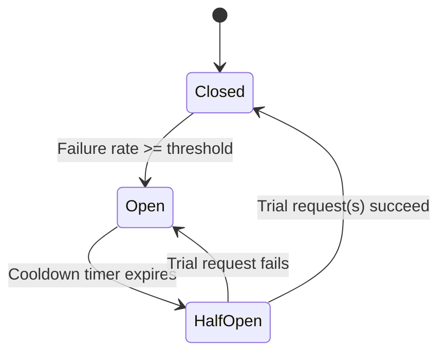
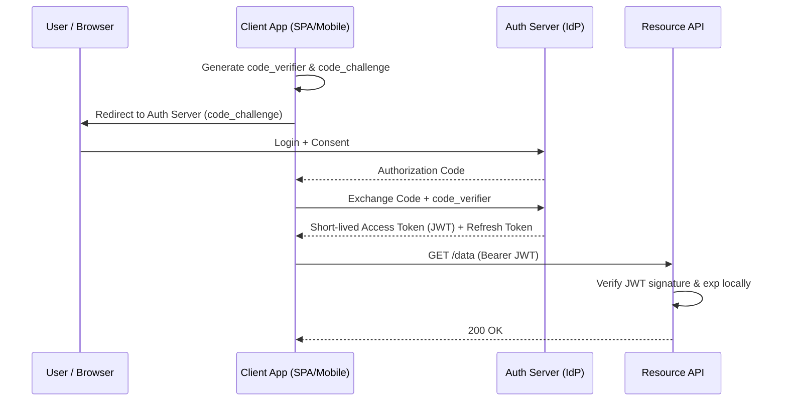

# Revise Reliability and Security Patterns: Breakers, DR, RTO/RPO, OAuth

> **Prerequisites:** [Previous lesson: Revise Caching, Messaging and Consistency: Outbox, Sagas, Idempotency](../03-revise-caching-messaging-and-consistency/README.md).
> **Estimated Reading Time:** 22–28 minutes
> **Target Audience:** Candidates revising circuit breakers, retries, disaster recovery and the security basics interviewers expect.

> [!NOTE]
> **In one line:** Reliability is **designing for failure you know will happen**; security is **making the failure of one control not the failure of the system**.

> [!TIP]
> **The Golden Rule:** Bound every wait, cap every retry, isolate every failure, and give every credential the least power it needs.

---

## 1. Core Concept & Why Interviewers Test It

A system that works at 200 RPS in a happy-path diagram will still suffer catastrophic outages in production if it lacks **overload protection, failure isolation, disaster recovery, and defense-in-depth security**. Interviewers test these patterns to separate engineers who design *toy diagrams* from Staff engineers who design *survivable production systems*.

Three signals interviewers look for:

1. **Blast-Radius Containment:** You never let a slow downstream dependency exhaust caller thread pools (timeouts, bulkheads, circuit breakers, load shedding).
2. **Quantified Recovery:** You express Disaster Recovery (DR) in concrete **RPO** (data loss) and **RTO** (downtime) budgets, and match them to the right topology cost.
3. **Practical Security:** You distinguish AuthN vs. AuthZ, know why OAuth 2.0 uses Authorization Code + PKCE, understand JWT revocation trade-offs, and enforce least privilege.

---

## 2. Quantitative Foundations & Back-of-the-Envelope Math

### Retry Storm Amplification

If a request traverses $k$ synchronous service layers, and each layer retries $r$ times on failure (total $1 + r$ attempts per layer):
$$\text{Worst-Case Load Multiplier } M = (1 + r)^k$$

*Worked Example:* A 3-layer chain (`Gateway -> Order -> Inventory -> DB`) where each layer retries $3$ times ($1 + 3 = 4$ attempts):
$$M = 4^3 = 64\times\text{ normal traffic!}$$
Even 3 total attempts per layer ($1 + 2 = 3$) yields $3^3 = 27\times$ traffic, instantly crushing a recovering database. **Rule:** Retry at **one layer only** (usually the edge/caller) and enforce a **Retry Budget** (retries $\le 10\%$ of total requests).

### Error Budget & SLO Math

$$\text{Error Budget} = (1 - \text{SLO}) \times T_{\text{window}}$$

*Worked Example:* Over a 30-day month ($43,200\text{ minutes}$):
- At **99.9% SLO:** Error budget = $0.001 \times 43,200 = 43.2\text{ minutes}$ of downtime (or $0.1\%$ failed requests: 1,000 failures per 1M requests).
- At **99.99% SLO:** Error budget = $0.0001 \times 43,200 = 4.32\text{ minutes}$. If a bad deploy burns 4 minutes in day 2, feature releases freeze until reliability stabilizes.

### Exponential Backoff with Full Jitter

$$\text{sleep} = \text{random}\left(0,\; \min\left(T_{\max},\; T_{\text{base}} \cdot 2^{\text{attempt}}\right)\right)$$
Full jitter spreads synchronized client retries uniformly across the backoff window, preventing thundering-herd spikes at $t = 1\text{ s}, 2\text{ s}, 4\text{ s}$.

---

## 3. Decision Matrices & Trade-Off Rules

### Resilience Patterns Matrix

| Pattern | Problem Solved | Key Configuration Detail | Common Pitfall |
| :--- | :--- | :--- | :--- |
| **Timeout** | Hanging sockets exhaust threads | Set $<$ caller's remaining deadline | Retrying after deadline already expired |
| **Retry + Backoff + Jitter** | Transient blips (503, network reset) | Cap attempts (2–3); idempotent calls only | Retrying without jitter or retry budget |
| **Circuit Breaker** | Hammering a dead dependency | Closed -> Open -> Half-Open; fail fast | Tripping on 4xx client errors instead of 5xx |
| **Bulkhead** | One slow tenant/API starves all others | Separate thread/connection pools per dependency | Sizing pools too small (false rejections) |
| **Load Shedding** | Total traffic exceeds server capacity | Drop low-priority requests early (HTTP 503) | Queuing unboundedly until OOM |
| **Rate Limiting** | Abuse, noisy neighbors, DDoS | Token bucket (bursts) or sliding window | Rate-limiting health checks or internal retries |
| **Graceful Degradation** | Dependency outage | Serve stale cache, default ranking, or read-only | Failing entire page when recommendations die |

### Disaster Recovery (DR) Strategy Matrix

| Strategy | RPO (Data Loss) | RTO (Downtime) | Relative Cost | Architecture |
| :--- | :--- | :--- | :--- | :--- |
| **Backup & Restore** | Hours | Hours to 1 day | `$` (Lowest) | Periodic snapshots to S3; provision infra on disaster |
| **Pilot Light** | Minutes | 10–30 minutes | `$$` (Low) | DB replicates continuously; compute scaled to 0 until failover |
| **Warm Standby** | Seconds–Minutes | Minutes | `$$$` (Medium) | Scaled-down copy running live; scale up + DNS switch |
| **Active-Active Multi-Region** | Near Zero | Near Zero | `$$$$` (Highest) | Both regions serve live traffic; conflict resolution needed |

---

## 4. Visual Architecture & Request Flows

### Circuit Breaker State Machine



### OAuth 2.0 Authorization Code + PKCE Flow



---

## 5. Deep-Dive Pattern 1: Timeouts, Deadline Propagation & Retry Budgets

Every RPC must carry an explicit **deadline** (e.g., `gRPC deadline` or `X-Request-Deadline`). If the API Gateway has a 500 ms budget and spends 300 ms in Auth + Service A, Service A must pass only the **remaining 200 ms** to Service B. Without deadline propagation, Service B keeps running expensive DB queries long after the client has already timed out.

**Retry Rules:**
1. **Idempotent Methods Only:** Never blindly retry `POST /charge` unless it carries an `Idempotency-Key`. Safe to retry: `GET`, `PUT`, `DELETE`, or keyed `POST`.
2. **Retry Budgets:** Track `(retries / total_requests)` over a sliding 10-second window. If retries exceed 10%, fail fast instead of amplifying an outage.
3. **Never Retry 4xx:** Only retry transient errors (`429`, `502`, `503`, `504`, socket timeouts), never `400`/`401`/`403`/`404`.

---

## 6. Deep-Dive Pattern 2: Circuit Breakers, Bulkheads & Load Shedding

- **Circuit Breaker:** Monitors failure rate (or slow-call rate) over a rolling window. When failures exceed e.g. 50% (with minimum 20 requests), it transitions **Closed -> Open**, returning immediate fallback/errors for `cooldown` seconds (e.g., 15 s) so the downstream service can recover. After cooldown, **Half-Open** allows 1–3 probe requests; success closes the breaker, failure re-opens it.
- **Bulkhead Isolation:** Partition connection pools and worker threads by dependency or tenant tier. If the Recommendations service hangs, only its 10-thread bulkhead fills up—the Checkout service's 100-thread pool remains 100% healthy.
- **Load Shedding (LIFO + Priority):** When queue depth exceeds capacity, drop excess requests at the edge (`503 Service Unavailable` + `Retry-After`) rather than letting every request time out. Serving 80% of traffic cleanly beats serving 0% at 30-second latency.

> [!WARNING]
> **The #1 Resilience Trap:** Setting a 30-second HTTP client timeout with 3 retries inside a synchronous endpoint. One dead dependency ties up worker threads for $4 \times 30\text{ s} = 120\text{ s}$, causing total server exhaustion in seconds.

---

## 7. Deep-Dive Pattern 3: DR (RTO/RPO) & Security Defense-in-Depth

**Disaster Recovery:**
- **RPO** dictates your **replication mode**: synchronous cross-AZ replication gives $\text{RPO} = 0$; asynchronous cross-region replication gives $\text{RPO} \approx \text{seconds–minutes}$.
- **RTO** dictates your **standby state** and **automation**: DNS TTLs (set $\le 60\text{ s}$), automated DB promotion, and regular **GameDay failover drills** (untested backups are not backups).

**Security Essentials:**
1. **OAuth 2.0 vs. OIDC:** OAuth 2.0 is **delegated authorization** (Access Token); OpenID Connect (OIDC) adds **authentication** (ID Token). Always use **Authorization Code + PKCE** for public clients (SPAs/mobile) to prevent authorization-code interception.
2. **JWT Revocation:** Stateless JWTs cannot be revoked before `exp` without state. Keep Access Tokens short-lived (**5–15 minutes**) paired with revocable Refresh Tokens, and use a small Redis **denylist** (or `token_version` check) only for urgent logouts/compromises.
3. **Defense-in-Depth:** TLS 1.3 in transit, KMS-managed envelope encryption at rest, secrets in a Vault (never in Git/env images), parameterized SQL queries, CSRF tokens / `SameSite` cookies, and WAF/rate limiting.

---

## 8. How This Scales: 1K vs 100K vs 10M+ Users

| Scale Tier | Resilience & Traffic Control | Disaster Recovery (DR) | Security & Observability |
| :--- | :--- | :--- | :--- |
| **1K Users** | Sensible HTTP timeouts + basic rate limit | Daily automated DB snapshots (`RPO=24h, RTO=4h`) | HTTPS, hashed passwords, secrets in cloud SSM/Vault, basic logs |
| **100K Users** | Retries w/ jitter, circuit breakers, Redis rate limiter | Multi-AZ DB (`RPO=0, RTO=2m`) + cross-region backups | OAuth2/OIDC, short JWTs, Prometheus RED metrics + SLO alerts |
| **10M+ Users** | Edge load shedding, per-tenant bulkheads, adaptive concurrency | Warm standby or Active-Active multi-region (`RPO<1m, RTO<5m`) | mTLS service mesh, KMS key rotation, distributed tracing (OTel) |

---

## 9. Failure Modes, Traps & Recovery

| Failure Mode | Root Cause | Impact | Recovery / Mitigation |
| :--- | :--- | :--- | :--- |
| **Retry Storm** | Multi-layer retries without jitter or budget | $27\times$–$64\times$ load crushes recovering DB | Retry at edge only; full jitter; 10% retry budget |
| **Thread Pool Exhaustion** | Slow dependency + no timeout/bulkhead | Entire API server hangs (502/504) | Strict timeouts (<500 ms), bulkheads, circuit breakers |
| **Split-Brain Failover** | Old primary still accepts writes after promotion | Silent data divergence / corruption | Fencing tokens, STONITH, automated DNS/VIP cutover |
| **Untested DR Backup** | Corrupted snapshot or missing IAM/KMS key in DR region | 4-hour RTO turns into 3-day outage | Automated monthly DR restore & GameDay chaos drills |
| **Leaked Long-Lived JWT** | `exp = 30 days` with no revocation mechanism | Attacker retains full access for a month | 5–15 min access tokens + refresh rotation + Redis denylist |
| **Alert Fatigue** | Paging on CPU/disk instead of user symptoms | Engineers ignore real outages | Page on **SLO burn rate** (error rate / p99 latency) |

---

## 10. Production War Story & Real-World Reference

### The 27x Retry Storm & Thread-Pool Collapse

A payment-processing API handled 4,000 RPS with a 99.95% SLO. A minor network blip caused their fraud-scoring service to stall for 12 seconds.

**Root Cause:**
1. The API Gateway retried 3 times, the Order Service retried 3 times, and the Fraud Client retried 3 times ($3^3 = 27\times$ amplification -> **108,000 RPS**).
2. The Fraud Client had a 10-second timeout and shared the same thread pool as `/health` and `/checkout`. Within 15 seconds, all pods failed Kubernetes liveness probes and entered a crash-loop.

**Fix:**
1. Removed retries from internal layers (retried at edge only with full jitter + 10% retry budget).
2. Added a **Circuit Breaker** (50% error threshold, 10 s cooldown) and **Bulkhead** around Fraud Scoring, falling back to rule-based local checks when open.
3. Separated `/health` onto its own lightweight handler. Subsequent Fraud outages degraded gracefully with **zero** checkout downtime.

---

## 11. Executable Reference Tooling (4 Languages)

This tooling implements a **Circuit Breaker State Machine** combined with a **Token Bucket Rate Limiter**—two core building blocks of production resilience.

````carousel
```go
package main

import (
	"errors"
	"fmt"
)

type State string

const (
	Closed   State = "closed"
	Open     State = "open"
	HalfOpen State = "half-open"
)

type Breaker struct {
	threshold int
	cooldown  int
	failures  int
	openedAt  int
	state     State
}

func NewBreaker(threshold, cooldown int) *Breaker {
	return &Breaker{threshold: threshold, cooldown: cooldown, state: Closed}
}

func (b *Breaker) Call(now int, fn func() (string, error)) string {
	if b.state == Open {
		if now-b.openedAt < b.cooldown {
			return "fast-fail"
		}
		b.state = HalfOpen
	}
	res, err := fn()
	if err != nil {
		b.failures++
		if b.state == HalfOpen || b.failures >= b.threshold {
			b.state, b.openedAt = Open, now
		}
		return "error"
	}
	b.failures, b.state = 0, Closed
	return res
}

func main() {
	b := NewBreaker(3, 10)
	bad := func() (string, error) { return "", errors.New("down") }
	good := func() (string, error) { return "ok", nil }
	for t := 0; t < 5; t++ {
		fmt.Println(t, b.Call(t, bad), b.state)
	}
	fmt.Println(5, b.Call(5, good), b.state)
	fmt.Println(20, b.Call(20, good), b.state)
}
```
<!-- slide -->
```typescript
type State = "closed" | "open" | "half-open";

class CircuitBreaker {
  private failures = 0;
  private openedAt: number | null = null;
  public state: State = "closed";

  constructor(private threshold = 3, private cooldown = 10) {}

  call(fn: () => string, now: number): string {
    if (this.state === "open") {
      if (this.openedAt !== null && now - this.openedAt < this.cooldown) {
        return "fast-fail";
      }
      this.state = "half-open";
    }
    try {
      const res = fn();
      this.failures = 0;
      this.state = "closed";
      return res;
    } catch {
      this.failures++;
      if (this.state === "half-open" || this.failures >= this.threshold) {
        this.state = "open";
        this.openedAt = now;
      }
      return "error";
    }
  }
}

const b = new CircuitBreaker();
const bad = () => { throw new Error("down"); };
const good = () => "ok";
console.log([0, 1, 2, 3, 4].map((t) => b.call(bad, t)));
console.log(b.call(good, 5), b.state);
console.log(b.call(good, 20), b.state);
```
<!-- slide -->
```python
class Breaker:
    def __init__(self, threshold: int = 3, cooldown: int = 10):
        self.threshold, self.cooldown = threshold, cooldown
        self.failures, self.opened_at, self.state = 0, None, "closed"

    def call(self, fn, now: int) -> str:
        if self.state == "open":
            if now - self.opened_at < self.cooldown:
                return "fast-fail"
            self.state = "half-open"
        try:
            result = fn()
        except Exception:
            self.failures += 1
            if self.state == "half-open" or self.failures >= self.threshold:
                self.state, self.opened_at = "open", now
            return "error"
        self.failures, self.state = 0, "closed"
        return result

class TokenBucket:
    def __init__(self, capacity: float, refill_per_sec: float):
        self.capacity, self.rate = capacity, refill_per_sec
        self.tokens, self.last = capacity, 0.0

    def allow(self, now: float) -> bool:
        self.tokens = min(self.capacity, self.tokens + (now - self.last) * self.rate)
        self.last = now
        if self.tokens >= 1.0:
            self.tokens -= 1.0
            return True
        return False

if __name__ == "__main__":
    def bad(): raise RuntimeError("down")
    def good(): return "ok"
    b = Breaker()
    print([b.call(bad, t) for t in range(5)])
    print(b.call(good, 5), b.state)
    print(b.call(good, 20), b.state)
```
<!-- slide -->
```csharp
using System;

class CircuitBreaker
{
    private readonly int _threshold, _cooldown;
    private int _failures, _openedAt;
    public string State { get; private set; } = "closed";

    public CircuitBreaker(int threshold = 3, int cooldown = 10)
    {
        _threshold = threshold;
        _cooldown = cooldown;
    }

    public string Call(Func<string> fn, int now)
    {
        if (State == "open")
        {
            if (now - _openedAt < _cooldown) return "fast-fail";
            State = "half-open";
        }
        try
        {
            var res = fn();
            _failures = 0;
            State = "closed";
            return res;
        }
        catch
        {
            _failures++;
            if (State == "half-open" || _failures >= _threshold)
            {
                State = "open";
                _openedAt = now;
            }
            return "error";
        }
    }

    static void Main()
    {
        var b = new CircuitBreaker();
        Func<string> bad = () => throw new Exception("down");
        Func<string> good = () => "ok";
        for (int t = 0; t < 5; t++) Console.WriteLine($"{t}: {b.Call(bad, t)} ({b.State})");
        Console.WriteLine($"5: {b.Call(good, 5)} ({b.State})");
        Console.WriteLine($"20: {b.Call(good, 20)} ({b.State})");
    }
}
```
````

---

## 12. Verification & CLI Diagnostics

```bash
# 1. Decode a JWT header and payload locally (without trusting unverified claims)
python3 -c '
import base64, json, sys
tok = sys.argv[1].split(".")[1]
tok += "=" * (-len(tok) % 4)
print(json.dumps(json.loads(base64.urlsafe_b64decode(tok)), indent=2))
' "<JWT_TOKEN>"

# 2. Verify TLS certificate chain, protocol version, and expiry
openssl s_client -connect example.com:443 -servername example.com </dev/null 2>/dev/null | openssl x509 -noout -dates -subject

# 3. Test rate-limiting / 429 behavior with concurrent bursts
seq 1 20 | xargs -P 10 -I {} curl -s -o /dev/null -w "%{http_code}\n" https://api.example.com/health | sort | uniq -c

# 4. Calculate monthly error budget in minutes for a given SLO
python3 -c 'slo=0.9995; print(f"Error budget: {(1-slo)*30*24*60:.2f} min/month")'
```

---

## 13. Common Interview Mistakes & Red Flags

| Common Mistake (Red Flag) | Why It Fails | Staff-Level Answer |
| :--- | :--- | :--- |
| Retrying without backoff, jitter, or cap | Triggers synchronized retry storms | *"Retry idempotent calls at 1 layer with exponential backoff, full jitter, and a 10% budget."* |
| Mixing up RPO and RTO | Confuses data loss with downtime | *"RPO is max acceptable data loss (time); RTO is max acceptable recovery time."* |
| Claiming *"we have backups"* without drills | Untested backups frequently fail to restore | *"We automate DR failover and run quarterly GameDay restore drills."* |
| Using OAuth Implicit Flow or long-lived JWTs | Tokens leak in URLs / cannot be revoked | *"Use Auth Code + PKCE, 5–15 min JWTs, and rotating refresh tokens."* |
| Putting secrets in env vars/Docker images | Exposed in image layers and process dumps | *"Inject secrets at runtime from Vault/KMS with short-lived IAM roles."* |
| Alerting on every CPU spike | Causes alert fatigue; misses real outages | *"Alert on user-facing symptom SLOs (error-budget burn rate and p99)."* |

---

## 14. Key Terminology & Glossary

| Term | Definition |
| :--- | :--- |
| **Timeout** | Upper bound on how long a caller waits for a dependency before aborting. |
| **Retry Budget** | Cap (e.g., 10% of total traffic) on extra retry requests to prevent retry storms. |
| **Circuit Breaker** | State machine (Closed/Open/Half-Open) that fails fast when a dependency is unhealthy. |
| **Bulkhead** | Isolating thread/connection pools per dependency so one failure cannot sink the whole process. |
| **Load Shedding** | Intentionally rejecting excess low-priority requests early (`503`) to protect core capacity. |
| **RPO (Recovery Point Objective)** | Maximum acceptable data loss measured in time (e.g., 5 minutes of transactions). |
| **RTO (Recovery Time Objective)** | Maximum acceptable downtime before service is restored. |
| **OAuth 2.0 + PKCE** | Delegated authorization flow using a cryptographic code verifier to protect public clients. |
| **OIDC (OpenID Connect)** | Identity layer built on OAuth 2.0 that issues a signed ID Token. |
| **SLI / SLO** | Service Level Indicator (measured metric) and Service Level Objective (target threshold). |
| **Error Budget** | Allowed unreliability ($1 - \text{SLO}$) over a window; governs release velocity vs. stability work. |
| **Defense in Depth** | Layering independent security controls (WAF, TLS, AuthZ, KMS, audit logs) so one breach isn't fatal. |

---

## 15. Interview Follow-Up Questions (12 Q&As)

### Basic Conceptual Questions

<details>
<summary><strong>Q1: [BASIC] How do you prevent a retry storm?</strong></summary>

Use **exponential backoff with full jitter**, cap attempts at 2–3, retry **only idempotent operations** at **one layer**, and enforce a **retry budget** (e.g., max 10% extra traffic).

</details>

<details>
<summary><strong>Q2: [BASIC] Explain RTO and RPO with an example.</strong></summary>

**RPO** is how much data you can afford to lose (e.g., RPO = 5 min means replication/backups cannot lag more than 5 minutes). **RTO** is how long you can be down (e.g., RTO = 15 min means automated failover must finish within 15 minutes).

</details>

<details>
<summary><strong>Q3: [BASIC] What does a circuit breaker do, and what are its 3 states?</strong></summary>

It prevents cascading failures by stopping calls to an unhealthy dependency. **Closed** (normal traffic), **Open** (fail fast/fallback during cooldown), and **Half-Open** (allow a few probe requests to test recovery).

</details>

<details>
<summary><strong>Q4: [BASIC] OAuth 2.0 vs. OpenID Connect (OIDC)?</strong></summary>

**OAuth 2.0** handles **authorization** (delegating access to an API via an Access Token). **OIDC** sits on top of OAuth 2.0 to provide **authentication** (verifying who the user is via an ID Token).

</details>

### Scenario-Based Architecture Questions

<details>
<summary><strong>Q5: [SCENARIO] How do you revoke a compromised JWT immediately?</strong></summary>

Keep Access Tokens short-lived (5–15 min) + Refresh Tokens in a revocable DB. For immediate revocation, store revoked `jti` (token IDs) in a **Redis denylist** (with TTL = remaining token lifetime) or increment a `token_version` per user.

</details>

<details>
<summary><strong>Q6: [SCENARIO] A non-critical Recommendations service starts timing out at 5 seconds. How do you protect Checkout?</strong></summary>

Wrap Recommendations in a **tight timeout** (e.g., 150 ms), a dedicated **bulkhead** (small thread/connection pool), and a **circuit breaker** that falls back to cached/default popular items so Checkout stays fast and unaffected.

</details>

<details>
<summary><strong>Q7: [SCENARIO] Your CTO wants RPO = 0 and RTO < 1 minute across two continents. What do you say?</strong></summary>

Explain the **speed-of-light trade-off**: synchronous cross-continent replication (`RPO = 0`) adds 100–150 ms to every single write. Propose **Multi-AZ** (`RPO = 0`) within a region for 99.99%, or **async cross-region warm standby** (`RPO ~ seconds, RTO ~ 1–2 min`) unless they want to pay for Active-Active with conflict resolution.

</details>

<details>
<summary><strong>Q8: [SCENARIO] What are SLIs, SLOs, and Error Budgets, and how do teams use them?</strong></summary>

**SLIs** are the measurements (e.g., % of requests $< 200\text{ ms}$), **SLOs** are the targets (e.g., $99.9\%$), and the **Error Budget** ($0.1\%$) is the allowed failure quota. If a team burns its budget early, new feature launches pause in favor of reliability fixes.

</details>

### Advanced & Tricky Interview Questions

<details>
<summary><strong>Q9: [TRICKY] Why can't you rely on a token bucket rate limiter in local app memory across 50 pods?</strong></summary>

Each pod only sees $1/50$th of the user's requests, allowing $50\times$ the intended rate limit (and uneven enforcement). Use a centralized **Redis Lua script** (atomic check-and-decrement) at the API Gateway, or sync counts periodically with gossip/local approximation for extreme scale.

</details>

<details>
<summary><strong>Q10: [TRICKY] Why is deadline propagation critical in a microservice call graph?</strong></summary>

Without deadline propagation, if the gateway times out at 500 ms, downstream services D and E continue executing expensive queries for orphaned requests—wasting CPU/DB IOPS and worsening overload. Propagate `remaining_deadline` so downstream aborts immediately when time expires.

</details>

<details>
<summary><strong>Q11: [TRICKY] What is a "fencing token" and why does DR failover need it?</strong></summary>

During network partitions or slow GC pauses, a demoted primary database or lock holder might wake up and issue stale writes. A **fencing token** is a monotonically increasing epoch number checked by storage—any write with an older epoch is rejected, preventing split-brain corruption.

</details>

<details>
<summary><strong>Q12: [TRICKY] Why should you alert on "SLO burn rate" instead of raw error rate?</strong></summary>

A fixed $1\%$ error threshold either misses slow burns or pages constantly on 10-second blips. **Multi-window burn-rate alerts** (e.g., burning $2\%$ of a 30-day budget in 1 hour) catch real user-impacting incidents fast while eliminating noisy false-positive pages.

</details>

---

## 16. One-Page Master Cheat Sheet

```text
+-----------------------------------------------------------------------------+
|           RELIABILITY & SECURITY PATTERNS: ONE-PAGE CHEAT SHEET             |
+-----------------------------------------------------------------------------+
| RESILIENCE STACK                                                            |
|   Timeout (< caller deadline) -> Retry (1 layer, idempotent, jitter, 10%)   |
|   -> Circuit Breaker (Closed/Open/Half-Open) -> Bulkhead -> Load Shedding   |
|   Retry Storm Math: (1 + r)^k  (3 retries across 3 layers = 64x traffic!)   |
|                                                                             |
| DISASTER RECOVERY                                                           |
|   RPO = Max Data Loss  |  RTO = Max Downtime                                |
|   Backup ($) -> Pilot Light ($$) -> Warm Standby ($$$) -> Active-Active     |
|                                                                             |
| SECURITY & OBSERVABILITY                                                    |
|   OAuth 2.0 (AuthZ) + OIDC (AuthN) + Auth Code w/ PKCE; short JWT + denylist|
|   TLS in transit, KMS at rest, Vault secrets, least privilege, SLO burn rate|
+-----------------------------------------------------------------------------+
```

| Principle | Remember |
| :--- | :--- |
| **Graceful Degradation** | Serve cached/default data instead of crashing the whole page |
| **DR Reality** | Untested backups are not backups; rehearse failover regularly |
| **Observability** | Metrics (RED), Logs (structured + trace_id), Traces (distributed) |

---

## Further Reading

- Google SRE Book, Chapters on *Handling Overload*, *Addressing Cascading Failures*, and *Embracing Risk*.
- OWASP Cheat Sheet Series: *Authentication*, *Session Management*, and *OAuth 2.0*.
- Marc Brooker, *Timeouts, Retries, and Backoff with Jitter* (AWS Builders' Library).

---

## Next

Continue with [Revise GenAI System Design: RAG, Evaluation, Guardrails and Cost](../05-revise-genai-system-design/README.md).
