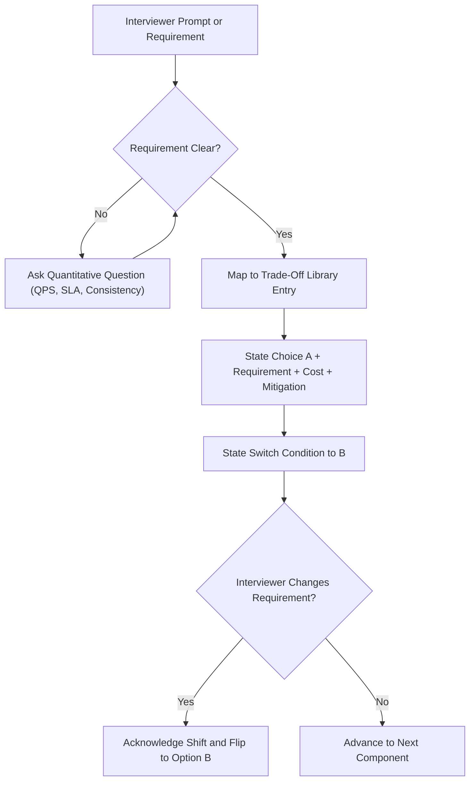
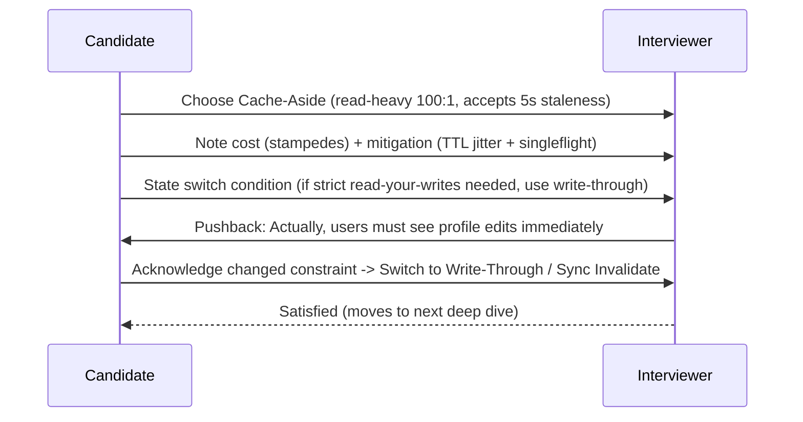

# Build a Trade-off Library for System Design Interviews

> **Prerequisites:** [Previous lesson: Revise GenAI System Design: RAG, Evaluation, Guardrails and Cost](../05-revise-genai-system-design/README.md).
> **Estimated Reading Time:** 22–28 minutes
> **Target Audience:** Candidates who can name options but struggle to defend a choice under questioning.

> [!NOTE]
> **In one line:** A trade-off library is **a personal list of decisions written as: what you gain, what you pay, and when you pick each side**.

> [!TIP]
> **The Golden Rule:** Never say 'X is better'. Say 'X is better **when** this condition holds, and it costs this'. The condition is the answer.

---

## 1. Core Concept & Why Interviewers Test It

Junior and mid-level candidates treat system design as a checklist of "best" technologies: *always use Kafka, always use Redis, always use microservices*. Senior and staff candidates know that **every architectural choice is a transfer of complexity or cost from one dimension to another**. A trade-off library externalizes those decision boundaries into structured, reusable rules so you can articulate them fluently under a 45-minute clock.

### The Canonical Sentence Template

Use one fixed grammatical shape so it comes out fluently under pressure:

> **"I would choose [A] over [B] because [requirement]. It costs [downside], which I accept because [reason]. If [condition changes], I would switch to [B]."**

**Concrete Example:** *"I would choose a cache-aside Redis layer over write-through because reads are 100 times writes and a few seconds of staleness is acceptable. It costs possible stale reads and stampedes on expiry, which I handle with TTL jitter and singleflight coalescing. If we needed strict read-after-write consistency on every update, I would invalidate synchronously on write or move to write-through."*

| Trade-Off Element | What Weak Candidates Say | What Staff-Level Candidates Say |
| :--- | :--- | :--- |
| **Option Selection** | "I'll use Cassandra because it scales." | "I'll use Cassandra over Postgres because we have 80K write QPS of time-ordered events with key-range access." |
| **Explicit Cost** | *(Silence or "no real downsides")* | "It costs cross-partition joins, secondary index efficiency, and eventual consistency by default." |
| **Mitigation** | *(None)* | "We accept that by denormalizing read views and using `LOCAL_QUORUM` for critical reads." |
| **Switch Condition** | *(Defends by repeating "Cassandra scales")* | "If we needed multi-row ACID transactions across entities, I would switch to CockroachDB or sharded Postgres." |

### Why It Matters in Interviews

1. **Demonstrates Seniority Before Being Prompted:** Proactively stating the downside of your own choice signals that you have operated systems in production (see [Evaluating Trade-offs Aloud](../../21-interview-framework/11-evaluating-trade-offs-aloud-in-system-design-interviews/README.md)).
2. **Defuses Follow-Up Curveballs:** When an interviewer asks *"What if traffic is 10x?"* or *"What if stale reads are illegal here?"*, they are testing whether you know the **switch condition** that flips your decision.
3. **Eliminates Decision Paralysis:** Instead of burning 4 minutes debating SQL vs. NoSQL mid-interview, you map the stated requirement to your pre-built condition and move forward in 15 seconds.

---

## 2. Quantitative Foundations & Time/Capacity Math

Good trade-offs are anchored in **numbers**, not adjectives. Rather than saying *"write-heavy"* or *"high latency"*, use quantitative thresholds to decide when Option A flips to Option B.

### Quantitative Switch Thresholds

1. **Read-to-Write Ratio ($R/W$) for Caching:**
   Let $C_{\text{db}}$ be DB read latency (e.g., 10 ms) and $C_{\text{cache}}$ be cache read latency (e.g., 1 ms), with cache hit rate $h \in [0, 1]$. For write-through, every write pays $T_{\text{db}} + T_{\text{cache}}$ synchronously. Effective average read+write latency per operation pair:

$$L_{\text{cache-aside}} = \frac{R}{R+W} \left( C_{\text{cache}} + (1 - h) C_{\text{db}} \right) + \frac{W}{R+W} C_{\text{db}}$$

$$L_{\text{write-through}} = \frac{R}{R+W} C_{\text{cache}} + \frac{W}{R+W} (C_{\text{db}} + C_{\text{cache}})$$

2. **Push vs. Pull Fan-Out Amplification ($F$):**
   For a user with $F$ followers posting at rate $\lambda_p$ posts/sec, and followers reading feeds at $\lambda_r$ reads/sec:

$$\text{Writes}_{\text{push}} = \lambda_p \cdot F, \qquad \text{Reads}_{\text{pull}} = \lambda_r \cdot K_{\text{following}}$$

When a celebrity has $F = 10^7$ followers and posts once ($\lambda_p = 1$), push generates **$10^7$ queue/cache writes** (taking minutes of lag and saturating Redis), whereas hybrid pull computes the merge only for active readers.

3. **Replication vs. Partitioning Break-Even:**
   A single primary DB with NVMe SSDs handles ~5K–15K writes/sec and ~2–4 TB comfortably. Beyond $W > 15\text{K writes/sec}$ or dataset size $D > 4\text{ TB}$, **read replicas cannot help** because every replica still replays 100% of writes; you must **partition (shard)**.

### Worked Numerical Example: Cache-Aside vs. Write-Through

Suppose a service handles **$R = 50,000\text{ reads/s}$** and **$W = 500\text{ writes/s}$** ($R/W = 100:1$), with $C_{\text{cache}} = 1\text{ ms}$, $C_{\text{db}} = 10\text{ ms}$, and cache hit rate $h = 0.95$:
- **Cache-aside** average read latency: $1\text{ ms} + 0.05 \times 10\text{ ms} = 1.5\text{ ms}$. Write latency: $10\text{ ms}$. Cache writes/s: $500 \times (1 - 0.95\text{ miss}) \approx 2,500\text{ cache fills/s}$ (lazy).
- **Write-through** ensures $h \approx 1.0$ for written keys, but **every write pays synchronous dual-write** ($11\text{ ms}$) and pollutes cache memory with cold items nobody reads. At $R/W = 100:1$ with 5s staleness tolerance, **cache-aside wins** on write simplicity and cache memory efficiency.

### Quantitative Decision Reference Table

| Decision Axis | Threshold favoring Option A | Threshold favoring Option B | Key Metric to Ask For |
| :--- | :--- | :--- | :--- |
| **Single DB vs. Sharded** | $W < 10\text{K/s}$ and $D < 2\text{ TB}$ | $W > 15\text{K/s}$ or $D > 4\text{ TB}$ | Write QPS & 5-year storage |
| **Push vs. Pull Fan-out** | Followers $F < 10\text{K}$ | Celebrity $F > 100\text{K}$ | Max follower count distribution |
| **Polling vs. SSE/WebSocket** | Update interval $> 30\text{s}$ | Sub-second live updates | Acceptable staleness & concurrency |
| **Sync RPC vs. Async Queue** | Caller needs result in $< 200\text{ ms}$ | Task $> 500\text{ ms}$ or bursty $10\text{x}$ spikes | SLA & burst-to-average ratio |
| **Batch vs. Stream** | Freshness SLA $\ge 1\text{ hour}$ | Freshness SLA $< 10\text{ seconds}$ | Business freshness requirement |

---

## 3. Decision Matrices, Rubrics & Trade-Off Rules

### Starter Trade-Off Library (12 Core Decisions)

Copy, extend, and drill these 12 foundational pairs grouped by architectural theme:

| Theme | Decision (A vs. B) | Pick A When | Pick B When | Cost of A |
| :--- | :--- | :--- | :--- | :--- |
| **Data** | SQL vs. NoSQL | Transactions, joins, flexible queries | High write scale, simple key/range access | Harder horizontal write scaling |
| **Data** | Cache-aside vs. Write-through | Read-heavy, staleness tolerable | Reads must be fresh (read-your-writes) | Stale reads, stampedes on expiry |
| **Data** | Replicate vs. Partition | Read scaling and high availability | Write and storage scaling beyond 1 node | Replication lag; or cross-shard cost |
| **Data** | Fixed vs. Content-defined chunking | Simple, uniform media/blobs | Edits shift byte offsets (sync/dedup) | Poor chunk reuse after insertions |
| **Comms** | Sync call vs. Async queue | Caller needs the answer now | Work can finish later, spikes likely | Tight coupling and tail-latency propagation |
| **Comms** | Polling vs. Push (WS/SSE) | Infrequent updates, stateless infra | Live sub-second updates | Wasted requests and higher latency |
| **Comms** | Orchestration vs. Choreography | Complex, auditable, compensating flows | Simple decoupled event reactions | Central coordinator SPOF/coupling |
| **Scale** | Push vs. Pull fan-out (feed) | Normal accounts, fast read SLA | Celebrity accounts ($>100\text{K}$ followers) | Write amplification & lag |
| **Consistency** | Strong vs. Eventual consistency | Money, inventory, identity, locks | Counts, feeds, search, analytics | Higher latency & lower availability |
| **Compute** | Batch vs. Stream | Latency of hours is acceptable | Seconds matter (fraud, live metrics) | Staleness (hours) |
| **Org** | Monolith vs. Microservices | Small team ($<20$ devs), early product | Many teams, independent scaling/deploys | Coupling in deploys and scaling |
| **Strategy** | Build vs. Buy | Core business differentiator | Commodity capability (auth, billing, email) | Engineering & maintenance burden |

> [!WARNING]
> **The #1 Trade-Off Trap:** Naming a benefit without a cost, or defending a choice by repetition when the interviewer explicitly changed a requirement. If the interviewer says *"Actually, stale reads are not allowed,"* do not argue that Redis is fast—immediately acknowledge the requirement shift and flip to write-through or synchronous invalidation.

---

## 4. Visual Workflows & Architecture Diagrams

### Diagram 1: Live Interview Trade-Off Decision Flow



### Diagram 2: Handling Interviewer Pushback (Sequence)



---

## 5. Deep-Dive Drill 1: Extending Your Library After Every Mock

A static cheat sheet you read once does not stick. Build your library iteratively using a **5-step post-mock loop**:

1. **Extract the Top 3 Decisions:** Immediately after any 45-minute practice problem, write down the 3 architectural forks that mattered most (e.g., for *Design Ticketmaster*: DB pessimistic locking vs. Redis distributed lock, CDN static seat map vs. live WebSocket delta, SQL vs. NoSQL for orders).
2. **Enforce the 4-Column Schema:** Every entry must have `Decision | Pick A When | Pick B When | Cost of A (+ Mitigation)`. If you cannot fill in the Cost column, you do not understand the technology yet—go read its failure modes.
3. **Write the Exact Switch Condition:** Explicitly state the quantitative trigger that flips A to B (e.g., *"Switch from single-region active-passive to multi-region active-active when cross-continent p99 > 200 ms AND RPO=0 is not required, or use Spanner if RPO=0 is mandatory"*).
4. **Tag by Theme for Fast Recall:** Group entries into **Data**, **Communication**, **Consistency**, **Reliability**, and **Cost** so you can scan by category when drawing a diagram.
5. **Prune Mastered Entries:** Every two weeks, archive entries you can recite cold with numbers and switch conditions; keep your active deck to 15–20 sharp cards.

---

## 6. Deep-Dive Drill 2: Resolving Compound Trade-Offs (CAP + PACELC + Cost)

Senior interviews rarely test isolated binary choices; they test **compound trade-offs** where solving one problem creates a second-order problem:

1. **PACELC over CAP:** CAP only applies *during a network partition* ($P \to A\text{ vs. }C$). In normal operation ($E$ = Else), you still trade **Latency ($L$) vs. Consistency ($C$)**.
   - *Example:* DynamoDB (`Eventually Consistent` reads) chooses **PA/EL** (available during partition, low latency normally). CockroachDB/Spanner chooses **PC/EC** (consistent during partition, pays consensus RTT latency normally).
2. **Reliability vs. Latency vs. Cost Triangle:**
   - Synchronous multi-AZ replication gives $RPO = 0$, but adds $1\text{–}3\text{ ms}$ per write.
   - Synchronous cross-region replication gives regional DR with $RPO = 0$, but adds $40\text{–}80\text{ ms}$ per write and 2x WAN egress cost.
   - Asynchronous cross-region replication keeps writes fast ($1\text{–}3\text{ ms}$), but accepts $RPO > 0$ (seconds of data loss on sudden region death).
3. **Always Pair a Cost with Its Operational Mitigation:**
   - Choosing **Async Queues** costs eventual consistency and duplicate delivery $\to$ mitigate with **idempotency keys** and **Outbox pattern**.
   - Choosing **Sharding** costs cross-shard joins and hot shards $\to$ mitigate with **query-aligned shard keys** and **salted keys** for celebrity hotspots.

---

## 7. Deep-Dive Drill 3: Executing Trade-Offs Aloud Under Pressure

How you *deliver* a trade-off matters as much as the technical content:

1. **Raise It Before Being Asked:** As soon as you draw a Kafka arrow or a Redis box, immediately say: *"I'm putting Kafka here instead of a direct HTTP call because X; the cost is Y, which we mitigate with Z."* Do not wait for the interviewer to challenge you.
2. **Use Signposting:** Frame your explanation clearly: *"There are two main ways to handle fan-out here: push vs. pull. Given our 10M-follower celebrity constraint, I'll use a hybrid..."*
3. **Never Argue With a Changed Requirement:** If the interviewer says *"What if we can't afford any stale reads?"*, do not defend your cache-aside diagram. Say: *"That changes our consistency requirement. With zero staleness tolerance, cache-aside breaks, so I'd switch to write-through with versioned cache keys or bypass cache on critical reads."*
4. **Close With a Top-3 Recap:** In minutes 43–45, summarize the **3 most consequential trade-offs** in your design and what you would revisit at 10x scale.

---

## 8. Adapting Answers Across Scale (1K vs 100K vs 10M+ Users)

A trade-off that is optimal at 10M DAU is **over-engineering** at 1K DAU. Always anchor your choice to the current scale tier and state the migration trigger:

| Decision | 1K DAU (MVP / Startup) | 100K DAU (Growth) | 10M+ DAU (Hyper-Scale) |
| :--- | :--- | :--- | :--- |
| **Architecture** | Modular Monolith (1 deployable) | Monolith + 2–3 extracted hot services (e.g., media, ingestion) | Domain-bounded microservices + service mesh |
| **Database** | Single managed Postgres | Postgres Primary + Read Replicas + Redis cache | Sharded DB / Distributed SQL (Vitess/CockroachDB) + multi-tier cache |
| **Messaging** | DB-backed job table (`SKIP LOCKED`) | Managed queue (SQS / RabbitMQ) | Partitioned log (Kafka / Pulsar) with consumer groups & DLQs |
| **Search** | Postgres `GIN` full-text / `pgvector` | Dedicated Elastic/OpenSearch cluster | Sharded hybrid search + cross-encoder re-rankers |
| **Why Interviewers Care** | Shows pragmatism & speed-to-market | Shows bottleneck-driven evolution | Shows distributed systems mastery |

---

## 9. Failure Modes, Traps & Recovery

1. **The "Resume-Driven Development" Trap:** Drawing Kafka, Kubernetes, Cassandra, and GraphQL for a 50 QPS internal admin tool.
   - *Recovery:* Explicitly state *"At 50 QPS, a single Postgres + monolith is simpler and cheaper; I would only introduce Kafka if we hit bursty 10K+ events/s or need multi-consumer replay."*
2. **The "No Downside" Illusion:** Claiming DynamoDB or Spanner has "no weaknesses."
   - *Recovery:* Force yourself to name at least one concrete downside for *every* component (DynamoDB: rigid access patterns, 400 KB item limit, hot partition throttling; Spanner: cross-region write latency, higher cost).
3. **Defending by Repetition:** Repeating *"Yes, but eventual consistency is fine"* after the interviewer explicitly changed the spec to financial ledger accuracy.
   - *Recovery:* Pause, repeat the interviewer's new constraint aloud, and execute the switch condition.
4. **Listing 6 Options Without Picking One:** Explaining SQL, Document, Wide-Column, and Graph DBs for 3 minutes and then saying *"so any of these could work."*
   - *Recovery:* Pick ONE decisively within 20 seconds using the sentence template, and briefly mention the runner-up as the switch alternative.

---

## 10. Production / Interview Calibration Case Study

### Case Study: How a Senior Candidate Flipped a "Borderline" Mock to "Strong Hire"

- **Prompt:** *Design a Real-Time Ride-Sharing Location Tracker (like Uber Driver Locations).*
- **First Attempt (Borderline):** The candidate drew `Driver App -> API Gateway -> Kafka -> Postgres + Redis`. When asked *"Why Postgres AND Redis?"*, the candidate replied *"Postgres is durable and Redis is fast."* When pushed *"What happens at 1M drivers sending GPS every 4 seconds (250K writes/s)?"*, the candidate froze and tried to defend Postgres with connection pooling.
- **Calibrated Second Attempt (Strong Hire):**
  1. **Quantitative Anchor:** Stated immediately: *"1M active drivers / 4s = 250K location writes/sec."*
  2. **Applied Template:** *"I'll write live driver coordinates to an in-memory Redis Geo/H3 cluster rather than Postgres because 250K updates/sec would saturate disk-backed B-tree indexes. It costs durability if a Redis node crashes, which I accept because GPS pings are ephemeral and self-heal within 4 seconds on the next ping. For trip history/billing, I'll asynchronously stream events via Kafka to object storage/time-series DB."*
  3. **Switch Condition:** *"If we needed sub-meter historical auditability on every single ping (e.g., autonomous vehicle telemetry), I'd switch to a partitioned append-only log + ScyllaDB instead of ephemeral Redis overwrites."*
- **Outcome:** Proactive cost + mitigation + switch condition turned a generic diagram into a Staff-level answer.

---

## 11. Executable Reference Tooling (4 Languages)

Keeping your trade-off library as structured data lets you query decisions by condition and verify that every entry includes a **cost** and a **switch condition**. Below is an executable **Trade-Off Library & Recommender** in Go, TypeScript, Python, and C#.

````carousel
```go
package main

import "fmt"

type TradeOff struct {
	OptionA         string
	OptionB         string
	CostOfA         string
	SwitchCondition string
}

var library = map[string]map[string]TradeOff{
	"cache write policy": {
		"reads dominate, staleness tolerable": {
			OptionA:         "cache-aside",
			OptionB:         "write-through",
			CostOfA:         "stale reads and cache stampedes on expiry",
			SwitchCondition: "switch to write-through if strict read-your-writes is required",
		},
		"reads must see fresh data": {
			OptionA:         "write-through",
			OptionB:         "cache-aside",
			CostOfA:         "higher write latency and cold-key cache pollution",
			SwitchCondition: "switch to cache-aside if write latency or RAM becomes a bottleneck",
		},
	},
	"fan-out": {
		"typical accounts": {
			OptionA:         "push",
			OptionB:         "pull",
			CostOfA:         "write amplification on large follower graphs",
			SwitchCondition: "switch to pull/hybrid when follower count exceeds 100K",
		},
		"millions of followers": {
			OptionA:         "pull",
			OptionB:         "push",
			CostOfA:         "higher read-time merge latency",
			SwitchCondition: "use push for normal accounts (<10K followers)",
		},
	},
}

func Recommend(decision, condition string) string {
	options, ok := library[decision]
	if !ok {
		return "unknown decision: add to library first"
	}
	entry, ok := options[condition]
	if !ok {
		return "ask for the requirement first"
	}
	return fmt.Sprintf("Choose %s over %s | Cost: %s | Switch: %s",
		entry.OptionA, entry.OptionB, entry.CostOfA, entry.SwitchCondition)
}

func main() {
	fmt.Println(Recommend("cache write policy", "reads must see fresh data"))
	fmt.Println(Recommend("fan-out", "millions of followers"))
	fmt.Println(Recommend("fan-out", "unknown"))
}
```
<!-- slide -->
```typescript
interface TradeOff {
  optionA: string;
  optionB: string;
  costOfA: string;
  switchCondition: string;
}

const library: Record<string, Record<string, TradeOff>> = {
  "cache write policy": {
    "reads dominate, staleness tolerable": {
      optionA: "cache-aside",
      optionB: "write-through",
      costOfA: "stale reads and cache stampedes on expiry",
      switchCondition: "switch to write-through if strict read-your-writes is required",
    },
    "reads must see fresh data": {
      optionA: "write-through",
      optionB: "cache-aside",
      costOfA: "higher write latency and cold-key cache pollution",
      switchCondition: "switch to cache-aside if write latency or RAM is constrained",
    },
  },
  "fan-out": {
    "typical accounts": {
      optionA: "push",
      optionB: "pull",
      costOfA: "write amplification on large follower graphs",
      switchCondition: "switch to pull/hybrid when followers > 100K",
    },
    "millions of followers": {
      optionA: "pull",
      optionB: "push",
      costOfA: "higher read-time merge latency",
      switchCondition: "use push for normal accounts (<10K followers)",
    },
  },
};

function recommend(decision: string, condition: string): string {
  const entry = library[decision]?.[condition];
  if (!entry) return "ask for the requirement first";
  return `Choose ${entry.optionA} over ${entry.optionB} | Cost: ${entry.costOfA} | Switch: ${entry.switchCondition}`;
}

console.log(recommend("cache write policy", "reads must see fresh data"));
console.log(recommend("fan-out", "millions of followers"));
console.log(recommend("fan-out", "unknown"));
```
<!-- slide -->
```python
library = {
    "cache write policy": {
        "reads dominate, staleness tolerable": {
            "pick": "cache-aside",
            "alt": "write-through",
            "cost": "stale reads and stampedes on expiry",
            "switch": "reads must see fresh data",
        },
        "reads must see fresh data": {
            "pick": "write-through",
            "alt": "cache-aside",
            "cost": "higher write latency and cold-key pollution",
            "switch": "writes dominate or staleness is acceptable",
        },
    },
    "fan-out": {
        "typical accounts": {
            "pick": "push",
            "alt": "pull",
            "cost": "write amplification",
            "switch": "millions of followers",
        },
        "millions of followers": {
            "pick": "pull",
            "alt": "push",
            "cost": "read-time merge latency",
            "switch": "typical accounts",
        },
    },
}


def recommend(decision: str, condition: str) -> str:
    entry = library.get(decision, {}).get(condition)
    if not entry:
        return "ask for the requirement first"
    return (
        f"Choose {entry['pick']} over {entry['alt']} | "
        f"Cost: {entry['cost']} | Switch if: {entry['switch']}"
    )


if __name__ == "__main__":
    print(recommend("cache write policy", "reads must see fresh data"))
    print(recommend("fan-out", "millions of followers"))
    print(recommend("fan-out", "unknown"))
```
<!-- slide -->
```csharp
using System;
using System.Collections.Generic;

public record TradeOff(string OptionA, string OptionB, string CostOfA, string SwitchCondition);

public static class TradeOffLibrary
{
    private static readonly Dictionary<string, Dictionary<string, TradeOff>> Library = new()
    {
        ["cache write policy"] = new()
        {
            ["reads dominate, staleness tolerable"] = new(
                "cache-aside", "write-through",
                "stale reads and cache stampedes on expiry",
                "switch to write-through if strict read-your-writes is required"),
            ["reads must see fresh data"] = new(
                "write-through", "cache-aside",
                "higher write latency and cold-key pollution",
                "switch to cache-aside if write latency or RAM is constrained")
        },
        ["fan-out"] = new()
        {
            ["typical accounts"] = new("push", "pull", "write amplification", "millions of followers"),
            ["millions of followers"] = new("pull", "push", "read-time merge latency", "typical accounts")
        }
    };

    public static string Recommend(string decision, string condition)
    {
        if (Library.TryGetValue(decision, out var rules) && rules.TryGetValue(condition, out var entry))
            return $"Choose {entry.OptionA} over {entry.OptionB} | Cost: {entry.CostOfA} | Switch: {entry.SwitchCondition}";
        return "ask for the requirement first";
    }

    public static void Main()
    {
        Console.WriteLine(Recommend("cache write policy", "reads must see fresh data"));
        Console.WriteLine(Recommend("fan-out", "millions of followers"));
        Console.WriteLine(Recommend("fan-out", "unknown"));
    }
}
```
````

---

## 12. Verification & CLI Diagnostics

Manage your personal trade-off library in Markdown/JSON and lint it automatically to ensure no entry is missing a **Cost** or **Switch Condition**:

```bash
# 1. Quick drill: test your library recommender from the CLI
python3 -c '
lib = {"cache write policy": {"reads must see fresh data": "write-through"}, "fan-out": {"millions of followers": "pull"}}
for d, c in [("cache write policy", "reads must see fresh data"), ("fan-out", "millions of followers"), ("fan-out", "unknown")]:
    print(f"{d} [{c}] -> {lib.get(d, {}).get(c, \"ask for the requirement first\")}")
'

# 2. Lint a JSON trade-off deck to verify every entry has pick, alt, cost, and switch_if
python3 -c '
import json
deck = [
    {"decision": "SQL vs NoSQL", "pick": "Postgres", "alt": "DynamoDB", "cost": "harder write sharding", "switch_if": "writes > 15K/s"},
]
required = {"decision", "pick", "alt", "cost", "switch_if"}
for i, card in enumerate(deck):
    missing = required - card.keys()
    assert not missing, f"Card {i} missing {missing}"
print(f"Verified {len(deck)} trade-off cards: 100% complete.")
'

# 3. Flashcard randomizer: pick 3 random trade-offs to recite aloud in 60 seconds
python3 -c '
import random
topics = ["SQL vs NoSQL", "Cache-aside vs Write-through", "Push vs Pull fan-out",
          "Sync vs Async", "Strong vs Eventual", "Orchestration vs Choreography"]
print("60-Second Drill:", random.sample(topics, 3))
'
```

---

## 13. Common Interview Mistakes & Red Flags

- **Saying one option is simply "better" or "industry standard"** without naming the governing requirement.
- **Naming a benefit without stating the cost** (signals lack of production scars).
- **Defending a choice by repetition** when the interviewer explicitly changes a constraint.
- **Keeping the library in your head only** instead of writing and reviewing structured cards.
- **Listing options without ever giving the switch condition** that flips the choice.
- **Over-engineering 1K-DAU problems** with hyper-scale trade-offs (e.g., sharded Cassandra for a 10 QPS app).
- **Confusing CAP with normal-operation trade-offs** (forgetting PACELC's latency vs. consistency trade-off when there is no network partition).

---

## 14. Key Terminology & Glossary

| Term | Definition |
| :--- | :--- |
| **Trade-Off Matrix** | A structured mapping of architectural options against requirements, costs, mitigations, and switch triggers. |
| **Switch Condition** | The exact quantitative or functional requirement change that flips Option A to Option B. |
| **Write Amplification** | When one logical write triggers many physical writes (e.g., pushing 1 celebrity post to 10M follower caches). |
| **Read-Your-Writes** | Consistency guarantee ensuring a user immediately sees their own latest update on subsequent reads. |
| **PACELC Theorem** | Extension of CAP: if Partitioned, trade Availability vs. Consistency; Else, trade Latency vs. Consistency. |
| **Orchestration** | Centralized workflow coordinator (e.g., Temporal) directing service steps; easier to audit, centralizes control. |
| **Choreography** | Decentralized event-driven reactions via pub/sub; looser coupling, harder end-to-end observability. |
| **Cache Stampede** | Concurrent cache misses on a hot expired key slamming the backing database simultaneously. |
| **Singleflight** | Request coalescing pattern ensuring only one in-flight DB fetch executes per key while others wait on its result. |
| **TTL Jitter** | Adding small random offsets to cache expiration times to prevent synchronized mass expiry. |

---

## 15. Interview Follow-Up Questions (12 Q&As)

### Basic Conceptual Questions

<details>
<summary><strong>Q1: How do you answer "Why not the other option?" in an interview? [BASIC]</strong></summary>

Use the 4-part template: (1) Name the **requirement** that favors your choice; (2) State the **cost** you accept and how you mitigate it; (3) Acknowledge what the other option optimizes for; and (4) State the **switch condition** that would make you choose the other option.

</details>

<details>
<summary><strong>Q2: How many trade-offs should a 45-minute design explicitly highlight? [BASIC]</strong></summary>

Highlight the **3 most consequential trade-offs** deeply rather than reciting a laundry list of 15 minor ones. Mention smaller choices briefly in passing, and recap your top 3 at the 43-minute mark.

</details>

<details>
<summary><strong>Q3: How do you build a personal trade-off library fast? [BASIC]</strong></summary>

After every practice problem, extract the 2 or 3 decisions that mattered most and write them in the fixed template (`Pick A when | Pick B when | Cost of A | Switch condition`). Within 6–8 problems you will have 15–20 battle-tested cards covering 90% of interview forks.

</details>

<details>
<summary><strong>Q4: Give a crisp trade-off for synchronous RPC vs. asynchronous queues. [BASIC]</strong></summary>

I choose an **async queue** over synchronous RPC when work takes $> 500\text{ ms}$ or traffic has $10\text{x}$ spikes, because it decouples availability and absorbs bursts. It costs eventual completion, duplicate-delivery handling (idempotency keys), and queue lag monitoring. If the caller needs the result synchronously in $< 200\text{ ms}$ to render the next UI state, I would switch to sync RPC with tight timeouts and circuit breakers.

</details>

### Scenario-Based Architecture Questions

<details>
<summary><strong>Q5: What should you do when the interviewer changes a requirement mid-design? [SCENARIO]</strong></summary>

Treat it as a planned follow-up, not an attack. Explicitly name the requirement that changed, explain which assumption in your trade-off just broke, and re-derive your choice using your switch condition (e.g., *"Since stale reads are no longer allowed, cache-aside breaks—I'll switch to write-through with synchronous invalidation"*).

</details>

<details>
<summary><strong>Q6: When would you choose Orchestration (e.g., Temporal) over Choreography (Kafka events)? [SCENARIO]</strong></summary>

Choose **Orchestration** for multi-step financial sagas, payment checkouts, or onboarding flows that need compensations, timeouts, and a single auditable state machine. It costs a central orchestrator dependency. Choose **Choreography** for independent side effects (e.g., `OrderPlaced` triggers analytics, email, and loyalty points) where teams should deploy without modifying a central workflow.

</details>

<details>
<summary><strong>Q7: An interviewer asks: "Why use Postgres instead of DynamoDB for an e-commerce order service?" How do you defend it? [SCENARIO]</strong></summary>

Choose **Postgres** because orders require multi-row ACID transactions (order header + line items + inventory/payment state) and ad-hoc queries (support lookups by email, date, or status) at moderate write volume ($<10\text{K writes/sec}$). It costs harder horizontal write sharding above 15K writes/sec. If order volume grew to 100K+ writes/sec globally, I would shard Postgres by `customer_id` (Vitess/Citus) or move to DynamoDB with transactional outbox + secondary search index.

</details>

<details>
<summary><strong>Q8: How do you trade off push vs. pull fan-out in a social feed? [SCENARIO]</strong></summary>

Use **hybrid fan-out**: **push** (fan-out on write) for normal users ($<10\text{K}$ followers) so reads are a single $O(1)$ cache lookup, accepting moderate write amplification. Switch to **pull** (fan-out on read) for celebrities ($>100\text{K}$ followers) to avoid $10^7$ writes per post, accepting a small read-time merge of cached celebrity posts.

</details>

### Advanced & Tricky Interview Questions

<details>
<summary><strong>Q9: An interviewer asks: "Your read-heavy system uses cache-aside, and a celebrity key just expired. Your DB CPU hits 100%. Why didn't your trade-off protect you?" [TRICKY]</strong></summary>

You hit the classic cost of cache-aside: a **cache stampede (thundering herd)**. When a hot key expires, thousands of concurrent requests miss simultaneously and stampede the DB. Mitigate without abandoning cache-aside using **singleflight request coalescing** (only 1 worker queries the DB per key), **probabilistic early expiration**, or **stale-while-revalidate** serving slightly stale data while refreshing asynchronously.

</details>

<details>
<summary><strong>Q10: Why is "Eventual Consistency" often a dangerously incomplete trade-off answer? [TRICKY]</strong></summary>

"Eventual consistency" does not specify *how stale* (50 ms vs. 5 minutes) or *which anomalies* are tolerable (lost updates vs. stale reads vs. out-of-order reads). Strong candidates refine it: *"We accept bounded staleness of $< 500\text{ ms}$ on follower reads, but enforce **monotonic reads** (sticky routing to the same replica) and **read-your-writes** for the author."*

</details>

<details>
<summary><strong>Q11: When does choosing Microservices over a Modular Monolith actively hurt reliability? [TRICKY]</strong></summary>

When a small team ($<20$ engineers) splits a tightly coupled domain over the network too early. You replace reliable in-process function calls with partial network failures, distributed transactions, version skew, and 10x operational overhead—without having independent scaling bottlenecks to justify it.

</details>

<details>
<summary><strong>Q12: How do you choose between Strong Consistency (e.g., Spanner/Raft) and Async Multi-Region Active-Active? [TRICKY]</strong></summary>

If double-spending or split-brain writes are catastrophic (ledgers, inventory locks, unique usernames), pay the consensus RTT cost and choose **strong consistency (CP)**. If availability and $< 50\text{ ms}$ local write latency globally matter more than immediate global agreement (likes, shopping carts, collaborative docs), choose **async active-active (AP)** with **CRDTs** or deterministic conflict resolution (LWW/merge).

</details>

---

## 16. One-Page Master Cheat Sheet

```text
+-----------------------------------------------------------------------------+
|                  TRADE-OFF LIBRARY MASTER CHEAT SHEET                       |
+-----------------------------------------------------------------------------+
| 1. TEMPLATE   : Choose [A] over [B] because [Req]. Costs [Downside],        |
|                 mitigated by [Fix]. Switch to [B] if [Condition changes].   |
| 2. NEVER SAY  : "X is better" or "X has no downsides"                       |
| 3. NUMBERS    : Single DB < 10-15K W/s & < 4TB | Celebrity pull > 100K foll |
|                 Sync < 200ms vs Async > 500ms  | Monolith < 20 devs         |
| 4. DELIVERY   : Raise trade-offs BEFORE asked; recap top 3 at minute 43-45  |
| 5. PUSHBACK   : Never argue; name the changed requirement & execute switch  |
| 6. BUILD LOOP : Extract top 3 decisions after every mock -> 4-column card   |
+-----------------------------------------------------------------------------+
```

| Topic | Remember |
| :--- | :--- |
| **Template** | Choose A over B because X; costs Y; accept because Z; switch if W |
| **Always state** | Gain, cost, mitigation and switch condition |
| **Build** | Two to three entries after every practice problem |
| **Use** | Raise it first; recap the top three at the end |
| **Avoid** | 'Better' without a condition |

---

## Further Reading

- Martin Kleppmann, *Designing Data-Intensive Applications*, which is organised around trade-offs.
- Neal Ford and Mark Richards, *Fundamentals of Software Architecture*, on trade-off analysis.

---

## Next

Continue with [Timed Solo Practice: Run a 45-Minute System Design Mock Alone](../07-timed-solo-practice/README.md).
