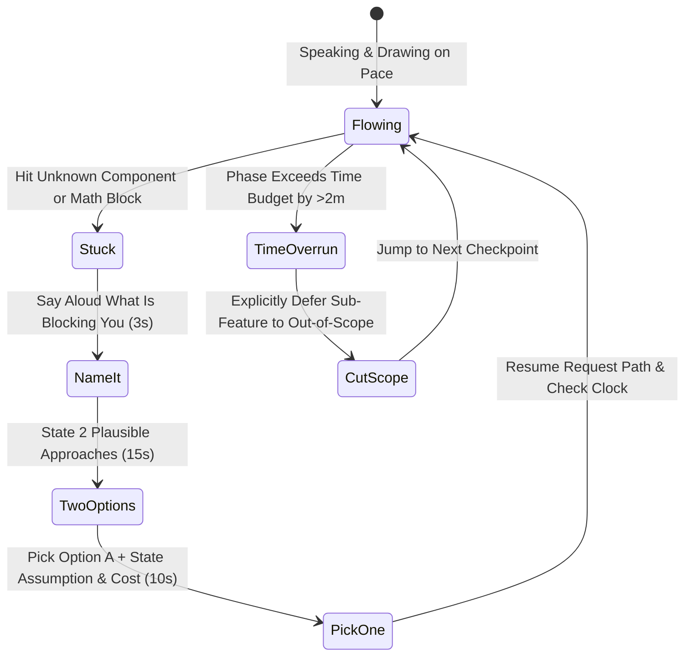

# Timed Solo Practice: Run a 45-Minute System Design Mock Alone

> **Prerequisites:** [Previous lesson: Build a Trade-off Library for System Design Interviews](../06-build-a-trade-off-library-for-system-design-interviews/README.md).
> **Estimated Reading Time:** 22–28 minutes
> **Target Audience:** Candidates who understand the material but have never practised the full 45 minutes under a clock.

> [!NOTE]
> **In one line:** Timed solo practice is **a full mock interview run alone**: a prompt, a timer, a whiteboard, and you speaking aloud as if someone were listening.

> [!TIP]
> **The Golden Rule:** Speak aloud and stop when the timer says stop. A design you only think through teaches far less than one you say and draw against a clock.

---

## 1. Core Concept & Why Interviewers Test It

System design interviews fail most often not from lack of distributed systems knowledge, but from **time-management collapse** and **unpracticed verbalization**. Candidates who read solutions passively suffer from the *illusion of competence*: recognizing a diagram feels easy, whereas generating an API, estimating QPS, drawing a write/read path, defending two deep dives, and closing with failure modes in 45 minutes is a high-load cognitive performance.

Timed solo practice isolates and trains three mechanical skills before you ever burn a peer mock or a real interview:
1. **Pacing Discipline:** Hitting hard checkpoints (`0-5`, `5-10`, `10-15`, `15-25`, `25-38`, `38-43`, `43-45`) so you never reach minute 35 with zero deep dives.
2. **Continuous Verbalization:** Speaking your architectural reasoning aloud while drawing, eliminating 15-second dead silences and nervous filler.
3. **Self-Diagnostic Evidence:** Recording audio/screen so you can audit your actual output against an objective 8-point checklist instead of relying on memory.

| Practice Mode | Cost / Setup | What It Trains Best | Blind Spot |
| :--- | :--- | :--- | :--- |
| **Passive Reading** | Zero setup | Vocabulary, pattern recognition | Zero pacing, zero verbalization, illusion of mastery |
| **Timed Solo Practice** | 45 min + phone audio + Excalidraw/paper | Pacing, speaking aloud, estimation speed, self-recovery | Cannot surprise you with unscripted interviewer pushback |
| **Peer Mock Interview** | 90 min + partner | Handling interruptions, pushback, ambiguous requirements | Expensive to schedule; wasted if basic pacing is broken |

### Why It Matters in Interviews

1. **The 45-Minute Clock Is Brutal:** Subtract 5 minutes for introductions and 5 minutes for candidate Q&A at the end of a real 55-minute slot, and you have **45 minutes** of actual design time (see [Prioritizing Under Time Pressure](../../21-interview-framework/13-prioritizing-under-time-pressure-in-system-design-interviews/README.md)).
2. **Silent Thinking Reads as Stuck:** In remote interviews, 20 seconds of silence while you stare at Excalidraw makes the interviewer assume you are lost. Solo practice forces you to narrate *"I'm choosing between X and Y; let me check the write QPS first..."*.
3. **Early Bottleneck Detection:** If you are still calculating storage at minute 14, solo practice exposes that immediately so you can fix your estimation shortcuts before a real loop.

---

## 2. Quantitative Foundations & Time/Capacity Math

Time budgeting in a 45-minute interview obeys strict **opportunity-cost math**: every extra minute spent on an early phase steals directly from **Deep Dives (minutes 25–38)**, which carry the highest weight in Staff/Senior rubrics.

### The 45-Minute Time Allocation Model

| Phase | Window | Duration | % of Time | Hard Deliverable Required Before Moving On |
| :--- | :--- | :--- | :--- | :--- |
| **1. Clarify & Scope** | `00–05` | 5 min | 11.1% | 3–5 functional reqs, explicit non-functional SLAs, 2 out-of-scope items |
| **2. Capacity Estimation** | `05–10` | 5 min | 11.1% | Read/Write QPS (avg + peak), 5-year storage, egress bandwidth |
| **3. API & Data Model** | `10–15` | 5 min | 11.1% | 3–4 core endpoints/RPCs, primary entities, DB choice + partition key |
| **4. High-Level Design** | `15–25` | 10 min | 22.2% | End-to-end boxes + arrows for Write Path and Read Path |
| **5. Deep Dives (2–3)** | `25–38` | 13 min | 28.9% | Bottleneck internals, data structures, algorithms, trade-offs |
| **6. Failures & Security** | `38–43` | 5 min | 11.1% | SPOFs, circuit breakers/DLQs, auth/rate-limiting, scaling at 10x |
| **7. Summary & Recap** | `43–45` | 2 min | 4.4% | Top 3 trade-offs + what you would evolve next |

### Estimation Speed Math (Powers of 10 & Seconds-Per-Day)

To finish Step 2 inside **5 minutes**, never do long division. Use standard interview approximations:

$$\text{Seconds per day} = 86,400 \approx 10^5\text{ s}$$

$$\text{QPS}_{\text{avg}} = \frac{\text{DAU} \times \text{Actions/User/Day}}{10^5}, \qquad \text{QPS}_{\text{peak}} \approx 3 \times \text{QPS}_{\text{avg}}\text{ (to } 5\times\text{)}$$

$$\text{5-Year Storage} = \text{Writes/Day} \times \text{Payload Bytes} \times 365 \times 5 \approx \text{Writes/Day} \times \text{Payload} \times 2,000$$

### Worked Numerical Example: 5-Minute Estimation Drill

Suppose you draw a prompt: **Design a URL Shortener** with **100M DAU**, each user clicks 10 links/day and creates 1 new link/month:
1. **Write QPS:** $100\text{M} / 30 \approx 3.3\text{M writes/day} \implies 3.3 \times 10^6 / 10^5 = 33\text{ writes/s}$ (peak $\approx 100\text{–}150\text{ W/s}$).
2. **Read QPS:** $100\text{M} \times 10 = 10^9\text{ reads/day} \implies 10^9 / 10^5 = 10,000\text{ reads/s}$ (peak $\approx 30,000\text{ R/s}$). **Read:Write ratio = 300:1** $\implies$ immediately justifies aggressive caching!
3. **5-Year Storage:** $3.3\text{M/day} \times 2,000\text{ days} \approx 6.6\text{B URLs}$. At $500\text{ bytes/row}$ $\implies 3.3\text{ TB}$. Fits on a single sharded cluster or small NoSQL table.
*Total time to compute aloud:* **90 seconds**, leaving 3.5 minutes buffer.

---

## 3. Decision Matrices, Rubrics & Trade-Off Rules

### Matrix 1: Solo Self-Review Checklist (8 Binary Gates)

Listen to your recording once at 1.25x speed and score each gate **Yes (1)** or **No (0)**:

| # | Checkpoint Question | Target Phase | What "No" Indicates |
| :--- | :--- | :--- | :--- |
| **1** | Did I ask at least 5 clarifying questions before drawing? | `00–05` | Jumped straight into boxes; solving the wrong problem |
| **2** | Did I state assumptions & numbers, and *use* them later? | `05–10` | Performative math disconnected from DB/cache choices |
| **3** | Did I draw explicit Write and Read request paths (not just static boxes)? | `15–25` | Unclear data flow; missing auth/cache/async boundaries |
| **4** | Did I name a trade-off with a cost for every major choice? | `15–38` | Resume-driven box-dropping without engineering judgment |
| **5** | Did I proactively pick the 2–3 deep dives instead of waiting? | `25–38` | Passive, mid-level posture instead of driving the session |
| **6** | Did I cover at least one failure mode and one security/abuse point? | `38–43` | Happy-path-only design; vulnerable to cascades or scraping |
| **7** | Did I finish with a Top-3 summary inside minute 45? | `43–45` | Poor time discipline; ran out of clock mid-sentence |
| **8** | Did I avoid >10-second dead silences and excessive filler? | `00–45` | Needs more spoken narration reps |

> [!WARNING]
> **The #1 Solo Practice Trap:** Thinking silently in your head for 25 minutes, sketching a neat diagram, and telling yourself *"Yeah, I know how I'd explain that."* Silent thinking hides stuttering, vague hand-waving, and forgotten trade-offs. If it wasn't spoken aloud and recorded, the rep didn't count.

---

## 4. Visual Workflows & Architecture Diagrams

### Diagram 1: The 45-Minute Timed Solo Session Loop


### Diagram 2: Mid-Session Recovery State Machine (When You Get Stuck)



---

## 5. Deep-Dive Drill 1: The Weekly Cadence & Prompt Rotation

Cramming 5 mock interviews on a Sunday causes cognitive fatigue and zero retention. Distributed spacing builds fluency:

1. **Weekly Rhythm (4 Hours Total/Week):**
   - **Tuesday (45 min):** Timed Solo Session A (e.g., Storage/Write-heavy prompt).
   - **Wednesday (20 min):** Audio Review + 8-Point Scorecard + add 2–3 entries to your [Trade-off Library](../06-build-a-trade-off-library-for-system-design-interviews/README.md).
   - **Thursday (45 min):** Timed Solo Session B (e.g., Real-time/GenAI prompt).
   - **Saturday (30 min):** One targeted [Deep-Dive Drill](../09-deep-dive-drills/README.md) on the weakest component from Tue/Thu.
2. **Prompt Category Rotation (Never Repeat Your Favorites):**
   Rotate across 6 buckets from [Track 22](../../22-interview-design-problems/README.md) without reading the solution beforehand:
   - *Storage & Feeds:* News Feed, Distributed KV Store, Cloud File Sync (Dropbox).
   - *Messaging & Real-Time:* Chat (WhatsApp/Slack), Ride-Sharing Locations, Live Leaderboard.
   - *High-Contention / Consistency:* Ticketmaster, Payment Ledger, Distributed Lock / Rate Limiter.
   - *Data & Ingestion:* Metrics/Logging Pipeline, Web Crawler, Ad Click Aggregator.
   - *Media & Edge:* Video Streaming (YouTube/Netflix), CDN.
   - *GenAI Systems:* Enterprise RAG Copilot, Guardrailed Agent Workflow.

---

## 6. Deep-Dive Drill 2: Speaking Aloud & Eliminating Dead Air

In a solo session, you must play *both* roles without breaking flow:

1. **Narrate Clarifying Questions Explicitly:** Say aloud: *"First, I'll clarify scope. Are we supporting custom aliases and expiration? I'll assume yes for expiration, no for analytics dashboards in v1 to stay focused."* Write the assumed answers on the whiteboard immediately.
2. **Signpost Every Transition:** Use crisp verbal markers at checkpoint boundaries:
   - At minute 5: *"Scope is locked. Moving to capacity estimation to size our storage and read/write ratio."*
   - At minute 15: *"API and schema are set. Now I'll draw the end-to-end write path, then the read path."*
   - At minute 25: *"With the high-level flow in place, the two biggest bottlenecks are X and Y. Let's dive into X first."*
3. **The 10-Second Dead-Air Rule:** Never pause silently for $>10$ seconds. If you need to think, narrate the trade-off you are weighing: *"I'm debating whether to put a queue between the API and the worker here—let me check if the client needs synchronous confirmation."*

---

## 7. Deep-Dive Drill 3: Handling Time Overruns & Recovery

Even experienced engineers lose track of time on a tricky sharding or consistency question. Train these two emergency maneuvers:

1. **The "Explicit Deferral" Cut (When Estimation/Schema Hits Minute 16):**
   Say aloud: *"I'm at minute 16, so I'm going to finalize the core `orders` table schema now and defer secondary indexes and billing webhooks to deep dives if time permits."* Immediately draw the High-Level Diagram.
2. **The "Assume & Flag" Recovery (When Stuck on an Internal Detail):**
   Say aloud: *"I'm slightly unsure of the exact Raft quorum edge case here, so I'll assume standard leader-lease reads with a 500ms clock-skew bound, flag that as an area to verify, and move to the failure-mode analysis."* Stalling for 4 minutes is a guaranteed fail; assuming and moving forward preserves your score across the remaining 5 rubric rows.

---

## 8. Adapting Answers Across Scale (1K vs 100K vs 10M+ Users)

A common solo-practice error is jumping straight to 10M-user complexity at minute 15 before establishing the baseline. Practice a **2-tier verbal framing**:

| Phase | How to Frame for 1K–100K Users (Baseline) | How to Evolve for 10M+ Users (Minutes 25–38) |
| :--- | :--- | :--- |
| **Clarify (0–5m)** | Establish target DAU & peak QPS cleanly | Ask about geographic distribution (single-region vs. global) |
| **Data Model (10–15m)** | Clean relational schema on 1 primary DB | Identify shard key (`tenant_id`, `user_id`) & hot-key risks |
| **HLD (15–25m)** | LB -> Stateless API -> Cache -> DB + Queue | Add CDN/Edge, multi-AZ read replicas, async fan-out workers |
| **Deep Dive (25–38m)** | Core correctness (idempotency, locking, pagination) | Partition rebalancing, consistent hashing, backpressure, multi-region DR |

---

## 9. Failure Modes, Traps & Recovery

1. **Peeking at the Solution Before the Timer:** Reading the Track 22 lesson first turns the session into a memory test, not a design test.
   - *Recovery:* Pick prompts from a randomized list; read the reference solution *only after* your 45-minute hard stop and audio audit.
2. **Spending 25 Minutes on APIs and Estimation:** Perfectionism on JSON payloads and exact byte counts leaves 0 minutes for deep dives.
   - *Recovery:* Use a visible countdown timer with audio chimes at minutes `5, 10, 15, 25, 38, 43, 45`. When a chime rings, finish your sentence and advance.
3. **Skipping the Audio Review:** Doing 10 solo mocks without listening back just reinforces the same bad habits 10 times.
   - *Recovery:* Treat the 20-minute review as mandatory; log your 8-point score in a CSV/tracker and only count a session as "done" once reviewed.
4. **Always Picking Comfortable Prompts:** Doing URL Shortener and Rate Limiter repeatedly while avoiding Distributed File Sync or GenAI RAG.
   - *Recovery:* Force a 6-category rotation; spend extra reps on your lowest-scoring category.

---

## 10. Production / Interview Calibration Case Study

### Case Study: Tracking 4 Weeks of Timed Solo Practice (8 Sessions)

A senior backend engineer preparing for Staff-level loops recorded 8 timed solo sessions over 4 weeks and logged their 8-point checklist scores:

- **Week 1 (Sessions 1–2, Prompts: *Notification System*, *Web Crawler*):**
  - *Observed Failure:* Ran out of time at minute 37 while still drawing HLD; scored **3/8** and **4/8**. Audio audit revealed 12 minutes spent on API/schema details and 45-second silent gaps while drawing.
  - *Targeted Fix:* Added a hard chime at minute 15 (`API/Data` cutoff) and practiced narrating every arrow aloud.
- **Week 2 (Sessions 3–4, Prompts: *Ticketmaster*, *Metrics Pipeline*):**
  - *Result:* Reached Deep Dives at minute 24; scored **6/8** on both. Missed failure modes/security on Session 3 due to a 16-minute deep dive on seat locking.
  - *Targeted Fix:* Added minute-38 chime forcing transition to Failures & Security.
- **Week 4 (Sessions 7–8, Prompts: *Enterprise RAG*, *Re-attempt Notification System*):**
  - *Result:* Scored **8/8** on both, finishing Top-3 Trade-off Summary at minute `44:15`. Dead silences dropped from 45s to <4s. Subsequent peer mocks immediately scored 27/32+.

---

## 11. Executable Reference Tooling (4 Languages)

Below is an executable **45-Minute Interview Pacing & Checkpoint Timer** in Go, TypeScript, Python, and C# that computes exact minute boundaries, phase weights, and can run in fast-forward/live mode during solo practice.

````carousel
```go
package main

import (
	"fmt"
	"time"
)

type Phase struct {
	Name        string
	Minutes     int
	Deliverable string
}

var plan = []Phase{
	{"Clarify & Scope", 5, "3-5 functional reqs, SLAs, out-of-scope"},
	{"Capacity Estimation", 5, "Avg/peak QPS, 5-yr storage, bandwidth"},
	{"API & Data Model", 5, "Core endpoints, entities, partition key"},
	{"High-Level Design", 10, "Write path + Read path diagram"},
	{"Deep Dives (2-3)", 13, "Bottlenecks, internals, trade-offs"},
	{"Failures & Security", 5, "SPOFs, rate limits, auth, 10x scaling"},
	{"Summary", 2, "Top 3 trade-offs & next steps"},
}

func PrintSchedule() {
	elapsed := 0
	for _, p := range plan {
		fmt.Printf("%2d-%-2d min | %-20s | %s\n", elapsed, elapsed+p.Minutes, p.Name, p.Deliverable)
		elapsed += p.Minutes
	}
	fmt.Printf("Total: %d minutes\n", elapsed)
}

func main() {
	PrintSchedule()
	_ = time.Second // available for live ticker mode
}
```
<!-- slide -->
```typescript
interface Phase {
  name: string;
  minutes: number;
  deliverable: string;
}

const plan: Phase[] = [
  { name: "Clarify & Scope", minutes: 5, deliverable: "3-5 functional reqs, SLAs, out-of-scope" },
  { name: "Capacity Estimation", minutes: 5, deliverable: "Avg/peak QPS, 5-yr storage, bandwidth" },
  { name: "API & Data Model", minutes: 5, deliverable: "Core endpoints, entities, partition key" },
  { name: "High-Level Design", minutes: 10, deliverable: "Write path + Read path diagram" },
  { name: "Deep Dives (2-3)", minutes: 13, deliverable: "Bottlenecks, internals, trade-offs" },
  { name: "Failures & Security", minutes: 5, deliverable: "SPOFs, rate limits, auth, 10x scaling" },
  { name: "Summary", minutes: 2, deliverable: "Top 3 trade-offs & next steps" },
];

function printSchedule(phases: Phase[]): void {
  let t = 0;
  for (const p of phases) {
    const window = `${String(t).padStart(2, " ")}-${String(t + p.minutes).padEnd(2, " ")} min`;
    console.log(`${window} | ${p.name.padEnd(20)} | ${p.deliverable}`);
    t += p.minutes;
  }
  console.log(`total: ${t} minutes`);
}

printSchedule(plan);
```
<!-- slide -->
```python
plan = [
    ("Clarify", 5),
    ("Estimate", 5),
    ("API and data", 5),
    ("High-level design", 10),
    ("Deep dives", 13),
    ("Failures and security", 5),
    ("Summary", 2),
]

t = 0
for name, minutes in plan:
    print(f"{t:>2}-{t + minutes:<2} min  {name}")
    t += minutes
print("total:", t, "minutes")
```
<!-- slide -->
```csharp
using System;
using System.Collections.Generic;

public record Phase(string Name, int Minutes, string Deliverable);

public static class InterviewTimer
{
    private static readonly List<Phase> Plan = new()
    {
        new("Clarify & Scope", 5, "3-5 functional reqs, SLAs, out-of-scope"),
        new("Capacity Estimation", 5, "Avg/peak QPS, 5-yr storage, bandwidth"),
        new("API & Data Model", 5, "Core endpoints, entities, partition key"),
        new("High-Level Design", 10, "Write path + Read path diagram"),
        new("Deep Dives (2-3)", 13, "Bottlenecks, internals, trade-offs"),
        new("Failures & Security", 5, "SPOFs, rate limits, auth, 10x scaling"),
        new("Summary", 2, "Top 3 trade-offs & next steps"),
    };

    public static void Main()
    {
        int t = 0;
        foreach (var p in Plan)
        {
            Console.WriteLine($"{t,2}-{t + p.Minutes,-2} min | {p.Name,-20} | {p.Deliverable}");
            t += p.Minutes;
        }
        Console.WriteLine($"total: {t} minutes");
    }
}
```
````

---

## 12. Verification & CLI Diagnostics

Use these CLI snippets to print your checkpoint schedule, pick an unseen prompt at random, and track your 8-point checklist scores over time:

```bash
# 1. Print the 45-minute checkpoint schedule before starting a session
python3 -c '
plan = [("Clarify",5),("Estimate",5),("API and data",5),("High-level design",10),("Deep dives",13),("Failures and security",5),("Summary",2)]
t = 0
for n, m in plan:
    print(f"{t:>2}-{t+m:<2} min  {n}")
    t += m
print("total:", t, "minutes")
'

# 2. Pick a random prompt across categories so you do not cherry-pick favorites
python3 -c '
import random
pool = [
    ("Storage", "Design Dropbox / Cloud File Sync"),
    ("Messaging", "Design WhatsApp / Slack"),
    ("Contention", "Design Ticketmaster"),
    ("Data Pipeline", "Design Ad Click Aggregator"),
    ("GenAI", "Design Enterprise RAG Copilot"),
    ("Real-Time", "Design Uber Driver Location Tracker"),
]
cat, prompt = random.choice(pool)
print(f"Selected [{cat}]: {prompt} -- Start 45m timer NOW!")
'

# 3. Compute your rolling solo-practice improvement score from binary checklists
python3 -c '
sessions = [[1,0,1,0,0,1,0,0], [1,1,1,1,0,1,0,1], [1,1,1,1,1,1,1,1]]
for i, s in enumerate(sessions, 1):
    print(f"Session {i}: {sum(s)}/8 ({sum(s)/8*100:.0f}%)")
'
```

---

## 13. Common Interview Mistakes & Red Flags

- **Thinking silently instead of speaking aloud**, leaving the interviewer guessing whether you are stuck.
- **Reading the reference solution before the timed attempt**, turning design practice into rote memorization.
- **Not recording audio**, leaving zero objective evidence of dead air, filler words, or skipped trade-offs.
- **Spending 20+ minutes on one early section** (estimation or schema) and skipping failure modes and summary.
- **Always practicing prompts you already like** while avoiding GenAI, distributed consensus, or data pipelines.
- **Doing back-to-back estimation math without connecting numbers to architecture** (computing QPS and then never mentioning it again).
- **Refusing to stop at minute 45**, which hides how incomplete your design would be in a real interview.

---

## 14. Key Terminology & Glossary

| Term | Definition |
| :--- | :--- |
| **Time Boxing** | Enforcing strict minute caps per interview phase (`5/5/5/10/13/5/2`) with a hard stop at 45:00. |
| **Illusion of Competence** | Mistaking passive recognition of a solution diagram for the ability to generate and defend it live. |
| **Signposting** | Verbal transition markers telling the listener which phase or bottleneck you are entering next. |
| **Hard Stop** | Stopping immediately at 45:00 during practice so incomplete sections are exposed honestly. |
| **Explicit Deferral** | Proactively moving a secondary feature out-of-scope mid-session to protect deep-dive time. |
| **Write Path / Read Path** | Tracing step-by-step request execution through arrows rather than pointing at static boxes. |
| **8-Point Audit** | Binary post-session checklist scored from the recorded audio to identify the top 2 weaknesses. |
| **Spaced Repetition** | Spreading 2 timed mocks + 1 review + 1 drill across a week rather than cramming. |
| **Actions/Day Approximation** | Using $1\text{ day} \approx 10^5\text{ s}$ and $5\text{ years} \approx 2,000\text{ days}$ for rapid mental QPS/storage math. |
| **Dead Air** | Silent pauses $>10$ seconds while thinking; broken by narrating the trade-off being weighed. |

---

## 15. Interview Follow-Up Questions (12 Q&As)

### Basic Conceptual Questions

<details>
<summary><strong>Q1: How often should I run timed solo practice? [BASIC]</strong></summary>

Two 45-minute timed sessions per week for four weeks (plus a 20-minute audio review and one 30-minute deep-dive drill) beats a single crammed weekend. Spacing allows your brain to consolidate patterns and lets you test targeted fixes between sessions.

</details>

<details>
<summary><strong>Q2: Is solo practice a replacement for peer mock interviews? [BASIC]</strong></summary>

No—it is the **prerequisite** for peer mocks. Solo practice is free, flexible, and fixes pacing, estimation speed, and speaking habits. Once you consistently score 7–8/8 on the solo checklist, add [peer mocks](../08-peer-mock-interviews-for-system-design/README.md) to test unscripted interruptions and pushback.

</details>

<details>
<summary><strong>Q3: How do I choose prompts for solo practice? [BASIC]</strong></summary>

Rotate across 6 core categories—storage/feeds, messaging/real-time, high-contention transactions, data pipelines, media/edge, and GenAI—and deliberately bias toward the categories you find hardest. Never read the solution lesson before starting the 45-minute clock.

</details>

<details>
<summary><strong>Q4: How do I know I am actually improving? [BASIC]</strong></summary>

Track your 8-point binary checklist scores and phase timestamps across recordings. Repeating the **same prompt 3–4 weeks later** is an objective benchmark: compare dead-air length, whether you reached deep dives by minute 25, and how cleanly you stated costs and switch conditions.

</details>

### Scenario-Based Architecture Questions

<details>
<summary><strong>Q5: What should I do when I get stuck mid-session? [SCENARIO]</strong></summary>

Never go silent. Say aloud what is blocking you, state two plausible options, pick one with an explicit assumption and cost, and keep moving. Stalling for 3 minutes is the failure—making a reasonable assumption and finishing the architecture is recovery.

</details>

<details>
<summary><strong>Q6: It is minute 17 and I am still defining database schemas and APIs. What do I do? [SCENARIO]</strong></summary>

Execute an **explicit deferral**: say *"To protect time for the high-level flow and deep dives, I'll lock the core table and primary key now and defer secondary endpoints."* Immediately draw the write and read paths so you still hit Deep Dives around minute 25.

</details>

<details>
<summary><strong>Q7: I always finish my High-Level Design at minute 20, then freeze because I don't know what to deep-dive on. How do I fix that? [SCENARIO]</strong></summary>

Look at your capacity math and your diagram's highest-stress arrow: (1) highest write/read QPS bottleneck, (2) hardest consistency/contention problem (e.g., double-booking, idempotency), or (3) hot-key/fan-out skew. Pick the top 2 proactively at minute 25 and run the [3-level drill](../09-deep-dive-drills/README.md).

</details>

<details>
<summary><strong>Q8: Why is recording audio so uncomfortable, and is it really necessary? [SCENARIO]</strong></summary>

Hearing your own filler words, rushed transitions, and vague explanations feels uncomfortable precisely because it breaks the illusion of competence. Listening once at 1.25x speed surfaces habits in 15 minutes that you would otherwise never notice in 20 unrecorded mocks.

</details>

### Advanced & Tricky Interview Questions

<details>
<summary><strong>Q9: In a real interview, the interviewer interrupts my 5-minute estimation and says "Skip the math, let's see the architecture." How does solo practice prepare for this? [TRICKY]</strong></summary>

Practice **modular phase transitions**: if an interviewer skips estimation, immediately ask for the 1–2 load assumptions that govern your architecture (*"Got it—should I assume read-heavy 100:1 or write-heavy?"*) and jump straight to API/HLD without getting rattled.

</details>

<details>
<summary><strong>Q10: How do you avoid memorizing "cookie-cutter" diagrams during solo practice? [TRICKY]</strong></summary>

Force yourself to justify *every* box from your Step 1–2 requirements. If you draw Redis or Kafka, state aloud which exact QPS number or latency SLA from minute 7 required it. If a requirement doesn't demand it, erase the box.

</details>

<details>
<summary><strong>Q11: What if I realize at minute 32 that my partition key in minute 13 creates a massive hot shard? [TRICKY]</strong></summary>

Treat it as a **win, not a mistake**! Say aloud: *"Wait—looking at our celebrity traffic, partitioning by `author_id` alone creates a hot shard. Let me fix that by salting the key or separating celebrity reads."* Catching and fixing your own flaw during a deep dive is a strong Staff-level signal.

</details>

<details>
<summary><strong>Q12: How should the 45-minute budget change for a GenAI system design prompt? [TRICKY]</strong></summary>

Keep the exact same `5/5/5/10/13/5/2` skeleton, but shift Estimation (Step 2) to **token volume, TTFT/TPOT, and USD/day** instead of just bytes/sec, and allocate Deep Dives (Step 5) to **RAG ACLs/re-ranking, evaluation harnesses, and cost/guardrail controls**.

</details>

---

## 16. One-Page Master Cheat Sheet

```text
+-----------------------------------------------------------------------------+
|                    TIMED SOLO PRACTICE MASTER CHEAT SHEET                   |
+-----------------------------------------------------------------------------+
| 1. SETUP      : Unseen prompt + 45m timer + whiteboard + audio recorder     |
| 2. BUDGET     : 0-5 Clarify | 5-10 Estimate | 10-15 API/Data | 15-25 HLD    |
|                 25-38 Deep Dives (2-3) | 38-43 Failures/Sec | 43-45 Summary |
| 3. MATH SHORT : 1 day ~ 10^5 sec | Peak ~ 3-5x Avg | 5 yrs ~ 2,000 days     |
| 4. HARD RULES : Speak aloud continuously (<10s silence) | Hard stop at 45m  |
| 5. STUCK FIX  : Name block -> State 2 options -> Pick 1 + cost -> Move on   |
| 6. AUDIT      : Listen at 1.25x -> Score 8-pt checklist -> Fix lowest 2     |
+-----------------------------------------------------------------------------+
```

| Topic | Remember |
| :--- | :--- |
| **Setup** | Prompt, 45 min timer, whiteboard, audio recording |
| **Budget** | 5 clarify, 5 estimate, 5 API/data, 10 HLD, 13 deep dives, 5 failures, 2 summary |
| **Review** | Eight-item checklist, note two weakest |
| **Rhythm** | Two sessions, one review and one drill per week |
| **Rule** | Speak aloud, stop at the timer |

---

## Further Reading

- Alex Xu, *System Design Interview*, chapter 3 on a framework for system design interviews.
- [Prioritizing Under Time Pressure](../../21-interview-framework/13-prioritizing-under-time-pressure-in-system-design-interviews/README.md) in this course.

---

## Next

Continue with [Peer Mock Interviews for System Design: Rubric and Feedback](../08-peer-mock-interviews-for-system-design/README.md).
