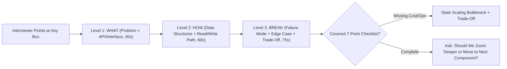
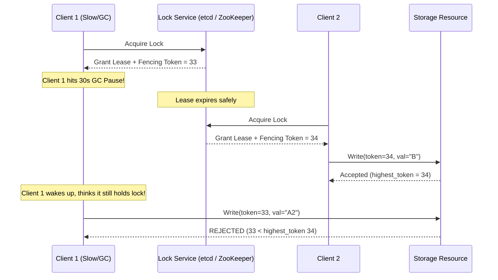

# Deep-Dive Drills: Go Three Levels Deep on Any Component

> **Prerequisites:** [Previous lesson: Peer Mock Interviews for System Design: Rubric and Feedback](../08-peer-mock-interviews-for-system-design/README.md).
> **Estimated Reading Time:** 22–28 minutes
> **Target Audience:** Candidates who draw a good high-level diagram but run out of depth when the interviewer asks 'how does that actually work?'

> [!NOTE]
> **In one line:** A deep dive is **going three levels down on one component**: what it does, how it does it, and what breaks.

> [!TIP]
> **The Golden Rule:** For any box you draw, be ready to answer: what is the data structure, what is the failure mode, and what is the trade-off. If you cannot, you drew a label, not a design.

---

## 1. Core Concept & Why Interviewers Test It

High-level diagrams (`Client -> LB -> API -> Cache -> DB + Kafka`) are table stakes; almost every mid-level candidate can draw them in 10 minutes. Senior and Staff interviews are decided in minutes `25–38` when the interviewer points at **one box** on your whiteboard and asks: *"Walk me through how that actually works under the hood, and what happens when it fails."*

A **Deep-Dive Drill** trains you to descend **three structured levels** on any infrastructure component in under 3 minutes—without notes and without hand-waving:

| Level | Core Question | Example: Message Queue (Kafka) | Example: Distributed Lock |
| :--- | :--- | :--- | :--- |
| **1. What** | What problem does it solve and what is its interface? | Decouples producers/consumers; `produce(topic, key, val)`, `poll()`, `commitOffset()` | Mutual exclusion across machines; `acquire(key, ttl) -> token`, `renew()`, `release()` |
| **2. How** | What are the data structures and algorithms inside? | Partitioned append-only log segments on disk, zero-copy `sendfile`, ISR replication, consumer offsets | Atomic `SET key val NX PX ttl` (Redis) or Raft/etcd lease with monotonic `revision` |
| **3. Break** | How does it fail, and what do you do about it? | Consumer crash $\to$ rebalance & redelivery (need idempotency); poison message $\to$ DLQ; broker loss $\to$ ISR failover | GC pause expires lease $\to$ two holders act concurrently! Fix with **fencing tokens** checked by resource |

### Why It Matters in Interviews

1. **Separates "Box-Droppers" from Systems Engineers:** Anyone can write "Redis" or "Consistent Hashing" on a whiteboard. Knowing *why* virtual nodes prevent hotspots or *how* a cache stampede collapses a DB proves production depth (see [Deep Dives and Bottlenecks](../../21-interview-framework/10-deep-dives-and-bottlenecks/README.md)).
2. **Protects Your Rubric Floor:** On the 8-row rubric, **Depth** and **Reliability** are the two most common rows that hold strong communicators back from Staff-level offers.
3. **Transferable Across Prompts:** Mastering 12 core component drills covers 90% of the bottlenecks across all Track 22 design problems.

---

## 2. Quantitative Foundations & Time/Capacity Math

Deep dives require concrete numbers—not vague claims like *"it uses memory"* or *"rebalancing is slow"*.

### Key Component Sizing & Failure Math

1. **Consistent Hashing Rebalance Cost:**
   With $N$ nodes and $K$ keys, naive `hash(key) % N` moves $\approx \frac{N-1}{N} \approx 100\%$ of keys when adding 1 node. A consistent hash ring moves only:

$$\text{Fraction of Keys Moved} \approx \frac{1}{N + 1}$$

   Adding $v$ **virtual nodes (vnodes)** per physical server reduces load standard deviation across nodes from $O(1/\sqrt{1})$ to:

$$\sigma_{\text{load}} \propto \frac{1}{\sqrt{v}}$$

   With $v = 150\text{–}200$ vnodes per physical node, load skew drops below $\pm 5\%$.

2. **Distributed Lock Lease Safety Margin:**
   If a lock lease has duration $T_{\text{lease}}$, and a worker experiences a stop-the-world GC pause $T_{\text{pause}}$ plus network delay $T_{\text{net}}$:

$$\text{Unsafe Overlap Occurs Whenever: } T_{\text{pause}} + T_{\text{net}} \ge T_{\text{lease}}$$

   Because $T_{\text{pause}}$ is unbounded in garbage-collected runtimes (10–60s pauses happen in production), **no finite $T_{\text{lease}}$ can guarantee mutual exclusion alone**—only a monotonic **fencing token** makes the protected resource safe.

3. **Snowflake 64-Bit ID Capacity:**
   Standard layout: `1 bit sign + 41 bits timestamp (ms) + 10 bits worker ID + 12 bits sequence`:

$$\text{Epoch Lifespan} = \frac{2^{41}}{1000 \times 86400 \times 365.25} \approx 69.7\text{ years}$$

$$\text{Max Throughput} = 2^{10}\text{ workers} \times 2^{12}\text{ IDs/ms} = 1,024 \times 4,096 = 4.19\text{ million IDs/ms}$$

### Worked Numerical Example: Consistent Hashing Cluster Expansion

Suppose you operate a 10-node Redis cache cluster holding **500M keys** (200 GB total):
- **With `hash(key) % 10`:** Adding an 11th node remaps $\frac{10}{11} \approx 90.9\%$ of keys ($\mathbf{454.5M\text{ cache misses}}$ instantaneously!), causing a catastrophic DB thundering herd.
- **With Consistent Hashing ($v = 150$ vnodes/node):** Adding an 11th node moves only $\frac{1}{11} \approx 9.1\%$ of keys ($\approx 45.4\text{M}$ keys), and vnodes ensure each existing node transfers $\sim 0.9\%$ evenly rather than overloading one neighbor.

### Component Internals Reference Table

| Component | Core Data Structure | Critical Bottleneck | Key Number to Know |
| :--- | :--- | :--- | :--- |
| **Cache (Redis)** | Hash table + LRU/LFU doubly-linked list | Single-threaded command loop / hot-key network | ~100K ops/s per core; `<1 ms` p99 |
| **Message Queue (Kafka)** | Partitioned append-only log + `.index` | Partition count & slow consumer lag | 100K–1M msgs/s per broker (sequential I/O) |
| **Rate Limiter** | Token bucket / Sliding window log (Redis ZSET/Lua) | Atomic read-modify-write race | 1 Lua script = 1 RTT (`<1 ms`) |
| **Search Index** | Inverted index (FST + postings) + HNSW | High-cardinality faceting & segment merges | Segment refresh typically `1s` (NRT) |
| **Object Storage (S3)** | Erasure-coded chunks (e.g., Reed-Solomon 10+4) | Metadata index / small-object overhead | 11 nines (`99.999999999%`) durability |

---

## 3. Decision Matrices, Rubrics & Trade-Off Rules

### The 7-Point Component Checklist

Run these 7 questions against **any** component during a deep dive:

| # | Dimension | Questions You Must Answer Aloud |
| :--- | :--- | :--- |
| **1** | **Data** | What is stored, what is the exact key, what is the item size, and how is it partitioned? |
| **2** | **Read & Write Path** | Step by step, what happens on disk/memory/network for one write and one read? |
| **3** | **Consistency** | What guarantees does it give (linearizable, RYW, eventual), and what can be stale? |
| **4** | **Scaling** | What saturates first (CPU, RAM, disk IOPS, network, lock contention), and how do you scale out? |
| **5** | **Failure** | What if it is slow, partitioned, or dead? What is the blast radius and recovery? |
| **6** | **Operations** | How do you deploy, reshard/migrate with zero downtime, and alert on it? |
| **7** | **Cost** | What grows fastest with scale (RAM, cross-AZ egress, IOPS, index size)? |

### The 12 Drills to Rotate Through

| # | Component | Level 2 (Internals) | Level 3 (What Breaks + Fix) |
| :--- | :--- | :--- | :--- |
| **1** | **Cache** | Hash map + LRU/W-TinyLFU | Stampede $\to$ singleflight; Hot key $\to$ local L1 cache / key salting |
| **2** | **Message Queue** | Partitioned append-only log + offsets | Redelivery $\to$ idempotency; Poison msg $\to$ DLQ; Lag $\to$ partition scale |
| **3** | **Rate Limiter** | Token bucket / Sliding window + Redis Lua | Race condition $\to$ Lua atomicity; Redis down $\to$ fail-open + local limiter |
| **4** | **Consistent Hashing** | Hash ring + $v=150$ virtual nodes | Non-uniform load $\to$ vnodes; Cascade on node death $\to$ bounded loads |
| **5** | **DB Sharding** | Range vs. Hash sharding + routing proxy | Hot shard $\to$ composite/salted key; Resharding $\to$ dual-write + cutover |
| **6** | **Replication** | Leader-follower WAL streaming | Lag $\to$ read-your-writes cookie; Failover $\to$ Raft/fencing to stop split-brain |
| **7** | **Search Index** | Inverted index + BM25 + HNSW | Freshness $\to$ 1s refresh segments; Deep pagination $\to$ `search_after` cursor |
| **8** | **Distributed Lock** | Lease (`NX PX`) / etcd Raft revision | GC pause $\to$ stale holder writes! Fix with **monotonic fencing token** |
| **9** | **ID Generation** | Snowflake 64-bit (`ts + worker + seq`) | Clock skew (NTP jump back) $\to$ refuse/wait or logical sequence bits |
| **10** | **CDN** | Edge PoP cache + Origin Shield | Cache busting $\to$ versioned URLs; Origin overload on purge $\to$ Origin Shield |
| **11** | **WebSocket Gateway** | Stateful epoll/kqueue + Redis/etcd conn map | Node crash $\to$ jittered reconnect; Fan-out $\to$ pub/sub gateway routing |
| **12** | **Object Storage** | Metadata DB + Erasure-coded blob chunks | Bit rot $\to$ background scrubbers + checksums; Hot prefix $\to$ hash prefix |

> [!WARNING]
> **The #1 Deep-Dive Trap:** Using wall-clock time (`time.Now()`) for correctness in distributed locks, ID ordering, or conflict resolution (LWW). Clocks drift and jump backward on NTP syncs. Always use **logical/monotonic counters** (Raft `term+index`, etcd `revision`, or fencing tokens) for correctness.

---

## 4. Visual Workflows & Architecture Diagrams

### Diagram 1: The Three-Level Deep-Dive Descent



### Diagram 2: Distributed Lock Stale-Holder Failure & Fencing Token Fix



---

## 5. Deep-Dive Drill 1: Distributed Lock & Fencing Tokens (Worked 3-Level Drill)

Let's execute the 3-level drill on **Distributed Locking** exactly as you should speak it in ~3 minutes:

- **Level 1 (What):** A distributed lock ensures mutually exclusive access to a shared resource (e.g., preventing two cron workers from charging the same subscription twice). Interface: `acquire(resource_id, ttl) -> (lease_id, fencing_token)`, `renew(lease_id)`, `release(lease_id)`.
- **Level 2 (How):** We store the lock in a linearizable consensus store like **etcd** or **ZooKeeper** (Raft/ZAB) using a lease with TTL so a crashed worker doesn't deadlock the resource forever. Each successful `acquire` returns a strictly increasing **monotonic integer** (`fencing_token`, such as etcd's `mod_revision`). While working, a background heartbeat renews the lease.
- **Level 3 (Break):** What if Client 1 acquires token `1`, enters a 20-second GC pause or network partition, and wakes up *after* its 10-second lease expired and Client 2 acquired token `2`? Both clients believe they hold the lock! **Why Redis `SET NX` alone fails here:** the lock service cannot stop Client 1 from sending a stale write to the database. **The Fix:** Every write to the protected storage/DB must carry `fencing_token`, and the storage engine atomically enforces `WHERE fencing_token > current_highest_token`. Client 1's stale write (`token=1 < 2`) is rejected at the resource boundary.
- **Trade-Off:** Consensus-backed locks (etcd) cost ~5–15 ms RTT per acquire and lower throughput than Redis, so use Redis `SET NX` only for **efficiency locks** (avoiding duplicate work), and consensus + fencing tokens for **correctness locks** (preventing data corruption).

---

## 6. Deep-Dive Drill 2: Distributed Rate Limiter (3-Level Drill)

- **Level 1 (What):** Protects downstream services from abuse, noisy neighbors, and DDoS by capping requests per `tenant_id` or IP. Interface: `allow(key, cost) -> (allowed: bool, remaining: int, retry_after_ms: int)`.
- **Level 2 (How):** Use **Token Bucket** (allows controlled bursts up to bucket capacity $B$, refilling at rate $r$/s) or **Sliding Window Counter** stored in Redis. Execute the check-and-decrement inside a **single Redis Lua script** (`EVALSHA`) so read-modify-write is atomic without network race conditions.
- **Level 3 (Break):**
  1. *Race condition:* Naive `GET` + `DECR` in app code allows concurrent threads to bypass limits $\to$ fixed by Lua script.
  2. *Redis hotspot / failure:* If Redis is unreachable, **fail-open** (log + allow traffic using a fallback local in-memory token bucket per gateway pod) rather than taking down the entire API.
  3. *Multi-region sync:* Syncing counters synchronously across continents adds 80ms per request $\to$ allocate regional quotas or gossip async deltas every 500 ms, accepting slight over-admission during bursts.

---

## 7. Deep-Dive Drill 3: Database Sharding & Hot-Partition Recovery (3-Level Drill)

- **Level 1 (What):** Horizontally partitions a dataset across $N$ independent database nodes when write QPS ($>15\text{K/s}$) or storage ($>4\text{ TB}$) exceeds one primary.
- **Level 2 (How):** Choose a **shard key** aligned with the primary query path (e.g., `tenant_id` or `user_id`) and route via **hash partitioning** (even distribution) or **range partitioning** (efficient range scans). A stateless routing layer (e.g., Vitess `vtgate` or DynamoDB router) maps `hash(shard_key)` to a virtual shard/vbucket.
- **Level 3 (Break):**
  1. *Hot shard (celebrity problem):* One mega-tenant generates 40% of all writes, saturating Shard 3 while 15 other shards sit at 5% CPU $\to$ fix with **composite salted keys** (`tenant_id#rand(0..9)` for writes, scatter-gather 10 parallel reads) or isolating whale tenants onto dedicated shards.
  2. *Zero-downtime resharding:* Moving from 8 to 16 shards cannot lock tables $\to$ use **snapshot + CDC tailing** (clone shard to new split, stream binlog/WAL changes, verify checksum, atomic route flip).

---

## 8. Adapting Answers Across Scale (1K vs 100K vs 10M+ Users)

Show interviewers you know *when* deep-dive complexity is justified:

| Component | 1K Users (Simple) | 100K Users (Standard) | 10M+ Users (Hyper-Scale) |
| :--- | :--- | :--- | :--- |
| **Locking** | DB row lock (`SELECT ... FOR UPDATE`) | Single Redis `SET NX` (efficiency) | etcd/ZooKeeper + resource-enforced **fencing tokens** |
| **Rate Limiting** | In-memory token bucket in API process | Central Redis + atomic Lua script | Edge/Envoy local + async Redis cluster + tenant tiers |
| **ID Generation** | Postgres `BIGSERIAL` / UUIDv4 | DB sequence batching or ULID | Distributed Snowflake / Sonyflake with NTP skew guards |
| **Sharding** | Unsharded single Postgres | Read replicas + vertical partitioning | Consistent-hash sharded cluster + hot-key salting |

---

## 9. Failure Modes, Traps & Recovery

1. **The "Happy-Path-Only" Deep Dive:** Explaining how a cache or queue works when everything is healthy, then stopping.
   - *Recovery:* Force yourself to never finish a deep dive without stating **one failure mode** and **one trade-off**.
2. **Ignoring Network Partitions & GC Pauses:** Assuming a worker holding a 10s lease finishes in 2s every time.
   - *Recovery:* Always design assuming arbitrary process pauses and reordered packets (fencing tokens, idempotency keys, version numbers).
3. **Resharding With Modulo (`key % N`):** Proposing `user_id % N` for cache or DB sharding without realizing adding 1 node invalidates ~90%+ of keys.
   - *Recovery:* Propose consistent hashing with virtual nodes (for caches) or virtual-bucket mapping tables (for stateful DBs).
4. **Confusing Throughput with Tail Latency:** Saying *"Kafka handles 1M msgs/s so latency is low"* while ignoring consumer rebalance stop-the-world pauses or disk `fsync` settings.
   - *Recovery:* Mention `acks=all` vs. `acks=1`, `min.insync.replicas`, and cooperative sticky rebalance.

---

## 10. Production / Interview Calibration Case Study

### Case Study: The "Fencing Token" Split-Brain Incident

- **Scenario:** A distributed billing system used a Redis `SET lock:invoice_42 worker_id NX PX 10000` lock before charging customer cards and writing `status = PAID` to object storage/DB.
- **The SEV-1 Incident:** Under heavy memory pressure, Worker A hit a **14-second JVM GC pause** right after acquiring the lock. At `t = 10s`, Redis expired the lease. Worker B acquired the lock, charged the card, and wrote `status = PAID`. At `t = 14s`, Worker A woke up, unaware its lease had expired, and overwrote/double-charged the invoice!
- **Why Redis Alone Failed:** Even **Redlock** (multi-node Redis locking) cannot prevent a paused client from sending a stale write after its lease expires.
- **The Fix:** Replaced efficiency locks with an **etcd lease + monotonic `mod_revision` fencing token**, and added an optimistic/fencing check at the storage layer (`UPDATE invoices SET ... WHERE last_fencing_token < :token`) plus payment-gateway **idempotency keys**. Stale Worker A writes are now rejected 100% of the time.

---

## 11. Executable Reference Tooling (4 Languages)

Below is an executable **Fencing Token Resource Guard** demonstrating how the protected resource—not the lock service—prevents stale lock-holder corruption in Go, TypeScript, Python, and C#.

````carousel
```go
package main

import "fmt"

type FencedResource struct {
	highestToken int64
	value        string
}

func (r *FencedResource) Write(token int64, val string) string {
	if token <= r.highestToken {
		return fmt.Sprintf("rejected stale token %d (highest=%d)", token, r.highestToken)
	}
	r.highestToken = token
	r.value = val
	return fmt.Sprintf("accepted token %d", token)
}

func main() {
	r := &FencedResource{}
	fmt.Println(r.Write(1, "A"))  // holder 1 acquires lock
	fmt.Println(r.Write(2, "B"))  // holder 1 paused, lease expired, holder 2 takes over
	fmt.Println(r.Write(1, "A2")) // holder 1 wakes up and tries stale write
	fmt.Println("final value:", r.value)
}
```
<!-- slide -->
```typescript
class FencedResource {
  private highestToken = 0;
  public value: string | null = null;

  write(token: number, val: string): string {
    if (token <= this.highestToken) {
      return `rejected stale token ${token} (highest=${this.highestToken})`;
    }
    this.highestToken = token;
    this.value = val;
    return `accepted token ${token}`;
  }
}

const r = new FencedResource();
console.log(r.write(1, "A"));   // holder 1 gets the lock
console.log(r.write(2, "B"));   // holder 1 paused, lease expired, holder 2 took over
console.log(r.write(1, "A2"));  // holder 1 wakes up and tries to write
console.log(r.value);
```
<!-- slide -->
```python
class Resource:
    def __init__(self):
        self.highest = 0
        self.value = None

    def write(self, token, value):
        if token <= self.highest:
            return f"rejected stale token {token}"
        self.highest = token
        self.value = value
        return f"accepted token {token}"


if __name__ == "__main__":
    r = Resource()
    print(r.write(1, "A"))   # holder 1 gets the lock
    print(r.write(2, "B"))   # holder 1 paused, lease expired, holder 2 took over
    print(r.write(1, "A2"))  # holder 1 wakes up and tries to write
    print(r.value)
```
<!-- slide -->
```csharp
using System;

public class FencedResource
{
    private long _highestToken = 0;
    public string? Value { get; private set; }

    public string Write(long token, string value)
    {
        if (token <= _highestToken)
            return $"rejected stale token {token}";

        _highestToken = token;
        Value = value;
        return $"accepted token {token}";
    }

    public static void Main()
    {
        var r = new FencedResource();
        Console.WriteLine(r.Write(1, "A"));
        Console.WriteLine(r.Write(2, "B"));
        Console.WriteLine(r.Write(1, "A2"));
        Console.WriteLine(r.Value);
    }
}
```
````

---

## 12. Verification & CLI Diagnostics

Use these CLI snippets to verify fencing-token rejection, calculate consistent-hashing key movement, and run a 3-minute random component drill:

```bash
# 1. Verify fencing-token stale write rejection locally
python3 -c '
class Resource:
    def __init__(self): self.highest, self.val = 0, None
    def write(self, tok, v):
        if tok <= self.highest: return f"REJECTED stale token {tok}"
        self.highest, self.val = tok, v
        return f"ACCEPTED token {tok}"
r = Resource()
for tok, v in [(1,"A"), (2,"B"), (1,"A2")]:
    print(r.write(tok, v))
print("Final state:", r.val)
'

# 2. Compare modulo hashing vs consistent hashing key movement when scaling 10 -> 11 nodes
python3 -c '
import hashlib
keys = [f"k:{i}" for i in range(10000)]
mod_moved = sum(1 for k in keys if int(hashlib.md5(k.encode()).hexdigest(), 16)%10 != int(hashlib.md5(k.encode()).hexdigest(), 16)%11)
print(f"Modulo 10->11 moved: {mod_moved/len(keys)*100:.1f}% | Consistent hashing theory: {1/11*100:.1f}%")
'

# 3. Pick a random component from the 12 drills for a 3-minute spoken 3-level drill
python3 -c '
import random
drills = ["Cache", "Message Queue", "Rate Limiter", "Consistent Hashing", "DB Sharding",
          "Replication", "Search Index", "Distributed Lock", "ID Generation", "CDN", "WebSocket Gateway", "Object Storage"]
print("3-Minute Drill (What -> How -> Break):", random.choice(drills))
'
```

---

## 13. Common Interview Mistakes & Red Flags

- **Naming a component and stopping** (*"We'll add Kafka and Redis here"*) without explaining data structures or failure modes.
- **Describing the happy path only**, omitting what happens when a node crashes, pauses, or splits.
- **Using wall-clock time (`time.Now()`) for correctness** in distributed locks or conflict resolution.
- **Never mentioning what grows with scale** (RAM, partition count, cross-shard joins, egress cost).
- **Memorizing canned answers** instead of practicing the `What -> How -> Break` 3-level descent aloud.
- **Treating Redis `SET NX` as a correctness lock** without fencing tokens at the backing resource.
- **Proposing `hash(key) % N` for sharded caches**, ignoring the ~90% cache-miss storm on node addition.

---

## 14. Key Terminology & Glossary

| Term | Definition |
| :--- | :--- |
| **Three-Level Drill** | Structured deep-dive descent: Level 1 (What/Interface), Level 2 (How/Internals), Level 3 (What Breaks/Mitigation). |
| **Fencing Token** | A strictly increasing monotonic number issued with each lock grant and verified by the protected resource to reject stale holders. |
| **Virtual Nodes (vnodes)** | Multiple positions per physical server on a consistent hash ring to reduce load skew to $<5\%$. |
| **ISR (In-Sync Replicas)** | Set of Kafka broker replicas caught up with the leader; governs durability vs. availability (`min.insync.replicas`). |
| **Dead-Letter Queue (DLQ)** | Side queue where repeatedly failing ("poison") messages are parked to prevent blocking healthy queue progress. |
| **Singleflight** | In-process coalescing ensuring only 1 concurrent caller fetches a missing key from the DB while others share the result. |
| **Origin Shield** | Intermediate caching tier between edge CDN PoPs and origin servers to collapse cache-miss storms. |
| **Split-Brain** | Failure state where two nodes simultaneously believe they are the active leader/lock holder and accept conflicting writes. |
| **Hot Partition / Salting** | Appending a bounded random suffix (`key#0..9`) to spread extreme write traffic across multiple shards. |
| **Snowflake ID** | 64-bit time-ordered distributed ID (`41b timestamp + 10b worker + 12b sequence`) avoiding central DB coordination. |

---

## 15. Interview Follow-Up Questions (12 Q&As)

### Basic Conceptual Questions

<details>
<summary><strong>Q1: What is a "deep dive" in a system design interview? [BASIC]</strong></summary>

The interviewer points to one component in your high-level diagram and tests whether you understand how it actually works internally—moving from its **interface (What)** to its **data structures and algorithms (How)** to its **failure modes and trade-offs (Break)**.

</details>

<details>
<summary><strong>Q2: How do you prepare for deep dives efficiently? [BASIC]</strong></summary>

Rotate through the 12 core infrastructure components (cache, queue, rate limiter, consistent hashing, sharding, replication, search, distributed lock, IDs, CDN, WebSockets, object storage) and practice the **3-level drill** aloud until each component takes ~3 minutes without notes.

</details>

<details>
<summary><strong>Q3: Why is a distributed lock tricky even with a TTL? [BASIC]</strong></summary>

A TTL prevents deadlock if a holder crashes, **but** a paused holder (e.g., 20s GC pause) can wake up after its 10s lease expired and write concurrently with the new holder. Only a monotonic **fencing token** checked by the protected resource prevents the stale holder from corrupting state.

</details>

<details>
<summary><strong>Q4: How deep is "deep enough" during a 45-minute interview? [BASIC]</strong></summary>

You are deep enough once you have explicitly named: (1) the **internal data structure or algorithm**, (2) at least **one realistic failure mode** and its mitigation, and (3) **what grows with scale + the trade-off** you accepted.

</details>

### Scenario-Based Architecture Questions

<details>
<summary><strong>Q5: What should I do if the interviewer asks about internals of a component I don't know well? [SCENARIO]</strong></summary>

Reason from first principles using the 7-point checklist: state the data and access pattern, propose a plausible data structure (e.g., append-only log, B-tree, hash ring), name the obvious failure modes, and explicitly state which internal detail you are assuming rather than bluffing.

</details>

<details>
<summary><strong>Q6: An interviewer asks you to design a distributed rate limiter. Walk through Level 2 and Level 3. [SCENARIO]</strong></summary>

*Level 2:* Store a Token Bucket (`tokens`, `last_refill_ts`) per `tenant_id` in Redis and execute refill + decrement inside an atomic **Redis Lua script** (1 RTT, zero race conditions). *Level 3:* If Redis goes down, **fail-open** with a local per-pod fallback limiter so legitimate traffic isn't blackholed; for multi-region, use local regional quotas with async sync to avoid 80ms cross-region RTT.

</details>

<details>
<summary><strong>Q7: Your message queue consumer keeps crashing on one malformed JSON payload, halting the entire partition. How do you fix it? [SCENARIO]</strong></summary>

You have a **poison pill message**. Never retry indefinitely in-band. Configure a bounded retry count (e.g., 3 retries with exponential backoff + jitter), then route the failing message to a **Dead-Letter Queue (DLQ)** with error metadata and alert on-call while advancing the consumer offset so healthy messages continue flowing.

</details>

<details>
<summary><strong>Q8: How do you handle a celebrity hot-key in Redis that receives 300K reads/sec on a single shard? [SCENARIO]</strong></summary>

A single Redis shard saturates around ~100K ops/s. Mitigate with two layers: (1) **Local in-process L1 cache** on API servers with a short 1–5s TTL (absorbs 99% of reads locally); or (2) **Key salting** (`hot_key#0..9`) replicated across 10 Redis shards, with clients reading a random replica suffix.

</details>

### Advanced & Tricky Interview Questions

<details>
<summary><strong>Q9: Why does Redlock (multi-node Redis locking) still fail without fencing tokens? [TRICKY]</strong></summary>

Redlock attempts to improve lock-service availability across 5 independent Redis masters, **but** it still relies on wall-clock timeouts (`TTL`) and cannot revoke a lease from a client that is paused in GC or delayed on the network. Without monotonic fencing tokens verified at the storage layer, two clients can still write concurrently.

</details>

<details>
<summary><strong>Q10: In Kafka, why can't you just set `partitions = 10,000` on every topic "just in case we scale"? [TRICKY]</strong></summary>

Each partition has open file handles (`.log` + `.index` + `.timeindex`), memory buffers, leader-election metadata in KRaft/ZooKeeper, and end-to-end replication overhead. Too many partitions increase broker recovery time on failover, raise p99 `produce` latency, and slow down consumer group rebalances.

</details>

<details>
<summary><strong>Q11: What happens to a Snowflake ID generator if NTP steps the system clock backward by 50ms? [TRICKY]</strong></summary>

Stepping the clock backward risks generating **duplicate IDs** for timestamps already issued. Production Snowflake implementations detect `now < last_timestamp`: for tiny skews (`<5 ms`), spin-wait until `now >= last_timestamp`; for larger backward jumps, **refuse requests / fail health check** or borrow from reserved sequence/worker bits so duplicates are never emitted.

</details>

<details>
<summary><strong>Q12: Why is `OFFSET 100000 LIMIT 20` a deep-dive anti-pattern in search and sharded DBs? [TRICKY]</strong></summary>

On a sharded database or search cluster with 10 shards, fetching `OFFSET 100000 LIMIT 20` forces **every shard** to sort and return `100,020` rows ($1,000,200$ rows total!) to the coordinator just to discard the first `1,000,000`. Fix it with **keyset / cursor pagination** (`WHERE (score, id) < (last_score, last_id) LIMIT 20` or Elasticsearch `search_after`).

</details>

---

## 16. One-Page Master Cheat Sheet

```text
+-----------------------------------------------------------------------------+
|                      DEEP-DIVE DRILLS MASTER CHEAT SHEET                    |
+-----------------------------------------------------------------------------+
| 1. 3-LEVELS   : Level 1 WHAT (API) -> Level 2 HOW (Data Struct) ->          |
|                 Level 3 BREAK (Failure + Fix + Trade-off)  [~3 min total]   |
| 2. 7-PT CHECK : Data | Read/Write Path | Consistency | Scaling | Failure |  |
|                 Operations | Cost                                           |
| 3. 12 DRILLS  : Cache, Queue, Rate Limit, Consistent Hash, Sharding, Repl,  |
|                 Search, Dist Lock, Snowflake ID, CDN, WebSocket, Object S3  |
| 4. LOCK RULE  : Leases expire during GC pauses -> ALWAYS enforce monotonic  |
|                 FENCING TOKENS at the resource; never trust wall clocks!    |
| 5. HASH RULE  : Modulo % N moves ~91% on 10->11; Consistent Hash moves ~9%  |
+-----------------------------------------------------------------------------+
```

| Topic | Remember |
| :--- | :--- |
| **Three levels** | What, how, break |
| **Checklist** | Data, paths, consistency, scaling, failure, operations, cost |
| **Rotate** | Cache, queue, limiter, hashing, sharding, replication, search, lock, IDs, CDN, WebSocket, object storage |
| **Lock** | Lease plus fencing token; do not trust clocks |
| **Rule** | Always finish with a failure mode and a trade-off |

---

## Further Reading

- Martin Kleppmann, *How to do distributed locking* (martin.kleppmann.com).
- [Deep Dives and Bottlenecks](../../21-interview-framework/10-deep-dives-and-bottlenecks/README.md) in this course.

---

## Next

Continue with [GenAI System Design Mock Interview: What Interviewers Look For](../10-genai-system-design-mock-interview/README.md).
