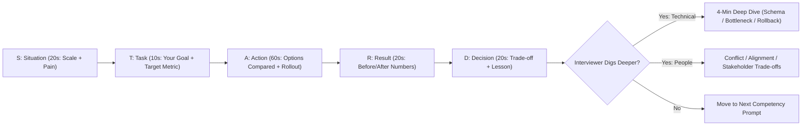

# Behavioral Architecture Stories: STAR Answers for Design Decisions

> **Prerequisites:** [Previous lesson: GenAI System Design Mock Interview: What Interviewers Look For](../10-genai-system-design-mock-interview/README.md).
> **Estimated Reading Time:** 24–27 minutes
> **Target Audience:** Candidates preparing the behavioural half of senior loops, where design decisions are discussed as stories.

> [!NOTE]
> **In one line:** A good architecture story answers **what was decided, why, what it cost, and what you learned**, in about two minutes, with numbers.

> [!TIP]
> **The Golden Rule:** Be specific about **your** decision and your reasoning. 'We' hides your contribution; vague outcomes hide your impact.

---

## 1. Core Concept & Why Interviewers Test It

In Senior and Staff loops, the system design round tests what you can design on a whiteboard; the behavioral architecture round tests **what you actually shipped, owned, and survived in production**. Interviewers use behavioral architecture prompts to verify that your whiteboard instincts match real-world engineering judgment—specifically how you handle ambiguity, trade-offs, cross-team conflict, and failure.

A classic STAR (Situation, Task, Action, Result) answer is fine for junior roles, but at Senior+ levels it feels incomplete unless you add **D (Decision Reflection)**—explicitly naming the alternatives you rejected, the trade-off you accepted, and what you would change with hindsight.

1. **Ownership Signal ("I" vs. "We"):** Interviewers need to isolate your technical judgment from your team's collective output.
2. **Trade-Off Maturity:** Every real architecture choice sacrifices something (consistency, cost, operability, or velocity). Hiding the downside makes your story sound rehearsed or naive.
3. **Measurable Impact:** Claims like *"the system got much faster"* carry zero calibration; *"p95 latency dropped from 3.2 s to 420 ms and DB CPU fell 35%"* proves you actually measured before and after.

| Element | What Interviewers Score | Weak Signal (Red Flag) |
| :--- | :--- | :--- |
| **Situation & Scale** | Clear system context, traffic/data scale, and business urgency | Vague background with no scale or constraint |
| **Task & Ownership** | Your specific mandate and accountability | *"Our team was asked to..."* with unclear personal role |
| **Action & Options** | 2–3 concrete options evaluated with data, plus safe rollout | *"I decided to add Redis"* with no alternatives considered |
| **Result (Metrics)** | Before/after latency, error rate, cost, or incident count | *"Everyone was happy with the result"* |
| **Decision Reflection** | Candid trade-off accepted + what you would do earlier next time | *"Everything went great, wouldn't change a thing"* |

---

## 2. Quantitative Foundations & Scoring / Capacity Math

Behavioral stories have two quantitative dimensions: **pacing math** (fitting a complete STAR-D arc into a 120–150 second spoken window without rambling) and **story-to-prompt coverage math** (maximizing prompt coverage with minimal memorization).

### Spoken Pacing Budget

At a natural conversational pace of $W \approx 140\text{ words/minute}$ ($2.33\text{ words/sec}$), a 2-minute ($120\text{ s}$) story holds $\sim 280\text{ words}$ total. Allocate the word budget strictly:

$$\text{Total Words} = W_{\text{S}} + W_{\text{T}} + W_{\text{A}} + W_{\text{R}} + W_{\text{D}} \approx 280\text{ words}$$

| Part | Content | Time | Word Budget | Share |
| :--- | :--- | :--- | :--- | :--- |
| **S**ituation | System, scale, constraint, why it mattered | 20 s | ~45 words | 15% |
| **T**ask | Your responsibility and the target metric | 10 s | ~25 words | 8% |
| **A**ction | What **you** did, options compared, rollout plan | 60 s | ~140 words | 50% |
| **R**esult | Measured before/after outcome with numbers | 20 s | ~45 words | 15% |
| **D**ecision | What you traded off, and what you'd do differently | 20 s | ~45 words | 12% |

### Story-to-Prompt Matrix Coverage

If you prepare $N = 6$ core stories and each story maps to $k = 3$–$4$ behavioral themes (e.g., scaling, conflict, ambiguity, failure), your total prompt coverage across a 5-round loop is high without memorizing 25 separate scripts.

$$\text{Coverage Pairs} = \sum_{i=1}^{6} |\text{Themes}(S_i)| \ge 18\text{ distinct prompt angles}$$

Keep a **2-minute core version** (for the initial answer) and a **4-minute deep-dive version** (schema, metrics, rollback plan) ready if the interviewer asks follow-ups.

---

## 3. Rubrics, Checklists & Decision Matrices

### The 6 Essential Stories to Prepare

1. **A scaling decision:** How you identified a bottleneck with profiling/metrics and chose between architectural options.
2. **A reliability failure you owned:** A production incident, how you mitigated blast radius, ran the post-mortem, and prevented recurrence.
3. **A disagreement about design:** How you argued with data/benchmarks against a peer or senior leader, and how it resolved.
4. **A migration or rewrite:** Risk management, dual-write/shadow verification, incremental rollout, and rollback plan.
5. **A trade-off you got wrong:** A decision that backfired and what you changed in your engineering process afterward. Candor is heavily rewarded.
6. **Influence without authority:** Persuading another team or leadership to adopt a standard, contract, or architecture you didn't control.

### Story-to-Prompt Mapping Matrix

| Story Archetype | Primary Prompt | Secondary Prompts It Also Answers |
| :--- | :--- | :--- |
| **1. Scaling Decision** | *"Tell me about a time you improved performance."* | Ambiguity, data-driven decision, cost optimization |
| **2. Reliability Failure** | *"Tell me about a major outage you handled."* | Ownership, high pressure, root-cause analysis |
| **3. Design Disagreement** | *"Tell me about a technical conflict."* | Disagree and commit, mentoring, stakeholder management |
| **4. Migration / Rewrite** | *"Tell me about a risky technical project."* | Incremental delivery, backward compatibility, planning |
| **5. Wrong Trade-Off** | *"Tell me about a mistake or failure."* | Humility, learning velocity, course correction |
| **6. Influence w/o Authority** | *"Tell me about driving alignment across teams."* | Cross-org leadership, RFCs, RFC consensus building |

---

## 4. Visual Workflows & Mock Interview Flows

### STAR-D Narrative Arc & Follow-Up Branching



### How an Interviewer Probes Your Story

```mermaid
sequenceDiagram
    participant Int as Interviewer
    participant Cand as Candidate

    Int->>Cand: "Tell me about a time you solved a hard scaling bottleneck."
    Cand->>Int: Deliver 2-min STAR-D (p95 3.2s -> 420ms via CDC search index)
    Int->>Cand: Probe 1: "Why didn't you just add Redis caching?"
    Cand->>Int: "Long-tail query hit rate was <18%; caching wouldn't fix cold p95."
    Int->>Cand: Probe 2: "What broke during rollout?"
    Cand->>Int: "Found 2 CDC drift bugs at 5% canary; added hourly reconciliation."
    Int->>Cand: Probe 3: "What would you do differently?"
    Cand->>Int: "Build automated drift detection before enabling shadow traffic."
```

---

## 5. Deep-Dive Walkthrough: Scaling Decision (Worked STAR-D Example)

*Prompt: "Tell me about a time you improved the performance of a system."*

- **Situation (20 s):** Our order search page had a p95 latency of 3.2 seconds at 40,000 searches per hour, and checkout conversion was dropping noticeably during peak hours.
- **Task (10 s):** I owned the search service and was tasked with bringing p95 under 800 ms within one quarter without a full platform rewrite.
- **Action (60 s):** I profiled the endpoint and found 70% of request time was spent in a 3-table SQL join with wildcard `LIKE` filters. I compared three options: (1) composite indexes, (2) Redis query caching, and (3) denormalizing into a dedicated search index. Indexing couldn't accelerate leading-wildcard filters, and query logs showed an 18% cache hit rate due to long-tail filters. I proposed an Elasticsearch/OpenSearch index fed asynchronously via a CDC change stream, rolled out behind a feature flag to 5% shadow/canary traffic before 100%.
- **Result (20 s):** p95 latency dropped from 3.2 s to 420 ms (an 87% reduction), and primary database CPU load fell by 35%.
- **Decision Reflection (20 s):** I explicitly accepted a 2–5 second eventual-consistency lag and the operational cost of a search cluster. If I did it again, I would build automated drift-reconciliation checks *before* launch, because we caught two CDC schema-mapping drift bugs during the first week at 5%.

---

## 6. Deep-Dive Walkthrough: Reliability Failure & Ownership

*Prompt: "Tell me about a production incident you owned and what you changed."*

- **Situation:** During a payment-gateway timeout spike, our checkout service retried failed HTTP POST requests automatically, causing duplicate charges for ~1.4% of active users over 18 minutes.
- **Task:** As the on-call service owner, I needed to stop the duplicate charges immediately, reconcile affected accounts, and eliminate the root cause permanently.
- **Action:** I first disabled automatic client retries via a dynamic config flag to stop the bleeding within 4 minutes, then wrote a reconciliation script against gateway settlement logs to auto-refund duplicates within 2 hours. For the permanent fix, I introduced client-generated UUID idempotency keys persisted in a unique-constrained Postgres table with an explicit state machine (`INITIATED -> SUCCEEDED / FAILED`) before calling the external gateway.
- **Result:** Zero duplicate-charge incidents over the subsequent 12 months across 4M+ transactions, and incident-remediation time for payment anomalies dropped from hours to automated alerts.
- **Decision Reflection:** Adding synchronous idempotency persistence added ~6 ms to p95 checkout latency and required a 7-day key-retention cleanup job. I'd also enforce an integration chaos test for 504 timeouts on all external payment endpoints from day one.

---

## 7. Deep-Dive Walkthrough: Technical Disagreement & Influence Without Authority

*Prompt: "Tell me about a time you disagreed with a peer or leader on an architecture decision."*

- **Situation:** During a monolith-to-services split, a staff engineer on a partner team wanted synchronous gRPC calls across four services on the critical order-placement path.
- **Task:** I was responsible for order-placement availability (99.95% SLO) and needed to align both teams on a resilient boundary without blocking their quarter's roadmap.
- **Action:** Instead of debating opinions, I built a 1-page availability math model showing that chaining four 99.9% synchronous dependencies caps composite availability at $0.999^4 \approx 99.6\%$ (below our 99.95% SLO) and compounds p99 tail latency. I proposed keeping the synchronous path to two hops and emitting an outbox event for downstream fulfillment and notifications. We agreed on a 2-week prototype using a shared protobuf schema.
- **Result:** Order placement maintained 99.97% availability through Black Friday peak (4x normal traffic), while the partner team shipped their fulfillment service on schedule.
- **Decision Reflection:** Async events introduced eventual consistency and required dead-letter queue alerting for the partner team. I learned that bringing availability math and a concrete interface proposal resolves design stalemates 5x faster than architecture debates.

---

## 8. Calibration Across Levels (Mid vs. Senior vs. Staff)

| Dimension | Mid-Level (L4) | Senior (L5) | Staff (L6) |
| :--- | :--- | :--- | :--- |
| **Scope of Story** | Feature or single-service optimization | Multi-service system, incident ownership, cross-team trade-off | Org-wide platform migration, RFC alignment across 3+ teams, multi-quarter bets |
| **Use of Data** | Mentions basic latency or error improvement | Uses profiling, before/after p95/p99, cost, and SLO math to pick options | Ties technical metrics directly to business KPIs, engineering velocity, and risk |
| **Conflict Handling** | Escalates to manager or compromises quickly | Uses prototypes, benchmarks, and RFCs to resolve disagreement | Aligns incentives across conflicting orgs and establishes durable standards |
| **Failure Reflection** | Acknowledges the bug and how it was fixed | Identifies systemic gaps (missing alerts, missing idempotency, rollout gates) | Changes org-wide engineering process, templates, or paved-road tooling |

---

## 9. Failure Modes, Traps & Recovery

| Narrative Trap | What It Sounds Like | How to Recover Mid-Story |
| :--- | :--- | :--- |
| **The "We" Trap** | *"We migrated the database and we saw latency drop..."* | Pivot immediately: *"Specifically, my role was designing the dual-write validator and running the canary..."* |
| **The Rambling Backstory** | 90 seconds explaining the company's business model | Cut to the chase: *"To keep it brief, the core constraint was 3.2 s p95 on 40K/hr searches."* |
| **No Rejected Alternatives** | *"So I added Kafka and it worked."* | Insert the trade-off: *"We rejected polling Postgres because of lock contention, and accepted Kafka's consumer lag."* |
| **Zero Metrics** | *"The system became much more reliable."* | Use honest proxies if exact dashboards are gone: *"Incidents dropped from ~2/week to 1/quarter."* |
| **Blaming Partner Teams** | *"The other team refused to listen and wrote bad code."* | Reframe neutrally: *"They optimized for delivery speed under a deadline; I optimized for p99 isolation."* |

---

## 10. Real-World Calibration & Post-Mortem Case Study

### Case Study: Why Strong Engineers Still Fail Senior Behavioral Rounds

A principal engineer coaching 40+ senior candidates tracked why candidates with strong system design scores still received "No Hire" or down-level (L5 $\to$ L4) outcomes in behavioral architecture rounds:

1. **62% lacked explicit rejected alternatives:** Candidates described *what* they built, not *why* they rejected two other viable architectures. Without options compared, interviewers scored them at Mid-level (execution) rather than Senior (judgment).
2. **48% had no measured Result or only gave team-wide numbers:** Saying *"our org cut cloud spend"* without isolating their specific service or contribution failed ownership checks.
3. **35% dodged the "mistake" prompt:** Answering *"Tell me about a time you got a trade-off wrong"* with a disguised humble-brag (*"I worked too hard on perfection"*) triggered an immediate candor red flag.

**The Fix:** Structuring every story as a 6-field data record (`situation`, `task`, `action_options`, `result_metric`, `tradeoff`, `lesson`) and rehearsing each aloud against a 120-second timer lifted pass rates dramatically because every senior rubric signal became explicit.

---

## 11. Executable Reference Tooling (4 Languages)

Below is a **STAR-D Story Readiness & Coverage Auditor** in Go, TypeScript, Python, and C#. It validates that every story contains all 6 required senior signals and reports which stories are interview-ready vs. incomplete.

````carousel
```go
package main

import (
	"fmt"
	"strings"
)

type Story struct {
	Name         string
	Situation    string
	Task         string
	Action       string
	ResultMetric string
	Tradeoff     string
	Lesson       string
}

func missingFields(s Story) []string {
	checks := []struct{ k, v string }{
		{"situation", s.Situation}, {"task", s.Task}, {"action", s.Action},
		{"result_metric", s.ResultMetric}, {"tradeoff", s.Tradeoff}, {"lesson", s.Lesson},
	}
	var missing []string
	for _, c := range checks {
		if strings.TrimSpace(c.v) == "" {
			missing = append(missing, c.k)
		}
	}
	return missing
}

func main() {
	stories := []Story{
		{"search latency", "p95 3.2s", "under 800ms", "search index via CDC", "420 ms p95", "staleness", "consistency checks earlier"},
		{"payments outage", "duplicate charges", "stop and fix", "idempotency keys", "", "", "test retries"},
	}
	for _, s := range stories {
		if m := missingFields(s); len(m) == 0 {
			fmt.Printf("%s: ready\n", s.Name)
		} else {
			fmt.Printf("%s: missing %s\n", s.Name, strings.Join(m, ", "))
		}
	}
}
```
<!-- slide -->
```typescript
interface Story {
  situation: string;
  task: string;
  action: string;
  result_metric: string;
  tradeoff: string;
  lesson: string;
}

const REQUIRED: (keyof Story)[] = [
  "situation", "task", "action", "result_metric", "tradeoff", "lesson",
];

const stories: Record<string, Story> = {
  "search latency": {
    situation: "p95 3.2s", task: "under 800ms", action: "search index via CDC",
    result_metric: "420 ms p95", tradeoff: "staleness", lesson: "consistency checks earlier",
  },
  "payments outage": {
    situation: "duplicate charges", task: "stop and fix", action: "idempotency keys",
    result_metric: "", tradeoff: "", lesson: "test retries",
  },
};

for (const [name, story] of Object.entries(stories)) {
  const missing = REQUIRED.filter((f) => !story[f].trim());
  console.log(`${name}: ${missing.length === 0 ? "ready" : "missing " + missing.join(", ")}`);
}
```
<!-- slide -->
```python
REQUIRED = ["situation", "task", "action", "result_metric", "tradeoff", "lesson"]

stories = {
    "search latency": {
        "situation": "p95 3.2s",
        "task": "get under 800ms",
        "action": "search index via change stream",
        "result_metric": "420 ms p95",
        "tradeoff": "staleness",
        "lesson": "consistency checks earlier",
    },
    "payments outage": {
        "situation": "duplicate charges",
        "task": "stop and fix",
        "action": "idempotency keys",
        "result_metric": "",
        "tradeoff": "",
        "lesson": "test retries",
    },
}

for name, story in stories.items():
    missing = [f for f in REQUIRED if not story.get(f)]
    print(f"{name}: {'ready' if not missing else 'missing ' + ', '.join(missing)}")
```
<!-- slide -->
```csharp
using System;
using System.Collections.Generic;
using System.Linq;

class StoryAuditor
{
    static readonly string[] Required = { "situation", "task", "action", "result_metric", "tradeoff", "lesson" };

    static void Main()
    {
        var stories = new Dictionary<string, Dictionary<string, string>>
        {
            ["search latency"] = new()
            {
                ["situation"] = "p95 3.2s", ["task"] = "under 800ms", ["action"] = "search index via CDC",
                ["result_metric"] = "420 ms p95", ["tradeoff"] = "staleness", ["lesson"] = "consistency checks earlier"
            },
            ["payments outage"] = new()
            {
                ["situation"] = "duplicate charges", ["task"] = "stop and fix", ["action"] = "idempotency keys",
                ["result_metric"] = "", ["tradeoff"] = "", ["lesson"] = "test retries"
            }
        };

        foreach (var (name, fields) in stories)
        {
            var missing = Required.Where(r => !fields.TryGetValue(r, out var v) || string.IsNullOrWhiteSpace(v)).ToList();
            Console.WriteLine($"{name}: {(missing.Count == 0 ? "ready" : "missing " + string.Join(", ", missing))}");
        }
    }
}
```
````

---

## 12. Verification & CLI Diagnostics

Use these quick CLI checks to audit your story bank and enforce the 280-word (~2-minute) spoken pacing limit:

```bash
# 1. Check word count of a written STAR-D story (target: 240-310 words for 2 minutes)
wc -w story_search_latency.txt

# 2. Verify all 6 required STAR-D fields are non-empty in a JSON story bank
python -c "import json; req=['situation','task','action','result_metric','tradeoff','lesson']; bank=json.load(open('stories.json')); print({k:[f for f in req if not v.get(f)] for k,v in bank.items()})"

# 3. Check ratio of 'I ' vs 'We ' pronouns in your draft story to catch over-using 'we'
python -c "txt=' '+open('story.txt').read().lower(); print('I:', txt.count(' i '), 'We:', txt.count(' we '))"
```

---

## 13. Common Interview Mistakes & Red Flags

1. **Saying "we" for every technical decision:** Hides whether you drove the architecture or merely implemented someone else's ticket.
2. **Zero numbers or mismatched numbers:** Claiming *"huge latency improvement"* without before/after baselines.
3. **Telling a story with no alternatives or trade-offs:** Makes the decision sound trivial or accidental rather than engineered.
4. **Skipping failure/mistake stories:** Senior+ candidates are expected to have shipped imperfect trade-offs and learned from them.
5. **Blaming another team or manager:** Frame disagreements around competing constraints (speed vs. reliability, cost vs. latency), never personalities.
6. **Running over 3 minutes without pausing:** Monologuing for 5 minutes prevents the interviewer from probing and wastes loop time.
7. **Not rehearsing aloud to a timer:** Reading bullet points silently feels fast; speaking them coherently takes 30–40% longer.

---

## 14. Key Terminology & Glossary

| Key Term | Definition |
| :--- | :--- |
| **STAR-D** | Situation, Task, Action, Result, plus **Decision reflection** (trade-off accepted and hindsight lesson). |
| **Decision Reflection** | The explicit senior signal explaining what you sacrificed and what you would change next time. |
| **Ownership Signal** | Clear attribution using *"I"* for your analysis, proposals, and execution within a team context. |
| **Story Matrix** | Mapping 6 core architecture stories across 15+ behavioral competency prompts to avoid over-memorization. |
| **2-Min / 4-Min Versions** | Keeping a concise 2-minute summary for the initial answer and a 4-minute technical deep dive for follow-ups. |
| **Disagree and Commit** | Advocating with data for your preferred design, then executing wholeheartedly if the group chooses another path. |
| **Blameless Post-Mortem** | Incident analysis focused on systemic gaps (missing alerts, missing idempotency, missing gates) rather than human blame. |
| **Proxy Metric** | An honest, measurable substitute (hours saved/week, incidents/quarter, review cycle time) when exact revenue/latency logs are unavailable. |
| **Influence Without Authority** | Driving architectural alignment across teams you do not manage via RFCs, prototypes, and shared metrics. |
| **Canary / Shadow Rollout** | Risk-mitigation technique frequently probed in migration stories to prove safe production engineering. |

---

## 15. Interview Follow-Up Questions (12 Q&As)

### Basic Conceptual Questions

<details>
<summary><strong>Q1: How long should a behavioral architecture story be? [BASIC]</strong></summary>

Aim for **2 minutes (~260–300 words)** for the initial STAR-D pass, leaving room for the interviewer to ask 2–3 minutes of targeted technical or leadership follow-ups.

</details>

<details>
<summary><strong>Q2: How many stories do I need to prepare for a full interview loop? [BASIC]</strong></summary>

Six well-crafted stories are enough: scaling decision, reliability failure, design disagreement, migration/rewrite, wrong trade-off, and influence without authority. Each story can be angled to answer 3–4 different prompts.

</details>

<details>
<summary><strong>Q3: What if I don't have big-company scale or exact dashboard numbers? [BASIC]</strong></summary>

Use honest relative or operational numbers—build time cut from 22 min to 6 min, on-call pages down from 8/week to 1/month, manual hours saved per week—and explain briefly how you measured them.

</details>

<details>
<summary><strong>Q4: Is it safe to tell a story where my architecture failed? [BASIC]</strong></summary>

Yes—in fact, it is expected at Senior and Staff levels. Choose a real technical misjudgment, own it without excuses, quantify the impact, and emphasize the systemic safeguard you put in place afterward.

</details>

### Scenario-Based Architecture Questions

<details>
<summary><strong>Q5: What if the interviewer interrupts my story halfway through? [SCENARIO]</strong></summary>

Do not fight to finish your script. Pause immediately, answer their specific question concisely, and ask if they'd like you to continue the outcome or move to the next question. Interruptions usually mean they already got the context and want to probe depth.

</details>

<details>
<summary><strong>Q6: How do I answer "Tell me about a time you disagreed with your manager or staff engineer"? [SCENARIO]</strong></summary>

Show that you brought **data, benchmarks, or availability math** rather than emotion. Explain what both sides were optimizing for, how you ran a small prototype or RFC to de-risk the decision, and how you aligned afterward.

</details>

<details>
<summary><strong>Q7: My best architecture project was a team effort of 5 engineers. How do I avoid sounding arrogant while avoiding "we"? [SCENARIO]</strong></summary>

Frame the team goal briefly in Situation/Task (*"Our 5-person team owned checkout"*), then switch to *"I"* for your exact slice (*"I profiled the bottleneck, wrote the RFC for CDC indexing, and implemented the canary comparator"*).

</details>

<details>
<summary><strong>Q8: What if an interviewer asks a prompt that doesn't match any of my 6 stories? [SCENARIO]</strong></summary>

Pause for 5 seconds and pivot one of your 6 stories by changing the emphasis in the **Action** and **Decision** sections—for example, your migration story can highlight *ambiguity*, *risk management*, or *cross-team communication* depending on the prompt.

</details>

### Advanced & Tricky Interview Questions

<details>
<summary><strong>Q9: How do you show Staff-level (L6) judgment vs. Senior-level (L5) judgment in a behavioral story? [TRICKY]</strong></summary>

Senior stories show owning a multi-service technical solution and its trade-offs. Staff stories show **multiplying other teams**: aligning conflicting org incentives, establishing durable paved-road standards/RFCs, and tying architectural bets to multi-quarter business strategy.

</details>

<details>
<summary><strong>Q10: What if the interviewer challenges your Result metric and asks how you isolated it from other changes? [TRICKY]</strong></summary>

Be candid about confounding factors. Explain how you used feature flags, A/B holdouts, or before/after time-series correlation on the specific endpoint—and if other changes shipped simultaneously, acknowledge them honestly.

</details>

<details>
<summary><strong>Q11: How do you talk about a project that was cancelled before launch? [TRICKY]</strong></summary>

Focus on why it was the right engineering or business call to stop, what you learned during prototyping/shadow testing, and how you salvaged reusable components or documentation for the org.

</details>

<details>
<summary><strong>Q12: What is the biggest red flag in the "Decision Reflection" part of STAR-D? [TRICKY]</strong></summary>

Saying *"Honestly, it worked out great and I wouldn't change anything."* Even successful architectures accumulate tech debt, operational toil, or missing observability—naming one concrete thing you'd improve signals true production maturity.

</details>

---

## 16. One-Page Master Cheat Sheet

```text
+-----------------------------------------------------------------------------+
|             BEHAVIORAL ARCHITECTURE STORIES (STAR-D) CHEAT SHEET            |
+-----------------------------------------------------------------------------+
| STRUCTURE : S (20s) -> T (10s) -> A (60s) -> R (20s) -> D (20s) = ~2 mins   |
| WORD CAP  : ~280 words total at 140 wpm (keep a 4-min deep-dive ready)      |
| 6 STORIES : 1. Scaling  2. Outage  3. Disagreement  4. Migration            |
|             5. Wrong Trade-Off     6. Influence Without Authority           |
| MUST HAVE : "I" ownership, 2+ options compared, before/after metric, lesson |
| AVOID     : "We"-only language, no numbers, blaming others, 5-min monologues|
+-----------------------------------------------------------------------------+
```

| Topic | Remember |
| :--- | :--- |
| **Structure** | Situation, Task, Action, Result, Decision reflection |
| **Prepare** | Scaling, reliability failure, disagreement, migration, wrong trade-off, influence |
| **Include** | Your actions, rejected options, a measured metric, a trade-off, a candid lesson |
| **Time** | ~2 minutes spoken, with a 4-minute technical deep dive ready |
| **Avoid** | We-only language, vague outcomes, skipping failures |

---

## Further Reading

- Will Larson, *Staff Engineer: Leadership beyond the management track*.
- Tanya Reilly, *The Staff Engineer's Path*.
- [Peer Mock Interviews for System Design](../08-peer-mock-interviews-for-system-design/README.md) in this track.

---

## Next

Continue with [Weak-Area Review Loop: Find and Fix Your System Design Gaps](../12-weak-area-review-loop/README.md).
