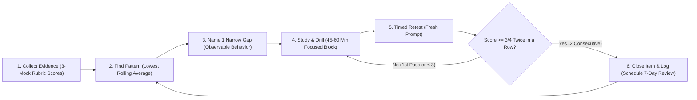
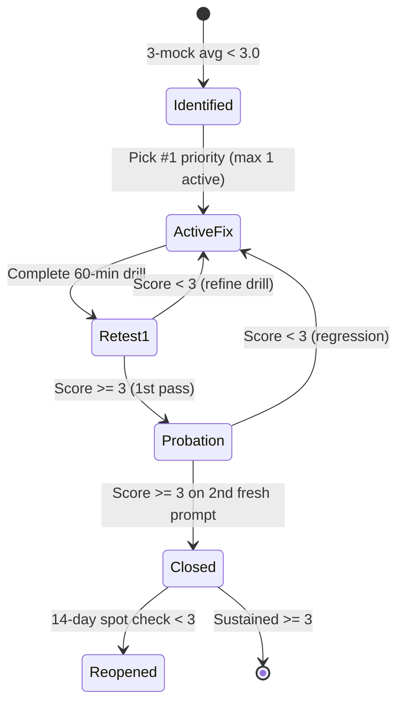

# Weak-Area Review Loop: Find and Fix Your System Design Gaps

> **Prerequisites:** [Previous lesson: Behavioral Architecture Stories: STAR Answers for Design Decisions](../11-behavioral-architecture-stories/README.md).
> **Estimated Reading Time:** 24–27 minutes
> **Target Audience:** Candidates who have done several mocks and want a systematic way to turn feedback into improvement.

> [!NOTE]
> **In one line:** A weak-area loop is **measure, pick one gap, study it, test it, repeat**, with a log that shows progress.

> [!TIP]
> **The Golden Rule:** Fix one weakness at a time and prove the fix with a fresh attempt. Studying everything equally is how weak areas stay weak.

---

## 1. Core Concept & Why Interviewers Test It

Most candidates plateau after 3–4 mock interviews because they practice **unstructured repetition**: they do another 45-minute mock on a random prompt, feel vaguely good or bad afterward, and then re-read topics they already enjoy. In deliberate practice (Anders Ericsson), improvement comes from isolating the **lowest-scoring sub-skill**, applying targeted corrective drills, and re-testing under realistic time pressure until the behavior becomes automatic.

In a real interview, you are only as strong as your **minimum rubric row**. A candidate who scores 4/4 on High-Level Architecture and Databases but 1/4 on Failure Modes or Capacity Estimation often receives a "No Hire" or down-level because one severe blind spot creates production risk.

1. **Multi-Session Signal Over Noise:** A single low score can be an unfamiliar prompt; a low 3-session rolling average is a genuine structural gap.
2. **Observable Behavior Over Vague Labels:** Naming a gap *"communication"* is useless. Naming it *"capacity estimation: I calculate QPS at minute 6 and never reference it when sizing shards or caches at minute 22"* is immediately testable.
3. **Verification Gate:** A gap is never closed by reading a chapter; it is closed only after **two consecutive 3+/4 scores** on fresh, timed prompts.

| Practice Mode | Typical Behavior | Why It Fails or Succeeds |
| :--- | :--- | :--- |
| **Random Mock Grinding** | Doing 10 mocks without a rubric log | Repeats the same pacing and depth mistakes on every prompt |
| **Comfort-Zone Studying** | Re-reading caching/Kafka because it feels familiar | Leaves weak rows (e.g., ACLs, estimation, DR) stuck at 1–2/4 |
| **Single-Fix Assumption** | Assuming reading a post fixes a gap | Fails under 45-minute cognitive load without timed retesting |
| **Weak-Area Loop** | Rolling 3-mock average -> 1 narrow gap -> 60m drill -> 2 timed retests | Forces measurable lift on the exact rubric row holding back the hire bar |

---

## 2. Quantitative Foundations & Scoring / Capacity Math

### Rolling Average & Priority Score

Let $S_{t, c} \in \{1, 2, 3, 4\}$ be your rubric score in session $t$ for competency $c$ (e.g., `Estimation`, `Depth`, `Trade-offs`, `Failures`). Over the last $W = 3$ mocks, the rolling mean is:

$$\bar{S}_c = \frac{1}{W} \sum_{t=T-W+1}^{T} S_{t, c}$$

When two competencies tie for the lowest $\bar{S}_c$, break the tie using **Impact Leverage** $L_c$ (how early in the 45-minute interview the gap cascades into other sections) and **Variance** $\sigma_c$:

$$\text{Priority}(c) = (4 - \bar{S}_c) \cdot L_c$$

For example, `Clarification & Estimation` ($L = 1.4$) cascades into `Database Sizing`, `Caching`, and `Sharding`, whereas `Summary` ($L = 1.0$) does not.

### Worked Numerical Example: 3-Session Rubric Audit

Suppose your last three mock rubrics scored:

| Session | Estimation | Depth | Trade-offs | Failures |
| :--- | :---: | :---: | :---: | :---: |
| **Mock 1** | 2 | 3 | 2 | 1 |
| **Mock 2** | 3 | 3 | 2 | 2 |
| **Mock 3** | 2 | 4 | 3 | 1 |
| **3-Mock Average ($\bar{S}_c$)** | **2.33** | **3.33** | **2.33** | **1.33** |

1. **Lowest Average:** `Failures` at $\bar{S} = 1.33$ (deficit $4 - 1.33 = 2.67$). Even though `Estimation` scored a 2 twice, `Failures` is the clear #1 bottleneck.
2. **Tie-Break Next:** Between `Estimation` ($\bar{S} = 2.33, L = 1.4 \implies \text{Priority} = 2.34$) and `Trade-offs` ($\bar{S} = 2.33, L = 1.2 \implies \text{Priority} = 2.00$), `Estimation` goes second.
3. **Spaced-Repetition Decay:** Closed items are re-checked on a **1-day -> 3-day -> 7-day -> 14-day** cadence so early fixes don't regress while you work on new gaps.

---

## 3. Rubrics, Checklists & Decision Matrices

### The Weakness Log Schema

| Date | Weakness (Observable) | Evidence | Fix Block (45–60 min) | Retest Result | Status |
| :--- | :--- | :--- | :--- | :--- | :--- |
| **03 Dec** | Estimation not used later in design | 2/4 in two mocks | Estimation lesson + 3 sizing drills | 3/4 (URL Shortener) | Open |
| **10 Dec** | No failure modes / circuit breakers | 1/4 in Mock 1 & 3 | Failures lesson + 10-min failure drill | 3/4 (Notification) | Open |
| **17 Dec** | Estimation not used later in design | Retest 1: 3/4, Retest 2: 4/4 | Repeat drill (Chat System) | 4/4 | **Closed** |

### Matching Weaknesses to Targeted Lessons

| Observed Weakness | Study This Target Module | Drill to Prove the Fix |
| :--- | :--- | :--- |
| **Do not know where to start** | [Interview Framework](../../21-interview-framework/README.md), lessons 1–4 | 10-min clarification + API contract drill on 3 prompts |
| **Estimates feel random** | [Numbers to memorize](../01-system-design-numbers-to-memorize/README.md) & [Capacity Estimation](../../21-interview-framework/05-capacity-estimation-in-system-design-interviews/README.md) | 5-min QPS/RAM/bandwidth drill + tie 1 number to sharding |
| **Shallow on databases** | [Revise database choices](../02-revise-database-choices/README.md) | Compare Postgres vs. DynamoDB vs. Cassandra for 3 workloads |
| **Shaky on consistency** | [Revise caching, messaging and consistency](../03-revise-caching-messaging-and-consistency/README.md) | Trace cache-aside stampede + outbox pattern end-to-end |
| **Ignore failures & security** | [Revise reliability and security](../04-revise-reliability-and-security-patterns/README.md) | Run a 5-min failure injection pass on your last diagram |
| **GenAI gaps** | [Revise GenAI system design](../05-revise-genai-system-design/README.md) | Sketch RAG with ACL pre-filtering, evals, and token cost |
| **Cannot defend choices** | [Trade-off library](../06-build-a-trade-off-library-for-system-design-interviews/README.md) | State 2 options + switch condition for 5 components |
| **Run out of depth** | [Deep-dive drills](../09-deep-dive-drills/README.md) | 3-level drill on B-tree/LSM, Kafka partitions, or rate limiters |
| **Slow or rambling** | [Timed solo practice](../07-timed-solo-practice/README.md) | Strict 45-min mock with alarms at 5, 10, 20, 35, 40 min |

---

## 4. Visual Workflows & Mock Interview Flows

### The 6-Step Weak-Area Review Loop



### Gap Lifecycle State Machine



---

## 5. Deep-Dive Walkthrough: Turning Vague Feedback into Observable Fixes

Peers and interviewers often give vague feedback like *"You need more depth"* or *"Your pacing felt rushed."* If you log that verbatim, you cannot drill it. Translate every vague critique into a **concrete, falsifiable trigger**:

| Vague Feedback | Observable Root Cause | 60-Minute Fix Block |
| :--- | :--- | :--- |
| *"Needs more depth"* | Stops at box names (*"we'll use Kafka"*) without explaining partitioning key, consumer group lag, or DLQ | Run a 3-level deep-dive drill on 3 core components: storage layout, hot-key handling, and failure recovery |
| *"Pacing felt rushed"* | Spends 18 minutes on requirements + estimation, leaving 5 minutes for deep dives | Practice a 5-min hard timer for Clarify and 5-min hard timer for Estimate on 3 prompts back-to-back |
| *"Didn't justify choices"* | Picks Postgres or Redis by habit without stating the rejected alternative | Write 10 trade-off cards with the exact template: *"Chose X over Y because Z; switch to Y if W"* |

---

## 6. Deep-Dive Walkthrough: Running a 60-Minute Fix Block

Do not spend 60 minutes passively reading. Structure your fix block with strict timeboxes:

1. **0–15 min (Diagnose & Read):** Re-read your last mock's notes for the target gap, then read *only* the matching revision section (not the whole track).
2. **15–35 min (Isolated Micro-Drill):** Practice the specific sub-skill in isolation across 2–3 prompts. Example for `Failures`: take three previous diagrams and spend 6 minutes each injecting (a) primary DB failover, (b) cache cluster eviction storm, and (c) downstream 504 timeout storm.
3. **35–55 min (Mini-Mock Verification):** Run a 20-minute timed slice of a *brand-new* prompt focusing on that skill from the start.
4. **55–60 min (Log & Schedule):** Record the exact score, what improved, and the date of Retest #2 (48 hours later).

---

## 7. Deep-Dive Walkthrough: Preventing Regression with Spaced Repetition

A classic trap is fixing `Estimation` in Week 1, moving to `Failures` in Week 2, and realizing in Week 3 that your `Estimation` has slipped back to 2/4 because you stopped anchoring designs to numbers.

- **WIP Limit = 1 Active, Max 3 Open:** Never work on 4 weaknesses simultaneously; cognitive overload prevents habit formation.
- **2-Pass Closure Rule:** One 3/4 retest can be prompt luck. Require two consecutive 3+/4 scores on *different* system archetypes (e.g., one read-heavy social feed, one write-heavy telemetry/payments system).
- **14-Day Regression Spot Check:** Every closed item gets one quick 10-minute verification inside a full mock two weeks later.

---

## 8. Calibration Across Levels (Mid vs. Senior vs. Staff)

| Dimension | Mid-Level (L4) | Senior (L5) | Staff (L6) |
| :--- | :--- | :--- | :--- |
| **Target Rubric Bar** | Consistent $\ge 2.5$–$3.0$, zero 1s | Consistent $\ge 3.0$ across all rows, $\ge 3.5$ in Depth & Trade-offs | Consistent $\ge 3.5$ across all rows, leads ambiguity & org-scale trade-offs |
| **Top Typical Gaps** | Missing estimation, forgetting caching/indexing details | Shallow failure modes, weak trade-off defense, poor timeboxing | Over-engineering simple prompts, missing multi-region/cost/migration strategy |
| **Loop Cadence** | 2–3 fix blocks/week over 3 weeks | 3–4 fix blocks/week over 2–3 weeks with peer calibration | Focused peer mocks with Staff+ peers probing ambiguity and operational cost |

---

## 9. Failure Modes, Traps & Recovery

| Loop Failure Mode | Symptom | Corrective Action |
| :--- | :--- | :--- |
| **Studying what you enjoy** | 4 hours on distributed consensus while `Clarification` is 2/4 | Force selection strictly via `min(rolling_avg)` |
| **Vague weakness labels** | Log says *"Get better at scale"* | Rewrite with a concrete observable rule (*"State QPS, storage, and peak factor in <5 min"*) |
| **Skipping the retest** | Reading 3 articles and marking the gap "Done" | Keep status `Open` until 2 timed mocks score $\ge 3/4$ |
| **Too many open items** | 7 active weaknesses in progress | Freeze 4 items in a backlog; keep max 1 `Active` and 2 `Probation` |
| **No written log** | Feeling like you aren't improving despite 6 mocks | Track every mock date, prompt, and 1–4 scores in a single CSV/JSON/Markdown table |

---

## 10. Real-World Calibration & Post-Mortem Case Study

### Case Study: Breaking a 4-Mock Plateau in 10 Days

**Background:** A senior backend candidate completed four peer mocks in two weeks and stalled at borderline scores (`2.5, 2.5, 2.75, 2.5`), feeling exhausted from studying "everything."

**Diagnosis via 3-Mock Audit:** Looking at the last three rubrics revealed a clear pattern:
- `Architecture`: 3, 3, 3 (3.00)
- `Databases`: 3, 3, 4 (3.33)
- `Failures & Reliability`: 1, 2, 1 (1.33)
- `Time Management`: 2, 2, 2 (2.00)

The candidate was spending 28 minutes polishing the happy-path database schema and running out of time before touching timeouts, retries, or failover—which tanked `Failures` and `Time Management` simultaneously.

**Intervention:**
1. **Fix Block 1 (Time Management):** Enforced hard phone alarms at `T+5m` (Clarify), `T+10m` (Estimate), `T+22m` (HLD), `T+37m` (Deep Dives), `T+42m` (Failures), `T+45m` (Summary).
2. **Fix Block 2 (Failures):** Ran three 15-minute failure-injection drills on past diagrams (idempotency, circuit breakers, DLQs, multi-AZ failover).

**Outcome:** Over the next two peer mocks (different prompts: *Rate Limiter* and *Notification System*), `Time Management` hit `3, 4` and `Failures` hit `3, 3`, lifting overall rubric averages from `2.5` to `3.38`—comfortably above the Senior hire bar.

---

## 11. Executable Reference Tooling (4 Languages)

Below is a **Weak-Area Pattern Detector & Priority Ranker** in Go, TypeScript, Python, and C#. It computes rolling averages across recent mock sessions, identifies the lowest consistent competency, and checks closure eligibility.

````carousel
```go
package main

import (
	"fmt"
	"sort"
)

type Session map[string]float64

func main() {
	sessions := []Session{
		{"Estimation": 2, "Depth": 3, "Trade-offs": 2, "Failures": 1},
		{"Estimation": 3, "Depth": 3, "Trade-offs": 2, "Failures": 2},
		{"Estimation": 2, "Depth": 4, "Trade-offs": 3, "Failures": 1},
	}
	totals := map[string]float64{}
	for _, s := range sessions {
		for k, v := range s {
			totals[k] += v
		}
	}
	type avgItem struct {
		area string
		avg  float64
	}
	var results []avgItem
	for k, sum := range totals {
		results = append(results, avgItem{k, sum / float64(len(sessions))})
	}
	sort.Slice(results, func(i, j int) bool { return results[i].avg < results[j].avg })
	for _, r := range results {
		fmt.Printf("%-11s %.2f\n", r.area, r.avg)
	}
	fmt.Printf("focus on: %s\n", results[0].area)
}
```
<!-- slide -->
```typescript
type RubricRow = "Estimation" | "Depth" | "Trade-offs" | "Failures";

const sessions: Record<RubricRow, number>[] = [
  { Estimation: 2, Depth: 3, "Trade-offs": 2, Failures: 1 },
  { Estimation: 3, Depth: 3, "Trade-offs": 2, Failures: 2 },
  { Estimation: 2, Depth: 4, "Trade-offs": 3, Failures: 1 },
];

const areas = Object.keys(sessions[0]) as RubricRow[];
const averages = areas
  .map((area) => ({
    area,
    avg: sessions.reduce((sum, s) => sum + s[area], 0) / sessions.length,
  }))
  .sort((a, b) => a.avg - b.avg);

for (const item of averages) {
  console.log(`${item.area.padEnd(11)} ${item.avg.toFixed(2)}`);
}
console.log(`focus on: ${averages[0].area}`);
```
<!-- slide -->
```python
sessions = [
    {"Estimation": 2, "Depth": 3, "Trade-offs": 2, "Failures": 1},
    {"Estimation": 3, "Depth": 3, "Trade-offs": 2, "Failures": 2},
    {"Estimation": 2, "Depth": 4, "Trade-offs": 3, "Failures": 1},
]

areas = sessions[0].keys()
avg = {a: sum(s[a] for s in sessions) / len(sessions) for a in areas}

for area, val in sorted(avg.items(), key=lambda kv: kv[1]):
    print(f"{area:<11} {val:.2f}")

print("focus on:", min(avg, key=avg.get))
```
<!-- slide -->
```csharp
using System;
using System.Collections.Generic;
using System.Linq;

class WeakAreaDetector
{
    static void Main()
    {
        var sessions = new List<Dictionary<string, double>>
        {
            new() { ["Estimation"] = 2, ["Depth"] = 3, ["Trade-offs"] = 2, ["Failures"] = 1 },
            new() { ["Estimation"] = 3, ["Depth"] = 3, ["Trade-offs"] = 2, ["Failures"] = 2 },
            new() { ["Estimation"] = 2, ["Depth"] = 4, ["Trade-offs"] = 3, ["Failures"] = 1 },
        };

        var areas = sessions[0].Keys.ToList();
        var ranked = areas
            .Select(a => (Area: a, Avg: sessions.Average(s => s[a])))
            .OrderBy(x => x.Avg)
            .ToList();

        foreach (var item in ranked)
            Console.WriteLine($"{item.Area,-11} {item.Avg:F2}");

        Console.WriteLine($"focus on: {ranked[0].Area}");
    }
}
```
````

---

## 12. Verification & CLI Diagnostics

Track your mock history in a simple JSONL file (`mocks.jsonl`) and run these diagnostic commands before each study session:

```bash
# 1. Compute 3-mock rolling average per rubric row from mocks.jsonl
python -c "import json; rows=[json.loads(l) for l in open('mocks.jsonl')][-3:]; keys=rows[0].keys(); avg={k:sum(r[k] for r in rows)/len(rows) for k in keys}; print(sorted(avg.items(), key=lambda x: x[1]))"

# 2. Check if any weakness in weakness_log.json has >=2 consecutive scores >=3 (ready to close)
python -c "import json; log=json.load(open('weakness_log.json')); print([w['name'] for w in log if w['status']=='Open' and w.get('retests',[])[-2:] >= [3,3]])"

# 3. Enforce WIP limit: verify at most 3 items are currently Open
python -c "import json; log=json.load(open('weakness_log.json')); open_items=[w for w in log if w['status']=='Open']; assert len(open_items)<=3, f'Too many open: {len(open_items)}'; print('WIP OK:', len(open_items))"
```

---

## 13. Common Interview Mistakes & Red Flags

1. **Choosing weaknesses by gut feeling:** Gut feel gravitates toward topics you recently forgot rather than the row consistently scoring 1–2/4.
2. **Studying 4–5 topics simultaneously:** Splits focus and prevents any single behavior from sticking under 45-minute pressure.
3. **Declaring a weakness fixed after one good mock:** One 3/4 can be a lucky prompt; require two consecutive 3+/4 scores on distinct prompts.
4. **Keeping no written rubric log:** Without a log, you cannot spot multi-session patterns or see objective progress when confidence dips.
5. **Never revisiting closed items:** Early fixes (like estimation or pacing) decay if not spot-checked 14 days later.
6. **Passive reading instead of timed drills:** Reading a 20-minute guide without running a timed 20-minute whiteboard retest does not change interview habits.
7. **Ignoring process gaps in favor of trivia:** Most rejections come from poor pacing, skipped clarification, or missing trade-offs—not obscure database internals.

---

## 14. Key Terminology & Glossary

| Key Term | Definition |
| :--- | :--- |
| **Deliberate Practice** | Structured practice targeting a specific sub-skill just outside current competence, with immediate feedback and retesting. |
| **Rolling 3-Mock Average** | Mean rubric score per competency across the last three mocks, smoothing out single-prompt luck. |
| **Observable Weakness** | A gap phrased as a concrete, testable behavior rather than a vague trait (e.g., *"no circuit breaker"* vs. *"reliability"*). |
| **Fix Block** | A 45–60 minute focused session combining targeted reading, isolated micro-drills, and a timed mini-retest. |
| **2-Pass Closure Rule** | Policy requiring two consecutive $\ge 3/4$ retest scores on different prompts before marking a weakness `Closed`. |
| **WIP Limit** | Work-In-Progress cap (1 active fix, max 3 open weaknesses) to prevent diluted study effort. |
| **Impact Leverage ($L_c$)** | Multiplier reflecting how early a gap cascades into later interview sections (e.g., Clarification/Estimation $\to$ Sharding/Caching). |
| **Probation State** | Intermediate state after 1 passing retest, awaiting a 2nd independent prompt pass before closure. |
| **Spaced Repetition Check** | Scheduled spot-check (e.g., 14 days post-closure) to ensure fixed behaviors do not regress. |
| **Failure-Injection Drill** | Timed 5–10 minute exercise where you intentionally break nodes in an existing diagram and design recovery paths. |

---

## 15. Interview Follow-Up Questions (12 Q&As)

### Basic Conceptual Questions

<details>
<summary><strong>Q1: How do I find my weakest area accurately? [BASIC]</strong></summary>

Score every mock on a 1–4 rubric across core rows (`Clarification`, `Estimation`, `Architecture`, `Depth`, `Trade-offs`, `Failures`, `Communication`). Compute the rolling average over your last 3 mocks and pick the lowest row.

</details>

<details>
<summary><strong>Q2: How long should a targeted fix block be? [BASIC]</strong></summary>

45 to 60 minutes: 15 minutes reading the targeted module, 20 minutes doing isolated micro-drills across 2–3 prompts, and 20 minutes running a timed mini-mock slice.

</details>

<details>
<summary><strong>Q3: When is a weakness officially closed? [BASIC]</strong></summary>

Only after **two consecutive 3+/4 scores** on fresh, timed prompts from different system archetypes (for example, a read-heavy feed and a write-heavy payment/telemetry system).

</details>

<details>
<summary><strong>Q4: How many gaps should I work on at once? [BASIC]</strong></summary>

Keep **1 active** gap in your current fix block and **at most 3 open** in your log. Anything more turns focused deliberate practice into scattered cramming.

</details>

### Scenario-Based Architecture Questions

<details>
<summary><strong>Q5: What if every row on my rubric looks equally weak (all 2s)? [SCENARIO]</strong></summary>

Start with **Clarification & Capacity Estimation**. They sit at minutes 0–10 of every interview, have the highest Impact Leverage ($L_c$), shape your database/cache choices, and improve fastest with 3–4 drills.

</details>

<details>
<summary><strong>Q6: My peer mock gave me great scores, but I failed a real company interview. Why? [SCENARIO]</strong></summary>

Peers are often gentler on follow-up depth and pacing than calibrated company interviewers. Audit where you hesitated in the real loop within 1 hour, log those exact moments as new observable weaknesses, and tighten your retest bar to 3.5+/4.

</details>

<details>
<summary><strong>Q7: How do I drill "Deep-Dive Depth" without memorizing 30 systems? [SCENARIO]</strong></summary>

Pick 10 universal building blocks (B-Tree vs. LSM, Redis eviction/stampede, Kafka partitions/consumer lag, Rate Limiter, Consistent Hashing, Distributed Lock, Outbox, Vector HNSW, S3 multipart, Idempotency) and drill going 3 levels deep on each.

</details>

<details>
<summary><strong>Q8: I keep running out of time at minute 35 before covering failures. What should I drill? [SCENARIO]</strong></summary>

Drill **strict timebox transitions**: set audible alarms at 5, 10, 22, 35, and 40 minutes during solo mocks. When the 35-minute alarm rings, immediately stop deep-diving and pivot to Failures & Trade-offs.

</details>

### Advanced & Tricky Interview Questions

<details>
<summary><strong>Q9: How do I know if a 1/4 score was a knowledge gap vs. a process/panic gap? [TRICKY]</strong></summary>

Ask yourself: *"Could I explain this component clearly if given 10 calm minutes right now?"* If yes, it's a **process/pacing gap** (drill timeboxing and checklists). If no, it's a **knowledge gap** (study the module and run micro-drills).

</details>

<details>
<summary><strong>Q10: Why is a 3-session rolling average better than reacting to the latest mock? [TRICKY]</strong></summary>

Prompt variance is high—an unfamiliar domain (e.g., Geospatial or GenAI) can cause a one-off dip. A 3-session window filters out prompt noise while still reacting quickly enough within a 2–3 week prep cycle.

</details>

<details>
<summary><strong>Q11: What should I do if a previously "Closed" weakness regresses two weeks later? [TRICKY]</strong></summary>

Reopen it immediately, demote it to `ActiveFix`, and investigate *why* it regressed (usually because a new habit like spending extra time on GenAI evaluation crowded out your failure-mode timebox).

</details>

<details>
<summary><strong>Q12: How do I run a Weak-Area Loop when I only have 5 days before an interview? [TRICKY]</strong></summary>

Compress the cycle: run 1 diagnostic mock on Day 1, pick **only the single lowest-scoring row** (usually Estimation, Timeboxing, or Failures), run two 60-minute fix blocks on Days 2–3, and run 1 full validation mock on Day 4 before resting on Day 5.

</details>

---

## 16. One-Page Master Cheat Sheet

```text
+-----------------------------------------------------------------------------+
|                  WEAK-AREA REVIEW LOOP MASTER CHEAT SHEET                   |
+-----------------------------------------------------------------------------+
| THE LOOP  : Evidence (3 mocks) -> Pattern -> 1 Narrow Gap -> 60m Fix ->     |
|             Timed Retest -> Log (Close after 2 consecutive >= 3/4 passes)   |
| WIP LIMIT : 1 Active fix at a time | Max 3 Open items in the log            |
| TIE-BREAK : Priority = (4 - RollingAvg) * ImpactLeverage (Clarify/Est first)|
| FIX BLOCK : 15m Read + 20m Micro-Drills (3 prompts) + 20m Timed Slice + Log |
| RETENTION : Spot-check closed items at 14 days to prevent regression        |
+-----------------------------------------------------------------------------+
```

| Topic | Remember |
| :--- | :--- |
| **Loop** | Evidence, pattern, one narrow weakness, study/drill, retest, log |
| **Log Fields** | Date, observable weakness, evidence, fix block, retest result, status |
| **Close Rule** | Two consecutive $\ge 3/4$ retests on different prompts |
| **WIP Limit** | One active, at most three open |
| **Match** | Use the weakness-to-lesson table to target the exact gap |

---

## Further Reading

- Anders Ericsson and Robert Pool, *Peak: Secrets from the New Science of Expertise* (deliberate practice).
- [Peer Mock Interviews](../08-peer-mock-interviews-for-system-design/README.md) in this track.
- [Timed Solo Practice](../07-timed-solo-practice/README.md) in this track.

---

## Next

Continue with [Are You Ready for System Design Interviews? Final Checklist](../13-are-you-ready-for-system-design-interviews-final-checklist/README.md).
