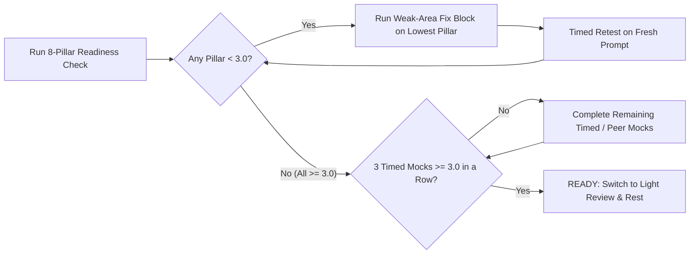
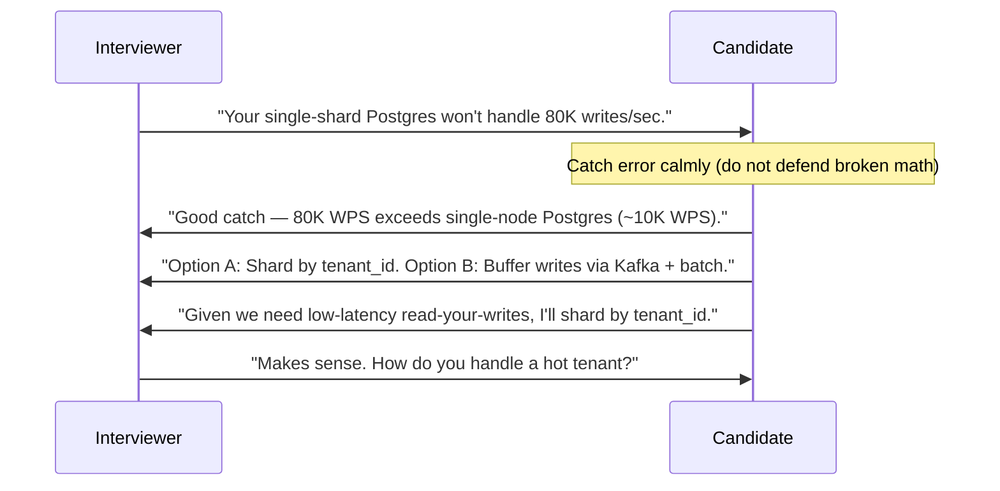

# Are You Ready for System Design Interviews? Final Checklist

> **Prerequisites:** [Previous lesson: Weak-Area Review Loop: Find and Fix Your System Design Gaps](../12-weak-area-review-loop/README.md).
> **Estimated Reading Time:** 24–28 minutes
> **Target Audience:** Candidates a week or two before an interview loop, who want an honest self-check and a last-week plan.

> [!NOTE]
> **In one line:** You are ready when you can **run the framework in 45 minutes, defend your choices, and recover from a stumble**, not when you have memorised the most solutions.

> [!TIP]
> **The Golden Rule:** Readiness is about reliable process under pressure. If you can do three timed mocks in a row with no row below a 3 on the rubric, you are ready.

---

## 1. Core Concept & Why Interviewers Test It

Most candidates delay interviews waiting to feel "100% ready"—a state that never arrives because system design has an unbounded surface area. Interviewers do not expect you to know every distributed protocol from memory; they evaluate whether you have a **repeatable 45-minute engineering process** that stays intact under time pressure, ambiguity, and unexpected follow-up probes.

Readiness is therefore a **measurable gate**, not a mood:

1. **Floor Over Ceiling:** Passing a Senior/Staff loop depends on having **no rubric row below 3/4** across three consecutive timed mocks, rather than having one 4/4 area masking a 1/4 blind spot.
2. **Process Under Stress:** When you blank on an unfamiliar prompt (e.g., *Design a Distributed Cron* or *Design a Live Auction Engine*), your checklist and 9-step framework restart your thinking automatically.
3. **Calm Recovery:** Making a mistake on the whiteboard is normal; noticing it, naming it, fixing the assumption, and moving on is one of the strongest Senior/Staff signals an interviewer can observe.

| Readiness Dimension | Ready State (Pass Bar) | Not-Ready State (Risk Signal) |
| :--- | :--- | :--- |
| **Process** | Runs 9-step framework in 45 min without notes; uses estimates later | Freezes on blank page or runs out of time before Failures/Summary |
| **Knowledge** | Recites core latency/availability numbers; defends DB, cache, queue, DR | Picks technologies by buzzword without stating access patterns |
| **Depth** | Can go 3 levels deep on 10+ components; holds 15+ trade-off cards | Stops at box names (*"we add Kafka and Redis"*) |
| **Communication** | 3+ timed mocks (1+ peer), 6 STAR-D stories, calm recovery when stuck | Silent drawing, defensive when challenged, no structured check-ins |

---

## 2. Quantitative Foundations & Scoring / Capacity Math

### The Readiness Gate Formula

Let your self-assessed or peer-scored competencies across the 8 core pillars (`Process`, `Estimation`, `Databases`, `Consistency`, `Reliability`, `GenAI`, `Depth`, `Communication`) be $s_1, s_2, \dots, s_8 \in \{1, 2, 3, 4\}$. Define the hire-bar threshold $B = 3.0$:

$$\text{Ready} \iff \left( \min_{i=1..8} s_i \ge B \right) \land \left( \frac{1}{8} \sum_{i=1}^{8} s_i \ge 3.0 \right)$$

Notice why the **minimum** matters more than the **mean**:

- Suppose your scores are `{Process: 4, Estimation: 3, Databases: 3, Consistency: 3, Reliability: 2, GenAI: 3, Depth: 3, Communication: 4}`.
- Your mean is $\frac{25}{8} = 3.125 \ge 3.0$, which looks "ready" on average—yet $\min_i s_i = 2$ (`Reliability`). In a real loop, if the interviewer spends 10 minutes probing failover, retries, and idempotency, that single `2` can sink the round.

### Final-Week Time Allocation Budget

With $T = 7$ days remaining and ~2 hours/day of high-focus prep (excluding Day 1 rest), allocate effort inversely to your remaining gaps—never cramming new topics in the final 24 hours:

$$\text{Prep Hours} = \underbrace{4\text{ h}}_{\text{2 Mocks (D7-D6)}} + \underbrace{2\text{ h}}_{\text{Top Gap Fix (D5)}} + \underbrace{2\text{ h}}_{\text{Peer Mock (D4)}} + \underbrace{2\text{ h}}_{\text{Sheets (D3)}} + \underbrace{1.5\text{ h}}_{\text{Light/Stories (D2)}} + \underbrace{0\text{ h new}}_{\text{Rest (D1)}}$$

---

## 3. Rubrics, Checklists & Decision Matrices

### The 15-Point Final Readiness Checklist

Tick each item honestly. Every unticked box becomes your targeted focus for the final week.

**Process**
- [ ] I can run the 9-step framework in 45 minutes without notes.
- [ ] I ask clarifying questions and state assumptions before drawing.
- [ ] I produce a capacity estimate and use it later in the design (DB sizing, shards, cache RAM, bandwidth).
- [ ] I finish with a trade-off summary inside the 45-minute window.

**Knowledge**
- [ ] I can recite the key latency, size, and availability numbers.
- [ ] I can choose and defend a database for an access pattern (read/write ratio, transactions, range scans).
- [ ] I can explain caching, queues, idempotency, transactional outbox, and sagas.
- [ ] I can design for failure: timeouts, jittered retries, circuit breakers, DLQs, and multi-AZ/multi-region DR.
- [ ] I can sketch a RAG/GenAI system with ACL pre-filtering, evaluation, and token cost control.

**Depth**
- [ ] I can go three levels down on at least ten core components.
- [ ] I have a trade-off library of at least fifteen entries with explicit switch conditions.
- [ ] I have completed at least five of the full designs in [Track 22](../../22-interview-design-problems/README.md) from a blank page.

**Communication**
- [ ] I have completed at least three timed mocks (at least one with another person).
- [ ] I have six behavioral STAR-D stories with measured numbers.
- [ ] I recover calmly when I am stuck or wrong.

### The 7-Day Countdown Plan

| Day | Focus | Deliverable |
| :--- | :--- | :--- |
| **7 & 6 days before** | Two timed full mocks (45 min each) | Score all 8 pillars; log top weakness |
| **5 days before** | Fix the #1 weakness below bar | 60-min study block + 2 timed retests |
| **4 days before** | Peer mock on an unfamiliar prompt | External rubric calibration + pacing check |
| **3 days before** | Revision sheets only | Review numbers, DBs, consistency, reliability |
| **2 days before** | Light mock + behavioral rehearsal | Speak 6 STAR-D stories aloud to a 2-min timer |
| **1 day before** | **Rest & mental reset** | Skim trade-off library + 9 steps only; sleep 8h |
| **Interview day** | Execution & composure | Eat, arrive early, test mic/board, keep water nearby |

---

## 4. Visual Workflows & Mock Interview Flows

### Final-Week Go / No-Go Decision Gate



### In-Interview Recovery Sequence (When Stuck or Wrong)



---

## 5. Deep-Dive Walkthrough: Executing During the 45-Minute Interview

Follow these seven behavioral habits during the live round to maximize signal:

1. **Slow down at the start (Minutes 0–5):** Two minutes of structured clarification (functional scope, scale, consistency vs. latency priority) saves ten minutes of drawing the wrong system.
2. **Think aloud continuously:** The interviewer can only credit reasoning they hear. State *why* you are choosing Postgres over DynamoDB before writing the box.
3. **Anchor numbers on the board (Minutes 5–10):** Write `QPS`, `Peak QPS`, `Storage/yr`, and `Cache RAM` in the top-right corner so you can point back to them during sharding and caching.
4. **Explicitly check in (Minute 20):** After drawing the high-level design, pause and ask: *"Does this end-to-end flow match what you expected? Where would you like me to go deeper—storage partitioning, consistency, or failure handling?"*
5. **Use the 2-Option Rule when stuck:** Never sit in silence for 30 seconds. Say what you are stuck on, propose two concrete options, compare one trade-off, and pick one.
6. **Own errors immediately:** If your math is off by 10x or you missed a SPOF, name it (*"Actually, that cache is a single point of failure; let's replicate it"*), fix it, and move on.
7. **Protect the final 8 minutes:** Reserve time for failure modes, security/auth, and a 2-minute trade-off summary.

---

## 6. Deep-Dive Walkthrough: The Post-Interview Debrief Protocol

Within **60 minutes** after every interview (pass or fail), write a 10-line debrief while memory is sharp:

1. **Exact prompt & constraints** given by the interviewer.
2. **What you drew** and which 2 components you deep-dived.
3. **Where you hesitated** or got pushed back by the interviewer.
4. **Root cause classification:** Was the stumble a *process gap* (rushed, skipped numbers, ran out of time) or a *knowledge gap*?
5. **Feed the Weak-Area Loop:** Convert the stumble into an observable item in your weakness log so every interview makes the next one stronger.

---

## 7. Deep-Dive Walkthrough: Interview-Day Logistics & Cognitive Hygiene

Technical readiness fails if cognitive bandwidth is drained by avoidable logistics:

- **Tooling Pre-Flight (Remote):** Test Excalidraw/Miro/whiteboard shortcuts, audio, and camera 30 minutes prior. Have a clean blank canvas template ready (top-right box for numbers, left-to-right flow).
- **Physical Setup:** Keep water nearby, silence all notifications, and keep a physical pen and notepad for quick arithmetic so you aren't fumbling with screen windows.
- **Mental Reset Between Rounds:** In a 4–5 round onsite/virtual loop, never ruminate on Round 1 during Round 2. Take 3 deep breaths, clear your scratchpad, and treat each round as an independent 45-minute slate.

---

## 8. Calibration Across Levels (Mid vs. Senior vs. Staff)

| Readiness Signal | Mid-Level (L4) | Senior (L5) | Staff (L6) |
| :--- | :--- | :--- | :--- |
| **Framework Ownership** | Completes all steps with occasional interviewer nudges | Drives pacing independently; checks in proactively | Sets the agenda, spots hidden business/org constraints early |
| **Trade-Off Articulation** | Explains pros/cons when asked | States rejected alternatives and switch conditions unprompted | Evaluates operational cost, team topology, and multi-quarter evolution |
| **Recovery Under Pressure** | Fixes errors with interviewer hints | Self-corrects math/SPOFs calmly mid-sentence | Turns interviewer pushback into deeper architectural exploration |

---

## 9. Failure Modes, Traps & Recovery

| Pre-Interview / Live Trap | Why It Hurts | Recovery / Prevention |
| :--- | :--- | :--- |
| **Cramming new topics in last 24h** | Increases anxiety and causes recall interference | Freeze new material at `T-24h`; review only your 1-page sheets |
| **Memorizing 20 architectures** | Breaks the moment an interviewer tweaks one constraint | Memorize the 9-step process + 15 trade-off cards instead |
| **Skipping rest the night before** | Slows mental arithmetic and working memory by 20–30% | Stop studying by 7 PM; prioritize 8 hours of sleep |
| **Waiting to feel 100% ready** | Endless procrastination; missing hiring windows | Book the loop once 3 consecutive timed mocks have zero rows $< 3$ |
| **Silent panic when blanking** | Wastes 2–3 minutes and signals helplessness | Return to Step 1: restate requirements, ask 1 question, write QPS |

---

## 10. Real-World Calibration & Post-Mortem Case Study

### Case Study: Process Readiness vs. Knowledge Over-Preparation

**Context:** Two candidates prepared for Senior Backend loops at top-tier tech companies over 6 weeks:
- **Candidate A** read 18 system design case studies passively, did zero timed mocks, and crammed Paxos/Raft papers the night before.
- **Candidate B** completed 6 timed mocks (including 2 peer mocks), built a 15-entry trade-off library, fixed two weak rows (`Estimation` and `Failures`) via the Weak-Area Loop, and rested the day before.

**Outcome:**
- **Candidate A** spent 17 minutes on clarification/HLD, forgot capacity numbers, got flustered when asked to shard a hot key, and ran out of time before discussing failures—receiving a **No Hire** despite knowing distributed systems theory.
- **Candidate B** hit every timebox, anchored sharding to QPS on the board, calmly corrected a cache-invalidation oversight when probed, and finished with a clear 3-bullet trade-off summary—receiving a **Strong Hire (L5)**.

**Takeaway:** Interviews test **execution of a reliable process under a 45-minute clock**, not encyclopedic recall.

---

## 11. Executable Reference Tooling (4 Languages)

Below is a **Final Readiness Gate Checker** in Go, TypeScript, Python, and C#. It evaluates all 8 readiness pillars against the minimum bar ($B = 3$), computes your overall average, and reports whether you are `READY` or which exact pillars to fix first.

````carousel
```go
package main

import (
	"fmt"
	"sort"
)

func main() {
	scores := map[string]int{
		"Process": 4, "Estimation": 3, "Databases": 3, "Consistency": 3,
		"Reliability": 2, "GenAI": 3, "Depth": 3, "Communication": 4,
	}
	const bar = 3
	sum := 0
	var below []string
	for k, v := range scores {
		sum += v
		if v < bar {
			below = append(below, fmt.Sprintf("%s=%d", k, v))
		}
	}
	sort.Strings(below)
	avg := float64(sum) / float64(len(scores))
	fmt.Printf("average: %.2f\n", avg)
	if len(below) == 0 && avg >= float64(bar) {
		fmt.Println("status: READY")
	} else {
		fmt.Printf("fix first: %v\n", below)
	}
}
```
<!-- slide -->
```typescript
const scores: Record<string, number> = {
  Process: 4,
  Estimation: 3,
  Databases: 3,
  Consistency: 3,
  Reliability: 2,
  GenAI: 3,
  Depth: 3,
  Communication: 4,
};

const BAR = 3;
const entries = Object.entries(scores);
const avg = entries.reduce((acc, [, v]) => acc + v, 0) / entries.length;
const below = Object.fromEntries(entries.filter(([, v]) => v < BAR));

console.log(`average: ${avg.toFixed(2)}`);
console.log(
  Object.keys(below).length === 0 && avg >= BAR
    ? "status: READY"
    : `fix first: ${JSON.stringify(below)}`
);
```
<!-- slide -->
```python
scores = {
    "Process": 4,
    "Estimation": 3,
    "Databases": 3,
    "Consistency": 3,
    "Reliability": 2,
    "GenAI": 3,
    "Depth": 3,
    "Communication": 4,
}
BAR = 3
below = {k: v for k, v in scores.items() if v < BAR}
avg = sum(scores.values()) / len(scores)
print("average:", round(avg, 2))
print("READY" if not below and avg >= BAR else f"fix first: {below}")
```
<!-- slide -->
```csharp
using System;
using System.Collections.Generic;
using System.Linq;

class ReadinessGate
{
    static void Main()
    {
        var scores = new Dictionary<string, int>
        {
            ["Process"] = 4, ["Estimation"] = 3, ["Databases"] = 3, ["Consistency"] = 3,
            ["Reliability"] = 2, ["GenAI"] = 3, ["Depth"] = 3, ["Communication"] = 4,
        };
        const int bar = 3;
        var avg = scores.Values.Average();
        var below = scores.Where(kv => kv.Value < bar).ToList();

        Console.WriteLine($"average: {avg:F2}");
        if (below.Count == 0 && avg >= bar)
            Console.WriteLine("status: READY");
        else
            Console.WriteLine("fix first: " + string.Join(", ", below.Select(kv => $"{kv.Key}={kv.Value}")));
    }
}
```
````

---

## 12. Verification & CLI Diagnostics

Run these quick checks during your final week to verify your readiness gate and timebox discipline:

```bash
# 1. Run the 8-pillar readiness gate against your latest scores JSON
python -c "import json; s=json.load(open('readiness.json')); bar=3; b={k:v for k,v in s.items() if v<bar}; print(f'avg={sum(s.values())/len(s):.2f}', 'READY' if not b else f'FIX: {b}')"

# 2. Verify your last 3 mocks in mocks.jsonl all have min(row) >= 3
python -c "import json; rows=[json.loads(l) for l in open('mocks.jsonl')][-3:]; print('3-mock streak OK:', all(min(r.values())>=3 for r in rows))"

# 3. Quick 45-minute mock timer reminder script (prints phase checkpoints)
python -c "phases=[(5,'Clarify'),(10,'Estimate'),(22,'High-Level Design'),(37,'Deep Dives'),(42,'Failures & Security'),(45,'Summary')]; print('\n'.join(f'T+{t:02d}m -> {p}' for t,p in phases))"
```

---

## 13. Common Interview Mistakes & Red Flags

1. **Cramming new distributed systems topics in the last 48 hours:** Creates fatigue and second-guessing without building usable intuition.
2. **Memorizing full solutions instead of the 9-step process:** Fails immediately when the interviewer alters latency, scale, or consistency constraints.
3. **Skipping rest the night before:** Degrades mental math, active listening, and calm recovery.
4. **Waiting to feel 100% ready:** Perfectionism delays interviews indefinitely; three clean timed mocks is the real bar.
5. **Skipping a post-interview write-up:** Wastes your highest-signal practice data if you need another loop.
6. **Ignoring the clock during the interview:** Spending 30 minutes on HLD leaves zero time for deep dives, failure modes, and trade-offs.
7. **Becoming defensive when challenged:** Arguing against valid math or SPOF feedback instead of adapting the design cleanly.

---

## 14. Key Terminology & Glossary

| Key Term | Definition |
| :--- | :--- |
| **Readiness Bar** | Three consecutive timed mocks with no rubric row below 3/4 and calm error recovery. |
| **9-Step Framework** | Repeatable 45-minute structure from clarification and estimation through HLD, deep dives, failures, and summary. |
| **Floor Over Ceiling** | Principle that passing depends on raising your lowest rubric row ($\ge 3$) rather than over-polishing strengths. |
| **Check-In Gate** | Explicit mid-interview pause (~minute 20) asking the interviewer where they want to go deeper. |
| **2-Option Rule** | Recovery tactic when stuck: name the blocker, propose two viable options, and pick one with a trade-off. |
| **Trade-Off Library** | Personal bank of 15+ component comparisons with explicit *"switch to Y when Z"* conditions. |
| **3-Level Drill** | Ability to explain a component's API/role (L1), internals/data structures (L2), and failure/hot-key behavior (L3). |
| **Post-Interview Debrief** | Structured 10-line write-up completed within 60 minutes of an interview to feed the Weak-Area Loop. |
| **Recall Interference** | Cognitive degradation caused by cramming new material right before performance, blurring existing patterns. |
| **Cognitive Hygiene** | Pre-flight tooling checks, rest, hydration, and between-round mental resets during an interview loop. |

---

## 15. Interview Follow-Up Questions (12 Q&As)

### Basic Conceptual Questions

<details>
<summary><strong>Q1: How do I know objectively that I am ready for my interview loop? [BASIC]</strong></summary>

You are ready when you have completed **three timed mocks in a row with no rubric row below 3/4**, can recite your core latency/availability numbers and 15+ trade-off cards, and can recover calmly when challenged.

</details>

<details>
<summary><strong>Q2: What should I do the night before the interview? [BASIC]</strong></summary>

Do a light 20-minute review of the 9-step framework and your trade-off library, prepare your desk/whiteboard, and get a full night's sleep. Studying new material the night before mostly adds anxiety.

</details>

<details>
<summary><strong>Q3: What if my mind goes completely blank on an unfamiliar prompt? [BASIC]</strong></summary>

Fall back immediately to the framework: restate the problem in your own words, ask two clarifying questions (users, scale, latency/consistency), and write down basic QPS/storage numbers. Process restarts thinking.

</details>

<details>
<summary><strong>Q4: Do I need to memorize every system in Track 22 before interviewing? [BASIC]</strong></summary>

No. The same 15–20 building blocks (caches, queues, partitioned DBs, rate limiters, CDC, outbox, vector search) appear in different combinations. Mastering the framework and core components covers unfamiliar prompts.

</details>

### Scenario-Based Architecture Questions

<details>
<summary><strong>Q5: I have 7 days left and my Reliability score is 2/4 while everything else is 3–4/4. What is my plan? [SCENARIO]</strong></summary>

Use Days 6–5 exclusively on Reliability: review timeouts, jittered retries, idempotency, circuit breakers, DLQs, and multi-AZ failover, then run two 15-minute failure-injection drills on past diagrams and one full peer mock on Day 4.

</details>

<details>
<summary><strong>Q6: Halfway through the interview, the interviewer says "Let's change the requirement—now it's 100x more writes." How do I react? [SCENARIO]</strong></summary>

Welcome the pivot calmly: point to your numbers on the board, recalculate write QPS, identify what breaks first (e.g., synchronous SQL indexes or cache write-through), and swap in write-optimized patterns (sharding, LSM/Cassandra, or async queue buffering).

</details>

<details>
<summary><strong>Q7: What if the interviewer seems quiet or gives very little feedback during my design? [SCENARIO]</strong></summary>

Don't rush or over-talk. Keep thinking aloud clearly and use structured **check-ins** every 10–12 minutes (*"I've covered the write path; would you like me to dive into read fan-out or failure recovery next?"*).

</details>

<details>
<summary><strong>Q8: What if I realize at minute 30 that my earlier database choice doesn't support a new query pattern? [SCENARIO]</strong></summary>

Name it transparently: *"For this new range-query requirement, DynamoDB key-value lookups alone won't suffice—we can add a GSI, or project an async read model into Elasticsearch."* Self-correction is a positive senior signal.

</details>

### Advanced & Tricky Interview Questions

<details>
<summary><strong>Q9: Why do candidates with a 3.3+ average still sometimes fail an interview round? [TRICKY]</strong></summary>

Because hiring committees look for **minimum bar across all competencies**, not just a high average. A 4/4 in Architecture paired with a 1/4 in Failures or Communication/Collaboration still creates an unacceptable production or team risk.

</details>

<details>
<summary><strong>Q10: How do I handle a Staff-level interview where the prompt is intentionally vague ("Design a global notifications platform")? [TRICKY]</strong></summary>

Spend the first 5 minutes **shaping the ambiguity**: propose concrete product tiers (transactional OTP vs. marketing bulk), define SLAs per tier, identify multi-region compliance/cost constraints, and get explicit alignment before drawing.

</details>

<details>
<summary><strong>Q11: What should I do if I don't get the offer after preparing thoroughly? [TRICKY]</strong></summary>

Write your 10-line debrief within an hour, separate process gaps from knowledge gaps, feed the exact stumbles into your Weak-Area Review Loop, and re-test. Interview variance exists—even strong Staff engineers fail individual loops due to calibration or prompt fit.

</details>

<details>
<summary><strong>Q12: How do I balance speed vs. completeness in a 45-minute remote whiteboard tool? [TRICKY]</strong></summary>

Keep diagrams minimal: boxes, arrows, and short labels (`Gateway`, `Kafka (12p)`, `Redis (LRU)`). Never spend time styling colors or aligning pixels; spend 80% of your energy speaking trade-offs, bottlenecks, and failure paths.

</details>

---

## 16. One-Page Master Cheat Sheet

```text
+-----------------------------------------------------------------------------+
|                SYSTEM DESIGN FINAL READINESS CHEAT SHEET                    |
+-----------------------------------------------------------------------------+
| READY BAR  : 3 consecutive timed mocks with MIN(all rubric rows) >= 3.0     |
| 7-DAY PLAN : D7-6 Mocks | D5 Fix #1 Gap | D4 Peer Mock | D3 Sheets |        |
|              D2 Stories + Light Mock | D1 REST (no new topics!)             |
| IN ROUND   : Clarify (5m) -> Estimate (5m) -> HLD (12m) -> Check-in ->      |
|              Deep Dives (15m) -> Failures & Security (5m) -> Summary (3m)   |
| STUCK RULE : Name blocker -> Offer 2 options -> Pick 1 with a trade-off     |
| AFTER      : 10-line debrief within 60 mins -> feed Weak-Area Review Loop   |
+-----------------------------------------------------------------------------+
```

| Topic | Remember |
| :--- | :--- |
| **Ready bar** | Three timed mocks in a row, zero rubric rows below 3 |
| **Checklist** | Process, knowledge, depth, communication |
| **Last week** | Mocks, fix top gap, revision sheets, rest the day before |
| **During** | Clarify, think aloud, write numbers, check in, recover calmly |
| **After** | Write up within an hour and feed the Weak-Area Loop |

---

## Further Reading

- [System Design Interview Framework](../../21-interview-framework/01-system-design-interview-framework/README.md) in this course.
- [Weak-Area Review Loop](../12-weak-area-review-loop/README.md) in this track.
- [Track 22: Interview Design Problems](../../22-interview-design-problems/README.md) for blank-page practice prompts.

---

## Next

You have reached the end of the course. Go back to the [course index](../../README.md), pick your weakest track, and book your next mock interview.
